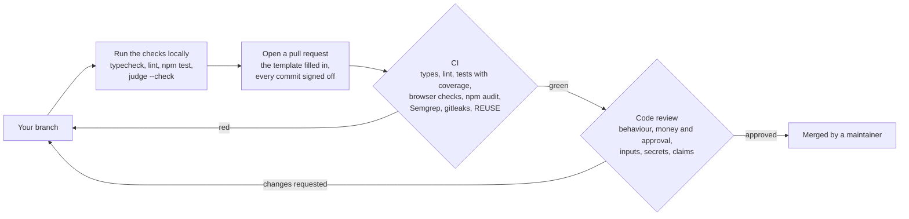

<div align="center">

<a href="README.md"><picture><source media="(prefers-color-scheme: dark)" srcset="docs/assets/brand/purser-mark-dark.svg"></picture></a>

# Contributing

**How to make a change to Purser that gets merged: the checks to run, the rules it keeps, the tests it brings and the sign-off.**

[](https://github.com/agamemnon-coder/x402-business-agents/actions/workflows/ci.yml?query=branch%3Amain)&nbsp;[](https://github.com/agamemnon-coder/x402-business-agents/actions/workflows/dco.yml)&nbsp;[](docs/assets/test-summary.json)&nbsp;[](docs/evidence/coverage.md)&nbsp;[](REUSE.toml)

[](https://github.com/agamemnon-coder/x402-business-agents/labels/good%20first%20issue)&nbsp;[](CODE_OF_CONDUCT.md)&nbsp;[](#sign-off-developer-certificate-of-origin)&nbsp;[](LICENSE)&nbsp;[](#the-rules-this-repository-keeps)

[Before you open a PR](#before-you-open-a-pull-request) · [The rules](#the-rules-this-repository-keeps) · [Style](#coding-style) · [Tests](#tests-come-with-the-change) · [Sign-off](#sign-off-developer-certificate-of-origin) · [Review](#code-review) · [First tasks](#small-tasks-for-a-first-contribution)

</div>

Purser is a hackathon project (Airwallex Agentic Banking Hackathon, Starter Kit 11) that runs on test money only: the
Airwallex sandbox and Alta (formerly Metal) testnet. Issues and pull requests are welcome.
Everyone who takes part follows the [code of conduct](CODE_OF_CONDUCT.md) (Contributor Covenant 2.1).



## Before you open a pull request

```sh
npm ci
npm run typecheck
npm run lint
npm test                    # stand-ins for Airwallex, Alta and Claude; no network, no keys
npm run judge -- --check    # every page built offline from the committed records
```

Run the tests with the API keys unset, as CI does. The browser checks (`test/browser/*.check.ts`) need Playwright's
Chromium; `BROWSER=firefox` or `BROWSER=webkit` runs them in the other engines.

## The rules this repository keeps

| | Rule | What it means |
|---|---|---|
| 📎 | **Nothing claimed that did not run.** | A figure on a page or in a doc is read from a run record (`docs/runs/`, `docs/demo/`) or listed in [docs/claims.md](docs/claims.md); a test checks it. Simulated, sandbox, testnet and stand-in parts are labelled as such; what has not run is called "next". |
| 🔑 | **No secrets.** | No key, token, password or environment value in code, tests, docs, commits or logs. gitleaks runs on every push; a false positive goes in `.gitleaksignore` with a comment saying why. |
| 🧪 | **No real money.** | Live runs use sandboxes and testnets, within a call budget agreed before the run, and each one gets a dated record under `docs/runs/`. |
| 🔌 | **Tests never use the network.** | Partners are faked in `test/fakes/`. |
| 🔏 | **Every payment beyond the CFO's limits needs the CFO's passkey** over the exact terms. | A change that weakens that, or lets a model approve, will not be merged. |

## Coding style

TypeScript is the project's language (the three Solidity contracts in `contracts/` aside). Its style guide is what the
tools enforce, and CI fails a pull request that breaks it:

- **TypeScript's `strict` mode** with `noUncheckedIndexedAccess` and `verbatimModuleSyntax` ([tsconfig.json](tsconfig.json)),
  checked by `npm run typecheck`;
- **ESLint's recommended rules and typescript-eslint's recommended rules**, with no `any` and no unused variables
  ([eslint.config.js](eslint.config.js)), checked by `npm run lint`;
- the conventions the code already keeps: ES modules with `.js` import paths; money as integer cents in code and a
  two-decimal string in terms and logs, never a float ([src/lib/money.ts](src/lib/money.ts)); every input from outside
  the runner (HTTP bodies, webhooks, partner answers, model output, files) parsed with a zod schema or an equally strict
  parser before it is used ([docs/security/requirements.md](docs/security/requirements.md#input-validation)).

An exception to a lint rule is rare, written at its line (`// eslint-disable-next-line <rule> -- <why>`), and reviewed
like any other change. The Solidity contracts follow the [Solidity style guide](https://docs.soliditylang.org/en/latest/style-guide.html);
they are compiled with a pinned `solc` in the tests, and no linter checks their style yet.

## Tests come with the change

This is the project's test policy; a pull request that does not keep it is not merged.

- **New functionality comes with tests** in the automated suite (`test/`, run by `npm test` and by CI on every pull
  request): what it must do and what it must refuse. A new money path, approval rule or partner call also gets a test
  of the refusal (the wrong amount, the wrong payee, the changed cent).
- **A bug fix comes with a regression test** that fails before the fix and passes after it, unless that is impractical
  (a pure wording or layout fix); then the pull request says why.
- **Tests never use the network or a key**; partners are faked in `test/fakes/`.
- **Coverage does not drop:** CI holds each area (money, policy, passkey, executors, relay, clearing and the others in
  [test/coverage-areas.ts](test/coverage-areas.ts)) at 90% of lines or more; the whole product's figures are in
  [docs/evidence/coverage.md](docs/evidence/coverage.md).

The pull request template asks which tests were added and run.

## Sign-off (Developer Certificate of Origin)

Every commit in a pull request is signed off. By signing off you state that you wrote the change, or otherwise have the
right to submit it under this project's licence (MIT), as the [Developer Certificate of Origin 1.1](https://developercertificate.org/)
words it. The sign-off is a line at the end of the commit message, with your name and the e-mail address of the
commit's author:

```text
Signed-off-by: Your Name <you@example.com>
```

`git commit -s` adds it. To sign off commits already made on your branch: `git rebase --signoff main`, then push with
`--force-with-lease`. A commit drafted with an AI assistant is signed off by the person who submits it, who takes
responsibility for it as for their own.

The [dco check](.github/workflows/dco.yml) lists every commit of a pull request without a matching sign-off. For now it
only warns, because the history before 19 November 2026 has none; it will become a required check
([GOVERNANCE.md](GOVERNANCE.md#legal-the-developer-certificate-of-origin)).

## Pull requests

Use the template (What changed, Why, Tests and checks run, Live calls made, Not done). Keep one topic per pull request;
merge `main` into your branch rather than rebasing a shared one. The changelog is generated: `npm run changelog`.

## Code review

Every pull request is reviewed before it is merged ([GOVERNANCE.md](GOVERNANCE.md#how-a-change-is-proposed-reviewed-and-merged)).
How a review is done:

1. **CI first.** The reviewer starts once the checks are green (typecheck, lint, the full test suite with coverage,
   the browser checks, `npm audit`, Semgrep, gitleaks, REUSE). A red check is answered before anything else.
2. **Read the whole diff** in GitHub's *Files changed* view, with the pull request's template: what changed, why, which
   tests were added and run, which live calls were made, what is not done.
3. **Check each of these**, and say in the review which one fails:
   - **Behaviour:** the change does what the pull request says, and nothing else; a new path has a test of what it must
     do and of what it must refuse; a fix has a regression test ([Tests come with the change](#tests-come-with-the-change)).
   - **Money and approval:** no change lets a model approve, lowers or skips a limit, or pays without the CFO's passkey
     over the exact terms beyond the limits; the signed terms' hash is still checked before any outside call; amounts
     stay integer cents.
   - **Inputs:** every new input from outside the runner is parsed with a zod schema or an equally strict parser
     ([requirements.md](docs/security/requirements.md#input-validation)).
   - **Secrets and money:** no key, token or environment value anywhere; live calls only to sandboxes and testnets,
     within the budget the pull request states.
   - **Claims:** every figure in a page or doc comes from a run record or a measurement the pull request names;
     simulated, sandbox and stand-in parts are labelled.
   - **Dependencies:** a new dependency is needed, maintained, pinned in the lockfile and passes `npm audit`.
   - **Style:** what the tools do not catch: names that say what a thing is, comments that say why, no dead code.
4. **Decide:** *Approve*, or *Request changes* with each failing point named. A change is acceptable when CI is green,
   every point above holds, and the commits are signed off. The author answers every comment, by a change or a reason.
5. **Merge** only then (squash or merge commit), by a maintainer.

While there is one maintainer, the maintainer's own pull requests are reviewed by CI and by the maintainer only; a
second person's review becomes required when a second maintainer joins ([GOVERNANCE.md](GOVERNANCE.md#how-a-second-maintainer-joins)).

## Small tasks for a first contribution

Issues that suit a new or casual contributor carry the label
[`good first issue`](https://github.com/agamemnon-coder/x402-business-agents/labels/good%20first%20issue): small, with
the files named, no key and no live call needed, and checkable with `npm test`. Comment on the issue to take it. Tasks of
that size open today:

- **Tests for an uncovered file:** [coverage.md](docs/evidence/coverage.md#the-largest-gaps-left-in-the-measured-scope)
  lists the files with the most uncovered statements; `src/agents/treasury.ts` (the treasury agent's price-rise
  planning) is one. Add tests of what it must do and refuse, with the stand-ins in `test/fakes/`.
- **An automated accessibility rule set:** run axe-core on the pages the browser checks already open
  (`test/browser/*.check.ts`), as [accessibility.md](docs/accessibility.md) lists under "Not done yet".
- **A linter for the three Solidity contracts** in `contracts/` (for example solhint with its recommended rules), run
  in CI; today no linter checks their style.
- **A broken link or an unclear sentence** in the docs: fix it in a pull request of its own.

## Conduct

> [!CAUTION]
> Security reports go to [SECURITY.md](SECURITY.md), not to a public issue.
