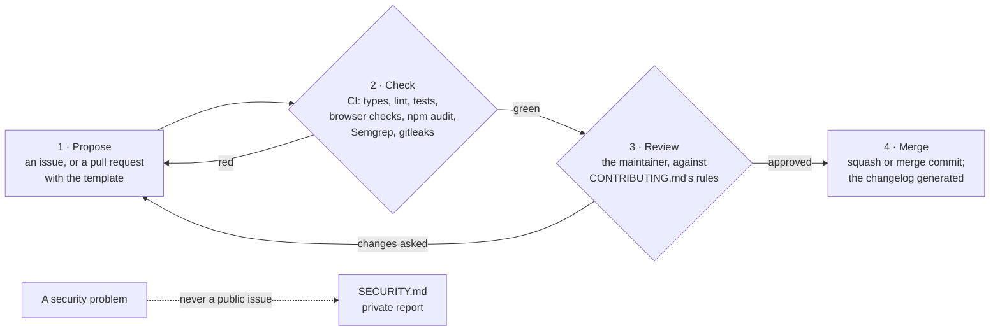
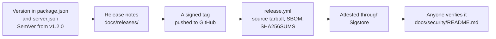
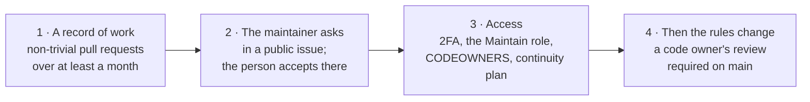
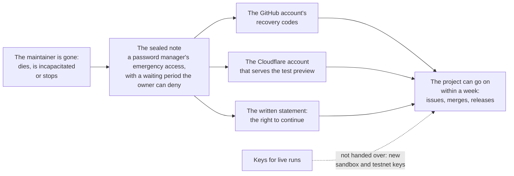

<a href="README.md"><picture><source media="(prefers-color-scheme: dark)" srcset="docs/assets/brand/purser-mark-dark.svg"></picture></a>

# Governance

**Who decides in Purser, how a change and a release get in, and how the project goes on without its one maintainer.**

&nbsp;&nbsp;&nbsp;&nbsp;

&nbsp;&nbsp;

[The model](#the-model-a-single-maintainer) · [Roles](#roles-and-responsibilities) · [Changes](#how-a-change-is-proposed-reviewed-and-merged) · [Releases](#how-a-release-is-made) · [A second maintainer](#how-a-second-maintainer-joins) · [Continuity](#continuity-if-the-maintainer-is-gone) · [DCO](#legal-the-developer-certificate-of-origin)

How Purser (this repository, `agamemnon-coder/x402-business-agents`) is run: who decides, how a change gets in, how a
release is made, who holds which role, how a second maintainer can join, and what happens if the maintainer is gone.
Written on 19 November 2026. It describes the project as it is today, one maintainer, and says where that falls short.

## The model: a single maintainer

Purser has one maintainer, the repository owner, **[@agamemnon-coder](https://github.com/agamemnon-coder)** (Max in the
docs and run records). The maintainer makes every final decision. Anyone may propose, review, argue and fork (the code
is MIT, [LICENSE](LICENSE)), but only the maintainer merges, releases and changes the repository's settings.

Much of the code is drafted by AI coding assistants (Claude, in Claude Code sessions) that the maintainer starts and
directs. Their commits carry a `Co-Authored-By` line. They work in branches, hold no merge right, no repository setting
and no live key, and every change they make reaches `main` only through a pull request the maintainer merges. The
maintainer is responsible for every merged change, whoever drafted it.

> [!NOTE]
> **One maintainer today.** Every final decision, merge and release is the maintainer's; AI coding assistants draft in
> branches and never merge, hold a key or change a setting. The bus factor is 1, and this document says where that
> falls short.

## Roles and responsibilities

| Role | Who holds it today | Responsibilities and the tasks the role must perform |
|---|---|---|
| **Maintainer** | @agamemnon-coder (the only one) | Reviews and merges every pull request ([CODEOWNERS](.github/CODEOWNERS)); keeps the rules in [CONTRIBUTING.md](CONTRIBUTING.md); triages issues (labels, answers, closes); decides on proposals and records architecture decisions ([docs/decisions.md](docs/decisions.md), [docs/adr/](docs/adr/README.md)); merges or closes Dependabot's update pull requests; owns the repository's settings, its Actions secrets and the hosted test preview (the Cloudflare account that serves the Workers); runs the live sandbox and testnet runs with the keys that only the maintainer holds ([docs/runbook.md](docs/runbook.md)); rotates a leaked key. |
| **Security response** | the maintainer | Receives private reports ([SECURITY.md](SECURITY.md)), answers within 3 working days, fixes, publishes the advisory and credits the reporter. |
| **Release manager** | the maintainer | Cuts versions as [docs/releasing.md](docs/releasing.md) says: SemVer from `v1.2.0`, a signed tag, the release workflow's attested artefacts, the release notes. |
| **Contributor** | anyone | Opens issues and pull requests that follow [CONTRIBUTING.md](CONTRIBUTING.md) and the [code of conduct](CODE_OF_CONDUCT.md): the checks pass, tests come with the change, every commit is signed off (Developer Certificate of Origin, below). |
| **AI coding assistant** | Claude sessions the maintainer starts | Drafts code, tests and docs in a branch on the maintainer's instructions; never merges, never holds a key, never changes a setting. |
| **Second maintainer** | vacant | Once filled: reviews and merges, shares triage and security response, holds the continuity access below. How to get there: [below](#how-a-second-maintainer-joins). |

Conduct reports go to the maintainer, as the [code of conduct](CODE_OF_CONDUCT.md) says.

[.github/CODEOWNERS](.github/CODEOWNERS) (20 November 2026) names the code owner of the money-moving, approval and passkey, security, cryptography, deployment and migration paths: today the one maintainer for all of them, so a second maintainer is still needed before any of those changes gets a second human review.

## How a change is proposed, reviewed and merged

1. **Propose.** A bug or an idea is an issue (the [templates](.github/ISSUE_TEMPLATE/)); a change is a pull request
   with the [template](.github/pull_request_template.md) filled in. A security problem goes to [SECURITY.md](SECURITY.md),
   never to a public issue. A larger change (a new money flow, a new partner, a change to the approval rules) starts as
   an issue, so the design is agreed before the code is written.
2. **Check.** CI ([ci.yml](.github/workflows/ci.yml)) runs on every pull request: type checks, lint, the full test suite
   with coverage per area, the browser checks, `npm audit`, Semgrep and gitleaks. The rule: a pull request is merged
   only with its checks green. Today the maintainer keeps it by hand; the ruleset that makes GitHub enforce it is an
   owner action ([docs/security/owner-actions.md](docs/security/owner-actions.md), step 3).
3. **Review.** The maintainer reads every pull request against the rules in [CONTRIBUTING.md](CONTRIBUTING.md): nothing
   claimed that did not run, no secrets, no real money, tests for new behaviour, and nothing that lets a model approve or
   weakens the passkey signature over the exact terms. While there is one maintainer, the maintainer's own pull requests
   (and the assistants' pull requests made for the maintainer) get no second human review; CI is the second check.
4. **Merge.** The maintainer merges (squash or merge commit). The changelog is generated from the merged pull requests
   (`npm run changelog`).
5. **Disagreement.** It is argued in the issue or pull request, in public, and the maintainer decides and says why.
   An architecture decision is written down with its reason and its cost if wrong ([docs/decisions.md](docs/decisions.md)).

## How a release is made

The maintainer cuts a release as [docs/releasing.md](docs/releasing.md) describes: SemVer from `v1.2.0`, the version
in `package.json` and `server.json`, release notes in [docs/releases/](docs/releases/), a signed tag pushed to GitHub,
and [release.yml](.github/workflows/release.yml) building the source tarball, its bill of materials and `SHA256SUMS`,
attested through Sigstore. How anyone verifies one: [docs/security/README.md](docs/security/README.md#verify-a-release).

## How a second maintainer joins

The project wants a second maintainer: today its bus factor is 1. Someone becomes a maintainer this way:

1. **A record of work here:** several non-trivial pull requests merged over at least a month, and reviews or issue
   triage that show they know the money rules ([docs/security.md](docs/security.md), [docs/assurance.md](docs/assurance.md)).
2. **The maintainer asks**, in a public issue, and the person accepts there. They agree to this document,
   [CONTRIBUTING.md](CONTRIBUTING.md), [SECURITY.md](SECURITY.md) and the [code of conduct](CODE_OF_CONDUCT.md).
3. **Access:** two-factor authentication on their GitHub account; the *Maintain* role on the repository; a line in
   [CODEOWNERS](.github/CODEOWNERS); a place in the continuity plan below. Live keys stay with whoever runs the live
   runs; a maintainer does not need them to review, merge or release.
4. **Then the rules change:** the ruleset on `main` requires one approving review from a code owner other than the
   author ([docs/security/owner-actions.md](docs/security/owner-actions.md), step 3), this document lists both names,
   and the OpenSSF answer on the bus factor is updated.

A maintainer who stops can say so in an issue; the remaining maintainer removes their access within a week. A
maintainer who breaks the code of conduct or the money rules loses the role by the other maintainer's decision, stated
in public.

## Continuity: if the maintainer is gone

The project must be able to go on (open and close issues, merge changes, release) within a week if its maintainer dies,
is incapacitated or stops. **With one maintainer, that rests on the plan below, in place since 19 November 2026** (the table says which part is
which). The plan:

| What someone else needs | How it reaches them | Status |
|---|---|---|
| The repository itself | Through the sealed note below: the GitHub account's recovery codes reach a trusted person. GitHub's *successor* setting (Settings → Account → **Successor settings**) is a further option, not set. Anyone can also fork the code under the MIT licence. | In place since 19 November 2026 (sealed note) |
| Merge and release rights within a week | A sealed recovery note in a password manager's emergency access (or a lockbox with a trusted person) holding the GitHub account's recovery codes, with a waiting period the owner can deny while able | In place since 19 November 2026: a password manager's emergency access, with a waiting period |
| The hosted test preview | The Cloudflare account that serves the Workers (`*.max-31b.workers.dev`), in the same sealed note. The site is a test preview with test money only; losing it stops no user's payments. | In place since 19 November 2026 (same note) |
| The legal right to continue | A short written statement (in the will, or a signed letter with the sealed note) that the successor may run the project, its name and its accounts | In place since 19 November 2026 (with the sealed note) |
| Keys for live runs | Not needed to continue: every live run uses the Airwallex sandbox and Alta testnet, and a successor creates new sandbox and testnet keys of their own ([docs/runbook.md](docs/runbook.md)). The private keys repository is not passed on. | Nothing to hand over |

Once a second maintainer has joined, they hold merge and release rights directly and the plan above becomes the
fallback. The steps for the owner, click by click, are in [docs/security/openssf-silver.md](docs/security/openssf-silver.md).

## Legal: the Developer Certificate of Origin

Every contributor asserts that they may contribute their change under the project's licence by signing off each commit
with the [Developer Certificate of Origin 1.1](https://developercertificate.org/) (`git commit -s`). What that means and
how: [CONTRIBUTING.md](CONTRIBUTING.md#sign-off-developer-certificate-of-origin). The check
([dco.yml](.github/workflows/dco.yml)) warns on a pull request with an unsigned commit; it does not fail it yet, because
the history before 19 November has no sign-offs. It becomes blocking once the ruleset on `main` is in place.

## Changing this document

A change to this document is a pull request like any other, merged by the maintainer; once there are two maintainers,
both must approve it.
