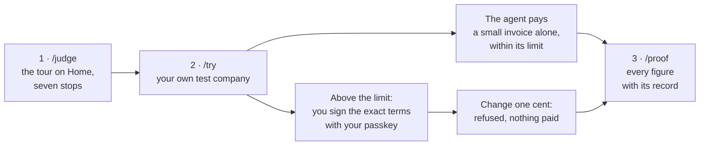

<div align="center">

<a href="README.md"><picture><source media="(prefers-color-scheme: dark)" srcset="docs/assets/brand/purser-mark-dark.svg"></picture></a>

# Purser for judges, on one page

**The 2-minute path, what is real and what is sandbox, how to verify it yourself, and the honest limits.**

[](docs/airwallex.md)&nbsp;[](docs/metal-award.md)&nbsp;[](docs/visa-award.md)&nbsp;[](docs/t0.md)&nbsp;[](#what-is-real-and-what-is-sandbox)

[](https://github.com/agamemnon-coder/x402-business-agents/actions/workflows/ci.yml?query=branch%3Amain)&nbsp;[](docs/assets/test-summary.json)&nbsp;[](#how-to-verify-it-yourself)&nbsp;[](LICENSE)

**1 · [Take the tour on /judge](https://kit11.max-31b.workers.dev/judge)** &nbsp;·&nbsp; **2 · [Try it on /try](https://kit11.max-31b.workers.dev/try)** (test money) &nbsp;·&nbsp; **3 · [See the proof on /proof](https://kit11.max-31b.workers.dev/proof)**

[The 2-minute path](#the-2-minute-path) · [Real or sandbox](#what-is-real-and-what-is-sandbox) · [Verify it](#how-to-verify-it-yourself) · [The honest limits](#the-honest-limits)

</div>

Purser is the control layer between a company's AI agents and its money: agents pay supplier invoices within limits
the CFO sets in code, and above a limit nothing is paid until the CFO signs the exact terms with a passkey. **Test
money only** throughout.

## The 2-minute path



1. **[/judge](https://kit11.max-31b.workers.dev/judge)** opens the judge tour on Home: seven stops (the film, /try,
   Purser Cloud as a guest, Alta, Visa, T:0 and the proof), each with one sentence on what to look at.
2. **[/try](https://kit11.max-31b.workers.dev/try)**: your own test company. Claude reads a sample invoice; a small one
   the agent pays alone, within its limit; above the limit you sign the exact terms with your own passkey (Face ID on
   an iPhone); then change one cent of what you signed and see it refused, with nothing paid.
3. **[/proof](https://kit11.max-31b.workers.dev/proof)**: every figure with its record, organised by the questions a
   judge asks; each tile opens the run record it is read from.

## What is real, and what is sandbox

| 🟢 Live calls (test money) | 🟡 Simulated |
|---|---|
| The Airwallex sandbox (transfers, FX quotes, cards; a sandbox PAID is the sandbox's own simulation) | The customer and the supplier |
| Alta (formerly Metal) testnet: mandates and payments on chain | The merchants' charges and the settlement |
| Visa via Airwallex's Airi: Airi's single-use credential on Airi's test card (sandbox), one recorded run | The second approver, where a run shows one |
| The T:0 shared sandbox ledger, read back | On /try: the bank each payment is made on, with payouts also sent to the Airwallex sandbox |
| Claude (the agents and the invoice reader) | |

Every run, live or simulated, is listed with its record in [docs/runs/README.md](docs/runs/README.md) and on
[/runs](https://kit11.max-31b.workers.dev/runs).

## How to verify it yourself

Offline, no keys, under 2 minutes (Node.js 22.13+ and git):

```sh
npm ci
npm run judge -- --check     # every page built from the main run's record, offline
npm run verify-approval      # the owner's real passkey approval of 7 November, checked with Node's crypto
```

Change one cent in a copy of that receipt and `npm run verify-receipt -- tampered.json` says NOT VALID. Any proof file
downloaded from /try checks on [/verify](https://kit11.max-31b.workers.dev/verify) and with `npm run verify-bundle`.

## The honest limits

> [!IMPORTANT]
> **Test money only.** No production money, no outside security review yet, no customers: the full list is below.

**What is not finished:**

- No independent security review yet: the OWASP ASVS Level 2 assessment is a self-assessment, and no third party has tested its security. ([docs/security/asvs-l2.md](docs/security/asvs-l2.md))
- No production money: the Airwallex sandbox, Alta testnet and Airi's test card only; test money throughout.
- No second human approver yet: one CFO passkey signs; where a run shows a second approver, it is simulated (a labelled test passkey).
- No customers: no pilots and no revenue yet.
- Before real money: every go-live requirement, with where it stands, is in [docs/go-live.md](docs/go-live.md).

Also: only routes connected to Purser are protected (a wallet or card an agent reaches outside Purser is not); the red
team's figures are our own scripted attacks, not an independent penetration test. The questions judges ask, answered
briefly: [/security](https://kit11.max-31b.workers.dev/security#judge-questions) and the README's "Questions judges
ask".
