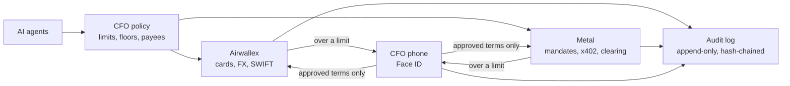

# Purser

[](https://github.com/agamemnon-coder/x402-business-agents/actions/workflows/ci.yml)
**1337 tests** in 169 files pass at this commit (`npm test`); CI runs them, the judge pages and a secret scan on every push.

**Your AI agents spend through Airwallex and Metal. The CFO stays in control.**

For the CFO of a small company that runs AI agents: each agent gets its own Airwallex company card and its own Metal
on-chain mandate, with limits it cannot break. Anything beyond them waits for the CFO's Face ID.

Claude agents read, plan and advise; Metal and Airwallex enforce the limits; the CFO approves anything beyond them.

```sh
git clone https://github.com/agamemnon-coder/x402-business-agents && cd x402-business-agents
npm ci
npm run judge        # the recorded live run, offline: no keys, no network
```

Or open the hosted site: [kit11.max-31b.workers.dev](https://kit11.max-31b.workers.dev/#tour).

## Proof: it ran for real (test money)

Friday run 1, 30 October 2026, 07:05 to 07:38 UTC, on tag `friday-runs` (`2bd4397`), every decision made by Max with
Face ID on his iPhone ([run log](docs/runs/2026-10-30-friday-1.md)). Each id was read back from Airwallex and Metal
afterwards, read-only ([data QA](docs/data-qa.md)).

| What happened | Rail | Proof |
|---|---|---|
| An agent's card is **declined by Airwallex** over its limit (`LIMIT_EXCEEDED`); after Face ID the same 45.00 is approved | Airwallex Issuing | cards •••• 8120, 6882, 7786 |
| Only the euro shortfall is converted: EUR 370.00 for USD 418.40 | Airwallex FX | conversion `08736b6e-0f62-41f8-9e4c-6f5a8cbff3c7` |
| The EUR 1,850.00 invoice is paid by SWIFT after Face ID, fee EUR 13.41, the approval hash in its metadata | Airwallex Transfers | transfer `4d508b0b-ef38-41d3-b96e-f6cc3f5cfeb4` |
| After a supplier's price rise, the CFO moves budget between the agents' mandates with Face ID | Metal testnet | [`0xbc70858f…b5d7`](https://testnet.metalntwx.com/tx/0xbc70858fef5ca185cb8dffb860becac2fe0876888aa5ea57d8aee2700449b5d7) |
| A payment over an agent's mandate is refused on chain (`MandateRefused`, an autonomous dry run) | Metal testnet | [`0xd24cb5a7…6acc`](https://testnet.metalntwx.com/tx/0xd24cb5a7a8219c69783420d9d14bdbdab188d9e2a46b6aab9aa8798adf496acc) |
| Every step is in a hash-chained audit log that anyone can recompute, with no keys | Purser | `npm run verify-log -- --jsonl docs/audit/friday-1-audit.jsonl` |

**What is real and what is simulated:** the Airwallex calls run against the Airwallex **sandbox** and the Metal
transactions on Metal **testnet**, with test money only. Simulated by the sandbox: the merchants' card charges, a SWIFT
transfer's last steps (SENT, PAID) and the deposit that stands in for Metal earnings. Run by us: the customer
(Summit and its agent) and the supplier (Stockline). Northwind Outdoor is the example company. `npm run judge` replays
the recorded run offline; it calls neither rail. Every public claim and its source: [docs/claims.md](docs/claims.md).

<p>
  
  
</p>

*Left: Airwallex itself declines the agent's card over its limit. Right: Metal refuses a payment over the agent's
on-chain mandate. Both from the recorded live run (test money).*

## How it works



**Why Face ID and not a password or PIN.** Every approval is a passkey signature (WebAuthn, user verification
required) whose challenge is the SHA-256 of the exact terms shown on the phone. The private key never leaves the
phone; there is no password or PIN to leak, guess or phish, and the passkey works only on Purser's own site. A
signature over one set of terms is worthless for any other, so an agent, a script or a stolen session cannot turn
it into a different payment. The runner checks each signature before anything moves, and `npm run verify` checks
every recorded approval again afterwards.

**Kit 11 (x402 Business Agents), as built.** Northwind Outdoor, an outdoor wholesaler that sells live stock data to
retailers per query: the kit's data business. Three agents draw on one Metal account, each under its own mandate:

| Kit 11 agent | Its job in the brief | Budget when bound → after the CFO's Face ID |
|---|---|---|
| Sourcing agent | buys the upstream data per query; its card pays warehouse and data software | 10.00 → 12.00, cap 0.03 → 0.04 a purchase |
| Support agent | refunds customers when a dispute holds; its card pays helpdesk software | 4.00 |
| Treasury agent | designs the rebalance after the price rise (with the agents on, its own split, e.g. 14 / 2 / 4); the sweep to Airwallex runs on its mandate; the EUR licence fee is paid through Airwallex (FX and SWIFT, after Face ID), not from a Metal mandate; both are code's decisions (with the agents on, it advises when to pay the licence) | 6.00 → 4.00 in the brief |

20.00 test USD between them, before and after, held in code (`TOTAL_BUDGET_CENTS`). Every Kit 11 sentence and where
it is done: [docs/requirements-matrix.md](docs/requirements-matrix.md) section 4.

**Built for the rules, not certified:** Airwallex is the regulated provider (accounts, card issuing, payouts; its KYB,
KYC and screening are its own, not shown in this repo), Metal enforces the limits on chain, and Purser holds no funds of
its own (they stay in the business's Airwallex and Metal accounts), logs every model call its agents make and keeps a
person in charge
([docs/compliance.md](docs/compliance.md)).

## The judge tour (3 minutes)

On the hosted site or after `npm run judge`; each step links to its proof.

1. **The problem:** AI agents are starting to spend company money; one shared card or wallet gives no limit per agent
   and no one place for the exceptions. ([Watch](https://kit11.max-31b.workers.dev/film))
2. **Airwallex declines the card** above its limit; after the CFO's Face ID the limit follows and the same purchase
   is paid. ([the Airwallex ids](https://kit11.max-31b.workers.dev/demo?step=1))
3. **Metal refuses the higher price** against the on-chain mandate, and the CFO moves budget between the mandates
   within the same 20.00 with Face ID. ([the transactions](https://kit11.max-31b.workers.dev/demo?step=3))
4. **The Dispute desk checks every order:** a simulated customer (we filed for it) disputes 12 orders; each is
   checked against its signed order and the mandate on chain. All 12 hold, so nothing new is refunded. ([the evidence](https://kit11.max-31b.workers.dev/metal#dispute))
5. **Try it yourself:** type a task for an agent. ([Try it](https://kit11.max-31b.workers.dev/try))

`npm run judge` needs no keys and no network after `npm ci`. Besides the tour it serves the CFO dashboard as it stood
at the end of the run, a simulated month, the Scenario Lab (`/lab`, 18 stories against stand-ins for Airwallex and
Metal), "How Purser uses Metal" (`/metal`) and the agents deciding by themselves (`/?autonomy`, an autonomous dry run
with test passkeys and test money, not a live run with Max).

## Run it live

Needs a Metal testnet RPC endpoint, Airwallex sandbox keys and, optionally, an Anthropic key. Setup, commands and
the step-by-step run are in [docs/run-it.md](docs/run-it.md).

## Read more

Start here:

- [docs/metal-award.md](docs/metal-award.md): what the build uses from Metal, with proof on testnet
- [docs/airwallex.md](docs/airwallex.md): every Airwallex API Purser calls, and why
- [docs/security.md](docs/security.md): threat model, attacks and what stops each one
- [docs/controls-matrix.md](docs/controls-matrix.md): every risk, the control against it, its test and the live evidence
- [docs/runbook.md](docs/runbook.md): incidents, the emergency stop, key rotation and recovery
- [docs/ask-purser.md](docs/ask-purser.md): Ask Purser: a single-use card for one task (a flight, a hotel, a train) from one sentence: at once within the CFO's policy (up to €300, 3 a day, asked at the runner), otherwise after Face ID
- [docs/claude.md](docs/claude.md): Powered by Claude: which model does what, why, and what it costs per call and per €1,000 paid
- [docs/compliance.md](docs/compliance.md): who does what (Airwallex, Metal, Purser) for the EU AI Act, PSD2, GDPR, AML and audit
- [docs/requirements-matrix.md](docs/requirements-matrix.md): what the hackathon asks for, where Purser does it, and the proof
- [docs/decisions.md](docs/decisions.md): decisions taken during the build, and what each costs if wrong
- [docs/roadmap.md](docs/roadmap.md): from company cards for agents to the agent finance department (not built yet)
- [docs/runs/](docs/runs/): logs of live runs

<details>
<summary>The old README sections, now in docs</summary>

- [Overview, the story, controls, where Claude is used](docs/overview.md)
- [Company cards (Airwallex Issuing)](docs/cards-and-clearing.md#company-cards-airwallex-issuing)
- [Selling by Metal clearing (prepaid, new on testnet)](docs/cards-and-clearing.md#selling-by-metal-clearing-prepaid-new-on-testnet)
- [A month in 90 seconds (simulated)](docs/cards-and-clearing.md#a-month-in-90-seconds-simulated)
- [The CFO policy](docs/cfo-policy.md), [in plain words](docs/cfo-policy.md#the-cfo-policy-in-plain-words) and
  [four eyes](docs/cfo-policy.md#four-eyes-two-people-above-a-threshold)
- [Outside agents: the agent API (MCP)](docs/agent-api.md#outside-agents-the-agent-api-mcp) and the
  [GL export for the ERP](docs/agent-api.md)
- [Invoice fraud and prompt injection](docs/fraud-and-injection.md)
- [Dashboard and phone approval with a passkey](docs/phone-approval.md)
- [Run it](docs/run-it.md)
- [Code map, tooling, credits](docs/architecture.md)

</details>

*USDZ, Metal testnet's stablecoin, is shown as "test USD". Retailers' payments into the Global Accounts are sandbox simulations too.

Built with Claude (Anthropic) as the developer, directed and reviewed by Max Geurtsen. Licence: MIT.
