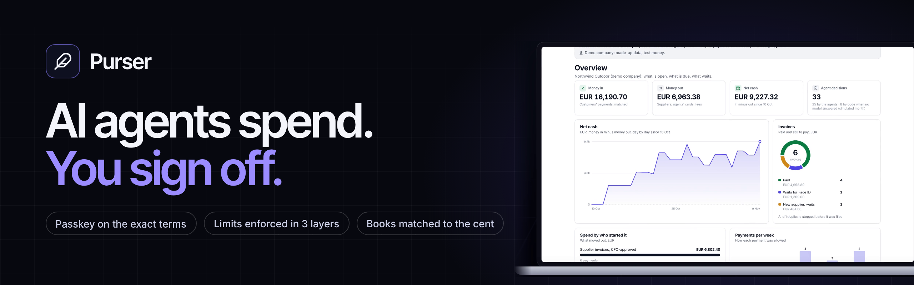
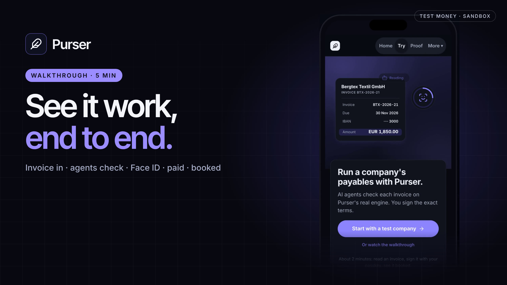
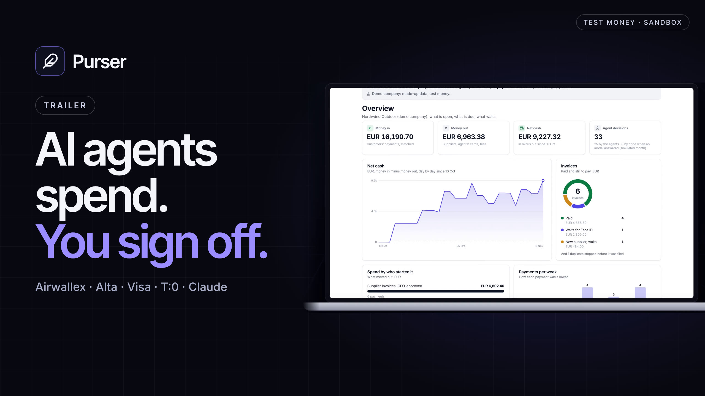
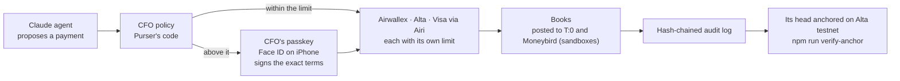

<div align="center">

<a href="https://kit11.max-31b.workers.dev/"><picture><source media="(prefers-color-scheme: dark)" srcset="docs/assets/readme/banner-dark.png"></picture></a>

# Purser · AI agents spend. You sign off.

**AI agents pay your suppliers. Above their limit, you sign the exact terms with Face ID, and one changed cent breaks the signature.**

**Built on Airwallex.** Purser's agent cards and payments run on Airwallex's API (the sandbox, test money: [docs/airwallex.md](docs/airwallex.md)).

**[Try it in 2 minutes](https://kit11.max-31b.workers.dev/try)** · [Watch the film](https://youtu.be/mp9fmOYfBWc) · [Verify a payment yourself](#verify-it-yourself-in-3-commands)

</div>

## Kit 11, step by step

The brief's eight steps, what Purser does in each, and one proof each from the 3 November main run: [docs/kit11.md](docs/kit11.md).

An approval is usually a button. In Purser it's a signature over the exact terms: change one cent and it's worthless.

[](https://github.com/agamemnon-coder/x402-business-agents/actions/workflows/ci.yml?query=branch%3Amain) [](https://github.com/agamemnon-coder/x402-business-agents/actions/workflows/github-code-scanning/codeql) [](docs/assets/test-summary.json) [](LICENSE) [](#connect-any-ai)

[](https://kit11.max-31b.workers.dev/airwallex) [](https://kit11.max-31b.workers.dev/alta) [](https://kit11.max-31b.workers.dev/visa) [](https://kit11.max-31b.workers.dev/t0) [](https://kit11.max-31b.workers.dev/claude)

**Live demo: [kit11.max-31b.workers.dev/try](https://kit11.max-31b.workers.dev/try)**: a test company of your own on test money, in 2 minutes · [the walkthrough](https://youtu.be/mp9fmOYfBWc) (AI voice and music: ElevenLabs) · [every id on /proof](https://kit11.max-31b.workers.dev/proof)

## Verify it yourself in 3 commands

The quick start: under 2 minutes, no keys. Needs Node.js 22.13 or later and git. `npm ci` downloads packages from npm; after that, no network and no keys.

```sh
npm ci                       # under a minute: the exact versions in the lockfile
npm run judge -- --check     # about 5 s: every page in CHECK_PATHS built from the main run's record, offline
npm run verify-approval      # under 1 s: the owner's real passkey approval of 7 November, checked with Node's crypto
```

<details><summary>What you should see (abridged)</summary>

```text
ok    /  200  63106 bytes
ok    /proof  200  138535 bytes
…
ok    signature          the ES256 signature verifies with the receipt's public key

VALID: docs/runs/2026-11-07-awx-1/receipt-P-0002.json
Proves: the holder of this public key signed exactly these terms, with the authenticator reporting user verification, on this site.
Does not prove: who holds the key, or that it was Face ID (no attestation is checked). A test world's terms: nothing real moved.
```

</details>

`npm run verify-approval` reads that receipt; change one cent in it and it says NOT VALID. `npm run verify-receipt -- receipt.json`
checks any receipt of the same format. Pay on [/try](https://kit11.max-31b.workers.dev/try), download the proof (JSON), and check it on [/verify](https://kit11.max-31b.workers.dev/verify) in your browser, or with `npm run verify-bundle -- purser-proof.json`: the same checks, the same code, no server ([samples](docs/proof/)).

The full suite, `npm test` (about 8 to 9 min on a laptop): **6932 tests passing**, 4 skipped, in 618 files (the last full run, on commit `fdfabc5a`: [summary](docs/assets/test-summary.json)), on stand-ins for Airwallex, Alta and Claude. The skipped ones run only on local D1 (`npm run test:d1`). Two kinds of line in its output are expected noise, not failures: Node's "ExperimentalWarning: SQLite is an experimental feature" and "try-sign: a live agent call failed" (a test that checks the fallback when the model is down).

CI runs these checks on every push; the CI badge at the top shows the result of the latest run on main.

## Where things are

| Folder | What it holds |
|---|---|
| `src/` | Purser itself: the agents, the policy and its checks, the rails (Airwallex, Alta (formerly Metal), Visa via Airi), the ledger |
| `cloud/` | Purser Cloud on Cloudflare Workers: the console, its API, /try and the engine |
| `worker/` | The public site's Worker (kit11): the pages and the relay for the dashboard and passkey approvals |
| `docs/runs/` | The record of every live run: ids, amounts, timestamps |
| `test/` | The tests (`npm test`) and the browser checks (`test/browser/`) |

## Watch it

| [The walkthrough](https://youtu.be/mp9fmOYfBWc) · AI voice and music: ElevenLabs | [The trailer (1:30)](https://youtu.be/n3HLVGROJc4) · test money only |
|---|---|
| <a href="https://youtu.be/mp9fmOYfBWc"></a> | <a href="https://youtu.be/n3HLVGROJc4"></a> |

## In 30 seconds

- **Within the CFO's limits the agent pays alone**, and each rail holds the limit again: Airwallex's card controls, Alta's mandate on chain.
- **Above a limit, the CFO signs the exact terms** with a passkey (Face ID on iPhone); change one cent and the signature no longer verifies.
- **Run live on test money:** the main run of 3 November (24 decisions by Claude, 86 Alta payments, 16 stops, nothing paid over a limit) and 25 live runs, every id on [/proof](https://kit11.max-31b.workers.dev/proof).

## Airwallex at the centre: new on 14 November (merged, live, test money)

The live FX quote in the signed terms, the sandbox transfer, the Cloud's Airwallex tab, the signed events and the agent cards: [docs/airwallex-centre.md](docs/airwallex-centre.md).

## How it works in 3 steps

| 1 · The agent asks | 2 · Code checks the limit | 3 · You sign the exact terms |
|---|---|---|
| A Claude agent proposes a payment: an invoice, a card charge, an x402 purchase. | Within the CFO's limits it pays alone; Airwallex and Alta (formerly Metal) hold the limit again. | Above them, the CFO's passkey (Face ID on iPhone) signs the SHA-256 of the exact terms. |

**Not signed is never paid.**

- **Face ID or a passkey signs the exact terms.** The approval is a signature over the SHA-256 of the terms; change one cent and it no longer verifies. The owner's real approval of 7 November is checked offline by `npm run verify-approval` ([record](docs/runs/2026-11-07-awx-1.md)).
- **Limits are enforced in 3 layers: Purser's code, Airwallex's card controls and Alta's on-chain mandate.** Airwallex itself declined an agent's card over the CFO's limit ([record](docs/runs/2026-11-07-awx-1.md)); Alta refused a purchase over the mandate on chain ([record](docs/runs/2026-11-03-main-run.md)). The mandates: [/api/metal/mandates](https://kit11.max-31b.workers.dev/api/metal/mandates), a live read from Alta testnet, or the recorded 12 Nov snapshot when the chain does not answer (the answer says which).
- **The audit chain is anchored on chain.** Every event goes into a hash-chained log; its head is in a value-0 Alta testnet transaction, and `npm run verify-anchor` prints MATCH ([record](docs/runs/2026-11-13-anchor.md); run live again on 15 Nov: MATCH, [record](docs/runs/2026-11-15-anchor-verified.md)).

Test money only: Alta testnet, Airwallex sandbox, Visa via Airwallex Airi (sandbox), Claude. **Check it yourself, offline, no keys:** `npm ci` · `npm run judge -- --check` · `npm run verify-approval` ([what each does](#verify-it-yourself-in-3-commands))

## Built with

| Partner | What Purser uses | Live or simulated | Proof |
|---|---|---|---|
| **Airwallex** (sandbox) | agent cards and limits, FX, SWIFT payouts, its approval as a second lock, the payee name check | Sandbox, live calls; SWIFT settlement simulated through the sandbox's simulation API | [the card decline](docs/runs/2026-11-07-awx-1.md), [two locks](docs/runs/2026-11-12-airwallex-two-locks-paid.md), [name check](docs/runs/2026-11-12-airwallex-payee-check.md) |
| **Alta** (testnet) | a mandate per agent, x402 payments, limits changed only by two passkeys, the audit anchor | Testnet, live transactions, test money | [main run](docs/runs/2026-11-03-main-run.md), [two passkeys](docs/runs/2026-11-12-faceid-onchain.md), [anchor](docs/runs/2026-11-13-anchor.md) |
| **Visa** Intelligent Commerce via Airwallex's Airi (sandbox, test card) | a Visa credential bound to one purchase; above the limit only after Face ID | Airwallex sandbox, live calls, test card; a headless browser typed the card into Airwallex's hosted page | [vic-3](docs/runs/2026-11-12-vic-3.md), [vic-4](docs/runs/2026-11-13-vic-4.md) |
| **Claude** by Anthropic | the agents' decisions (Haiku, Sonnet, Opus) and the invoice reader; code checks each | Live calls | [main run](docs/runs/2026-11-03-main-run.md), [/claude](https://kit11.max-31b.workers.dev/claude) |
| **T:0** (shared sandbox entity) | an outside ledger: the main run's 95 journal entries, checked against our books: every account to the cent, plus the entry count | Shared sandbox ledger, live calls | [record](docs/runs/2026-11-10-t0-journal-sandbox.md) |

No endorsement implied.

## Gallery

The pages and the console, as screenshots: [docs/gallery.md](docs/gallery.md).

## How it works

Airwallex's AgentOS says its "components do not initiate money-out actions (transfers, FX conversions, or payouts) on
your behalf" ([docs](https://www.airwallex.com/docs/developer-tools/ai/agentos), read 13 November 2026). Purser is the control layer for when agents do move money on Airwallex: within limits the CFO signs, and above them only with the CFO's passkey on the exact terms.



## For judges: 3 minutes

**What it is:** the control layer between a company's AI agents and its money on Airwallex and Alta, built for
Starter Kit 11 (x402 Business Agents) and entered for the Metal Award and the Visa Award.
The Kit 11 scenario, run live on 3 November.\
**1. [Try it](https://kit11.max-31b.workers.dev/try):** a test company of your own; approve the exact terms with your
passkey, then change them: refused.\
**2. [Proof](https://kit11.max-31b.workers.dev/proof):** one id per rail in [docs/in-depth.md](docs/in-depth.md#what-ran-live-one-id-per-rail), every run in [docs/runs/](docs/runs/README.md).\
**Offline:** [the quick start](#verify-it-yourself-in-3-commands), under 2 minutes, no keys.\
**Simulated:** the customer, the supplier, the merchants' charges, the settlement and the second approver; test money only.

## What's live, what's simulated

One column per rail in [Built with](#built-with); every run, live or simulated, with its record, in [docs/in-depth.md](docs/in-depth.md#whats-live-whats-simulated-run-by-run).

## Visa Award

Purser's Visa Award entry: [docs/visa-award.md](docs/visa-award.md).

## Metal Award

Each agent pays x402 under its own mandate on Alta testnet, and Alta refuses what is over it: in the main run of 3 November, 86 Alta payments and purchase #24 refused on chain ([tx](https://testnet.metalntwx.com/tx/0x2e92f9cb4549246f58b9b888881c258bf117c6233c1d8f126f4833ae6ae41871), [run](docs/runs/2026-11-03-main-run.md)). On 12 November a passkey account with two owners (the CFO's passkey and a labelled test passkey) changed the mandate only when both signed, and Alta refused a payment over its cap ([record](docs/runs/2026-11-12-faceid-onchain.md), [diagram](docs/diagrams.md#3-the-mandate-on-alta-bound-refused-raised-revoked)). [/metal](https://kit11.max-31b.workers.dev/alta) · [docs/metal-award.md](docs/metal-award.md)

## The business hypothesis

Not validated with customers yet: 2 finance conversations (a CFO and a bank finance professional, quoted, anonymous); more in progress; no pilots, no revenue. Every line below is a hypothesis except the cited source.

- **The problem:** when an AI agent pays today, its limit lives in a prompt it can be talked out of, or in a month-end review that finds the money after it has left. ([problem.md](docs/business/problem.md#what-goes-wrong))
- **Who buys:** the finance team of a small company or scale-up that already banks with Airwallex and lets AI agents pay; the CFO uses it and decides. ([model.md](docs/business/model.md#who-buys-and-who-uses-it-hypothesis))
- **Pilot pricing:** Starter €49 a month (100 invoices, then €0.25 each); Business from €249 a month; a small fee per payout. A hypothesis. ([model.md](docs/business/model.md#pilot-pricing-hypothesis))
- **Why now:** Airwallex wrote on 5 October 2026 that agents moving money need limits enforced "through underlying infrastructure rather than prompts" ("Agentic banking starts with governance", source S1). ([problem.md](docs/business/problem.md#why-now-sourced))
- **Why Purser:** it builds on Airwallex's own card controls and Alta's mandates, and adds what sits on top: one CFO policy for card and chain, approvals signed over the exact terms, a hash-chained audit log. ([model.md](docs/business/model.md#risks-and-what-we-do-not-know))

**Why not Airwallex's own approvals?** Purser signs the exact terms with the CFO's passkey before the API call, enforces per-agent limits across Airwallex and Alta, and can additionally require Airwallex's approval workflow (`IN_APPROVAL` handled, [src/airwallex/approvals.ts](src/airwallex/approvals.ts)). Live in the sandbox, 10 and 12 Nov: Airwallex held a payout signed by a labelled test passkey `IN_APPROVAL` until the owner approved it in Airwallex's web app; then `PAID`, settlement simulated ([run](docs/runs/2026-11-12-airwallex-two-locks-paid.md)).

## Enterprise

What a finance team gets beyond the demo, test money today: [docs/enterprise.md](docs/enterprise.md).

## What Purser guarantees

| Guarantee | Enforced by | Evidence |
|---|---|---|
| Beyond the limits, money moves only on the CFO's signature over the exact terms. | Purser's code + the CFO | [Face ID decisions](https://kit11.max-31b.workers.dev/proof#faceid) |
| An agent's card cannot spend over the CFO's limit. | Airwallex | [Airwallex's own decline](https://kit11.max-31b.workers.dev/airwallex#awx-1-steps) |
| A Visa card purchase above the limit waits for the CFO's Face ID. | Purser's code + the CFO | [The Airi runs](https://kit11.max-31b.workers.dev/visa) |
| An agent cannot pay past its on-chain budget. | Alta (on chain) | [A refusal on chain](https://kit11.max-31b.workers.dev/alta) |
| An invoice is paid once. | Purser's code | [A renamed duplicate refused](test/invoice-duplicate-key.test.ts) |
| No key, token or credential reaches Claude. | Purser's code | [Every Claude decision](https://kit11.max-31b.workers.dev/claude) |
| The record cannot be changed quietly. | Purser's code | [The offline verify](#verify-it-yourself-in-3-commands) |

## Try it in 2 minutes

1. **Pay an invoice yourself:** [kit11.max-31b.workers.dev/try](https://kit11.max-31b.workers.dev/try). A test company of your own; Claude reads a sample invoice, you approve the exact terms with your own passkey, it is paid on a simulated bank and booked. Change what you signed: refused.
2. **Look around a company:** [Purser Cloud as a guest](https://purser-try.max-31b.workers.dev/), then *Try as guest*: the demo company's dashboard and books, read-only, made-up data, test money.
3. **Ask your own AI:** add the remote MCP server `https://purser-try.max-31b.workers.dev/mcp` and choose the demo company (public token `purser-demo-read-only`): ask "what's waiting for the CFO?". It reads; it cannot approve or pay ([Connect any AI](#connect-any-ai)).

## See it

The hands-on demo as a clip, and each page's first screen: [docs/see-it.md](docs/see-it.md).

## How it works in 5 files

The five files that make a payment safe, and the policy's worst case: [docs/how-it-works.md](docs/how-it-works.md).

## Proof in numbers

The charts, drawn from the run records: [docs/charts.md](docs/charts.md).

## Connect any AI

Connect Claude or any MCP client to the demo company's books: [docs/connect-any-ai.md](docs/connect-any-ai.md).

## Built after the kit (test environment, test money)

What was built after the kit (test environment, test money): [docs/built-after-the-kit.md](docs/built-after-the-kit.md).

## Who does what

Who built what, and what each partner runs: [docs/who-does-what.md](docs/who-does-what.md).

## Repository map

```text
src/        Purser itself: policy and limits, approvals, executors per rail, agents, books, the site's pages
worker/     the kit11 Worker: the site, the relay and the hands-on demo
cloud/      Purser Cloud: the console, its API and the MCP server
test/       the suite (vitest) and the browser checks (test/browser)
docs/       the runs and their records (docs/runs), the long description, security, claims
contracts/  the Solidity contracts used on Alta testnet, with their ABIs
examples/   the Dispute desk, reusable by any seller on Alta
scripts/    charts, changelog and other generators
```

Where it runs: two Cloudflare Workers, their Durable Objects, D1, the MCP server and the relay, drawn in [docs/architecture.md](docs/architecture.md#where-it-runs).

## Tests and quality

The suite's count is written from its last full run by `npm run test-count` (the line under [Verify it yourself](#verify-it-yourself-in-3-commands));
CI runs it on every push, with CodeQL and gitleaks; `npm run test:coverage` measures coverage per area.

## Awards entered

The Founder's Choice Award, the Judges' Choice Award, the Metal Award and the Visa Award (Starter Kit 11, x402 Business Agents).

## Links

- **Read:** [docs/in-depth.md](docs/in-depth.md) (each judging criterion, the live runs with every id, what is real and what is mock) · [docs/README.md](docs/README.md) (every doc, by reader) · [docs/diagrams.md](docs/diagrams.md) · [docs/claims.md](docs/claims.md) (every claim and its source) · [docs/runs/](docs/runs/) (every run log, dated) · [docs/controls.md](docs/controls.md) · [docs/security.md](docs/security.md)
- **Partners:** [docs/metal-award.md](docs/metal-award.md) and [docs/airwallex.md](docs/airwallex.md) (what Purser uses from each) · [The Visa TAP note](docs/submission/long-description.md#visa): built and verified against Visa's public reference verifier; not eligible Visa tooling for this hackathon (Visa, 5 Nov)
- **Run and build:** [docs/run-it.md](docs/run-it.md) (live, with sandbox keys and an Alta RPC) · [docs/payables.md](docs/payables.md) (the invoice inbox, built after the submission; code in [src/ap](src/ap)) · [skills/purser-spend/SKILL.md](skills/purser-spend/SKILL.md) (for outside agents) · [CONTRIBUTING.md](CONTRIBUTING.md) · [SECURITY.md](SECURITY.md)
- **Site:** [Hands-on demo](https://kit11.max-31b.workers.dev/try) (a test company of your own, test money) · [The replay of the main run of 3 November](https://kit11.max-31b.workers.dev/replay) (under Proof, not in the menu) · [/security](https://kit11.max-31b.workers.dev/security)
- **Releases:** [`v1.0-submission`](https://github.com/agamemnon-coder/x402-business-agents/releases/tag/v1.0-submission) (8 November, the hackathon submission) · [CHANGELOG.md](CHANGELOG.md) (every pull request since, generated from git) · [docs/releases/v1.1-submission.md](docs/releases/v1.1-submission.md) (the next tag, `v1.1-submission`)
- **Submission:** [docs/submission/README.md](docs/submission/README.md) (the submission text, with the short Description) · [docs/submission/long-description.md](docs/submission/long-description.md) (the long form text it replaced, in full)

All money here is test money: the Airwallex sandbox and Alta testnet. Licence: MIT.
