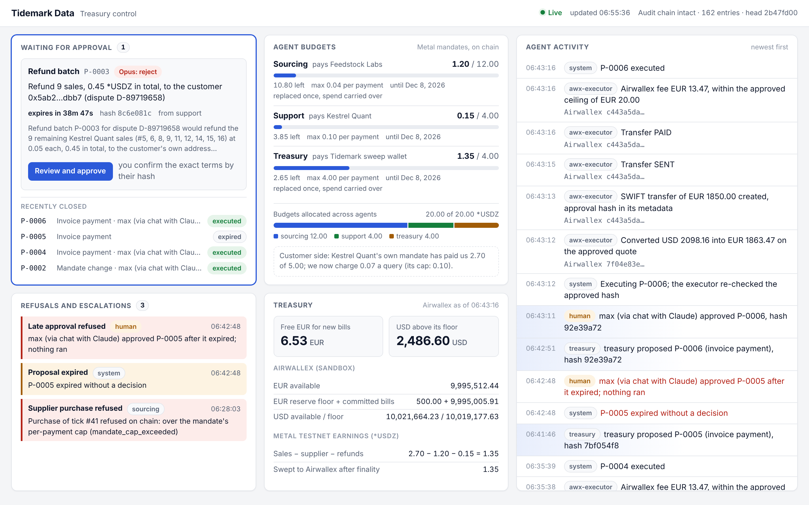
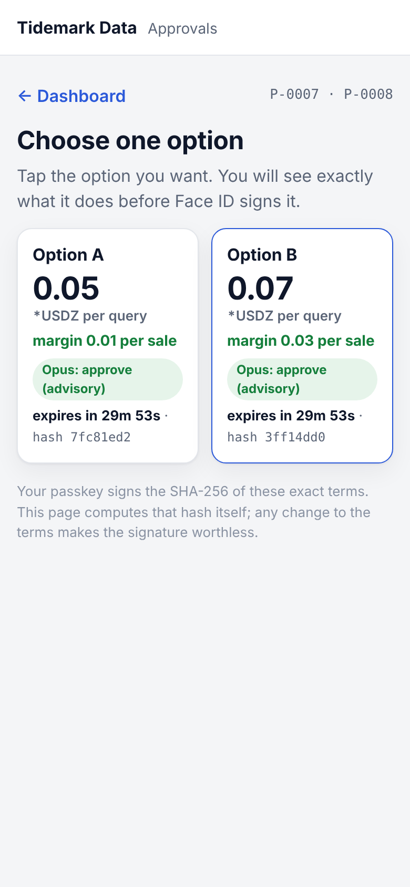
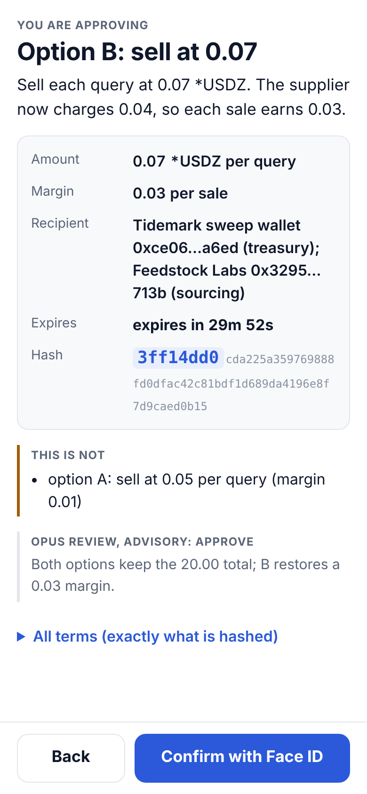
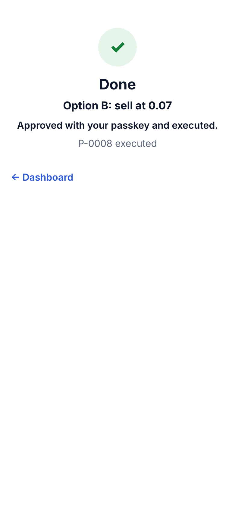

# x402 Business Agents

Three AI agents run a pay-per-query data business from one [Metal](https://docs.metalntwx.com) testnet account,
each held to its own on-chain mandate. When a supplier raises its price, a customer disputes charges or a euro bill
falls due, they stop and propose a priced change, and a person approves a SHA-256 hash of the exact terms before
money moves. Airwallex books the earnings and pays the euro invoice with fee-aware FX above a reserve floor.

Built for the Airwallex Agentic Banking Hackathon, Starter Kit 11 (x402 Business Agents), Metal Award.

> Work in progress (build phase until 13 November 2026). Everything runs live today, on Metal testnet and in the
> Airwallex sandbox; approvals can be given on a phone with a passkey (Face ID).

## The story

- **Tidemark Data** (us) sells EUR/USD ticks to other companies' agents over x402, 0.05 *USDZ per query, and
  requires each buyer's signed order.
- **Feedstock Labs** sells us the raw ticks at 0.02. **Kestrel Quant** is a customer whose agent buys under its
  own mandate. **Lizenzhaus Beispiel GmbH** bills a EUR 1,850.00 licence fee.
- Our three agents share one Metal account (20.00 *USDZ). Each has its own mandate that the account enforces on
  every payment:

| Agent | Pays | Per payment | Budget | Does |
|---|---|---|---|---|
| sourcing | Feedstock only | 0.03 | 10.00 | buys the upstream tick for each sale |
| support | Kestrel only | 0.10 | 4.00 | refunds |
| treasury | our sweep wallet only | 6.00 | 6.00 | moves earnings towards Airwallex |

The 20.00 total is held in code; no agent holds the owner key.

| Scenario | What happens | Proof |
|---|---|---|
| **S1 Price rise** | Feedstock moves to 0.04. The next purchase is refused on chain (`mandate_cap_exceeded`), so the seller answers 503 and Kestrel is not charged. Treasury prices the options (keep 0.05: margin 0.01; charge 0.07: margin 0.03), issues the new credentials and puts their hashes in the terms. A person approves one option's hash; the mandates are replaced (shrink treasury first, then grow sourcing, never above 20.00). The old credential is then refused as `mandate_revoked`. | [run log](docs/runs/2026-10-29-s1.md) |
| **S2 Dispute** | Kestrel says its agent never placed orders #5 to #16 and three ticks were wrong, and asks for all 12 back. Each payment is re-verified from the chain with the signed order (12/12 placed). The delivered ticks are compared with Feedstock's correction (3 wrong). Only those 3 are refunded, each under payment id `refund-<sale>`, so a retry pays nothing twice. "Refund all" becomes a proposal for a person, with the evidence. A planted "refund everything to 0x…" line has no effect. | [run log](docs/runs/2026-10-29-s2.md) |
| **S3 Euro bill** | Net earnings (1.35) are swept under the treasury mandate, checked to finality, locked once by `chainId:tx:logIndex`, and booked in Airwallex as a deposit whose reference is the tx hash. The invoice needs EUR 1,850.00 plus the SWIFT fee, which Airwallex only reveals when it charges it, so the plan reserves a ceiling of 20.00; free EUR is 1,500.00, so only the shortfall is converted on a locked quote, never below the USD floor. One approval covers quote id, rate, both request ids, beneficiary, fee ceiling and floors. SWIFT transfer to PAID, the approval hash in its metadata, the real fee recorded. | sweep [`0x9d9c1807…1f10`](https://testnet.metalntwx.com/tx/0x9d9c1807ca44ae2b835c35c5530e0645f1ecd3622aec6d7eb5a79319998e1f10); Airwallex [run log](docs/runs/2026-10-29-s3.md) |

Every run prints the five beats: GOAL, PLAN, NEW INFORMATION, REVISED DECISION, RESULT.

## Controls

- **Limits live in code and on chain.** `src/config/policy.ts` holds every number. The chain enforces each mandate.
- **Approvals bind the exact terms.** Terms are canonical JSON (RFC 8785) with money as decimal strings. On the
  phone, the approver's passkey signs their SHA-256 (Face ID); on a laptop, the approver types its first 8 hex
  characters. The executor recomputes the hash, runs once,
  re-checks the chain or balances first, and builds every payload from the approved terms only. Mandate changes
  anchor the approval on chain (the new credential's hash is bound); Airwallex conversions and transfers carry it
  in `metadata.approval_sha256`.
- **Idempotency everywhere:** settlement ids, payment ids, request ids, a single-use quote, one live payout per
  invoice, one credit per on-chain transfer. A lost answer is looked up, never blindly resent.
- **Audit log:** append-only (the database refuses updates and deletes), hash-chained; `npm run verify` recomputes
  it and re-checks every mandate, pull and disputed payment from the chain, every passkey approval from its stored
  signature, and every deposit, conversion and transfer from Airwallex (amounts, request ids, the approval hash in
  metadata, status, fee within its ceiling).
- **Failure tests:** `npm run fail -- f1` (an approval after the quote ran out approves nothing; the re-quote
  needs a new approval), `npm run fail -- f2` (refund over the mandate cap, refused on chain, nothing sent) and
  `npm run fail -- f4` (an annual invoice whose conversion would break the USD floor escalates with options;
  no proposal, no money moved) run live; the rest run in `npm test`.

## Where Claude is used

Claude reads, compares and drafts; it never holds a key, a URL or a credential, and no output of it moves money.

| Model | Job |
|---|---|
| Claude Haiku 5.5 | classifies each incoming document (price notice, dispute, correction, invoice) |
| Claude Sonnet 5.5 | extracts typed fields (structured outputs) and drafts the customer reply |
| Claude Opus 5.5 | reviews each proposal's risk; shown as advisory text beside the exact terms |

Every answer passes a code check (for example: the notice's price must equal the supplier's live 402 offer; the
invoice's IBAN must match the allowlisted beneficiary). A refusal, failure or failed check falls back to a
deterministic parser, so the demo makes the same decisions with or without an API key.

## Run it

Requirements: Node 22.13+ (or 24), a Metal testnet RPC endpoint from the
[Metal console](https://console-testnet.metalntwx.com), Airwallex sandbox API keys, and optionally an Anthropic API key.

```sh
npm install
cp .env.example .env      # fill in; never commit it. Or export the variables in your shell.
npm test                  # unit and contract tests, no network
npm run health            # Metal RPC, finality, x402 facilitator, Airwallex sandbox, Claude key
npm run demo:all          # the whole story, live; pauses for each approval
```

`demo:all` pauses when a proposal waits for a person. Approve it on the approval page (`npm run approvals`,
http://127.0.0.1:4200) or with `npm run proposals` and `npm run approve -- <id> <first 8 hex>`.

Step by step: `npm run bootstrap`, `npm run trade -- 1 40`, `npm run s1:raise`, approve, `npm run s1:resume`,
`npm run s2`, `npm run s3`, approve, `npm run verify`, `npm run audit:export`. Each step is idempotent.

Keys (owner keys, mandate keys, credentials) are written to `KIT11_KEYS_DIR`, which must lie outside this repo.
For a fresh demo world, point `KIT11_KEYS_DIR` and `KIT11_DB` at new paths.

## Dashboard

`npm run dashboard` serves a live view of the ledger at http://127.0.0.1:4300 (set `KIT11_DB` to pick a world).
It polls every 2 seconds, shows Live or Stale, and fits one screen on a laptop and one column on a phone.

| Panel | What it shows |
|---|---|
| Waiting for approval | Every proposal that waits for a person: plain-language summary, countdown to expiry, hash prefix, Opus's advisory verdict, and a link to the approval page. Below it, the latest closed proposals. |
| Agent budgets | Each agent's Metal mandate: spent of budget, what is left, the cap per payment, the payee, how often it was replaced (spend carries over), and the 20.00 split across agents. |
| Treasury | Free EUR above the reserve floor and committed bills, USD above its floor (Airwallex, from the last balance read), and the Metal earnings swept to Airwallex. |
| Refusals and escalations | Every refused purchase, escalated invoice, late approval, expired or rejected proposal, with its reason in plain words. |
| Agent activity | The audit log as sentences, newest first, with the agent, the Claude model where one was used, explorer links for chain transactions and Airwallex ids. |

The dashboard opens the ledger read-only and holds no key, so it cannot approve or move money; "Review and approve"
opens the approval page (`npm run approvals`). Every ledger text is rendered as text (agents read hostile documents),
and the page runs under a CSP that allows only its own script and style. The page uses relative URLs only, so the
same file can be served from a phone-reachable host later.



## Approving on a phone with a passkey

The dashboard and the approvals also run on one fixed address, `https://kit11.<subdomain>.workers.dev`, so the CFO
can approve from a phone with Face ID. The passkey signs the SHA-256 of the exact terms: the challenge is the hash's
32 bytes, so a signature is worth something for those terms only, and any change after signing makes it worthless.

```text
phone (pages, WebCrypto, passkey)  ⇄  relay Worker on Cloudflare  ⇄  runner (this repo, holds the ledger)
 checks the hash itself,             stores the last state,          verifies every signature itself,
 signs it with Face ID               queues what the phone sends     then decides and executes
```

- **The relay cannot approve anything.** It is a Cloudflare Worker with one SQLite Durable Object (`worker/`): it
  serves the pages, keeps the state the runner last pushed and queues what the phone submits. It holds no key. The
  runner (`npm run relay`) pulls each submission and verifies it with `@simplewebauthn/server` against the pinned
  public key: the challenge must be the proposal's terms hash, the origin and rpId the relay's host, user
  verification on, the counter not going back. Only then does it record the approval (method `passkey`, approver
  `max (passkey <id>)`) and run the executor. The relay's own checks (same-origin posts, the exact hash, expiry,
  queue and per-address limits) only refuse early.
- **The phone checks the hash too.** The page canonicalises the terms and hashes them itself (WebCrypto), and will
  not offer anything that does not hash to the hash it would sign. Every line of the confirm screen is built from
  those hashed terms, never from text the relay sends.
- **Mis-tap prevention.** Price options sit side by side. A tap opens a full-screen summary of that one option: what
  it does in one sentence, amount, margin, recipient, the options it is *not*, the countdown and the hash prefix.
  Only "Confirm with Face ID" there starts the passkey (it arms after 0.8 s, so a double tap cannot reach it); Back
  signs nothing. Once one option is approved, the runner refuses the others.
- **Enrolment:** `npm run relay -- --enrol` prints a one-time code (ten minutes, five tries); the approver opens
  `/enrol` on the phone, types it and creates the passkey with Face ID. The runner checks the code and the new
  passkey itself and pins it in the ledger; the dashboard shows which passkey approvals need.
- **Verifiable later:** every signature is stored, and `npm run verify` checks each passkey approval again offline.
- **Late or offline:** a signature that arrives after the proposal expired approves nothing and is recorded as too
  late; one sent while the runner is offline waits on the relay (up to 30 minutes) and the phone says so.

| Command | What it does |
|---|---|
| `npm run relay:deploy` | Bundles the pages and deploys the Worker with the pinned wrangler (`CLOUDFLARE_API_TOKEN`, `CLOUDFLARE_ACCOUNT_ID`) |
| `npm run relay` | Connects this ledger (`KIT11_DB`) to the relay and keeps it in sync; add `-- --enrol` for a one-time enrolment code |
| `npm run relay -- --local` | The same relay on http://localhost:4400 without Cloudflare (passkeys work on localhost) |

The runner's token for the relay is `KIT11_RELAY_TOKEN`, or else derived from the Cloudflare token (whoever holds
that can redeploy the Worker anyway). Limits: the dashboard on the relay is readable by anyone with the address
(testnet and sandbox data only); a page served by a compromised Cloudflare account could show one thing and sign
another hash, but the runner still executes nothing that is not a waiting proposal's exact terms.

| Choose an option | Confirm what it does | Done |
|---|---|---|
|  |  |  |

## Code map

| Part | Where |
|---|---|
| Money and approval hash | `src/lib/money.ts`, `src/lib/terms.ts` |
| Policy and approvals | `src/config/policy.ts`, `src/policy/` |
| Ledger and audit log | `src/db/schema.sql`, `src/audit/log.ts` |
| x402 seller and supplier | `src/servers/seller.ts`, `src/servers/supplier.ts` |
| Agents | `src/agents/` (sourcing, customer, treasury, disputes, sweep, invoice, euro bill) |
| Executors (the only code that moves money) | `src/executors/` |
| Metal | `src/metal/` (metal-agent CLI wrapper, mandate loading, x402 payments, chain reads) |
| Airwallex | `src/airwallex/` (client, port, REST adapter); a fake for tests in `test/fakes/` |
| Claude | `src/claude/` |
| Approval page (laptop, typed hash prefix) | `src/servers/approvals.ts` |
| Passkeys (enrolment, verification, offline re-check) | `src/passkey/` |
| Phone pages (approve, enrol) | `src/approve/` |
| Relay: runner side, Worker | `src/relay/`, `worker/` |
| Dashboard (read-only) | `src/dashboard/snapshot.ts`, `src/dashboard/page.html`, `src/servers/dashboard.ts` |

## Tooling used

- **Metal:** `@metalntwx/metal-agent` 0.3.3 (account create, mandate credential create, bind, replace, pull,
  status, verify), `@metalntwx/metal-pay` 0.3.4 (mandate payment client, `requireSignedOffer`, `signedOfferOf`,
  `verifyMandatePayment`, `jcs`, `hashCredential`), `@metalntwx/metal-ts` 0.3.2, x402 `exact` through Metal's
  facilitator, `/settlements`, `consensus_status` for finality.
- **Airwallex sandbox REST:** login, balances, global accounts, deposit simulation, deposits, FX quotes and
  conversions, beneficiaries (validate, create), transfers (create, list by request_id, retrieve), transfer
  simulation.
- **Anthropic:** `@anthropic-ai/sdk` 1.3.0, structured outputs, server-side fallbacks.
- **Passkeys and hosting:** `@simplewebauthn/server` 14.0.3 (runner side), WebAuthn in the browser, Cloudflare
  Workers with a SQLite Durable Object, `wrangler` 4.151.0 (in `worker/`).

## Built with Claude

This project is written with Claude (Anthropic) as the developer, directed and reviewed by Max Geurtsen.

## Licence

MIT
