<div align="center">


<a href="https://kit11.max-31b.workers.dev/"><picture><source media="(prefers-color-scheme: dark)" srcset="docs/assets/readme/hero-dark.webp">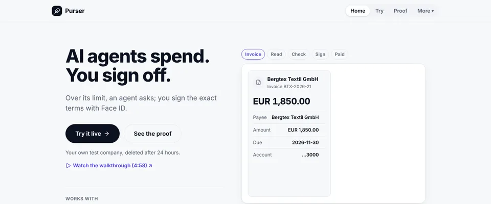</picture></a>

# Purser · AI agents spend. You sign off.

**Purser is the control layer between a company's AI agents and its money: an agent pays on its own within the limits the CFO set, and anything above them waits for the CFO's Face ID or passkey on the exact terms.**

An approval is usually a button. In Purser it's a signature over the exact terms: change one cent and it's worthless.

<a href="https://kit11.max-31b.workers.dev/try"></a> <a href="https://kit11.max-31b.workers.dev/proof"></a> <a href="https://youtu.be/mp9fmOYfBWc"></a>

[](https://github.com/agamemnon-coder/x402-business-agents/actions/workflows/ci.yml?query=branch%3Amain) [](https://github.com/agamemnon-coder/x402-business-agents/actions/workflows/github-code-scanning/codeql) [](docs/assets/test-summary.json) [](LICENSE) [](package.json) [](tsconfig.json) [](#connect-any-ai) [](https://registry.modelcontextprotocol.io/v0/servers?search=io.github.agamemnon-coder/purser) [](https://kit11.max-31b.workers.dev/airwallex) [](https://kit11.max-31b.workers.dev/metal) [](https://kit11.max-31b.workers.dev/visa) [](https://kit11.max-31b.workers.dev/claude) [](https://kit11.max-31b.workers.dev/t0)

**Live demo: [kit11.max-31b.workers.dev/try](https://kit11.max-31b.workers.dev/try)**: a test company of your own on test money, in 2 minutes · [the walkthrough, 4:58](https://youtu.be/mp9fmOYfBWc) (AI voice and music: ElevenLabs) · [every id on /proof](https://kit11.max-31b.workers.dev/proof)

</div>

- **Face ID or a passkey signs the exact terms.** The approval is a signature over the SHA-256 of the terms; change one cent and it no longer verifies. The owner's real approval of 7 November is checked offline by `npm run verify-approval` ([record](docs/runs/2026-11-07-awx-1.md)).
- **Limits are enforced in 3 layers: Purser's code, Airwallex's card controls and Metal's on-chain mandate.** Airwallex itself declined an agent's card over the CFO's limit ([record](docs/runs/2026-11-07-awx-1.md)); Metal refused a purchase over the mandate on chain ([record](docs/runs/2026-11-03-main-run.md)). The mandates: [/api/metal/mandates](https://kit11.max-31b.workers.dev/api/metal/mandates), a live read from Metal testnet, or the recorded 12 Nov snapshot when the chain does not answer (the answer says which).
- **The audit chain is anchored on chain.** Every event goes into a hash-chained log; its head is in a value-0 Metal testnet transaction, and `npm run verify-anchor` prints MATCH ([record](docs/runs/2026-11-13-anchor.md)).

Test money only: Metal testnet, Airwallex sandbox, Visa via Airwallex Airi (sandbox), Claude. **Check it yourself, offline, no keys:** `npm ci` · `npm run judge -- --check` · `npm run verify-approval` ([what each does](#verify-it-yourself-in-3-commands))

<table><tr><td width="25%"><a href="https://kit11.max-31b.workers.dev/proof"></a><br><b>/proof</b></td><td width="25%"><a href="https://purser-try.max-31b.workers.dev/">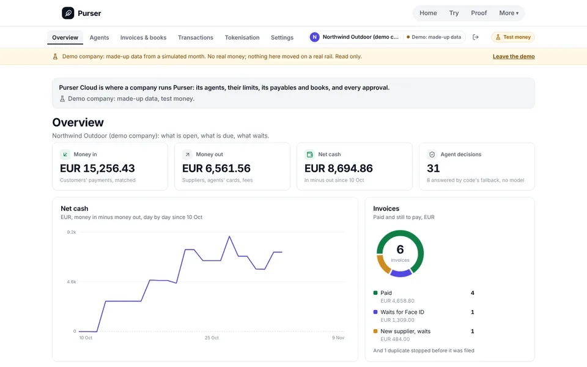</a><br><b>Purser Cloud as a guest</b></td><td width="25%"><a href="https://kit11.max-31b.workers.dev/books">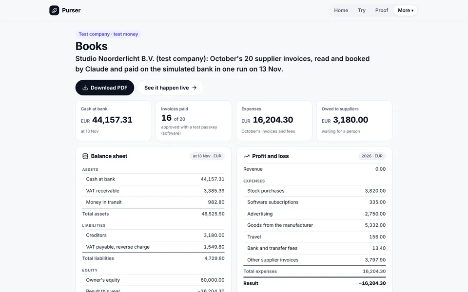</a><br><b>/books</b></td><td width="25%"><a href="https://kit11.max-31b.workers.dev/security">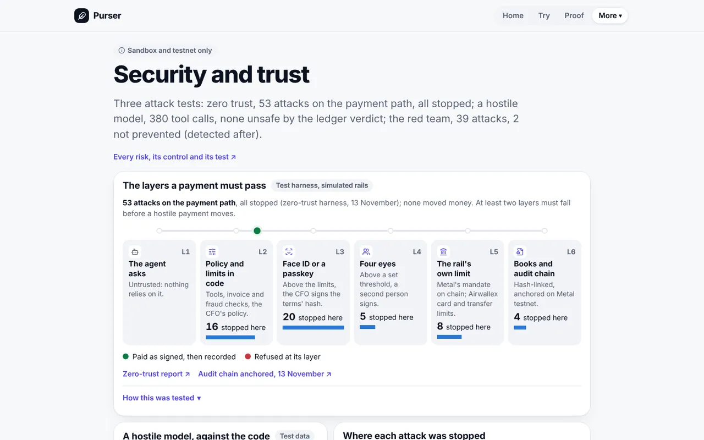</a><br><b>/security</b></td></tr></table>

## Enterprise

What a finance team gets beyond the demo; test money today, each with where to check it.

- **Purser Cloud:** a console per company with Overview, Agents, Invoices & books, Transactions, Tokenisation and Settings; a public test preview where *Try as guest* opens a demo company read-only ([purser-try.max-31b.workers.dev](https://purser-try.max-31b.workers.dev/), [docs/cloud.md](docs/cloud.md)).
- **Approval alerts:** WhatsApp, e-mail, Slack and Teams tell the CFO a payment waits; an alert never carries anything that approves. Built and tested with stand-ins, not sent live yet; WhatsApp goes live once Twilio keys are set ([docs/cloud.md](docs/cloud.md#approval-alerts)).
- **Zero trust and step-up:** agents act only through a fixed set of tools that code checks; sensitive console settings ask for a fresh passkey check ([docs/security.md](docs/security.md#zero-trust-layer-by-layer), [cloud/src/stepUp.ts](cloud/src/stepUp.ts)).
- **Security contact:** [security.txt](https://kit11.max-31b.workers.dev/.well-known/security.txt) and [SECURITY.md](SECURITY.md); the layers a payment must pass on [/security](https://kit11.max-31b.workers.dev/security).
- **MCP connector:** 14 read tools, and proposing an invoice's payment, never approving it; in the MCP Registry as [`io.github.agamemnon-coder/purser`](https://registry.modelcontextprotocol.io/v0/servers?search=io.github.agamemnon-coder/purser) ([Connect any AI](#connect-any-ai)).
- **Tests:** the suite's count is written from its last full run by `npm run test-count` ([summary](docs/assets/test-summary.json), [the line below](#verify-it-yourself-in-3-commands)); CI runs it on every push.

## How it works

Airwallex's AgentOS says its "components do not initiate money-out actions (transfers, FX conversions, or payouts) on
your behalf" ([docs](https://www.airwallex.com/docs/developer-tools/ai/agentos), read 13 November 2026). Purser is the control layer for when agents do move money on Airwallex: within limits the CFO signs, and above them only with the CFO's passkey on the exact terms.

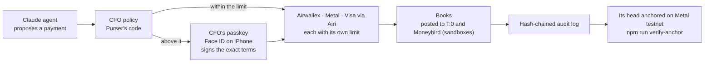

## For judges: 3 minutes

**What it is:** the control layer between a company's AI agents and its money on Airwallex and Metal, built for
Starter Kit 11 (x402 Business Agents) and entered for the Metal Award and the Visa Award.
The Kit 11 scenario, run live on 3 November.\
**1. [Try it](https://kit11.max-31b.workers.dev/try):** a test company of your own; approve the exact terms with your
passkey, then change them: refused.\
**2. [Proof](https://kit11.max-31b.workers.dev/proof):** one id per rail in [docs/in-depth.md](docs/in-depth.md#what-ran-live-one-id-per-rail), every run in [docs/runs/](docs/runs/README.md).\
**Offline:** [the quick start](#verify-it-yourself-in-3-commands), under 2 minutes, no keys.\
**Simulated:** the customer, the supplier, the merchants' charges, the settlement and the second approver; test money only.

## What's live, what's simulated

Each row from its run record; test money throughout. Every run, newest first: [docs/runs/](docs/runs/README.md).

| What | Status | Date | Record |
|---|---|---|---|
| Three Claude agents run a company for a day: 86 Metal payments, 1 card charge, 1 SWIFT transfer | Live: Metal testnet, Airwallex sandbox. Customer, supplier, settlement and second approver simulated | 3 Nov | [main run](docs/runs/2026-11-03-main-run.md) |
| Airwallex itself declines an agent's card over the CFO's limit | Live, Airwallex sandbox | 7 Nov | [record](docs/runs/2026-11-07-awx-1.md) |
| An agent pays via Airwallex's Airi with a Visa credential Purser binds to one purchase (the sandbox did not refuse reuse; Purser did); above the limit only after Face ID | Live, Airwallex sandbox, test card | 7, 12 and 13 Nov | [first](docs/runs/2026-11-07-vic-1.md), [reuse not refused](docs/runs/2026-11-12-vic-3.md), [latest](docs/runs/2026-11-13-vic-4.md) |
| Airwallex's own approval as a second lock: a payout signed in Purser waited `IN_APPROVAL` until a person approved it there, then PAID; later the owner's iPhone approved an invoice, held `IN_APPROVAL` | Live, Airwallex sandbox; 12 Nov a labelled test passkey, settlement simulated; 13 Nov not taken to PAID | 12 and 13 Nov | [PAID](docs/runs/2026-11-12-airwallex-two-locks-paid.md), [iPhone](docs/runs/2026-11-13-airwallex-faceid.md) |
| Before the CFO is asked, the payee's bank checks the name; one signature covers a batch of two payouts, read back before submit | Live, Airwallex sandbox; no money moved by the name check; a test passkey | 12 Nov | [name check](docs/runs/2026-11-12-airwallex-payee-check.md), [batch](docs/runs/2026-11-12-airwallex-batch-transfer.md) |
| An agent's limit on chain changes only when two passkeys sign; over the cap, Metal refuses | Live, Metal testnet; the second owner a labelled test passkey | 12 Nov | [record](docs/runs/2026-11-12-faceid-onchain.md) |
| The books posted to T:0 and to Moneybird, read back | Live, both sandboxes | 10 and 12 Nov | [T:0](docs/runs/2026-11-10-t0-journal-sandbox.md), [Moneybird](docs/runs/2026-11-12-moneybird-sandbox.md) |
| The hands-on demo: Claude reads a sample invoice | Live Claude; the bank simulated; a test passkey | 13 Nov | [record](docs/runs/2026-11-13-try-sample.json) |
| Purser's records anchored on chain: one value-0 transaction carries their head; `npm run verify-anchor` prints MATCH | Live, Metal testnet | 13 Nov | [record](docs/runs/2026-11-13-anchor.md) |
| In Purser Cloud: the payee check, batch approval and reconciliation as product features | Built and tested on stand-ins; not shown switched on in a live run | — | [reconcile-books.md](docs/reconcile-books.md) |
| Real customers, real money, a second person approving | Not yet | — | [go-live.md](docs/go-live.md) |

## Visa Award

Visa Intelligent Commerce through Airwallex's Airi: an agent pays with a Visa credential Purser binds to one purchase; in the sandbox Airi/Airwallex did not refuse a reuse or a higher amount ([vic-3](docs/runs/2026-11-12-vic-3.md)), Purser did ([vic-4](docs/runs/2026-11-13-vic-4.md)); within the CFO's limit on its own and above it only after the CFO's passkey. Live in the Airwallex sandbox with a test card on 7 November (a scripted run, no Claude call; [first run](docs/runs/2026-11-07-vic-1.md)) and 13 November: 2 paid in the 13 Nov run (5 paid across 3 Visa runs); 1 after Face ID, 5 refused by Purser incl. reused credentials, 1 not tapped: nothing charged ([latest run](docs/runs/2026-11-13-vic-4.md)). Visa TAP is an extra, not part of the entry. [/visa](https://kit11.max-31b.workers.dev/visa)

## Metal Award

Each agent pays x402 under its own mandate on Metal testnet, and Metal refuses what is over it: in the main run of 3 November, 86 Metal payments and purchase #24 refused on chain ([tx](https://testnet.metalntwx.com/tx/0x2e92f9cb4549246f58b9b888881c258bf117c6233c1d8f126f4833ae6ae41871), [run](docs/runs/2026-11-03-main-run.md)). On 12 November a passkey account with two owners (the CFO's passkey and a labelled test passkey) changed the mandate only when both signed, and Metal refused a payment over its cap ([record](docs/runs/2026-11-12-faceid-onchain.md), [diagram](docs/diagrams.md#3-the-mandate-on-metal-bound-refused-raised-revoked)). [/metal](https://kit11.max-31b.workers.dev/metal) · [docs/metal-award.md](docs/metal-award.md)

## The business hypothesis

Not validated with customers yet: 2 finance conversations (a CFO and a bank finance professional, quoted, anonymous); more in progress; no pilots, no revenue. Every line below is a hypothesis except the cited source.

- **The problem:** when an AI agent pays today, its limit lives in a prompt it can be talked out of, or in a month-end review that finds the money after it has left. ([problem.md](docs/business/problem.md#what-goes-wrong))
- **Who buys:** the finance team of a small company or scale-up that already banks with Airwallex and lets AI agents pay; the CFO uses it and decides. ([model.md](docs/business/model.md#who-buys-and-who-uses-it-hypothesis))
- **Pilot pricing:** Starter €49 a month (100 invoices, then €0.25 each); Business from €249 a month; a small fee per payout. A hypothesis. ([model.md](docs/business/model.md#pilot-pricing-hypothesis))
- **Why now:** Airwallex wrote on 5 October 2026 that agents moving money need limits enforced "through underlying infrastructure rather than prompts" ("Agentic banking starts with governance", source S1). ([problem.md](docs/business/problem.md#why-now-sourced))
- **Why Purser:** it builds on Airwallex's own card controls and Metal's mandates, and adds what sits on top: one CFO policy for card and chain, approvals signed over the exact terms, a hash-chained audit log. ([model.md](docs/business/model.md#risks-and-what-we-do-not-know))

**Why not Airwallex's own approvals?** Purser signs the exact terms with the CFO's passkey before the API call, enforces per-agent limits across Airwallex and Metal, and can additionally require Airwallex's approval workflow (`IN_APPROVAL` handled, [src/airwallex/approvals.ts](src/airwallex/approvals.ts)). Live in the sandbox, 10 and 12 Nov: Airwallex held a payout signed by a labelled test passkey `IN_APPROVAL` until the owner approved it in Airwallex's web app; then `PAID`, settlement simulated ([run](docs/runs/2026-11-12-airwallex-two-locks-paid.md)).

## Try it in 2 minutes

1. **Pay an invoice yourself:** [kit11.max-31b.workers.dev/try](https://kit11.max-31b.workers.dev/try). A test company of your own; Claude reads a sample invoice, you approve the exact terms with your own passkey, it is paid on a simulated bank and booked. Change what you signed: refused.
2. **Look around a company:** [Purser Cloud as a guest](https://purser-try.max-31b.workers.dev/), then *Try as guest*: the demo company's dashboard and books, read-only, made-up data, test money.
3. **Ask your own AI:** add the remote MCP server `https://purser-try.max-31b.workers.dev/mcp` and choose the demo company (public token `purser-demo-read-only`): ask "what's waiting for the CFO?". It reads; it cannot approve or pay ([Connect any AI](#connect-any-ai)).

## See it


*The hands-on demo, end to end: a test company files a sample invoice, Claude reads it, Pay, the approval passkey (Chromium's virtual authenticator: a test passkey, no person or phone), paid on the simulated bank, booked and filed. Test money.* ([MP4](docs/assets/media/try-flow.mp4)) Recorded from the live sites by `npm run media:record` ([media.json](docs/assets/media/media.json)); the charts are under [Proof in numbers](#proof-in-numbers) and the diagrams under [How it works](#how-it-works-in-5-files).

<table><tr><td width="33%"><a href="docs/assets/media/cloud-dashboard.mp4">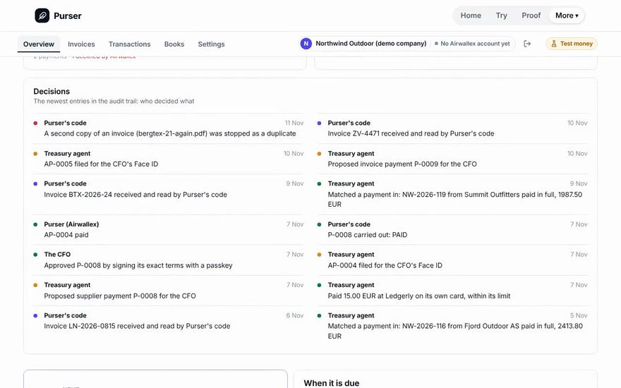</a><br>▶ <a href="docs/assets/media/cloud-dashboard.mp4">MP4, 13 s</a></td><td width="33%"><a href="docs/assets/media/books.mp4">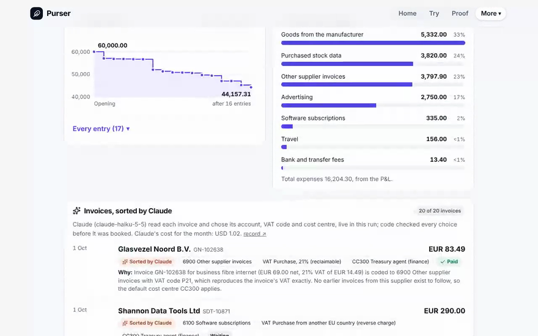</a><br>▶ <a href="docs/assets/media/books.mp4">MP4, 14 s</a></td><td width="33%"></td></tr><tr><td>Purser Cloud as a guest: the demo company's dashboard (made-up data from a simulated month, test money), then its books.</td><td>kit11 /books: a test company's month, read and booked by Claude live; balance sheet, charts and the invoices sorted by Claude. Test money.</td><td>kit11 /proof: every claim with its run record.</td></tr></table>

<table><tr><td width="25%"><a href="https://kit11.max-31b.workers.dev/airwallex">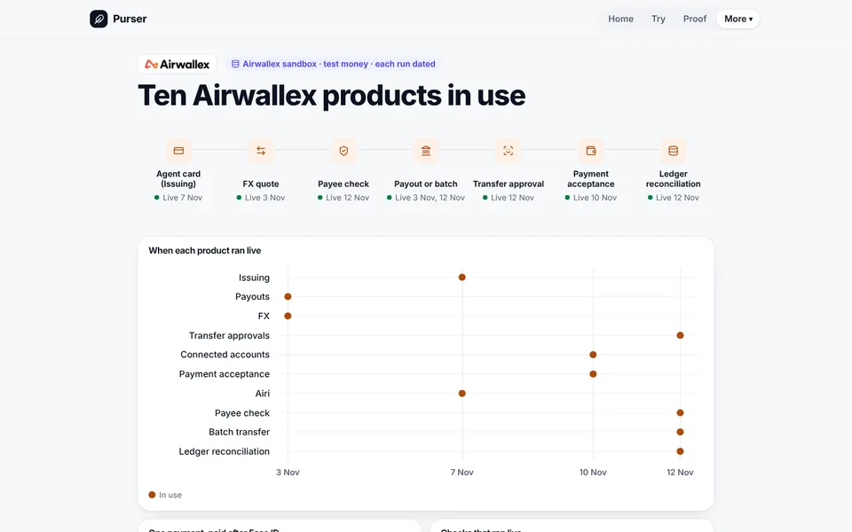</a><br><b>/airwallex</b></td><td width="25%"><a href="https://kit11.max-31b.workers.dev/metal">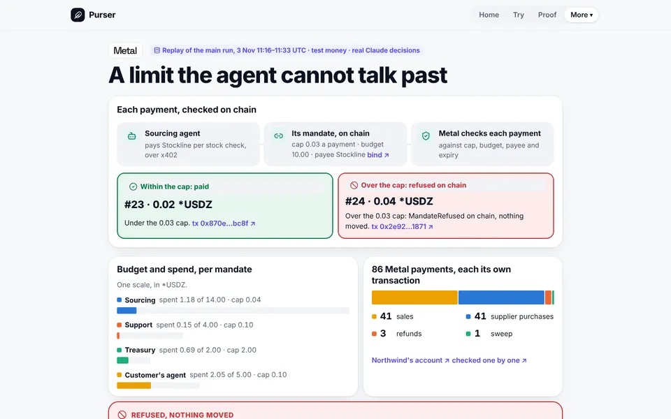</a><br><b>/metal</b></td><td width="25%"><a href="https://kit11.max-31b.workers.dev/visa">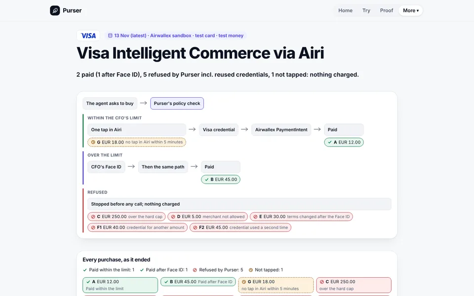</a><br><b>/visa</b></td><td width="25%"><a href="https://kit11.max-31b.workers.dev/claude">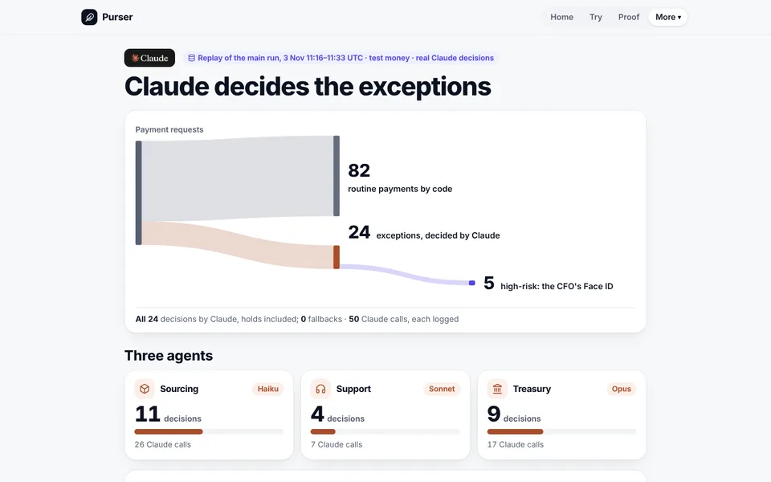</a><br><b>/claude</b></td></tr></table>

The pages and the console as the live site showed them on 13 November (`npm run readme:shots -- --live`; without `--live` the same shots from a local build): Purser Cloud as a guest with its demo company, light theme. Test money throughout.

## How it works in 5 files

Northwind Outdoor, the example company, is an outdoor wholesaler that sells live stock data to retailers per query: the
kit's data business. Purser gives each AI agent of a small company its own Airwallex card and its own Metal on-chain mandate. Metal holds
each agent's on-chain budget, Airwallex holds each card's limit, Purser's code holds the rest; the CFO approves anything
beyond them, with a passkey (Face ID on iPhone) on the exact terms.

**Claude agents propose and pay; Purser's code, Airwallex and Metal each hold a limit; above them, the CFO signs the exact terms with a passkey (Face ID on iPhone).**


<details><summary>One payment beyond the limit, end to end</summary>

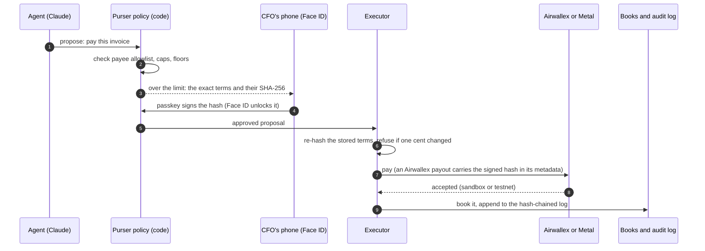

</details>

Within the limits an agent pays on its own; beyond them, nothing runs without the CFO's passkey.

<!-- worst-case -->
**Worst case, set by policy: EUR 28,200 on cards and task cards + USD 20 on chain a month.**

Task cards under a CFO-signed limit: EUR 900 a day. Everything above waits for the CFO.

<details><summary>How this is computed</summary>

- Sourcing agent: EUR 100 on its card + USD 10 on chain (test USD) a month.
- Support agent: EUR 150 on its card + USD 4 on chain (test USD) a month.
- Treasury agent: EUR 50 on its card + EUR 27,900 in task cards + USD 6 on chain (test USD) a month.
- A day: EUR 1,200 + USD 20: a card or a mandate can go in one day, task cards 3 a day.
- Counted: each card's monthly limit (card.*.monthly, EUR) and each Metal mandate's budget (test USD, *USDZ; it lasts 40 days and can all go at once). Task cards, which the Treasury agent may issue on its own within the limit the CFO signed with Face ID: up to EUR 300 each (approval.task_card_eur), 3 a day (EUR 900), 31 days a month (EUR 27,900), counted above.
- ≈ EUR 28,217.70 in all at the main run's rate of 3 Nov 2026 (1.129917 USD per EUR, docs/demo/main-run.json); test USD is never added to EUR otherwise.
- With a shared card or an API key, the limit is the card's or the account's.
- Computed from the policy by [`exposureOf`](src/policy/exposure.ts); `test/exposure.test.ts` checks this block against it.

</details>
<!-- /worst-case -->

1. **The policy.** [`reserveSpend`](src/policy/holds.ts#L63) runs before an agent's payment is signed or charged: its identity, the CFO's stops and caps, the mandate's cap and budget, the shared 20.00 total and velocity. A refusal means nothing is signed.
2. **The terms hash and the passkey.** [`termsHash`](src/lib/terms.ts#L41) is the SHA-256 of a proposal's exact terms as canonical JSON; [`verifyApprovalSignature`](src/passkey/webauthn.ts#L53) accepts a passkey's signature only if it signed that hash, with user verification (Face ID) on.
3. **The executors' hash check.** Every executor in [src/executors/](src/executors/) starts with [`beginExecution`](src/policy/approvals.ts#L265), which re-hashes the stored terms and runs nothing unless they match the approved hash, before the expiry.
4. **The Metal mandate layer.** [`payUnderMandate`](src/metal/pay.ts#L34) signs an x402 payment with the agent's own mandate key only after the caller's guard passes it (Sourcing's is `reserveSpend`); on chain, Metal refuses what is over the mandate.
5. **The audit chain.** [`audit`](src/audit/log.ts#L37) appends each event with `row_hash = SHA-256(prev_hash ‖ JCS(row))`; the database refuses UPDATE and DELETE, and `npm run verify` re-checks the chain.

### Verify it yourself in 3 commands

The quick start: under 2 minutes, no keys. Needs Node.js 22.13 or later and git. `npm ci` downloads packages from npm; after that, no network and no keys.

```sh
npm ci                       # under a minute: the exact versions in the lockfile
npm run judge -- --check     # about 5 s: every page in CHECK_PATHS built from the main run's record, offline
npm run verify-approval      # under 1 s: the owner's real passkey approval of 7 November, checked with Node's crypto
```

What you should see (abridged):

```text
ok    /  200  63106 bytes
ok    /proof  200  138535 bytes
…
ok    signature          the ES256 signature verifies with the receipt's public key

VALID: docs/runs/2026-11-07-awx-1/receipt-P-0002.json
Proves: the holder of this public key signed exactly these terms, with the authenticator reporting user verification, on this site.
Does not prove: who holds the key, or that it was Face ID (no attestation is checked). A test world's terms: nothing real moved.
```

`npm run verify-approval` reads that receipt; change one cent in it and it says NOT VALID. `npm run verify-receipt -- receipt.json`
checks any receipt of the same format.

The full suite, `npm test` (about 8 to 9 min on a laptop): **6524 tests passing**, 4 skipped, in 580 files (the last full run, on commit `0e031afc`: [summary](docs/assets/test-summary.json)), on stand-ins for Airwallex, Metal and Claude. The skipped ones run only on local D1 (`npm run test:d1`). Two kinds of line in its output are expected noise, not failures: Node's "ExperimentalWarning: SQLite is an experimental feature" and "try-sign: a live agent call failed" (a test that checks the fallback when the model is down).

CI runs these checks on every push; the CI badge at the top shows the result of the latest run on main.

## Architecture

Where it runs: two Cloudflare Workers, their Durable Objects, D1, the MCP server and the relay.

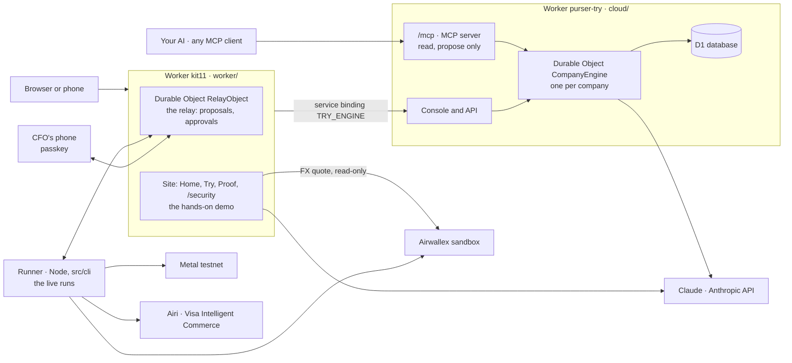

## Proof in numbers

   

Drawn from the run records and git history by `npm run charts` (scripts/repo-charts.ts); `test/repo-charts.test.ts` redraws them. Every id behind them is on [/proof](https://kit11.max-31b.workers.dev/proof) and in [docs/runs/](docs/runs/README.md).

## Connect any AI

Use your own AI assistant with a Purser company: Claude (claude.ai, the Claude apps, Claude Code), ChatGPT, Cursor, VS Code's agent mode, Gemini CLI, Windsurf, or any client that speaks MCP to a remote server. It reads the books and can propose an invoice's payment; **it can never approve or pay**: every payment still needs the CFO's passkey over the exact terms.

1. In Purser Cloud, Settings, Connect your AI: make a connector token (only an owner signed in with a passkey can).
2. In your AI, add the remote MCP server `https://purser-try.max-31b.workers.dev/mcp` (in Claude Code: `/plugin marketplace add agamemnon-coder/x402-business-agents` and `/plugin install purser@purser`).
3. Sign in with your token, or choose the demo company: its public, read-only token is `purser-demo-read-only` (made-up data from a simulated month, test money; it can propose nothing).

Purser shows with its own icon and offers three ready-made prompts: *CFO weekly brief*, *What needs my Face ID?* and *Explain this invoice*. Checked on 13 November 2026, 06:57 UTC: `tools/list` on that address with the demo token answers 7 read tools; the same morning the owner added it in the Claude iOS app (as the owner states it). The other clients are listed from their own documentation and have not been tried live against a deployed cloud. Every client's steps and every tool: [docs/connect-claude.md](docs/connect-claude.md).

Since then, in this repository (live once the cloud is redeployed): the server speaks MCP 2026-07-28 as well as the older revisions, with 14 read tools (cash and its projection, what waits for approval, the CFO's policy in plain words, spend by agent or supplier, VAT, a payment's audit trail, one payment explained), the books as resources, sign-in by Client ID Metadata Document for ChatGPT and Claude, and a page per client at `/connect-ai` with one-click links for Cursor and VS Code. Checked with the MCP Inspector against a local cloud; ChatGPT, Cursor, VS Code, Gemini CLI and Windsurf are described from their own documentation. Connections to other systems, read or export only (signed webhooks, Slack and Teams message formats, Xero, QuickBooks and Exact CSV, the read API's OpenAPI), each labelled live or format export: [docs/connections.md](docs/connections.md).

## Built after the kit (test environment, test money)

On [/try](https://kit11.max-31b.workers.dev/try) Claude reads a test company's invoice and the CFO signs the exact terms with a passkey (Face ID on iPhone). The payables inbox below is built to do that for every supplier invoice of a small company. It runs on this site as the [hands-on demo](https://kit11.max-31b.workers.dev/try) and [/books](https://kit11.max-31b.workers.dev/books), on test money; the product console is a private preview. Its code is in this repository: the inbox in [src/ap](src/ap), the books in [src/ledger](src/ledger), the documents in [src/vault](src/vault), the accounting links in [src/erp](src/erp), payments in other currencies in [src/payouts](src/payouts), and Purser Cloud, the console and its API, in [cloud/](cloud). It is built and tested against stand-ins and on Cloudflare's local database; on 10 November it ran once end to end in the Airwallex sandbox for three test companies (1 payout PAID, 3 refused by Airwallex: [run record](docs/runs/2026-11-10-platform-e2e.md)). Purser Cloud runs publicly as a test preview at [purser-try.max-31b.workers.dev](https://purser-try.max-31b.workers.dev/), where *Try as guest* opens a demo company read-only (made-up data from a simulated month); what ran live and when is [above](#whats-live-whats-simulated). The product's own console deployment is another matter: that hosted preview exists but is private (behind an access key); no customer uses it, and it is not ready for real money. Its connected-account payout ran end to end in the Airwallex sandbox on 10 November: EUR 4.84 PAID on a test company's behalf (`593c340b-1752-4537-9ef2-0eb3558897cc`, settlement simulated), with Purser's EUR 0.02 fee, booked in T:0 ([run record](docs/runs/2026-11-10-platform-e2e.md)); an earlier run that morning paid EUR 5.00 with a EUR 0.05 fee (`a9460dba-f31b-4111-be58-6d9a9e71adb1`, [record](docs/runs/2026-11-10-connected-accounts-sandbox.md)). The Kit 11 build keeps Metal and x402 for the agents' own payments; the inbox pays suppliers through Airwallex payouts. Details and screenshots: [docs/after-the-kit.md](docs/after-the-kit.md).

- **Payables inbox:** supplier invoices arrive as PDF or e-mail, are read, checked (duplicates, changed bank details, totals) and booked.
- **Scanned invoices:** two independent readings must agree on IBAN, total, currency and invoice number; otherwise a person decides.
- **One Face ID for a batch:** the CFO signs a list of exact terms once; each payment still runs and is checked on its own.
- **Cloud console** with passkey sign-in, a register of every money movement, Dutch screens.
- **Six red-team rounds:** every confirmed finding fixed with a test, except one point from round 6 that is still open ([docs/go-live.md](docs/go-live.md)).
- **Airwallex connected accounts:** each customer would open its own Airwallex account through Purser; every payout and card call is checked against that company's signed account binding. Live in the sandbox since 10 November: 3 connected accounts ACTIVE; payouts with Purser's fee from the first (above, and an end-to-end run from invoice to T:0); the two newer accounts' payouts refused by Airwallex, which wants the paying company's registration number ([run record](docs/runs/2026-11-10-platform-e2e.md)).

## Who does what

 official files, unmodified, no endorsement implied ([sources](docs/assets/logos/SOURCES.md))

- **Built by Max Geurtsen** (Claude by Anthropic as the developer, directed and reviewed by Max): Purser itself: the CFO's policy and limits, the approval flow (Face ID on the exact terms,
  four eyes), the agents' tools and prompts, the relay and the site, the hash-chained audit log, the books, the tests.
- **Airwallex (sandbox):** the agents' cards and card limits, FX, the SWIFT euro payout, webhooks; its own approval
  workflow as a second lock. [/airwallex](https://kit11.max-31b.workers.dev/airwallex)
- **Metal (testnet):** the on-chain mandates and the agents' payments; it refuses what is over a mandate, and a passkey
  account changes a limit only when two owners sign. [/metal](https://kit11.max-31b.workers.dev/metal)
- **Claude by Anthropic:** two sets of agents. The Kit 11 agents pay for the company's own running costs (cards, x402
  on Metal), the three agents' decisions: Sourcing on Claude Haiku, Support on Claude Sonnet, Treasury on Claude Opus.
  The payables agents handle supplier invoices (Home, /try, Purser Cloud): the Reader reads an invoice, the Checker
  checks it, the Coder books account and VAT, the Payer proposes the payment; code enforces the limits and the CFO
  signs with a passkey (Face ID on iPhone). [/claude](https://kit11.max-31b.workers.dev/claude)
- **Face ID and passkeys (WebAuthn on the CFO's phone):** the CFO's passkey (unlocked with Face ID on an iPhone; Purser asks for no attestation, so it cannot tell which authenticator was used) signs the hash of
  the exact terms.
- **Visa Intelligent Commerce via Airwallex's Airi (sandbox, test card):** an agent pays with a Visa credential Purser binds to one purchase (the sandbox did not refuse a reuse or a higher amount, Purser did: [vic-3](docs/runs/2026-11-12-vic-3.md), [vic-4](docs/runs/2026-11-13-vic-4.md)). This is
  the work entered for the Visa Award (Visa confirmed on 7 Nov that the VIC run counts). The Visa TAP work is an extra:
  Visa said on 5 Nov that TAP is not eligible tooling for this hackathon ([rules](docs/rules.md)). [/visa](https://kit11.max-31b.workers.dev/visa)
- **T:0 (shared sandbox entity):** a general ledger outside Purser. On 10 Nov the main run's books went in as 95 journal entries, debits equal to credits, matched line by line ([record](docs/runs/2026-11-10-t0-journal-sandbox.md)). [/t0](https://kit11.max-31b.workers.dev/t0)
- **Cloudflare:** Workers and Durable Objects run the relay, the site and Purser Cloud's engine (one object per company).

## Links

- **Read:** [docs/in-depth.md](docs/in-depth.md) (each judging criterion, the live runs with every id, what is real and what is mock) · [docs/README.md](docs/README.md) (every doc, by reader) · [docs/diagrams.md](docs/diagrams.md) · [docs/claims.md](docs/claims.md) (every claim and its source) · [docs/runs/](docs/runs/) (every run log, dated) · [docs/controls.md](docs/controls.md) · [docs/security.md](docs/security.md)
- **Partners:** [docs/metal-award.md](docs/metal-award.md) and [docs/airwallex.md](docs/airwallex.md) (what Purser uses from each) · [The Visa TAP note](docs/submission/long-description.md#visa): built and verified against Visa's public reference verifier; not eligible Visa tooling for this hackathon (Visa, 5 Nov)
- **Run and build:** [docs/run-it.md](docs/run-it.md) (live, with sandbox keys and a Metal RPC) · [docs/payables.md](docs/payables.md) (the invoice inbox, built after the submission; code in [src/ap](src/ap)) · [skills/purser-spend/SKILL.md](skills/purser-spend/SKILL.md) (for outside agents) · [CONTRIBUTING.md](CONTRIBUTING.md) · [SECURITY.md](SECURITY.md)
- **Site:** [Hands-on demo](https://kit11.max-31b.workers.dev/try) (a test company of your own, test money) · [The replay of the main run of 3 November](https://kit11.max-31b.workers.dev/replay) (under Proof, not in the menu) · [/security](https://kit11.max-31b.workers.dev/security)
- **Releases:** [`v1.0-submission`](https://github.com/agamemnon-coder/x402-business-agents/releases/tag/v1.0-submission) (8 November, the hackathon submission) · [CHANGELOG.md](CHANGELOG.md) (every pull request since, generated from git) · [docs/releases/v1.1-final.md](docs/releases/v1.1-final.md)
- **Submission:** [docs/submission/README.md](docs/submission/README.md) (the submission text, with the short Description) · [docs/submission/long-description.md](docs/submission/long-description.md) (the long form text it replaced, in full)

All money here is test money: the Airwallex sandbox and Metal testnet. Licence: MIT.
