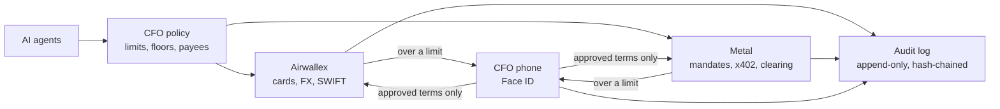

# Purser

**Your AI agents spend through Airwallex and Metal. The CFO stays in control.**

Each agent gets an Airwallex company card and a Metal on-chain mandate. The CFO sets the limits for both: card limits come from the CFO policy, and an agent's mandate changes only when
the CFO signs the new terms with Face ID. When an agent needs more, it stops and asks, and the CFO approves on a phone with Face ID.

**Who it is for:** the CFO (or controller) of a small company that runs AI agents and wants them to spend company
money only within limits the CFO sets.

**Built for the rules, not certified:** Airwallex is the regulated provider (accounts, card issuing, payouts; its KYB,
KYC and screening are its own, not shown in this repo), Metal enforces the limits on chain, and Purser holds no funds of
its own (they stay in the business's Airwallex and Metal accounts), logs every model call its agents make and keeps a
person in charge
([docs/compliance.md](docs/compliance.md)).



## For a juror

```sh
npm ci && npm run judge
```

No keys, and no network after `npm ci`; the judge step itself starts in seconds. It serves the recorded
live run, the CFO dashboard as it stood at the end, a simulated month, and the Scenario Lab (`/lab`: 18 stories,
from a normal purchase to the emergency stop, each with what should happen and what did), "How Purser uses Metal"
(`/metal`: every Metal feature Purser uses, with its testnet proof and docs link (clearing and the receive policy from separate live runs), a mandate inspector per agent, and the Dispute
desk case order by order), and opens your browser.

## Run it live

Needs a Metal testnet RPC endpoint, Airwallex sandbox keys and, optionally, an Anthropic key. Setup, commands and
the step-by-step run are in [docs/run-it.md](docs/run-it.md).

## Read more

Start here:

- [docs/metal-award.md](docs/metal-award.md): what the build uses from Metal, with proof on testnet
- [docs/airwallex.md](docs/airwallex.md): every Airwallex API Purser calls, and why
- [docs/security.md](docs/security.md): threat model, attacks and what stops each one
- [docs/controls-matrix.md](docs/controls-matrix.md): every risk, the control against it, its test and the live evidence
- [docs/runbook.md](docs/runbook.md): incidents, the emergency stop, key rotation and recovery
- [docs/ask-purser.md](docs/ask-purser.md): Ask Purser: a single-use card for one task (a flight, a hotel, a train) from one sentence: at once within the CFO's policy (up to €300, 3 a day, asked at the runner), otherwise after Face ID
- [docs/claude.md](docs/claude.md): Powered by Claude: which model does what, why, and what it costs per decision
- [docs/compliance.md](docs/compliance.md): who does what (Airwallex, Metal, Purser) for the EU AI Act, PSD2, GDPR, AML and audit
- [docs/requirements-matrix.md](docs/requirements-matrix.md): what the hackathon asks for, where Purser does it, and the proof
- [docs/decisions.md](docs/decisions.md): decisions taken during the build, and what each costs if wrong
- [docs/roadmap.md](docs/roadmap.md): from company cards for agents to the agent finance department (not built yet)
- [docs/runs/](docs/runs/): logs of live runs

The old README sections, now in docs:

- [Overview, the story, controls, where Claude is used](docs/overview.md)
- [Company cards (Airwallex Issuing)](docs/cards-and-clearing.md#company-cards-airwallex-issuing)
- [Selling by Metal clearing (prepaid, new on testnet)](docs/cards-and-clearing.md#selling-by-metal-clearing-prepaid-new-on-testnet)
- [A month in 90 seconds (simulated)](docs/cards-and-clearing.md#a-month-in-90-seconds-simulated)
- [The CFO policy](docs/cfo-policy.md), [in plain words](docs/cfo-policy.md#the-cfo-policy-in-plain-words) and
  [four eyes](docs/cfo-policy.md#four-eyes-two-people-above-a-threshold)
- [Outside agents: the agent API (MCP)](docs/agent-api.md#outside-agents-the-agent-api-mcp) and the
  [GL export for the ERP](docs/agent-api.md)
- [Invoice fraud and prompt injection](docs/fraud-and-injection.md)
- [Dashboard and phone approval with a passkey](docs/phone-approval.md)
- [Run it](docs/run-it.md)
- [Code map, tooling, credits](docs/architecture.md)

## Test money

All money here is test money: the Airwallex sandbox and Metal testnet. Simulated by the sandbox:
merchants' card charges, a SWIFT transfer's last steps (SENT, PAID), the deposit that stands in for Metal earnings at
Airwallex, and retailers' payments into the Global Accounts. *USDZ is shown as "test USD".

Built with Claude (Anthropic) as the developer, directed and reviewed by Max Geurtsen. Licence: MIT.
