<div align="center">


# Purser · AI agents spend. You sign off.

**For CFOs whose AI agents pay suppliers: when an agent wants to pay an invoice over its limit, you sign the exact terms with Face ID.**

An approval is usually a button. In Purser it's a signature over the exact terms: change one cent and it's worthless.

**[Try it in a minute.](https://kit11.max-31b.workers.dev/try)** · [Proof](https://kit11.max-31b.workers.dev/proof) · [Books](https://kit11.max-31b.workers.dev/books) · [Purser Cloud as a guest](https://purser-try.max-31b.workers.dev/) · [Connect any AI](#connect-any-ai) · **[Judge it in 3 minutes →](https://kit11.max-31b.workers.dev/judge)** · [Film, 3:58](https://youtu.be/kCUsFHrxE-o) · [Verify it offline](#verify-it-yourself-in-3-commands) · [The 60-second story](https://kit11.max-31b.workers.dev/try/sign)

[](https://github.com/agamemnon-coder/x402-business-agents/actions/workflows/ci.yml?query=branch%3Amain) [](LICENSE) [](#verify-it-yourself-in-3-commands) [](https://kit11.max-31b.workers.dev/try) 

</div>

## For reviewers in 30 seconds

**What it is:** the control layer between a company's AI agents and its money on Airwallex and Metal, built for
Starter Kit 11 (x402 Business Agents) and entered for the Metal Award and the Visa Award.
The Kit 11 scenario, run live on 3 November.\
**Try it:** on [Try](https://kit11.max-31b.workers.dev/try), a test company of your own: approve the exact terms with
your passkey, then change them: refused.\
**Verify offline:** `npm ci && npm run judge`, then `npm run verify-approval` ([three commands](#verify-it-yourself-in-3-commands)).\
**Proof:** one id per rail (Airwallex, Metal, Visa, Claude, x402) in [docs/in-depth.md](docs/in-depth.md#what-ran-live-one-id-per-rail);
every live run in [docs/runs/](docs/runs/README.md).\
**Simulated:** the customer, the supplier, the merchants' charges, the settlement and the second approver; test money
only.

<picture><source media="(max-width: 600px) and (prefers-color-scheme: dark)" srcset="docs/assets/payment-life-tall-dark.svg"><source media="(max-width: 600px)" srcset="docs/assets/payment-life-tall-light.svg"><source media="(prefers-color-scheme: dark)" srcset="docs/assets/payment-life-wide-dark.svg"></picture>

<table><tr><td width="25%"><a href="https://kit11.max-31b.workers.dev/try/sign">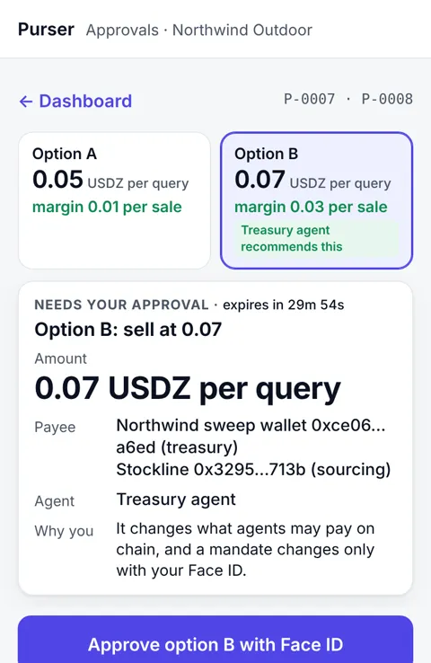</a><br><b>Approve with Face ID</b></td><td width="25%"><a href="https://kit11.max-31b.workers.dev/">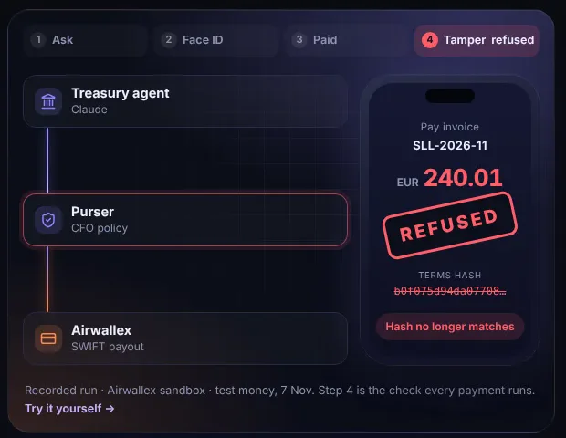</a><br><b>One cent changed, refused</b></td><td width="25%"><a href="https://kit11.max-31b.workers.dev/proof">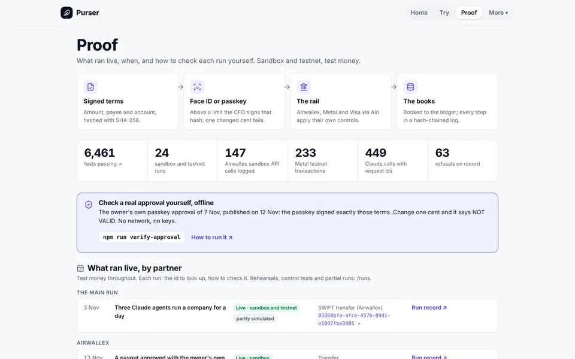</a><br><b>Proof, every id</b></td><td width="25%"><a href="https://kit11.max-31b.workers.dev/try">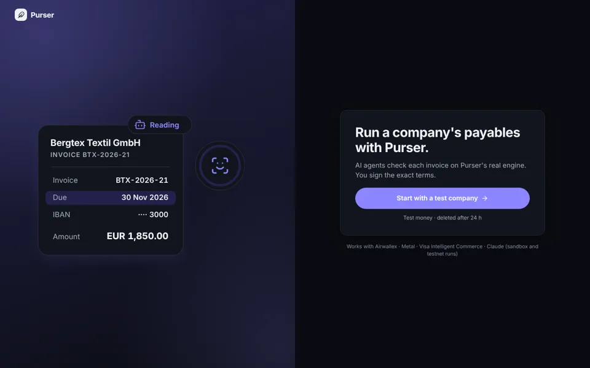</a><br><b>Hands-on, test money</b></td></tr></table>

## See it

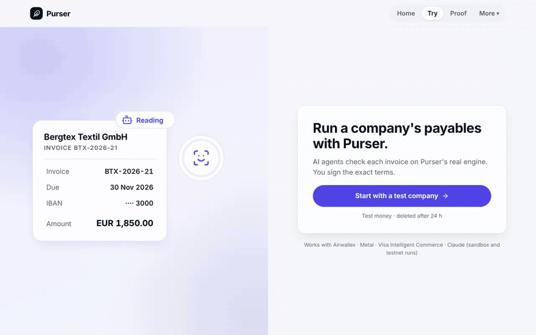
*The hands-on demo, end to end: a test company files a sample invoice, Claude reads it, Pay, the approval passkey (Chromium's virtual authenticator: a test passkey, no person or phone), paid on the simulated bank, booked and filed. Test money.* ([MP4](docs/assets/media/try-flow.mp4)) Recorded from the live sites by `npm run media:record` ([media.json](docs/assets/media/media.json)); the charts are under [Proof in numbers](#proof-in-numbers) and the diagrams under [How it works](#how-it-works-in-5-files).

<table><tr><td width="33%">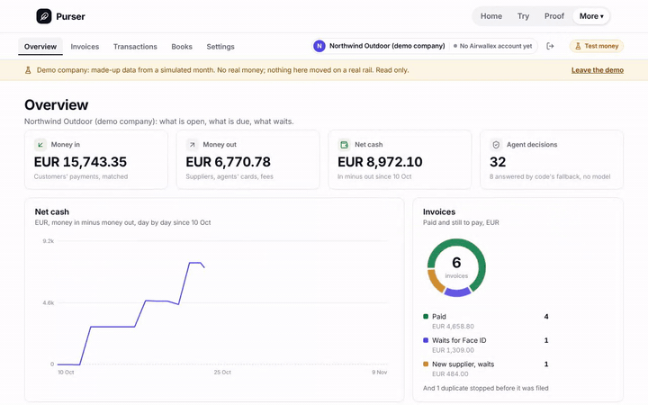</td><td width="33%">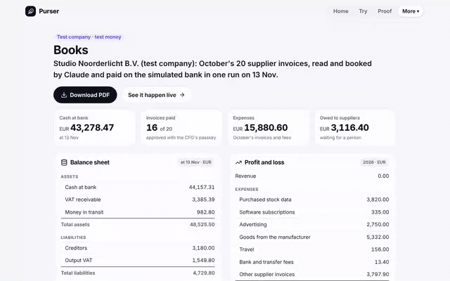</td><td width="33%">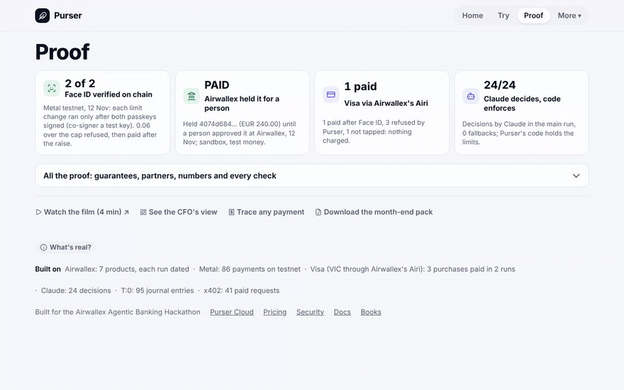</td></tr><tr><td>Purser Cloud as a guest: the demo company's dashboard (made-up data from a simulated month, test money), then its books.</td><td>kit11 /books: a test company's month, read and booked by Claude live; balance sheet, charts and the invoices sorted by Claude. Test money.</td><td>kit11 /proof: every claim with its run record.</td></tr></table>

## Try it in 2 minutes

1. **Pay an invoice yourself:** [kit11.max-31b.workers.dev/try](https://kit11.max-31b.workers.dev/try). A test company of your own; Claude reads a sample invoice, you approve the exact terms with your own passkey, it is paid on a simulated bank and booked. Change what you signed: refused.
2. **Look around a company:** [Purser Cloud as a guest](https://purser-try.max-31b.workers.dev/), then *Try as guest*: the demo company's dashboard and books, read-only, made-up data, test money.
3. **Ask your own AI:** add the remote MCP server `https://purser-try.max-31b.workers.dev/mcp` and choose the demo company (public token `purser-demo-read-only`): ask "what's waiting for the CFO?". It reads; it cannot approve or pay ([Connect any AI](#connect-any-ai)).

## Why this is a company

Not validated with customers yet: 2 finance conversations (a CFO and a bank finance professional, quoted, anonymous); more in progress; no pilots, no revenue. Every line below is a hypothesis except the cited source.

- **The problem:** when an AI agent pays today, its limit lives in a prompt it can be talked out of, or in a month-end review that finds the money after it has left. ([problem.md](docs/business/problem.md#what-goes-wrong))
- **Who buys:** the finance team of a small company or scale-up that already banks with Airwallex and lets AI agents pay; the CFO uses it and decides. ([model.md](docs/business/model.md#who-buys-and-who-uses-it-hypothesis))
- **Pilot pricing:** Starter €49 a month (100 invoices, then €0.25 each); Business from €249 a month; a small fee per payout. A hypothesis. ([model.md](docs/business/model.md#pilot-pricing-hypothesis))
- **Why now:** Airwallex wrote on 5 October 2026 that agents moving money need limits enforced "through underlying infrastructure rather than prompts" ("Agentic banking starts with governance", source S1). ([problem.md](docs/business/problem.md#why-now-sourced))
- **Why Purser:** it builds on Airwallex's own card controls and Metal's mandates, and adds what sits on top: one CFO policy for card and chain, approvals signed over the exact terms, a hash-chained audit log. ([model.md](docs/business/model.md#risks-and-what-we-do-not-know))

**Why not Airwallex's own approvals?** Purser signs the exact terms with the CFO's passkey before the API call, enforces per-agent limits across Airwallex and Metal, and can additionally require Airwallex's approval workflow (`IN_APPROVAL` handled, [src/airwallex/approvals.ts](src/airwallex/approvals.ts)). Live in the sandbox, 10 and 12 Nov: Airwallex held a payout signed by a labelled test passkey `IN_APPROVAL` until the owner approved it in Airwallex's web app; then `PAID`, settlement simulated ([run](docs/runs/2026-11-12-airwallex-two-locks-paid.md)).

## How it works in 5 files

Purser gives each AI agent of a small company its own Airwallex card and its own Metal on-chain mandate. Metal holds
each agent's on-chain budget, Airwallex holds each card's limit, Purser's code holds the rest; the CFO approves anything
beyond them, with Face ID on the exact terms.

**Claude agents propose and pay; Purser's code, Airwallex and Metal each hold a limit; above them, the CFO signs the exact terms with Face ID.**


Who holds which limit (the same three diagrams, with notes, are in [docs/diagrams.md](docs/diagrams.md)):

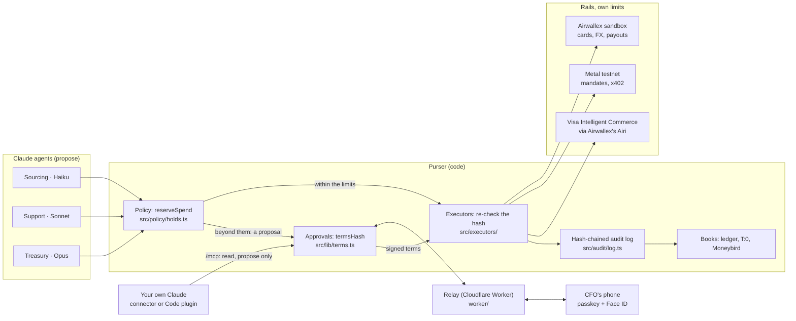

<details><summary>One payment beyond the limit, end to end</summary>

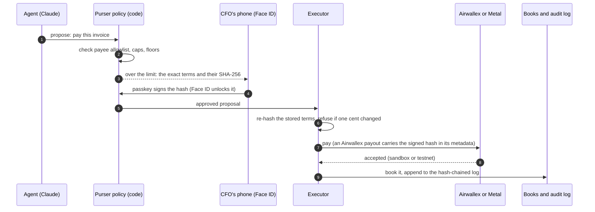

</details>

<details><summary>The mandate on Metal: bound, refused, raised, revoked (the run of 12 November; the second owner a labelled virtual test passkey)</summary>

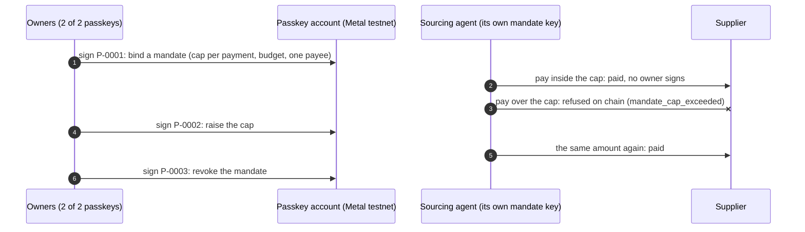

</details>

Within the limits an agent pays on its own; beyond them, nothing runs without the CFO's passkey.

<!-- worst-case -->
**Worst case, set by policy: EUR 28,200 on cards and task cards + USD 20 on chain a month.**

Task cards under a CFO-signed limit: EUR 900 a day. Everything above waits for the CFO.

<details><summary>How this is computed</summary>

- Sourcing agent: EUR 100 on its card + USD 10 on chain (test USD) a month.
- Support agent: EUR 150 on its card + USD 4 on chain (test USD) a month.
- Treasury agent: EUR 50 on its card + EUR 27,900 in task cards + USD 6 on chain (test USD) a month.
- A day: EUR 1,200 + USD 20: a card or a mandate can go in one day, task cards 3 a day.
- Counted: each card's monthly limit (card.*.monthly, EUR) and each Metal mandate's budget (test USD, *USDZ; it lasts 40 days and can all go at once). Task cards, which the Treasury agent may issue on its own within the limit the CFO signed with Face ID: up to EUR 300 each (approval.task_card_eur), 3 a day (EUR 900), 31 days a month (EUR 27,900), counted above.
- ≈ EUR 28,217.70 in all at the main run's rate of 3 Nov 2026 (1.129917 USD per EUR, docs/demo/main-run.json); test USD is never added to EUR otherwise.
- With a shared card or an API key, the limit is the card's or the account's.
- Computed from the policy by [`exposureOf`](src/policy/exposure.ts); `test/exposure.test.ts` checks this block against it.

</details>
<!-- /worst-case -->

1. **The policy.** [`reserveSpend`](src/policy/holds.ts#L63) runs before an agent's payment is signed or charged: its identity, the CFO's stops and caps, the mandate's cap and budget, the shared 20.00 total and velocity. A refusal means nothing is signed.
2. **The terms hash and the passkey.** [`termsHash`](src/lib/terms.ts#L41) is the SHA-256 of a proposal's exact terms as canonical JSON; [`verifyApprovalSignature`](src/passkey/webauthn.ts#L53) accepts a passkey's signature only if it signed that hash, with user verification (Face ID) on.
3. **The executors' hash check.** Every executor in [src/executors/](src/executors/) starts with [`beginExecution`](src/policy/approvals.ts#L246), which re-hashes the stored terms and runs nothing unless they match the approved hash, before the expiry.
4. **The Metal mandate layer.** [`payUnderMandate`](src/metal/pay.ts#L34) signs an x402 payment with the agent's own mandate key only after the caller's guard passes it (Sourcing's is `reserveSpend`); on chain, Metal refuses what is over the mandate.
5. **The audit chain.** [`audit`](src/audit/log.ts#L37) appends each event with `row_hash = SHA-256(prev_hash ‖ JCS(row))`; the database refuses UPDATE and DELETE, and `npm run verify` re-checks the chain.

### Verify it yourself in 3 commands

Needs Node.js 22.13 or later and git. `npm ci` downloads packages from npm; after that, no network and no keys.

```sh
npm ci
npm test
npm run judge -- --check
```

- `npm ci` (under a minute): installs the exact versions in the lockfile; every dependency is pinned.
- `npm test` (4 to 7 min): **6331 tests passing**, 4 skipped, in 553 files (the last full run, on commit `60df283a`: [summary](docs/assets/test-summary.json)), on stand-ins for Airwallex, Metal and Claude, every check above included. The skipped ones run only on local D1 (`npm run test:d1`).
- `npm run judge -- --check` (about 3 s): builds every page in `CHECK_PATHS` (src/cli/judge.ts) from the main run's committed record, offline, and fetches each once.
- `npm run verify-approval` (under 1 s): checks the receipt of the owner's real passkey approval of 7 November, published on 12 November, offline with Node's own crypto: the passkey signed exactly those terms; change one cent and it says NOT VALID. `npm run verify-receipt -- receipt.json` does the same for the receipt you get after signing on [/try/sign](https://kit11.max-31b.workers.dev/try/sign). Getting the receipt needs the live site and your own passkey.

CI runs these checks on every push; the CI badge at the top shows the result of the latest run on main.

## Proof in numbers

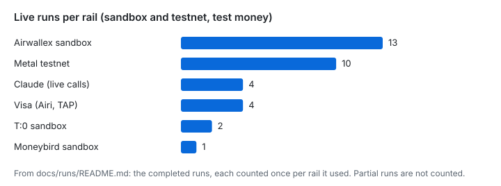 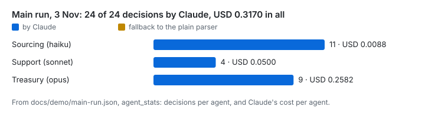
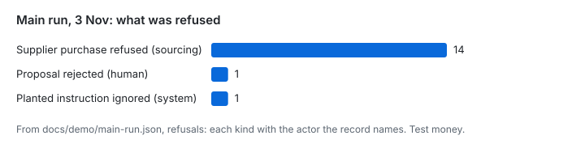 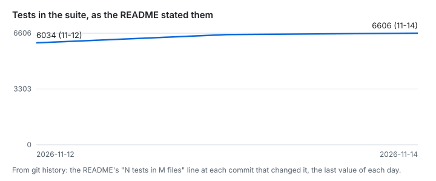

Drawn from the run records and git history by `npm run charts` (scripts/repo-charts.ts); `test/repo-charts.test.ts` redraws them. Every id behind them is on [/proof](https://kit11.max-31b.workers.dev/proof) and in [docs/runs/](docs/runs/README.md).

## Connect any AI

Use your own AI assistant with a Purser company: Claude (claude.ai, the Claude apps, Claude Code), Cursor, VS Code's agent mode, Gemini CLI, Windsurf, or any client that speaks MCP to a remote server. It reads the books and can propose an invoice's payment; **it can never approve or pay**: every payment still needs the CFO's passkey over the exact terms.

1. In Purser Cloud, Settings, Connect your AI: make a connector token (only an owner signed in with a passkey can).
2. In your AI, add the remote MCP server `https://purser-try.max-31b.workers.dev/mcp` (in Claude Code: `/plugin marketplace add agamemnon-coder/x402-business-agents` and `/plugin install purser@purser`).
3. Sign in with your token, or choose the demo company: its public, read-only token is `purser-demo-read-only` (made-up data from a simulated month, test money; it can propose nothing).

Purser shows with its own icon and offers three ready-made prompts: *CFO weekly brief*, *What needs my Face ID?* and *Explain this invoice*. Checked on 13 November 2026, 06:57 UTC: `tools/list` on that address with the demo token answers 7 read tools; the same morning the owner added it in the Claude iOS app (as the owner states it). The other clients are listed from their own documentation and have not been tried live against a deployed cloud. Every client's steps and every tool: [docs/connect-claude.md](docs/connect-claude.md).

## Built after the kit (test environment, not live)

On [/try/sign](https://kit11.max-31b.workers.dev/try/sign) the Treasury agent asks to pay one invoice above its limit and the CFO signs the exact terms with Face ID. The payables inbox below is built to do that for every supplier invoice of a small company. Its code is in this repository, not on this site: the inbox in [src/ap](src/ap), the books in [src/ledger](src/ledger), the documents in [src/vault](src/vault), the accounting links in [src/erp](src/erp), payments in other currencies in [src/payouts](src/payouts), and Purser Cloud, the console and its API, in [cloud/](cloud). It is built and tested against stand-ins and on Cloudflare's local database; on 10 November it ran once end to end in the Airwallex sandbox for three test companies (1 payout PAID, 3 refused by Airwallex: [run record](docs/runs/2026-11-10-platform-e2e.md)). Purser Cloud runs publicly as a test preview at [purser-try.max-31b.workers.dev](https://purser-try.max-31b.workers.dev/), where *Try as guest* opens a demo company read-only (made-up data from a simulated month); what is new since 8 November, the hands-on demo and Connect any AI among it, is [below](#what-changed-since-the-first-hand-in-8-nov). The product's own console deployment is another matter: that hosted preview exists but is private (behind an access key); no customer uses it, and it is not ready for real money. Its connected-account payout ran end to end in the Airwallex sandbox on 10 November: EUR 4.84 PAID on a test company's behalf (`593c340b-1752-4537-9ef2-0eb3558897cc`, settlement simulated), with Purser's EUR 0.02 fee, booked in T:0 ([run record](docs/runs/2026-11-10-platform-e2e.md)); an earlier run that morning paid EUR 5.00 with a EUR 0.05 fee (`a9460dba-f31b-4111-be58-6d9a9e71adb1`, [record](docs/runs/2026-11-10-connected-accounts-sandbox.md)). The Kit 11 build keeps Metal and x402 for the agents' own payments; the inbox pays suppliers through Airwallex payouts. Details and screenshots: [docs/after-the-kit.md](docs/after-the-kit.md).

- **Payables inbox:** supplier invoices arrive as PDF or e-mail, are read, checked (duplicates, changed bank details, totals) and booked.
- **Scanned invoices:** two independent readings must agree on IBAN, total, currency and invoice number; otherwise a person decides.
- **One Face ID for a batch:** the CFO signs a list of exact terms once; each payment still runs and is checked on its own.
- **Cloud console** with passkey sign-in, a register of every money movement, Dutch screens.
- **Six red-team rounds:** every confirmed finding fixed with a test, except one point from round 6 that is still open ([docs/go-live.md](docs/go-live.md)).
- **Airwallex connected accounts:** each customer would open its own Airwallex account through Purser; every payout and card call is checked against that company's signed account binding. Live in the sandbox since 10 November: 3 connected accounts ACTIVE; payouts with Purser's fee from the first (above, and an end-to-end run from invoice to T:0); the two newer accounts' payouts refused by Airwallex, which wants the paying company's registration number ([run record](docs/runs/2026-11-10-platform-e2e.md)).

## Who does what

 official files, unmodified, no endorsement implied ([sources](docs/assets/logos/SOURCES.md))

- **Built by Max Geurtsen** (Claude by Anthropic as the developer, directed and reviewed by Max): Purser itself: the CFO's policy and limits, the approval flow (Face ID on the exact terms,
  four eyes), the agents' tools and prompts, the relay and the site, the hash-chained audit log, the books, the tests.
- **Airwallex (sandbox):** the agents' cards and card limits, FX, the SWIFT euro payout, webhooks.
- **Metal (testnet):** the on-chain mandates and the agents' payments; it refuses what is over a mandate.
- **Claude by Anthropic:** two sets of agents. The Kit 11 agents pay for the company's own running costs (cards, x402
  on Metal), the three agents' decisions: Sourcing on Claude Haiku, Support on Claude Sonnet, Treasury on Claude Opus.
  The payables agents handle supplier invoices (Home, /try, Purser Cloud): the Reader reads an invoice, the Checker
  checks it, the Coder books account and VAT, the Payer proposes the payment; code enforces the limits and the CFO
  signs with Face ID.
- **Face ID and passkeys (WebAuthn on the CFO's phone):** the CFO's passkey, unlocked with Face ID, signs the hash of
  the exact terms.
- **Visa Intelligent Commerce via Airwallex's Airi (sandbox, test card):** an agent pays with a single-use card credential.
- **Cloudflare:** Workers and Durable Objects run the relay, the site and Purser Cloud's engine (one object per company).

## What changed since the first hand-in (8 Nov)

Every pull request since `v1.0-submission` is in [CHANGELOG.md](CHANGELOG.md); the main lines, each with its record:

- **Try, hands-on:** [/try](https://kit11.max-31b.workers.dev/try) gives you a test company of your own: Claude reads a sample invoice, you approve the exact terms with your own passkey, it is paid on a simulated bank, booked and filed ([one visit, 13 Nov](docs/runs/2026-11-13-try-sample.json)).
- **Books:** [/books](https://kit11.max-31b.workers.dev/books) is a test company's month: 20 supplier invoices read and coded by Claude, 16 paid on the simulated bank, the books balanced, the CFO's approvals by a software passkey ([record, 13 Nov](docs/runs/2026-11-13-books-month.json)). The VAT overview puts foreign VAT (a German supplier's 19%, not reclaimable in the Dutch return) on its own row (`src/ap/books.ts`, `test/vat-foreign.test.ts`).
- **Purser Cloud and Connect any AI:** a public guest console, and your own AI over MCP, read and propose only ([above](#connect-any-ai)).
- **The CFO's real Face ID at Airwallex:** on 13 Nov the owner's own iPhone approved an invoice; Purser created the SWIFT transfer once and Airwallex held it `IN_APPROVAL` for a person; its step to PAID was not done that day ([record](docs/runs/2026-11-13-airwallex-faceid.md)).
- **Metal:** a passkey account on chain (2 of 2 owners, the second a labelled virtual test passkey) bound, raised and revoked a mandate, and Metal refused a payment over the cap ([record](docs/runs/2026-11-12-faceid-onchain.md)); an invoice token minted, financed and settled, a prototype ([record](docs/runs/2026-11-12-tokenize.md)).
- **Visa via Airwallex's Airi (sandbox, test card):** a fourth live run on 13 Nov: 2 paid (1 after Face ID), 5 refused by Purser incl. reused credentials, 1 not tapped: nothing charged ([record](docs/runs/2026-11-13-vic-4.md)).
- **Books elsewhere:** Moneybird sandbox, 0 differences ([record](docs/runs/2026-11-12-moneybird-sandbox.md)); T:0, the main run's books posted ([record](docs/runs/2026-11-10-t0-journal-sandbox.md)).
- **Quality:** Firefox next to Chromium and WebKit in CI, chaos tests per partner, property tests for tokens and the bookkeeping links, and the suite's own count under [Verify it yourself](#verify-it-yourself-in-3-commands).

## Releases

[`v1.0-submission`](https://github.com/agamemnon-coder/x402-business-agents/releases/tag/v1.0-submission) (8 November) is the hackathon submission; what came after it is in [CHANGELOG.md](CHANGELOG.md), generated from git, and the next release's notes are [docs/releases/v1.1-final.md](docs/releases/v1.1-final.md).

## Links

- **Read:** [docs/in-depth.md](docs/in-depth.md) (each judging criterion, the live runs with every id, what is real and what is mock) · [docs/README.md](docs/README.md) (every doc, by reader) · [docs/diagrams.md](docs/diagrams.md) · [docs/claims.md](docs/claims.md) (every claim and its source) · [docs/runs/](docs/runs/) (every run log, dated) · [docs/controls.md](docs/controls.md) · [docs/security.md](docs/security.md)
- **Partners:** [docs/metal-award.md](docs/metal-award.md) and [docs/airwallex.md](docs/airwallex.md) (what Purser uses from each) · [The Visa TAP note](docs/submission/long-description.md#visa): built and verified against Visa's public reference verifier; not eligible Visa tooling for this hackathon (Visa, 5 Nov)
- **Run and build:** [docs/run-it.md](docs/run-it.md) (live, with sandbox keys and a Metal RPC) · [docs/payables.md](docs/payables.md) (the invoice inbox, built after the submission; code in [src/ap](src/ap)) · [skills/purser-spend/SKILL.md](skills/purser-spend/SKILL.md) (for outside agents) · [CONTRIBUTING.md](CONTRIBUTING.md) · [SECURITY.md](SECURITY.md)
- **Site:** [Hands-on demo](https://kit11.max-31b.workers.dev/try) (a test company of your own, test money) · [The replay of the main run of 3 November](https://kit11.max-31b.workers.dev/replay) (under Proof, not in the menu) · [/security](https://kit11.max-31b.workers.dev/security)
- **Submission:** [docs/submission/README.md](docs/submission/README.md) (the submission text, with the short Description) · [docs/submission/long-description.md](docs/submission/long-description.md) (the long form text it replaced, in full)

All money here is test money: the Airwallex sandbox and Metal testnet. Licence: MIT.
