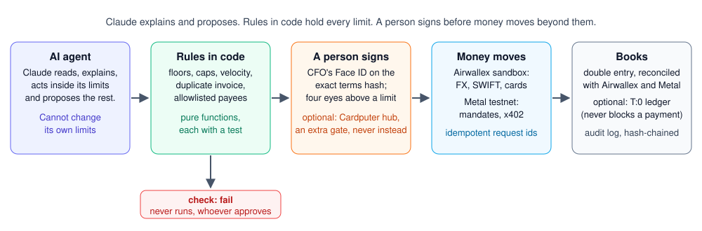
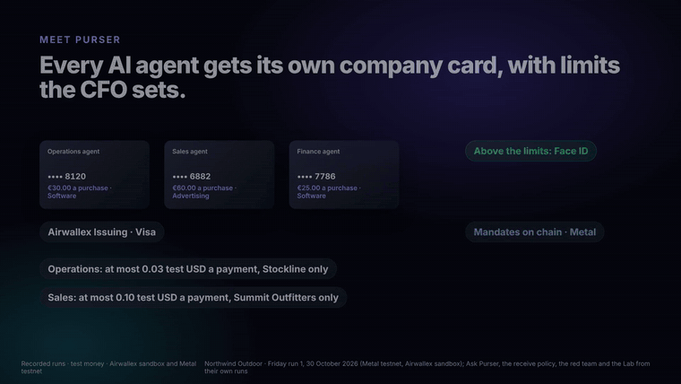
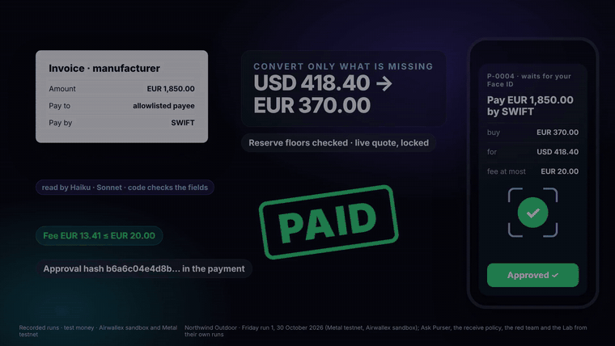

# Purser

[](https://github.com/agamemnon-coder/x402-business-agents/actions/workflows/ci.yml)

**Purser lets the CFO of a small company give its AI agents company money to spend through Airwallex and Metal, only
within limits the CFO sets in code and signs for with Face ID.**

Kit 11 · x402 Business Agents: three agents (Sourcing, Support, Treasury) on one Metal account, rebalancing when
supplier costs rise — plus Airwallex for cards, FX and the euro licence fee. Entered for the Metal Award.

**Visa TAP.** Our agents sign their card checkouts at TAP merchants with Visa's Trusted Agent Protocol. Their signatures are accepted by Visa's public TAP reference verifier (pinned commit 16d59bd). The TAP merchant in this demo is run by us. Body integrity, tag and payment checks are our own layer on top. Entered for the Visa Award (organisers confirmed one project may enter both Visa and Metal; whether TAP counts as Visa tooling is still being confirmed with Visa).

## How it works

<p align="center"></p>

An agent works inside its limits and proposes anything beyond them. Rules in code check every proposal against the CFO's
limits, and a run the rules fail never runs. A person signs the exact terms with Face ID; with the hub on, Max's
Cardputer is a second, separate yes, never a replacement for Face ID. Only then does Airwallex or Metal move money, and
every step lands in the books and the hash-chained audit log. In short: Claude explains and proposes, the rules in code
hold every limit, and a person signs before money moves beyond them. The diagram's source is
[docs/media/architecture.svg](docs/media/architecture.svg).

## Sandbox proof

**The run itself.** 3 November 2026, world `main-1`, run live against the Airwallex sandbox and Metal testnet with
real Claude decisions (24 of 24 by Claude) and the CFO's real Face ID. It ran on the frozen commit
`35e1cac` (the code the run ran on; no code
was changed during the run). Look the ids up yourself; the full log, with every step in UTC, is
[docs/runs/2026-11-03-hoofdrun.md](docs/runs/2026-11-03-hoofdrun.md). Times are UTC, from the run's ledger
([docs/demo/main-run.json](docs/demo/main-run.json)).

| What happened | Id | Time (UTC) |
|---|---|---|
| Metal refused the purchase over the mandate cap (`mandate_cap_exceeded`), recorded on chain | tx `0x2e92f9cb4549246f58b9b888881c258bf117c6233c1d8f126f4833ae6ae41871` | 11:23:33 |
| Sourcing's mandate replaced on chain after four eyes | tx `0x2a91ac97fc2a459da2b0c73f2b8020edec1901d051c7ef03bb088d36067fe790` | 11:26:59 |
| Treasury's mandate replaced on chain after four eyes | tx `0x789abb249896e01cee8e3641d7794676b6f2ce5d05f45093f6cc64101c9aebbc` | 11:26:54 |
| Earnings swept after finality; the Airwallex deposit uses the tx as its reference | tx `0x86936a5b29f9550857676fa710231af9e20882ebe6eee16f75a90af29767ccb4` (swept 11:27:23); deposit `b3812e05-2afa-4698-8f64-429f9608e0a0` (deposited 11:27:28) | 11:27:23 |
| Airwallex FX: EUR 110.00 bought for the licence shortfall | conversion `3ca88196-05da-4d88-9caa-796f03704636` | 11:31:19 |
| Airwallex SWIFT transfer: EUR 240.00 licence (fee EUR 13.42) | transfer `03360bfa-afce-457b-89d1-e1097fbe3985` | created 11:31:21, PAID 11:31:24 (6 s after Face ID) |
| Airwallex card: Packwise Pro (EUR 45.00), TAP-signed checkout, approved after the CFO raised the limit | authorization `01a1a12f-4113-7000-b76d-014677710007` | approved 11:33:07 |

**2 stopped at a limit** in the main run: Metal refused purchase #24 over the mandate cap (the tx above), and the CFO
rejected P-0004 with Face ID. Airwallex declined nothing in this run: Sourcing asked for the card raise (P-0006) first,
and the purchase was approved. Not counted: query #37, refused `mandate_revoked` while the mandate was being replaced.\
*Separate run, not counted:* Airwallex declined EUR 45.00 over the card limit (LIMIT_EXCEEDED), separate TAP run, 2 November

**How it ran.** The Airwallex sandbox keys (`AIRWALLEX_CLIENT_ID`, `AIRWALLEX_API_KEY`), the Metal testnet endpoint
(`METAL_RPC_URL`) and the Anthropic key (`KIT11_ANTHROPIC_API_KEY`) come from environment variables only. They are not
in the code, and not in the run log; the recorder that wrote the recording refuses to include a secret. The code reads the Airwallex keys in one place,
[`fromEnv` in src/airwallex/client.ts](src/airwallex/client.ts) (`grep -rn process.env src/airwallex` finds only
that), and the Metal endpoint in [`rpcUrl` in src/metal/network.ts](src/metal/network.ts). Metal wallet and mandate
key files are not environment variables: they sit in a folder outside the repository, and
[`keysDir` in src/metal/agentCli.ts](src/metal/agentCli.ts) refuses a folder inside it. Error text from Airwallex is
passed through [`redactSecrets`](src/lib/redact.ts) before it is stored.

**What is not published here.** No secret and no account id. Airwallex account ids and beneficiary ids are left out
of this page. Conversion, transfer and authorization ids and public Metal tx hashes are listed
because anyone can look them up.

**Fresh ids, the reproducible way.** `npm run smoke:sandbox` does one small FX conversion (buys EUR 10.00 with USD) and
one small SWIFT transfer (EUR 10.00) to a payee code already allowlists, then prints the conversion id, the transfer id,
the time (UTC) and the git commit, and writes them to `out/smoke-sandbox.json` (gitignored). It runs against the sandbox
only (any other base URL is refused, and this build's Airwallex client refuses production anyway), takes the keys from the
environment and never prints them, and is idempotent: both request ids are on disk before the first call, and a run that
stopped is resumed under them, each step looked up by request id first. It needs sandbox keys with write access. The ids
above stay the proof: they are from the main run itself; `smoke:sandbox` is how anyone with keys gets fresh ones
([src/smoke/sandbox.ts](src/smoke/sandbox.ts), tested on the Airwallex stand-in in
[smoke-sandbox.test.ts](test/smoke-sandbox.test.ts)).

## Guards in code

Every limit that holds money back, where it lives and which test asserts it. Numbers are in
[src/config/policy.ts](src/config/policy.ts); Claude never sets one. "No test" means no test asserts that rule
(searched, not assumed). Tests run on stand-ins for Airwallex and Metal; where the real service enforces the rule,
the row says so, and the live proof is the [sandbox run](#sandbox-proof).

| Rule | Where in code | Test |
|---|---|---|
| **EUR reserve floor, at plan.** No plan when free EUR (available minus floor, commitments and payouts under way) is below zero | [`planInvoice`](src/policy/treasury.ts) (`underfunded`); [`proposeInvoicePayment`](src/agents/euroBill.ts) escalates | [policy.test.ts](test/policy.test.ts) ("makes no plan when EUR is already below its floor plus commitments"); [euroBill.test.ts](test/euroBill.test.ts) ("escalates, and quotes nothing, when committed EUR has already been spent") |
| **EUR reserve floor, at execution.** Checked again on a fresh balance before the conversion and the payout, on a resume, and after each retry wait | [`executeInvoicePayment`](src/executors/invoicePayment.ts) (precondition, resume check, `floorReason`) | Only the check after a retry wait is tested: [contract/airwallex.test.ts](test/contract/airwallex.test.ts) ("after each wait the EUR floor is checked again"). The check before the conversion and the resume check: **no test** |
| **USD reserve floor, at plan.** A locked FX quote is used only if selling its USD keeps USD at or above the floor | [`checkQuoteAgainstFloor`](src/policy/treasury.ts), called in [`proposeInvoicePayment`](src/agents/euroBill.ts) | [policy.test.ts](test/policy.test.ts) ("escalates when the USD side would break its floor"); [euroBill.test.ts](test/euroBill.test.ts) (F4b: no conversion, no proposal) |
| **USD reserve floor, at execution.** Checked again before the conversion | [`executeInvoicePayment`](src/executors/invoicePayment.ts) ("USD would now drop under its floor") | **No test** |
| **Metal mandate cap per payment.** Metal refuses a payment over the mandate's cap on chain; Purser refuses it first | On chain: Metal (live proof: the refusal tx in [Sandbox proof](#sandbox-proof)). Purser's pre-check: [`purserRefusal`](src/policy/holds.ts) (via `mandateCapRefusal`), run first by `reserveSpend` | [holds.test.ts](test/holds.test.ts) ("refuses a payment over the mandate's cap per payment", Purser's side); [let-through.test.ts](test/let-through.test.ts) (a Metal refusal `mandate_cap_exceeded` is recorded and nothing settles; Metal is a stand-in there) |
| **CFO policy cap per payment** (`cap.<agent>`, none until the CFO sets one) | [`capRefusal`](src/policy/rules.ts) | [executors-refunds.test.ts](test/executors-refunds.test.ts) ("checks the CFO policy's per-refund limit before signing"); [policy-rules.test.ts](test/policy-rules.test.ts) |
| **Airwallex card limit per purchase** (default EUR 30.00 for Sourcing). Set on the card from the CFO policy; Airwallex itself declines the rest | [`cardLimits`](src/policy/rules.ts); [`syncOne` / `syncCards`](src/policy/cards.ts) | [cards.test.ts](test/cards.test.ts) ("syncs every card on demand": the card's limits follow the policy; the 45.00 purchase over a 30.00 limit is declined `LIMIT_EXCEEDED` by the Airwallex stand-in). The real decline is in the live record, not in a test |
| **Refunds: at most 0.10 each and 0.20 per dispute on their own**; above either, a proposal for Face ID | [`routeRefundBatch`](src/policy/refunds.ts) (shared rule in [examples/metal-dispute-desk/src/refunds.ts](examples/metal-dispute-desk/src/refunds.ts)); limits `REFUND_AUTO_*` in config, `approval.refund_each` / `approval.refund_per_dispute` in [rules.ts](src/policy/rules.ts); used by [`openDisputeCase`](src/seller/desk.ts) | [refunds.test.ts](examples/metal-dispute-desk/test/refunds.test.ts) (one refund of 0.11 and a 0.25 batch go to a person); [dispute-case.test.ts](test/dispute-case.test.ts) ("proposes a refund above the limits for Face ID": nothing paid); [policy-rules.test.ts](test/policy-rules.test.ts) |
| **Licence payout fee: EUR 20.00 ceiling.** The plan reserves it before converting; a fee above it is flagged. Airwallex does not quote the fee in advance, so a higher fee is recorded as `transfer.fee_over_ceiling`, not blocked | `SWIFT_FEE_MAX_EUR_CENTS` in config; [`planInvoice`](src/policy/treasury.ts); [`feeWithinCeiling`](src/executors/invoicePayment.ts) | [swift-fee-reserve.test.ts](test/swift-fee-reserve.test.ts) (reserve and flag); [euroBill.test.ts](test/euroBill.test.ts) ("converts only the 370.00 shortfall (fee ceiling 20.00)") |
| **Licence amount: exactly EUR 240.00.** Any other amount from the licensor waits for a person | `CONTRACTED_EUR_CENTS` in config; [`checkInvoice`](src/agents/invoice.ts) | [licence-fee.test.ts](test/licence-fee.test.ts) ("stops any other amount from the licensor for a person") |
| **Velocity, per minute and per hour.** One payment over a limit stops that agent and is not made; only Face ID lifts the stop. There is **no per-day** payment limit | [`velocityGate`](src/policy/velocity.ts) (Metal, before signing); `velocityObserve` (card, as Airwallex reports it); limits `VELOCITY` in config | [velocity.test.ts](test/velocity.test.ts) |
| **Per day: only Ask Purser's task cards.** Issued at once only if fewer than 3 in 24 hours (and within the EUR 300 threshold) | [`withinPolicy`](src/agents/askPurser.ts) | [review-oct30.test.ts](test/review-oct30.test.ts) ("issues at most 3 cards a day within the policy") |
| **Card limit per month** (default EUR 100.00 for Sourcing). Set on the card; Airwallex enforces it | [`cardLimits`](src/policy/rules.ts); [`syncOne`](src/policy/cards.ts) | [cards.test.ts](test/cards.test.ts) (a monthly change is synced to the card). That Airwallex declines over the month: not tested here, only in the live service |
| **Mandate budget (total per mandate) and the agents' shared total of 20.00** | [`budgetAndVelocity`](src/policy/holds.ts) (`budget_exceeded`, `total_budget_exceeded`); on chain, the mandate's budget | [holds.test.ts](test/holds.test.ts) ("refuses what would go over it", "keeps all agents together under the shared total") |
| **Duplicate invoice.** Refused at plan (also for a cosmetically different number), and again inside the filing transaction and before any conversion | [`invoiceAlreadyHandled`](src/agents/euroBill.ts) and `invoiceKey`; the same check as the `guard` of [`createProposal`](src/policy/approvals.ts); [`executeInvoicePayment`](src/executors/invoicePayment.ts) (another payout for the invoice) | [invoice-duplicate-key.test.ts](test/invoice-duplicate-key.test.ts); [euroBill.test.ts](test/euroBill.test.ts) (second copy, one already waiting, another payout at execution); [treasury-paid-review.test.ts](test/treasury-paid-review.test.ts) ("createProposal's guard runs inside the write", with a stub guard) |
| **Spending hold while a mandate replace is open.** No payment under a mandate that an open replace names | [`replaceHoldRefusal`](src/policy/replaceHold.ts), run by [`purserRefusal`](src/policy/holds.ts) and `holdBeyondCap` | [dry179-replace-hold.test.ts](test/dry179-replace-hold.test.ts) |
| **Four eyes.** Above the CFO's threshold (`approval.four_eyes_eur`), an invoice payment, a supplier's new bank details and a mandate replace need two different people, never the proposer. Off until the CFO sets a threshold | [`fourEyes`](src/policy/fourEyes.ts); [`decide`](src/policy/approvals.ts) | [four-eyes.test.ts](test/four-eyes.test.ts) |
| **Passkey only.** Once a passkey is enrolled, a typed hash prefix can only reject | [`decide`](src/policy/approvals.ts) | [passkey-ledger.test.ts](test/passkey-ledger.test.ts) (H1); [approvals-page.test.ts](test/approvals-page.test.ts) |
| **The hash on the terms.** A person approves the hash of the exact terms; a wrong prefix or changed terms run nothing | [`decide`](src/policy/approvals.ts); [`beginExecution`](src/policy/approvals.ts) | [approvals.test.ts](test/approvals.test.ts) ("refuses a wrong prefix", "refuses terms changed after approval") |
| **Approval expiry.** A late decision approves nothing; an approval void once the proposal expires | [`decide`](src/policy/approvals.ts), `beginExecution`, `expireDue` | [approvals.test.ts](test/approvals.test.ts) ("voids an approval once the proposal expires", F1, "expires stale proposals in one sweep") |
| **Block 6: spend moved since the proposal.** A mandate replace is refused if the agent's spend changed after it was proposed | [`executeMandateReplace`](src/executors/mandateReplace.ts) ("spent moved … a new one is needed") | [executors-mandate.test.ts](test/executors-mandate.test.ts); [dry179-sequence.test.ts](test/dry179-sequence.test.ts) |
| **No owner keys for agents.** No agent, autonomy, Claude or /try module names an owner key; the owner's on-chain act runs only from the executor after an approved proposal | [`ownerSigner`](src/executors/ownerSigner.ts); [`executeMandateReplace`](src/executors/mandateReplace.ts) | [no-owner-key.test.ts](test/no-owner-key.test.ts) |
| **Hub gate (optional, `HUB_DECISIONS_ENABLED`).** An extra gate on top of the approval, never instead of it: an approved proposal runs only when the hub says `approve` for its exact run id and Purser's check is `pass`; a run whose check is `fail` never runs; a hub `reject` closes it; an unreachable hub falls back to the Face ID approval alone, and that is recorded | [`hubGateRefusal`](src/hub/gate.ts), called in [`beginExecution`](src/policy/approvals.ts), which every executor calls; the hub is asked in [`consultHub`](src/hub/consult.ts) from [`execute`](src/executors/index.ts) | [hub-gate.test.ts](test/hub-gate.test.ts) (check fail plus approve never runs; unreachable falls back; another world's run id is ignored; flag off unchanged); [hub-push.test.ts](test/hub-push.test.ts) (no secret, IBAN, account number, address or personal data in the push) |
| **No threshold or amount in a prompt.** No agent prompt or tool description types in a number the policy holds; code passes such facts in | [src/config/policy.ts](src/config/policy.ts), [src/policy/rules.ts](src/policy/rules.ts); the prompts in src/agents, src/autonomy, src/claude | [prompt-no-thresholds.test.ts](test/prompt-no-thresholds.test.ts) (checks the static prompt text; a value interpolated from code is a code fact) |

**What needs a person (Face ID).** Anything beyond the limits above becomes a proposal; nothing moves until it is
approved, and the hash, expiry and passkey rules apply to every one of them:

- **Refund batches** over 0.10 a refund or 0.20 a dispute ([`refund_batch`](src/seller/desk.ts)).
- **Mandate replacements**, which rebalance the agents' budgets within the 20.00 total
  ([`mandate_replace`](src/agents/treasury.ts)); two people once four eyes is on.
- **Invoice payouts**, including the licence ([`invoice_payment`](src/agents/euroBill.ts)); two people above the
  four-eyes threshold.
- **Card limit raises** ([`proposeCardRaise`](src/agents/cardBuyer.ts), a `policy_change`; tested in
  [cards.test.ts](test/cards.test.ts): nothing changes until it is approved and synced).
- **Policy loosening** (a higher or removed limit, a lower floor, an unblocked payee, lifting a stop). The phone can
  only tighten; a loosening is proposed on the runner and approved with Face ID
  ([`loosens`](src/policy/rules.ts); [passkey.test.ts](test/passkey.test.ts), N2). Also:
  [`task_card`](src/agents/askPurser.ts) above the threshold, [`payee_change`](src/policy/payeeChange.ts) and
  [`owners_execute`](src/metal/ownersExecute.ts) (always two owners).

## Safety

- **Idempotent money calls.** Every Airwallex write carries a request id that is stored before the call. After a timeout
  or a lost answer, Purser looks the request id up first and adopts what it finds; it never sends blind a second time
  ([src/executors/invoicePayment.ts](src/executors/invoicePayment.ts), the `transfers` table;
  [contract/airwallex.test.ts](test/contract/airwallex.test.ts): "a lost answer, then duplicate_request_id on the resend:
  the existing transfer is adopted, paid exactly once").
- **Audit chain.** The audit log is append-only (the database refuses updates and deletes) and hash-chained: each row
  holds the hash of the one before. `npm run verify` recomputes the chain from the genesis hash and re-checks every
  passkey approval, credential and pull; `npm run verify-log` checks an exported log
  ([src/audit/log.ts](src/audit/log.ts), [src/cli/verify.ts](src/cli/verify.ts); [audit.test.ts](test/audit.test.ts)).
- **Reconciliation.** Each Airwallex transfer and card transaction and each Metal payment is checked against the ledger
  by id and amount, every hour while the runner runs; a difference is an audit row and an alarm, and nothing is fixed
  automatically (`npm run reconcile`; [reconcile.test.ts](test/reconcile.test.ts)).
- **No secrets in the repository.** Keys come from environment variables only (Airwallex, Metal, Anthropic, T:0, the
  hub); error text is passed through [`redactSecrets`](src/lib/redact.ts) before it is stored, and the hub's address
  and token are never logged.
- **Sandbox and testnet only.** The Airwallex client refuses any base URL but the sandbox; Metal runs on testnet. All
  money here is test money.
- **A person signs.** Face ID on the exact terms hash; a typed hash prefix can only reject once a passkey is enrolled;
  four eyes above the CFO's threshold. Second approver: a labelled test passkey in this demo. In production this is a
  second person.
- **Outside services never decide alone.** The hub can only add a "no": unreachable, it falls back to Face ID alone,
  recorded. T:0 gets the books after a payment, in the background: a failure is logged and the payment is not affected.

## What is real, what is mock

- **Live, in that run:** the Airwallex sandbox calls above (FX, SWIFT transfer, card authorization, the deposit), the
  Metal testnet transactions above, the Claude decisions, and the CFO's Face ID. Sandbox and testnet only: the money
  is test money. The sandbox itself simulates the last steps of the SWIFT transfer (SENT, PAID) and the merchant's
  card charge; see [Test money](#test-money).
- **Recorded, not live:** Home, Watch and Proof on the hosted site replay this recording.
- **Offline:** `npm run judge` runs the recording with no keys and no network.
- **Stand-ins:** the Scenario Lab (`/lab`) runs against stand-ins for Airwallex and Metal, not the real services.
- **Simulated:** the month in 90 seconds is a simulation, not a month of real payments.
- **Test fixtures:** the automated tests run on fixtures and stand-ins; they do not call the sandbox or testnet.
- **Built, tested on stand-ins, not yet run live:** the hub push and the hub gate (a fake hub in the tests; it waits for
  Max's hub address and token), the T:0 sink after each payment (a fake T:0; the shared T:0 sandbox key can read but
  not post, `403 CAPI71`, see [docs/runs/2026-11-03-t0-sandbox.md](docs/runs/2026-11-03-t0-sandbox.md)), and
  `npm run smoke:sandbox` (the Airwallex stand-in; our current sandbox key is read-only).

## Run it in 3 commands

```sh
npm ci            # install
npm test          # the full suite, on stand-ins: no keys, no network
npm run judge     # the recorded live run, the dashboard and the Scenario Lab, offline
```

`npm run judge` needs no keys and no network after `npm ci`. It serves the recorded live run, the CFO dashboard as it
stood at the end, a simulated month, and the Scenario Lab (`/lab`: 18 stories run against stand-ins for Airwallex and
Metal, from a normal purchase to the emergency stop, each with what should happen and what did), "How Purser uses Metal"
(`/metal`: every Metal feature Purser uses, with its testnet proof and docs link, a mandate inspector per agent, and the
Dispute desk case order by order), and opens your browser.

To run it live you need a Metal testnet RPC endpoint, Airwallex sandbox keys and, optionally, an Anthropic key: setup,
commands and the step-by-step run are in [docs/run-it.md](docs/run-it.md). The hub (`HUB_PUSH_ENABLED`,
`HUB_DECISIONS_ENABLED`, `HUB_URL`, `HUB_PUSH_TOKEN`) and T:0 (`T0_ENABLED`, `T0_API_KEY`) are optional and off by
default; see [.env.example](.env.example).

## Tests

[](https://github.com/agamemnon-coder/x402-business-agents/actions/workflows/ci.yml)

**2127 tests in 236 files, all passing** on 4 November 2026 (`npx vitest run`, our last full run before this README; CI runs
the same suite on every push). Every test runs on stand-ins for Airwallex, Metal, Anthropic, T:0 and the hub; none
calls a real service.

## The demo

**Judge tour (3 minutes)**, on the hosted site ([kit11.max-31b.workers.dev](https://kit11.max-31b.workers.dev/))
or offline with `npm ci && npm run judge` (no keys, no network). Step 2 is from the main run of 3 November, step 3 from
the recorded run of 30 October (test money):

1. **The problem:** AI agents are starting to spend company money; one shared card or wallet gives no limit per agent
   and no one place for the exceptions. ([Watch](https://kit11.max-31b.workers.dev/film))
2. **The agent asks before its card would be declined** (main run, 3 November): the Sourcing agent asked for a card
   raise first (P-0006, EUR 30.00 → 46.00), the CFO approved it with Face ID, and Airwallex approved the TAP-signed
   EUR 45.00 purchase (authorization `01a1a12f-4113-7000-b76d-014677710007`). ([the card buy](https://kit11.max-31b.workers.dev/visa))\
   *Separate run, not counted:* Airwallex declined EUR 45.00 over the card limit (LIMIT_EXCEEDED), separate TAP run, 2 November
3. **Metal refuses the higher price** against the on-chain mandate (`mandate_cap_exceeded`), and the CFO moves budget
   between the mandates within the same 20.00 with Face ID. ([the recorded run's dashboard](https://kit11.max-31b.workers.dev/?recorded))
4. **The Dispute desk checks every order:** a simulated customer (we filed for it) disputes 12 orders; each is
   checked against its signed order and the mandate on chain. All 12 hold, so nothing new is refunded. ([the evidence](https://kit11.max-31b.workers.dev/metal#dispute))
5. **Try it yourself:** type a task for an agent. ([Try it](https://kit11.max-31b.workers.dev/try))

Also: **the agents deciding by themselves** (`/?autonomy`), from agent run 1 (a rehearsal, 2 November): we changed the
world, each agent decided with real Claude calls inside its limits (38 of 38 decisions by Claude). Max's real Face ID;
the second approver is a labelled test passkey (in production a second person); test money only.

<p>
  
  
</p>

*Left: Airwallex itself declines the agent's card over its limit. Right: Metal refuses a payment over the agent's
on-chain mandate. Both from the recorded run of 30 October (test money).*

**Kit 11 (x402 Business Agents), as built.** Northwind Outdoor, an outdoor wholesaler that sells live stock data to
retailers per query: the kit's data business. (In agent run 1, 44 of the 63 sales resold data from a cache up to
300 s old, as the Sourcing agent's buy policy allowed; Thursday's main run is planned with the cache off.) Three agents
draw on one Metal account, each under its own mandate:

| Kit 11 agent | Its job in the brief | Budget when bound → after the CFO's Face ID |
|---|---|---|
| Sourcing agent | buys the upstream data per query; its card pays warehouse and data software | 10.00 → 12.00, cap 0.03 → 0.04 a purchase |
| Support agent | refunds customers when a dispute holds; its card pays helpdesk software | 4.00 |
| Treasury agent | designs the rebalance after the price rise (with the agents on, its own split, e.g. 14 / 2 / 4); the sweep to Airwallex runs on its mandate; the EUR licence fee is paid through Airwallex (FX and SWIFT, after Face ID), not from a Metal mandate. With the agents off, both are code's decisions; with the agents on, the Treasury agent decides the sweep and advises when to pay the licence. | 6.00 → 4.00 in the brief |

20.00 test USD between them, before and after, held in code (`TOTAL_BUDGET_CENTS`). Every Kit 11 sentence and where
it is done: [docs/requirements-matrix.md](docs/requirements-matrix.md) section 4.

Each agent gets an Airwallex company card and a Metal on-chain mandate. The CFO sets the limits for both: card limits come from the CFO policy, and an agent's mandate changes only when
the CFO signs the new terms with Face ID. When an agent needs more, it stops and asks, and the CFO approves on a phone with Face ID.

**Who it is for:** the CFO (or controller) of a small company that runs AI agents and wants them to spend company
money only within limits the CFO sets.

**Designed with these principles, not certified:** Airwallex is the regulated provider (accounts, card issuing, payouts; its KYB,
KYC and screening are its own, not shown in this repo), Metal enforces the limits on chain, and Purser holds no funds of
its own (they stay in the business's Airwallex and Metal accounts), logs every model call its agents make and keeps a
person in charge
([docs/compliance.md](docs/compliance.md)).

## Read more

Start here:

- [docs/metal-award.md](docs/metal-award.md): what the build uses from Metal, with proof on testnet
- [docs/airwallex.md](docs/airwallex.md): every Airwallex API Purser calls, and why
- [docs/security.md](docs/security.md): threat model, attacks and what stops each one
- [docs/controls-matrix.md](docs/controls-matrix.md): every risk, the control against it, its test and the live evidence
- [docs/runbook.md](docs/runbook.md): incidents, the emergency stop, key rotation and recovery
- [docs/ask-purser.md](docs/ask-purser.md): Ask Purser: a single-use card for one task (a flight, a hotel, a train) from one sentence: at once within the CFO's policy (up to €300, 3 a day, asked at the runner), otherwise after Face ID
- [docs/claude.md](docs/claude.md): Powered by Claude: which model does what, why, and what it costs per call and per €1,000 paid
- [docs/compliance.md](docs/compliance.md): who does what (Airwallex, Metal, Purser) for the EU AI Act, PSD2, GDPR, AML and audit
- [docs/requirements-matrix.md](docs/requirements-matrix.md): what the hackathon asks for, where Purser does it, and the proof
- [docs/decisions.md](docs/decisions.md): decisions taken during the build, and what each costs if wrong
- [docs/roadmap.md](docs/roadmap.md): from company cards for agents to the agent finance department (not built yet)
- [docs/runs/](docs/runs/): logs of live runs

The old README sections, now in docs:

- [Overview, the story, controls, where Claude is used](docs/overview.md)
- [Company cards (Airwallex Issuing)](docs/cards-and-clearing.md#company-cards-airwallex-issuing)
- [Selling by Metal clearing (prepaid, new on testnet)](docs/cards-and-clearing.md#selling-by-metal-clearing-prepaid-new-on-testnet)
- [A month in 90 seconds (simulated)](docs/cards-and-clearing.md#a-month-in-90-seconds-simulated)
- [The CFO policy](docs/cfo-policy.md), [in plain words](docs/cfo-policy.md#the-cfo-policy-in-plain-words) and
  [four eyes](docs/cfo-policy.md#four-eyes-two-people-above-a-threshold)
- [Outside agents: the agent API (MCP)](docs/agent-api.md#outside-agents-the-agent-api-mcp) and the
  [GL export for the ERP](docs/agent-api.md)
- [Invoice fraud and prompt injection](docs/fraud-and-injection.md)
- [Dashboard and phone approval with a passkey](docs/phone-approval.md)
- [Run it](docs/run-it.md)
- [Code map, tooling, credits](docs/architecture.md)

## Test money

All money here is test money: the Airwallex sandbox and Metal testnet. Simulated by the sandbox:
merchants' card charges, a SWIFT transfer's last steps (SENT, PAID), the deposit that stands in for Metal earnings at
Airwallex, and retailers' payments into the Global Accounts. *USDZ is shown as "test USD". Run by us: Summit and its
agent, and Stockline. Northwind Outdoor is the example company.

Built with Claude (Anthropic) as the developer, directed and reviewed by Max Geurtsen. Licence: MIT.
