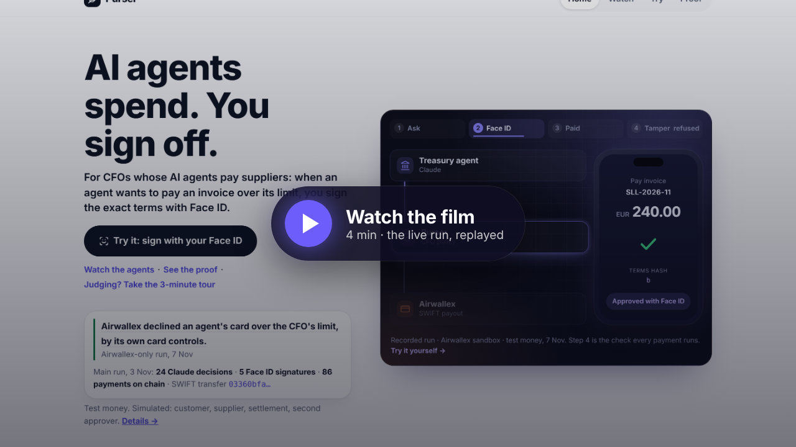
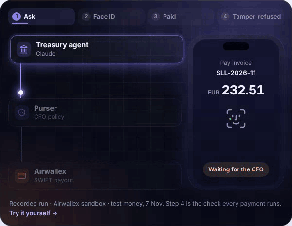
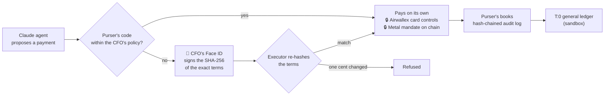

# Purser · AI agents spend. You sign off.

For CFOs whose AI agents pay suppliers: when an agent wants to pay an invoice over its limit, you sign the exact terms with Face ID.

- An approval is usually a button. In Purser it's a signature over the exact terms: change one cent and it's worthless.
- One CFO policy, a lock per rail: Airwallex card controls, Metal's mandate, the CFO's signature on invoices. A prompt is not a control.
- Real agents: Claude made all 24 decisions (routine payments are code); no key reaches Claude.

**[Try it in a minute.](https://kit11.max-31b.workers.dev/try/sign)**

[](https://github.com/agamemnon-coder/x402-business-agents/actions/workflows/ci.yml?query=branch%3Amain) [](LICENSE) [](#verify-it-yourself-in-3-commands) [](https://kit11.max-31b.workers.dev/try/sign) 

**[Judge it in 3 minutes →](https://kit11.max-31b.workers.dev/judge)**

The Kit 11 scenario, run live on 3 November, and a demo you sign yourself: **[kit11.max-31b.workers.dev](https://kit11.max-31b.workers.dev/)**.

**In three sentences.** Purser is a control layer for AI agents that spend company money: within limits the CFO sets they pay through Airwallex and Metal, and above them nothing runs until the CFO's passkey signs a SHA-256 of the exact terms, so changing one cent voids it. Live sandbox and testnet runs show it end to end: 24 Claude decisions, a SWIFT payout carrying the signed hash in Airwallex's own record, Airwallex's card controls and Metal refusing over-limit purchases, a VIC purchase via Airi, a connected-account payout with Purser's fee, and the books posted to T:0. Test money only; customers, suppliers and settlement are simulated, and the business model is not yet validated.

**Why not Airwallex's own approvals?** Purser signs the exact terms with the CFO's passkey before the API call, enforces per-agent limits across Airwallex and Metal, and can additionally require Airwallex's approval workflow (`IN_APPROVAL` handled, [src/airwallex/approvals.ts](src/airwallex/approvals.ts)). Live on 10 Nov: Airwallex held a passkey-signed payout `IN_APPROVAL` ([run](docs/runs/2026-11-10-airwallex-two-locks.md); the web-app approval was not completed).

[](https://kit11.max-31b.workers.dev/runs) [](https://kit11.max-31b.workers.dev/airwallex) [](https://kit11.max-31b.workers.dev/metal) [](https://kit11.max-31b.workers.dev/visa) [](docs/runs/2026-11-10-t0-journal-sandbox.md) [](https://kit11.max-31b.workers.dev/claude)

<table>
<tr>
<td width="50%"><a href="https://youtu.be/kCUsFHrxE-o"></a></td>
<td width="50%"></td>
</tr>
<tr>
<td align="center"><b>The film, 3:58</b> · the main run, replayed</td>
<td align="center"><b>Steps 1–3 recorded</b> (Airwallex sandbox, test money, 7 Nov) · step 4 is the check every payment runs</td>
</tr>
</table>

## For reviewers

- **What:** a control layer for AI agents that spend a company's money. Within limits set by the CFO an agent pays on its own; beyond them nothing runs until the CFO signs the exact terms with Face ID (a passkey on the phone; the server checks the signature, not which authenticator made it: attestation is not verified).
- **For:** the CFO of a small company whose AI agents pay suppliers and buy services.
- **Proofs you can check, each with its id:**
  1. Airwallex: the hash the CFO signed is in Airwallex's own record of the EUR 240.00 SWIFT payment, transfer `03360bfa-afce-457b-89d1-e1097fbe3985` (main run, 3 November; settlement simulated in the sandbox). [On the site](https://kit11.max-31b.workers.dev/airwallex#awx-hash).
  2. Airwallex's own card controls declined an agent's EUR 45.00 purchase (charge simulated via the sandbox) over its EUR 30.00 limit, `LIMIT_EXCEEDED`, card transaction `01a1b5e8-6dc2-7000-95bf-c8fc5e6e2f38` (the Airwallex-only run, 7 November). [Run log](docs/runs/2026-11-07-awx-1.md).
  3. Metal: purchase #24 over the agent's mandate refused on chain, after we switched off our own check once to test the chain: [the transaction](https://testnet.metalntwx.com/tx/0x2e92f9cb4549246f58b9b888881c258bf117c6233c1d8f126f4833ae6ae41871).
  4. Visa Intelligent Commerce through Airwallex's Airi (7 November; sandbox, test card): above the limit, PaymentIntent `int_sgpvzc9hjhnxvxc26ie` succeeded only after the CFO's Face ID. [Run log](docs/runs/2026-11-07-vic-1.md).
- **Live or simulated:** live are Claude's decisions, the Airwallex sandbox calls and the Metal testnet transactions. Simulated are the customer, the supplier, the merchants' charges, the settlement and the second approver (a labelled test passkey). Test money only.
- **Verify in two minutes:** [sign with your own Face ID](https://kit11.max-31b.workers.dev/try/sign), then try to change one cent; or offline, `npm ci && npm run judge`. A plain-text summary for tools: [llms.txt](llms.txt).

| Criterion | Where it is proven |
|---|---|
| Airwallex use | [/airwallex](https://kit11.max-31b.workers.dev/airwallex): cards per agent with the CFO policy as Airwallex's own controls, read back; Airwallex's own declines; SWIFT payouts carrying the signed hash; FX for the shortfall only. [Run log](docs/runs/2026-11-07-awx-1.md) |
| Agentic | [/watch](https://kit11.max-31b.workers.dev/watch), [/claude](https://kit11.max-31b.workers.dev/claude): three Claude agents, 24 of 24 decisions by Claude; an agent read Airwallex's decline and asked the CFO for a raise instead of retrying |
| Technical | [What Purser guarantees](https://kit11.max-31b.workers.dev/proof#guarantees), each promise with its code, its test and where it ran; [controls matrix](docs/controls-matrix.md); [verify it yourself](#verify-it-yourself-in-3-commands) |
| Finance value | [/try/sign](https://kit11.max-31b.workers.dev/try/sign); [the business case](docs/business/) (a hypothesis; 2 finance conversations, quoted, anonymous; more in progress; no customers yet) |
| Metal Award | [/metal](https://kit11.max-31b.workers.dev/metal), [docs/metal-award.md](docs/metal-award.md) |
| Visa Award | [/visa](https://kit11.max-31b.workers.dev/visa), [the Airi run's log](docs/runs/2026-11-07-vic-1.md) |
| Founder's and Judges' Choice | [/try/sign](https://kit11.max-31b.workers.dev/try/sign) in a minute; what comes next, not live: [docs/after-the-kit.md](docs/after-the-kit.md) |

## How a payment flows



## See it

<table>
<tr>
<td width="33%"><a href="https://kit11.max-31b.workers.dev/"></a><br/><b>Home</b> · the demo, Airwallex's own decline</td>
<td width="33%"><a href="https://kit11.max-31b.workers.dev/try/sign"></a><br/><b>Try</b> · sign with your own Face ID</td>
<td width="33%"><a href="https://kit11.max-31b.workers.dev/proof#guarantees"></a><br/><b>Proof</b> · each guarantee, its code, test and run</td>
</tr>
<tr>
<td width="33%"><a href="https://kit11.max-31b.workers.dev/runs"></a><br/><b>Runs</b> · every live run and its ids</td>
<td width="33%"><a href="https://kit11.max-31b.workers.dev/agents/sourcing"></a><br/><b>An agent</b> · card, mandate, every decision</td>
<td width="33%"><a href="https://kit11.max-31b.workers.dev/airwallex"></a><br/><b>Airwallex</b> · cards, declines, the signed hash</td>
</tr>
</table>

## Look here first

1. **[Try](https://kit11.max-31b.workers.dev/try/sign): sign with your own Face ID.** About a minute, in a test world of
   your own; nothing real moves. Live since 4 November 2026. Six steps and a closing card: [Try it, step by step](#try-it-step-by-step).
2. **[Watch](https://kit11.max-31b.workers.dev/watch): the agents, replayed.** A supplier doubles its price. A customer
   disputes 12 orders. A €240 bill is due in euros. Three Claude agents run a small data business on 20 test dollars
   through Metal and Airwallex; the CFO signed 5 times with Face ID. One live run, every id in
   [the main run](#the-main-run-3-november). [Film, 3:58](https://youtu.be/kCUsFHrxE-o).
3. **[Proof](https://kit11.max-31b.workers.dev/proof): every id.** The main run's, each checkable, and the
   Airwallex-only run of 7 November: accepted, every check passed ([below](#the-airwallex-only-run-awx-1-7-november-sandbox-test-money)).
4. **[The Airi run](#visa-intelligent-commerce-via-airwallexs-airi-a-live-run-7-nov): Visa Intelligent Commerce via
   Airwallex's Airi (7 November).** A scripted run, no Claude call: paid with a single-use Visa credential from Airi,
   within Purser's limit with no Purser approval (the cardholder still confirms each purchase in Airi), above it only
   after the CFO's Face ID; passed 5 of 5 checks, on the fourth attempt that day (the second in its world).
   Log: [docs/runs/2026-11-07-vic-1.md](docs/runs/2026-11-07-vic-1.md).

Starter Kit 11 · x402 Business Agents · entered for the Metal Award and the Visa Award (Visa: [the Airi run](#visa-intelligent-commerce-via-airwallexs-airi-a-live-run-7-nov), Visa Intelligent Commerce; TAP is outside the entry: [note](docs/submission/long-description.md#visa)). Northwind Outdoor,
the example company, is an outdoor wholesaler that sells live stock data to retailers per query: the kit's data business.

## How to run

Offline, with no keys. Needs Node.js 22.13 or later and git.

```sh
npm ci
npm run judge
```

`npm run judge` serves the site's pages on this computer from the main run's committed record
(http://localhost:4311) and opens the browser. The tests and the offline check:
[Verify it yourself in 3 commands](#verify-it-yourself-in-3-commands). Running it live (sandbox keys, a Metal RPC):
[docs/run-it.md](docs/run-it.md). Every doc, by reader: [docs/README.md](docs/README.md).

## The proof, one sentence per partner

- Airwallex (sandbox): the hash of the exact terms the CFO signed with Face ID is in Airwallex's own record of the EUR 240.00 SWIFT payment, and 3 of 3 agent cards carry the CFO's policy as Airwallex's own controls, read back from Airwallex. ([proof](https://kit11.max-31b.workers.dev/proof#airwallex))
- Metal (testnet): a mandate on chain per agent; 86 payments, each its own transaction; purchase #24 refused on chain (mandate_cap_exceeded); the mandates replaced on chain by the owner key after the CFO's Face ID in Purser (four eyes; second approver a labelled test passkey). ([proof](https://kit11.max-31b.workers.dev/proof#metal))
- Claude: 24 of 24 decisions in the main run, 0 fallbacks; a reliability run (rel-1) found a fault in how the agents hand off a card raise, and after the fix the eval rebuilt from that moment went from 6/10 to 10/10 and the next run (rel-1b) passed every step. ([proof](https://kit11.max-31b.workers.dev/proof#claude))
- awx-1, a separate Airwallex-only run (7 November; sandbox, test money, 0 Metal calls): accepted, all seven checks passed in one attempt. Airwallex approved and declined the agents' cards itself (`LIMIT_EXCEEDED`, `MERCHANT_CATEGORY_NOT_ALLOWED`); the Sourcing agent (Claude Haiku) read the decline and asked the CFO for a raise instead of retrying; two invoices were paid by SWIFT after the CFO's Face ID (settlement simulated in the sandbox), each carrying the signed hash in Airwallex's own metadata. ([run](#the-airwallex-only-run-awx-1-7-november-sandbox-test-money), [on the site](https://kit11.max-31b.workers.dev/airwallex#awx-1))

## How it works in 5 files

Purser gives each AI agent of a small company its own Airwallex card and its own Metal on-chain mandate. Metal holds
each agent's on-chain budget, Airwallex holds each card's limit, Purser's code holds the rest; the CFO approves anything
beyond them, with Face ID on the exact terms.

**Claude agents propose and pay; Purser's code, Airwallex and Metal each hold a limit; above them, the CFO signs the exact terms with Face ID.**


Within the limits an agent pays on its own; beyond them, nothing runs without the CFO's passkey.

<!-- worst-case -->
**Worst case, set by policy: EUR 300 on cards + USD 20 on chain a month.**

Task cards the Treasury agent may issue alone: up to EUR 900 a day. Everything above waits for the CFO.

<details><summary>How this is computed</summary>

- Sourcing agent: EUR 100 on its card + USD 10 on chain (test USD) a month.
- Support agent: EUR 150 on its card + USD 4 on chain (test USD) a month.
- Treasury agent: EUR 50 on its card + USD 6 on chain (test USD) a month.
- A day: EUR 300 + USD 20, the same as a month: neither a card nor a mandate has a daily limit.
- Counted: each card's monthly limit (card.*.monthly, EUR) and each Metal mandate's budget (test USD, *USDZ; it lasts 40 days and can all go at once). Task cards: up to EUR 300 each (approval.task_card_eur), 3 a day, not counted above.
- ≈ EUR 317.70 in all at the main run's rate of 3 Nov 2026 (1.129917 USD per EUR, docs/demo/main-run.json); test USD is never added to EUR otherwise.
- With a shared card or an API key, the limit is the card's or the account's.
- Computed from the policy by [`exposureOf`](src/policy/exposure.ts); `test/exposure.test.ts` checks this block against it.

</details>
<!-- /worst-case -->

1. **The policy.** [`reserveSpend`](src/policy/holds.ts#L63) runs before an agent's payment is signed or charged: its identity, the CFO's stops and caps, the mandate's cap and budget, the shared 20.00 total and velocity. A refusal means nothing is signed.
2. **The terms hash and the passkey.** [`termsHash`](src/lib/terms.ts#L41) is the SHA-256 of a proposal's exact terms as canonical JSON; [`verifyApprovalSignature`](src/passkey/webauthn.ts#L53) accepts a passkey's signature only if it signed that hash, with user verification (Face ID) on.
3. **The executors' hash check.** Every executor in [src/executors/](src/executors/) starts with [`beginExecution`](src/policy/approvals.ts#L246), which re-hashes the stored terms and runs nothing unless they match the approved hash, before the expiry.
4. **The Metal mandate layer.** [`payUnderMandate`](src/metal/pay.ts#L34) signs an x402 payment with the agent's own mandate key only after the caller's guard passes it (Sourcing's is `reserveSpend`); on chain, Metal refuses what is over the mandate.
5. **The audit chain.** [`audit`](src/audit/log.ts#L37) appends each event with `row_hash = SHA-256(prev_hash ‖ JCS(row))`; the database refuses UPDATE and DELETE, and `npm run verify` re-checks the chain.

### Verify it yourself in 3 commands

Needs Node.js 22.13 or later and git. `npm ci` downloads packages from npm; after that, no network and no keys.

```sh
npm ci
npm test
npm run judge -- --check
```

- `npm ci` (under a minute): installs the exact versions in the lockfile; every dependency is pinned.
- `npm test` (4 to 7 min): **3939 tests in 393 files, all passing**, on stand-ins for Airwallex, Metal and Claude, every check above included. One more test is skipped here: it runs only on local D1 (`npm run test:d1`).
- `npm run judge -- --check` (about 3 s): builds the site's 18 pages from the main run's committed record, offline, and fetches each once.
- `npm run verify-receipt -- receipt.json` (under 1 s): after you sign on [/try/sign](https://kit11.max-31b.workers.dev/try/sign), checks its receipt offline with Node's own crypto: your passkey signed exactly those terms; change one cent and it says NOT VALID. Getting the receipt needs the live site and your own passkey.

CI runs the same on every push.

## Why this is a company

Not validated with customers yet: 2 finance conversations (a CFO and a bank finance professional, quoted, anonymous); more in progress; no pilots, no revenue. Every line below is a hypothesis except the cited source.

> "At our company invoices go through a full approval process in our ERP. I think Purser is something for SMEs." — CFO at a US company (anonymous)
>
> "At the front it's automated, at the back it's a human check." (on the invoice process at their bank) — finance professional at a large Dutch bank (anonymous)

- **The problem:** when an AI agent pays today, its limit lives in a prompt it can be talked out of, or in a month-end review that finds the money after it has left. ([problem.md](docs/business/problem.md#what-goes-wrong))
- **Who buys:** the finance team of a small company or scale-up that already banks with Airwallex and lets AI agents pay; the CFO uses it and decides. ([model.md](docs/business/model.md#who-buys-and-who-uses-it-hypothesis))
- **Intended pricing:** €49 per company a month, including 5 agents and 1,500 Claude decisions; €10 per extra agent; €3 per extra 100 decisions. A hypothesis. ([model.md](docs/business/model.md#intended-pricing-hypothesis))
- **Why now:** Airwallex wrote on 5 October 2026 that agents moving money need limits enforced "through underlying infrastructure rather than prompts" ("Agentic banking starts with governance", source S1). ([problem.md](docs/business/problem.md#why-now-sourced))
- **Why Purser:** it builds on Airwallex's own card controls and Metal's mandates, and adds what sits on top: one CFO policy for card and chain, approvals signed over the exact terms, a hash-chained audit log. ([model.md](docs/business/model.md#risks-and-what-we-do-not-know))

## Built after the kit (test environment, not live)

On [/try/sign](https://kit11.max-31b.workers.dev/try/sign) the Treasury agent asks to pay one invoice above its limit and the CFO signs the exact terms with Face ID. The payables inbox below is built to do that for every supplier invoice of a small company. Its code is in this repository, not on this site: the inbox in [src/ap](src/ap), the books in [src/ledger](src/ledger), the documents in [src/vault](src/vault), the accounting links in [src/erp](src/erp), payments in other currencies in [src/payouts](src/payouts), and Purser Cloud, the console and its API, in [cloud/](cloud). It is built and tested against stand-ins and on Cloudflare's local database; on 10 November it ran once end to end in the Airwallex sandbox for three test companies (1 payout PAID, 3 refused by Airwallex: [run record](docs/runs/2026-11-10-platform-e2e.md)). A hosted preview exists but is private (behind an access key); no customer uses it, and it is not ready for real money. Its connected-account payout did run in the Airwallex sandbox on 10 November: EUR 5.00 paid on a test company's behalf (`a9460dba-f31b-4111-be58-6d9a9e71adb1`, settlement simulated), Airwallex accepting Purser's EUR 0.05 fee. The Kit 11 build keeps Metal and x402 for the agents' own payments; the inbox pays suppliers through Airwallex payouts. Details and screenshots: [docs/after-the-kit.md](docs/after-the-kit.md).

- **Payables inbox:** supplier invoices arrive as PDF or e-mail, are read, checked (duplicates, changed bank details, totals) and booked.
- **Scanned invoices:** two independent readings must agree on IBAN, total, currency and invoice number; otherwise a person decides.
- **One Face ID for a batch:** the CFO signs a list of exact terms once; each payment still runs and is checked on its own.
- **Cloud console** with passkey sign-in, a register of every money movement, Dutch screens.
- **Six red-team rounds:** every confirmed finding fixed with a test, except one point from round 6 that is still open ([docs/go-live.md](docs/go-live.md)).
- **Airwallex connected accounts:** each customer would open its own Airwallex account through Purser; every payout and card call is checked against that company's signed account binding. Live in the sandbox since 10 November: 3 connected accounts ACTIVE; payouts with Purser's fee from the first (above, and an end-to-end run from invoice to T:0); the two newer accounts' payouts refused by Airwallex, which wants the paying company's registration number ([run record](docs/runs/2026-11-10-platform-e2e.md)).

## Who does what

- **Built by Max Geurtsen:** Purser itself: the CFO's policy and limits, the approval flow (Face ID on the exact terms,
  four eyes), the agents' tools and prompts, the relay and the site, the hash-chained audit log, the books, the tests.
- **Airwallex (sandbox):** the agents' cards and card limits, FX, the SWIFT euro payout, webhooks.
- **Metal (testnet):** the on-chain mandates and the agents' payments; it refuses what is over a mandate.
- **Claude by Anthropic:** the three agents' decisions: Sourcing on Claude Haiku, Support on Claude Sonnet, Treasury
  on Claude Opus.
- **Face ID and passkeys (WebAuthn on the CFO's phone):** the CFO's passkey, unlocked with Face ID, signs the hash of
  the exact terms.

## The main run (3 November)

World `main-1`, 11:16–11:33 UTC, on the Airwallex sandbox and Metal testnet with test money, frozen commit `35e1cac`.
24 of 24 decisions by Claude (Sourcing on Haiku, Support on Sonnet, Treasury on Opus), 0 fallbacks. Max, the builder,
plays the CFO and signed with a personal passkey (Face ID on a phone). The second approval (four eyes on P-0002, 2 of 2) came from a labelled
virtual test passkey on the runner machine, pressed by our build tool, Claude Code, on the builder's go; in production the
second approver is a second person. The three runtime agents hold no owner key and no passkey, and no key reaches their
Claude models. Log: [docs/runs/2026-11-03-main-run.md](docs/runs/2026-11-03-main-run.md); record:
[docs/demo/main-run.json](docs/demo/main-run.json); replayed on [/watch](https://kit11.max-31b.workers.dev/watch).

<details><summary>The three scenes, the stops and the payments, every id</summary>

**1. The price rise** ([watch](https://kit11.max-31b.workers.dev/watch?scene=1)). Stockline went from 0.02 to 0.04 a
stock check, over the Sourcing mandate's 0.03 cap. We switched off our own check once to prove the chain holds the line:
Purser refuses an over-cap purchase before signing; with that check off for purchase #24, Metal refused it anyway; the
refusal is recorded on chain: `mandate_cap_exceeded` at 11:23:27, tx
`0x2e92f9cb4549246f58b9b888881c258bf117c6233c1d8f126f4833ae6ae41871` (11:23:33). Treasury's options came at 11:24:07,
40 s after Metal's refusal and 34 s after that tx, within the same 20.00: option A (P-0002) raises Sourcing's cap to
0.04 and keeps our price at 0.05; option B (P-0003) takes the same cap and raises our price to 0.07. The CFO signed A;
after four eyes, both mandates were replaced on chain: Treasury `0x789abb249896e01cee8e3641d7794676b6f2ce5d05f45093f6cc64101c9aebbc` (11:26:54), Sourcing
`0x2a91ac97fc2a459da2b0c73f2b8020edec1901d051c7ef03bb088d36067fe790` (11:26:59).

**2. The dispute** ([watch](https://kit11.max-31b.workers.dev/watch?scene=2)). A simulated customer disputes 12 orders,
saying its agent never placed them. Every order carries its agent's signature, so that claim fails. Three orders had
wrong data; the Support agent refunds those 3 (0.15 test USD) itself. "Refund the other 9" goes to the CFO, who rejects
it with Face ID. The refunds, #7, #10 and #13:
`0xe4bf79623f9cb9212a49ea7c0ced60d241041051f322d199e319989d6548c89d`,
`0xe44a3460faf6cb2050067bf22791df61803f8646adeb5fcc2a205d1f1afa75e5`,
`0x5099fe44b03d83f4dd3963fc59a40e2a506bee533e5a41e8f1b00a12bee14510`; P-0004 ("refund the other 9") rejected by Max
with Face ID at 11:29:37.

**3. Earnings and euros** ([watch](https://kit11.max-31b.workers.dev/watch?scene=3)). 0.69 swept after finality, tx
`0x86936a5b29f9550857676fa710231af9e20882ebe6eee16f75a90af29767ccb4`, booked at Airwallex as deposit
`b3812e05-2afa-4698-8f64-429f9608e0a0`. The Treasury agent planned the EUR 240.00 licence itself; after the CFO's
Face ID, EUR 110.00 bought by FX for USD 124.29 (conversion `3ca88196-05da-4d88-9caa-796f03704636`), then SWIFT:
transfer `03360bfa-afce-457b-89d1-e1097fbe3985`, fee EUR 13.42, accepted by Airwallex with the signed hash in its
metadata. Its settlement is simulated: in the sandbox Purser itself moves the transfer to SENT and PAID through
Airwallex's simulation API (marked PAID 11:31:24, 6 s after Face ID). The Sourcing agent
asked for a card raise first (P-0006, EUR 30.00 → 46.00), the CFO approved it with Face ID, and Airwallex approved the
TAP-signed EUR 45.00 purchase (authorization `01a1a12f-4113-7000-b76d-014677710007`).

**16 stops, nothing paid over a limit: one buy rule Claude set stopped 12 overpriced checks, Metal refused 2 purchases, the CFO rejected 1 proposal, and 1 planted instruction changed nothing.**
The buy rule's 12: stock checks #25–#36. The Sourcing agent (Claude Haiku) set its buy rule; code applied it to each
check while Stockline asked 0.04, over its 0.03 cap; nothing signed, no customer charged. Metal's 2: 1 over the mandate's cap (#24, its refusal
recorded in the tx above), 1 on a mandate that had just been replaced (#37, `mandate_revoked`, no tx of its own). The
CFO's 1: P-0004, with Face ID. The planted instruction: a line aimed at the AI inside the dispute document, treated as
data.\
*Not counted (a separate TAP run, 2 November):* Airwallex declined EUR 45.00 over the card limit (`LIMIT_EXCEEDED`).

**Payments:** 86 Metal payments + 1 card charge, all inside the limits with no approval at the time: 41 sales + 41
supplier purchases + 3 refunds + 1 sweep on Metal, and 1 card charge at Airwallex. 14 of the 55 queries got an error and were not charged. `verify` passes,
`reconcile` checked 88 with 0 differences, and every one of the 110 money movements has an origin.

</details>

| Kit 11 agent | Its job in the brief | Budget (test USD) when bound → after the CFO's Face ID |
|---|---|---|
| Sourcing agent | buys the upstream data per query; its card pays warehouse and data software | 10.00 → 14.00, cap 0.03 → 0.04 a purchase |
| Support agent | refunds customers when a dispute holds; its card pays helpdesk software | 4.00, cap 0.10 a refund |
| Treasury agent | rebalances the budgets after the price rise, sweeps earnings to Airwallex, plans the EUR licence (Airwallex FX and SWIFT, after Face ID) | 6.00 → 2.00 |

20.00 test USD between them, before and after, held in code (`TOTAL_BUDGET_CENTS`). The limits in code, each with its test:
[docs/controls.md](docs/controls.md#guards-in-code).

**Visa:** the Sourcing agent signs its card checkout with Visa's Trusted Agent Protocol (TAP), so a merchant can check
which agent is buying. Visa's public reference verifier accepted the signatures in a separate test on 2 November; the
merchant is ours.

## The Airwallex-only run, awx-1 (7 November; sandbox, test money)

A separate world, Airwallex sandbox only, test money only, 0 Metal calls; accepted, all seven checks (a–g) passed in
one attempt. The CFO signed all three proposals with Face ID on a personal phone. Log:
[docs/runs/2026-11-07-awx-1.md](docs/runs/2026-11-07-awx-1.md); record:
[docs/demo/airwallex-run.json](docs/demo/airwallex-run.json); on the site:
[/airwallex](https://kit11.max-31b.workers.dev/airwallex#awx-1).

<details><summary>Cards, declines, invoices and calls, every id</summary>

- **Cards:** 3 issued (····2441, ····4175, ····1562), each read back from Airwallex with the policy's limits, merchant
  category, EUR only and an end date.
- **Approved and declined by Airwallex:** EUR 19.99 approved (`01a1b5e8-5933-7000-94c1-0a9d4115f515`); EUR 45.00
  over the 30.00 limit declined `LIMIT_EXCEEDED` (`01a1b5e8-6dc2-7000-95bf-c8fc5e6e2f38`): the Sourcing agent (Claude
  Haiku) read the code and asked the CFO for a raise (P-0001) instead of retrying; after the CFO's Face ID the card was updated
  at Airwallex and the same 45.00 was approved (`01a1b5eb-5c54-7000-8227-1f077fc047f5`). EUR 19.99 on the Support card
  (MCC 7372 only) declined `MERCHANT_CATEGORY_NOT_ALLOWED` (`01a1b5eb-6784-7000-8bb2-ecf137506d3f`); its agent asked
  for no raise. All 4 card transactions came in by webhook (21 webhooks in all).
- **Invoices:** SLL-2026-11, EUR 240.00, paid from EUR without FX (free EUR 1,500.00 ≥ 260.00): transfer
  `738a4263-6d6c-4de8-94a3-93da1c175fb4`, PAID, fee EUR 13.50. BTX-2026-11, EUR 1,850.00 against free EUR 1,246.50:
  only EUR 623.50 bought for USD 704.45 at 1.129833 (quote `1605354b-5f6f-3ab5-8dbc-3af479c54b33`, conversion
  `fafcc208-bd1e-43d9-bd09-69191a8aa81f`, SETTLED), then transfer `4140dee2-6373-4eb4-a71f-bf69130f96a7`, PAID, fee
  EUR 13.50. Each payout carries `approval_sha256` in Airwallex's metadata; `verify` passes, `reconcile` 0 differences.
- **Calls:** 71 Airwallex API calls (run budget: 96); 14 Claude calls (0.0839 USD). Merchant charges and SENT/PAID are
  the sandbox's simulation endpoints; every approve, decline and code is Airwallex's own.

</details>


## Visa Intelligent Commerce via Airwallex's Airi: a live run (7 Nov)

A scripted run, no Claude call: paid with a single-use Visa (VIC) credential from Airi, each purchase confirmed by the
cardholder's passkey: within Purser's limit with no Purser approval, above it only after the CFO's Face ID; a
disallowed merchant was refused by Purser first. A separate world: Airwallex sandbox, test card, test money. What the
sandbox could not show: the credential is a test credential from Airi's test card; one person played both the CFO and
the cardholder; the agent's process typed the single-use number into Airwallex's hosted checkout page with a headless
browser, because the sandbox refuses a direct confirm; the merchant is our own Airwallex sandbox merchant. Passed,
[5 of 5 checks](docs/runs/2026-11-07-vic-1.md#checks-the-records-checks), on the fourth attempt that day, the second
in its world (the attempts before it are in the log). Log:
[docs/runs/2026-11-07-vic-1.md](docs/runs/2026-11-07-vic-1.md); record:
[docs/demo/airi-run.json](docs/demo/airi-run.json); on the site:
[/airwallex](https://kit11.max-31b.workers.dev/airwallex#airi-run),
[/visa](https://kit11.max-31b.workers.dev/visa#airi-run) and [/proof](https://kit11.max-31b.workers.dev/proof#airi-run).

<details><summary>The three purchases, and the control test (vic-2)</summary>

- **✓ Within the limit:** EUR 12.00 (Purser's limit: EUR 20.00). Within Purser's limit, no Purser approval is needed. Airi
  itself asks the cardholder to confirm each purchase with a passkey. PaymentIntent `int_sgpvzc9hjhnxvpblt2r`
  SUCCEEDED.
- **✓ Paid after Face ID:** EUR 45.00, above the limit, waited for the CFO's Face ID on its exact terms (P-0002); only
  then did Purser ask Airi for the credential (mandate `mdt_nlpdgv8gqhnxvxcjxbv`); the cardholder confirmed it in Airi,
  and the PaymentIntent (`int_sgpvzc9hjhnxvxc26ie`) SUCCEEDED.
- **✕ Refused by Purser:** EUR 5.00 at a merchant the CFO does not allow (`PURSER_MERCHANT_NOT_ALLOWED`), before any
  call to Airi.

**A control test of Purser's own checks, not a Visa run (vic-2, 7 Nov, 19:06–19:08 UTC).** The CFO's Face ID on a
phone, three times; 0 Airi and 0 Airwallex calls in the whole test, so nothing was bought.
[7 of 7 checks](docs/runs/2026-11-07-vic-2.md#checks); log:
[docs/runs/2026-11-07-vic-2.md](docs/runs/2026-11-07-vic-2.md); on the site:
[/visa](https://kit11.max-31b.workers.dev/visa#airi-run-2).

- **✕ Changed after Face ID: refused.** EUR 30.00, above the limit, approved with the CFO's Face ID. Our own labelled
  test then changed it to EUR 190.00 in the database; Purser refused it ("terms do not match the approved hash"), 0
  Airi calls.
- **✕ Shop locked by the CFO: refused.** The CFO blocked the test shop for Airi with Face ID (P-0002); the agent's next
  purchase, EUR 12.00, within the limit, was refused before Airi was asked (`PURSER_MERCHANT_NOT_ALLOWED`).
- **✓ Unlocked: offered again.** After the CFO's Face ID lifted the block (P-0003), the same purchase was offered on
  Airi again; the run stopped there.

</details>


## Try it, step by step

On [/try/sign](https://kit11.max-31b.workers.dev/try/sign), in a test world of your own; nothing real moves.

<details><summary>The seven steps</summary>

1. **The agent asks.** Your Treasury agent wants to pay an invoice above its limit. Claude Sonnet reads the invoice
   and Purser's code checks the reading; the terms come from that checked reading, with a live Airwallex sandbox
   quote. Claude Opus, live, advises as the Treasury agent.
2. **Signed with Face ID.** A passkey your phone or laptop makes (Face ID, Touch ID or a PIN) signs the hash of the
   exact terms, and the server checks the signature.
3. **Try to cheat.** Change one cent, the IBAN or the currency: the same signature is refused.
4. **Try to trick the agent.** Send it a fake invoice: Claude Sonnet reads it live, and Purser's code stops it.
5. **Change the rule, and see the worst case.** Let the agent pay more alone: a looser rule needs your signature, and
   the worst case in your test world is in sight.
6. **The agent pays alone.** Under the new rule, its next invoice is paid without you.
7. **The closing card.** What you did, and three ways on: the real run, a real payment traced, the code.

</details>


Then download the receipt and check it offline, with no server: `npm run verify-receipt -- receipt.json`.

**Also:** [the site](https://kit11.max-31b.workers.dev/) replays the main run; [`/try`](https://kit11.max-31b.workers.dev/try)
gives an agent a task of yours: Claude reads it, code applies the CFO's limits, no money moves.

## What is real, what is mock

- **Live, in the main run:** the Airwallex sandbox calls and Metal testnet transactions above, the Claude decisions and
  Max's passkey (Face ID on his phone). Test money only. The sandbox simulates a SWIFT transfer's last steps (SENT, PAID), the merchant's
  card charge and the deposit that stands in for Metal earnings at Airwallex.
- **On Metal testnet, checked against the chain on 5 November:** the 4 mandates bound at setup that morning and the
  2 replacements; 86 test-USD payments, each its own transaction (41 sales, 41 supplier purchases, 3 refunds, 1 sweep);
  1 refusal recorded on chain (#24, [tx](https://testnet.metalntwx.com/tx/0x2e92f9cb4549246f58b9b888881c258bf117c6233c1d8f126f4833ae6ae41871)).
  No emulator and no clearing in this run. Not on Metal: the EUR licence (FX, SWIFT) and the card buy, on the Airwallex
  sandbox; the other 13 refused purchases (12 stopped by the buy rule the Sourcing agent set, applied by code; #37, refused by Metal against
  its just-revoked mandate, with no transaction of its own) are in the ledger, not as transactions on chain.
- **Run by us:** Summit Outfitters (the customer) and its agent, Stockline (the supplier), the TAP merchant.
- **Replayed:** Home, Watch and Proof on the hosted site, and `npm run judge` offline, play the main run's record.
- **Stand-ins:** the automated tests and the Scenario Lab (`/lab`) run on stand-ins for Airwallex, Metal and Anthropic.
- **Your own test world:** `/try/sign` (live since 4 November 2026) runs each visitor's world on stand-in executors: no
  payment reaches Airwallex or Metal. Real: your passkey's signature and the server's check of it, the Airwallex sandbox
  FX quote (read-only), and the Claude agents' calls, each labelled live, or labelled as a fallback when none answered.
- **Live in the sandbox:** T:0 books: 95 journal entries posted to T:0's shared sandbox entity on 10 Nov (first je_prod_z7kTCuZ1iiwad01q); debits equal credits, and T:0 matches our books line by line ([record](docs/runs/2026-11-10-t0-journal-sandbox.md)).
- **Built, not yet live (stand-ins only):** the Cardputer hub push and gate (a fake hub in the tests), the emergency stop and `npm run smoke:sandbox`.

**Other live tests (separate worlds, dated):** awx-1, the Airwallex-only run (7 November, above), the Airi run (Visa Intelligent Commerce via Airwallex's Airi, 7 November, above;
Airwallex sandbox, test card, test money), the TAP run (2 November), four eyes on chain, the compliance contract and
clearing under load (30 October): [docs/runs/](docs/runs/) and [docs/metal-award.md](docs/metal-award.md).

## Words

<details><summary>Mandate, x402, terms hash, four eyes</summary>

- **Mandate:** an agent's on-chain spending permission on Metal: a cap per payment, a total budget, one payee, an end date.
- **x402:** HTTP 402 "Payment Required" as a payment protocol (version 2). On the mandate route the seller checks each payment before it does the work and settles it on Metal before it sends the answer. The protocol leaves the payer's budget to the payer; in Purser that is the CFO's signed limit, checked before anything is signed.
- **Terms hash:** the SHA-256 of a proposal's exact terms; the CFO's Face ID signs that hash, and nothing else runs.
- **Four eyes:** above the CFO's threshold, two approvers must each sign with their own passkey (in production two
  different people; in the main run the second was the labelled test passkey above); the proposer never approves.

</details>


## Links

- [docs/README.md](docs/README.md): every doc, grouped by reader (juror, builder, video)
- [docs/runs/](docs/runs/): every run log, dated
- [docs/controls.md](docs/controls.md): every guard in code, its test, and what needs a person
- [docs/claims.md](docs/claims.md): every claim in this repo and its source
- [docs/metal-award.md](docs/metal-award.md) and [docs/airwallex.md](docs/airwallex.md): what Purser uses from each
- [docs/payables.md](docs/payables.md): the invoice inbox, built after the submission (its code is in [src/ap](src/ap); not in the submitted run)
- [docs/security.md](docs/security.md): threat model, attacks and what stops each one
- [docs/submission/README.md](docs/submission/README.md): the submission text, with the short Description
- [docs/submission/long-description.md](docs/submission/long-description.md): the long form text it replaced, in full
- [The Visa TAP note](docs/submission/long-description.md#visa): built and verified against Visa's public reference verifier; not eligible Visa tooling for this hackathon (Visa, 5 Nov)

All money here is test money: the Airwallex sandbox and Metal testnet. Built with Claude (Anthropic) as the developer,
directed and reviewed by Max Geurtsen. Licence: MIT.
