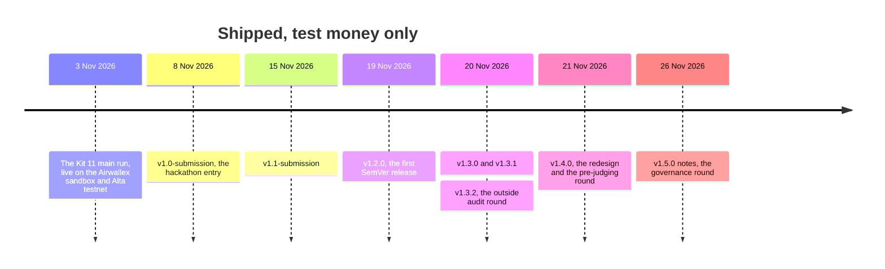
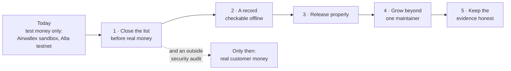

<a href="README.md"><picture><source media="(prefers-color-scheme: dark)" srcset="docs/assets/brand/purser-mark-dark.svg"></picture></a>

# Roadmap

**What Purser has shipped, what it intends to do next, and what it will not do: November 2026 to the end of 2027.**

&nbsp;&nbsp;&nbsp;&nbsp;&nbsp;

[Shipped](#shipped-so-far) · [Next](#what-the-project-intends-to-do) · [Not doing](#what-the-project-does-not-intend-to-do) · [The detail](docs/roadmap-v2.md) · [Changelog](CHANGELOG.md)

What Purser intends to do, and not do, from November 2026 to the end of 2027. It is the maintainer's intent, not a
promise of dates; the detail, layer by layer and agent by agent, is [docs/roadmap-v2.md](docs/roadmap-v2.md). Decisions
about it are taken as [GOVERNANCE.md](GOVERNANCE.md) says. Written on 19 November 2026.

> [!IMPORTANT]
> **Intent, not dates.** Nothing under "What the project intends to do" is built yet unless it says so. Everything that
> runs today runs on test money: the Airwallex sandbox and Alta (formerly Metal) testnet.

## Shipped so far

Every release since the hackathon submission, from the tags on GitHub and the notes in
[docs/releases/](docs/releases/); every merged pull request is in [CHANGELOG.md](CHANGELOG.md).

| Release | Date | What it brought | Notes |
|---|---|---|---|
| ✅ `v1.0-submission` | 8 Nov 2026 | The Kit 11 main run of 3 Nov and `/try/sign`: the entry to the Airwallex Agentic Banking Hackathon | [tag](https://github.com/agamemnon-coder/x402-business-agents/releases/tag/v1.0-submission) |
| ✅ `v1.1-submission` | 15 Nov 2026 | The release after the submission, with its new live runs | [notes](docs/releases/v1.1-submission.md) |
| ✅ `v1.2.0` | 19 Nov 2026 | Proven live, attacked on purpose, AI under control, verifiable and auditable; SemVer from here | [notes](docs/releases/v1.2.0.md) |
| ✅ `v1.3.0`, `v1.3.1` | 20 Nov 2026 | Every figure leads to its record; connect it to your own systems | [notes](docs/releases/v1.3.0.md) |
| ✅ `v1.3.2` | 20 Nov 2026 | The outside audit round: safer approvals, bugs fixed | [notes](docs/releases/v1.3.2.md) |
| ✅ `v1.4.0` | 21 Nov 2026 | The redesign and the pre-judging round | [notes](docs/releases/v1.4.0.md) |
| 📝 `v1.5.0` | 21 to 26 Nov 2026 | The governance round: the CFO's emergency stop, several legal entities, segregation of duties, a signed audit pack ([#486](https://github.com/agamemnon-coder/x402-business-agents/pull/486)); the notes are written, the tag is not on GitHub yet | [notes](docs/releases/v1.5.0.md) |

## What the project intends to do

Status: 🔜 next · 🔁 ongoing, with every release · 🙋 needs a second person to join.

1. 🔜 **Close the list before real money** ([docs/go-live.md](docs/go-live.md)) and the accepted risks in
   [docs/security.md](docs/security.md#accepted-risks-and-what-is-out-of-scope), first the two that fit a first
   customer: a signer the relay cannot serve (a native app that parses the terms itself, with hardware attestation),
   and policies compiled to code and checked for contradictions before the CFO signs them.
2. 🔜 **Make the record checkable offline**: a Merkle-tree transparency log with inclusion and consistency proofs instead
   of a linear hash chain.
3. 🔁 **Release properly**: SemVer from `v1.2.0`, signed tags, attested artefacts ([docs/releasing.md](docs/releasing.md)).
4. 🙋 **Grow beyond one maintainer**: a second maintainer with review rights ([GOVERNANCE.md](GOVERNANCE.md#how-a-second-maintainer-joins)),
   then required reviews on `main`.
5. 🔁 **Keep the evidence honest**: every figure from a run record, coverage above 80% of statements and 90% per money
   area, the OpenSSF Best Practices silver level ([docs/security/openssf-silver.md](docs/security/openssf-silver.md)).

> [!TIP]
> The six infrastructure layers behind these intents (an attested runner, a native signer, threshold signatures, a Merkle log,
> policies as code, portable mandates) and the next step for each agent are tabled in
> [docs/roadmap-v2.md](docs/roadmap-v2.md).

## What the project does not intend to do

| | Not doing | Why, and where it is said |
|---|---|---|
| ⛔ | **Move real customer money** before the list in [docs/go-live.md](docs/go-live.md) is closed and an outside security audit has been done ([docs/compliance.md](docs/compliance.md#what-a-real-launch-would-add)). | Until then: the Airwallex sandbox and Alta testnet only. |
| ⛔ | **Let an AI model approve a payment, or give a model a key.** | That is a rule of the project, not a phase ([CONTRIBUTING.md](CONTRIBUTING.md#the-rules-this-repository-keeps)). |
| ⛔ | **Translate the hackathon site** (`/try`, the landing pages) or the CLIs. | The product's pages are in Dutch and English through one catalogue ([docs/accessibility.md](docs/accessibility.md#internationalisation)); the site stays English. |
| ⛔ | **Maintain old versions in parallel.** | Fixes go to `main` and the latest release only ([docs/releasing.md](docs/releasing.md#supported-versions-and-upgrading)). |
