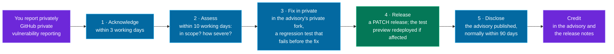
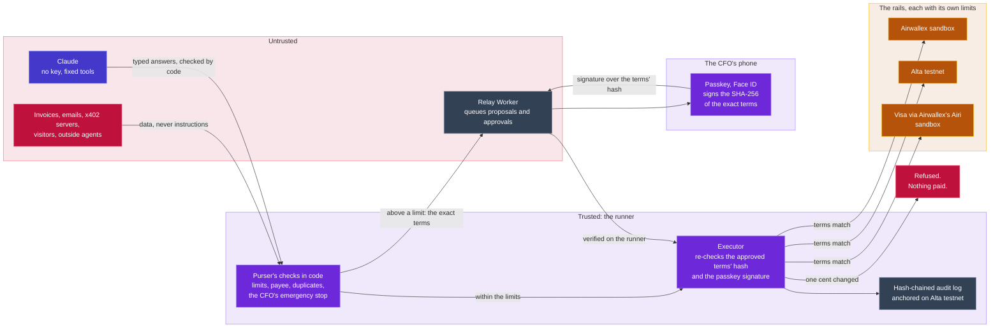

<a href="README.md"><picture><source media="(prefers-color-scheme: dark)" srcset="docs/assets/brand/purser-mark-dark.svg"></picture></a>

# Security

**How to report a vulnerability in Purser privately, how fast you hear back, and what is in scope.**

&nbsp;&nbsp;&nbsp;&nbsp;

&nbsp;&nbsp;&nbsp;&nbsp;

[Report](#reporting-a-vulnerability) · [Timeline](#disclosure-timeline) · [Handling](#how-a-report-is-handled) · [Supported versions](#supported-versions) · [Scope](#scope) · [Controls](#security-controls-at-a-glance) · [Trust boundaries](#trust-boundaries-and-the-money-path) · [Credit](#credit) · [Threat model](docs/security.md)

This is a hackathon project that only uses test money (Alta (formerly Metal) testnet, the Airwallex sandbox). Please do not test
against the hosted relay with real credentials.

> [!CAUTION]
> **Never report a vulnerability in a public issue, pull request or discussion.** Use GitHub's private form below.

## Reporting a vulnerability

Please report privately, never in a public issue, pull request or discussion.

| Channel | How |
|---|---|
| **GitHub private vulnerability reporting** (enabled on this repository; the preferred way) | https://github.com/agamemnon-coder/x402-business-agents/security/advisories/new (on the repository: Security → Advisories → Report a vulnerability). Only you and the maintainer see the report, and the fix is prepared in the advisory's private fork. |
| If you cannot use GitHub's form | Contact the maintainer through their GitHub profile, https://github.com/agamemnon-coder, and ask for a private channel; do not put the details in a public place. |
| Machine-readable | The same contact is in `/.well-known/security.txt` on the relay (https://kit11.max-31b.workers.dev/.well-known/security.txt). Published advisories: https://github.com/agamemnon-coder/x402-business-agents/security/advisories |

Please include what is affected (the route, file or commit), how to reproduce it, and what an attacker gains. Test money
only: do not use real credentials, and do not test against partners' systems (see Scope).

### Disclosure timeline

| When | What happens |
|---|---|
| Within 3 working days of the report | We acknowledge it and say who is looking at it. |
| Within 10 working days | We tell you whether it is in scope and how severe we think it is (CVSS where it helps). |
| As soon as a fix is ready | A PATCH release, and the hosted test preview redeployed if it is affected. |
| Within 90 days of the report at the latest | Coordinated public disclosure: the GitHub security advisory is published (with a CVE requested through GitHub when the issue affects users), sooner once the fix is out, at a date agreed with you. |

If we cannot fix it within 90 days, we agree a later date with you and say why in the advisory. You are free to disclose
after 90 days if we have stopped answering.

## How a report is handled

1. **Acknowledge** within 3 working days, in the advisory (or by e-mail), with who is looking at it.
2. **Assess**: reproduce it, decide whether it is in scope, and rate it (CVSS where it helps), together with the
   reporter. The reporter hears the outcome either way.
3. **Fix in private**: in the advisory's temporary private fork, with a regression test that fails before the fix
   (the test policy in [CONTRIBUTING.md](CONTRIBUTING.md#tests-come-with-the-change)). A fix that touches the money
   rules is checked against the assurance case ([docs/assurance.md](docs/assurance.md)).
4. **Release**: merge, deploy the hosted test preview if it is affected, and cut a PATCH release
   ([docs/releasing.md](docs/releasing.md)) whose notes name the advisory.
5. **Disclose**: publish the GitHub security advisory (with a CVE requested through GitHub when the issue affects
   users), normally within 90 days of the report or sooner once the fix is out, at a date agreed with the reporter.

## Supported versions

| Version | Gets security fixes |
|---|---|
| `main` | ✅ Yes |
| The latest release ([docs/releases/](docs/releases/)) | ✅ Yes ([docs/releasing.md](docs/releasing.md#supported-versions-and-upgrading)) |
| Older releases | ❌ No: upgrade to the latest release |
| The submission tags `v1.0-submission` and `v1.1-submission` | ❌ No: the hackathon submissions |

Supported: `main`. There are no other release branches. The submission tags are lightweight tags on GitHub, each naming a commit: `v1.0-submission` names `b704672c0` (8 November) and `v1.1-submission` names `a1807f2ef` (15 November, the merge of #400). An earlier annotated `v1.1-submission` tag made on the maintainer's machine named `c431a4689` (also 15 November, #358); it is not the tag on GitHub. Release tags: see [docs/releasing.md](docs/releasing.md) (only `v1.4.0` is signed).

## Scope

| ✅ In scope | ❌ Out of scope |
|---|---|
| The relay Worker (`worker/`): the site, `/try/sign`, and the relay's Durable Object that carries proposals and approvals | The partners' own systems (the Airwallex sandbox, Alta testnet, Airi, T:0, Moneybird): report those to them |
| Purser Cloud (`cloud/`): the console, its API, its engine, and the MCP server at `/mcp` (read and propose only: no tool can approve or pay) | Denial of service against the hosted test preview |
| The passkey approval flow, the policy and money executors (`src/policy`, `src/executors`), and the hash-chained audit log with its on-chain anchor (`src/audit`, `src/anchor`) | Anything that needs a real person's device or account |
| The TAP merchant layer (`src/visa`) | |

The threat model is [docs/security.md](docs/security.md); the controls are [docs/controls.md](docs/controls.md).

## Security controls at a glance

What stands between an agent and the money, and what keeps the code honest. Each badge opens the control's own
document or code; the colours are the console's: violet for Purser and the CFO's approval, green for what is checked
in CI, amber for test money.

| Control | What it does | Where |
|---|---|---|
|  | Above a limit, the CFO's passkey (Face ID) signs the SHA-256 of the exact terms; one cent changed and it no longer verifies. | [src/lib/terms.ts](src/lib/terms.ts), [src/policy/approvals.ts](src/policy/approvals.ts) |
|  | Before anything leaves for a rail, the executor checks that the stored terms still hash to what was signed. | [src/policy/hashFirst.ts](src/policy/hashFirst.ts), [src/executors/](src/executors/) |
|  | Each agent that can move money has its own key; a money-relevant request carries a signature over that exact request, and a replay is refused. | [docs/security/agent-identity.md](docs/security/agent-identity.md) |
|  | Every event goes into a hash-chained log whose head is anchored on Alta testnet. | [src/audit/log.ts](src/audit/log.ts), [src/anchor/](src/anchor/) |
|  | A release carries a CycloneDX bill of materials and Sigstore-signed attestations; releases after `v1.2.0` also carry SLSA Build Level 3 provenance. | [docs/security/README.md](docs/security/README.md#verify-a-release), [release.yml](.github/workflows/release.yml) |
|  | GitHub's code scanning on the repository. | [Code scanning](https://github.com/agamemnon-coder/x402-business-agents/actions/workflows/github-code-scanning/codeql) |
|  | gitleaks on every push and on the whole history of the commit under check. | [ci.yml](.github/workflows/ci.yml), [below](#no-secrets-in-this-repository) |
|  | The OpenSSF Scorecard workflow, and the project's OpenSSF Best Practices entry. | [scorecard.yml](.github/workflows/scorecard.yml), [bestpractices.dev](https://www.bestpractices.dev/projects/16923) |
|  | The Airwallex sandbox, Alta testnet and Visa via Airwallex's Airi (sandbox): no real money moves. | [Scope](#scope) |

## Trust boundaries and the money path

What a report is measured against: an agent's payment crosses these boundaries, and Purser's checks, the CFO's
passkey, the executor's re-check and the rails' own limits can each stop it. A summary of
the full diagram in [docs/security.md](docs/security.md#trust-boundaries), where each arrow says what crosses and what
checks it.

<picture><source media="(prefers-color-scheme: dark)" srcset="docs/assets/anim/money-path-security-dark.svg"></picture>

> [!NOTE]
> The CFO's emergency stop ran live for payments on the Airwallex sandbox on 26 November: a signed stop held a supplier
> payout at the rail with no create sent, and lifting it took the passkey (a virtual test passkey;
> [record](docs/runs/2026-11-26-stop-at-rail-live.md)). Freezing every card on a stop is tested against stand-ins only
> ([docs/claims.md](docs/claims.md)).

## Credit

Every reporter of a vulnerability that is resolved is credited by name (or handle) in the published advisory and in the
release notes, unless they ask to stay anonymous. Resolved reports, with their credit, are listed below.

| Date | Advisory | Reported by |
|---|---|---|
| (none yet) | No vulnerability has been reported through this process as of 19 November 2026. | |

The reviews and sweeps the project ran itself (the security reviews of 1, 8 and 13 November, the sweeps of
15 November) are in [docs/security.md](docs/security.md) and their tests; they were not outside reports.

## No secrets in this repository

No key, token, password or environment value is committed: gitleaks scans every push and the whole history of the
commit under check (CI job `secrets`), and its accepted false positives are listed by fingerprint, each with the reason,
in `.gitleaksignore`. Live runs read their keys from the environment or a proxy, never from a file in the repository;
`.env.example` lists variable names only. If you find a secret here, report it privately as above.

<b>Where to read more</b>

| Document | What it holds |
|---|---|
| [docs/security.md](docs/security.md) | The threat model: what we protect, the attackers and attacks, what stops each one, the accepted risks |
| [docs/controls.md](docs/controls.md) | Every control, how it works, and its evidence |
| [docs/security/README.md](docs/security/README.md) | The security artefacts: the software bill of materials, the supply-chain and static-analysis checks, how to verify a release |
| [docs/assurance.md](docs/assurance.md) | The assurance case: each invariant about money, the function that enforces it, its tests |
| [GOVERNANCE.md](GOVERNANCE.md) | Who holds the security response role |

