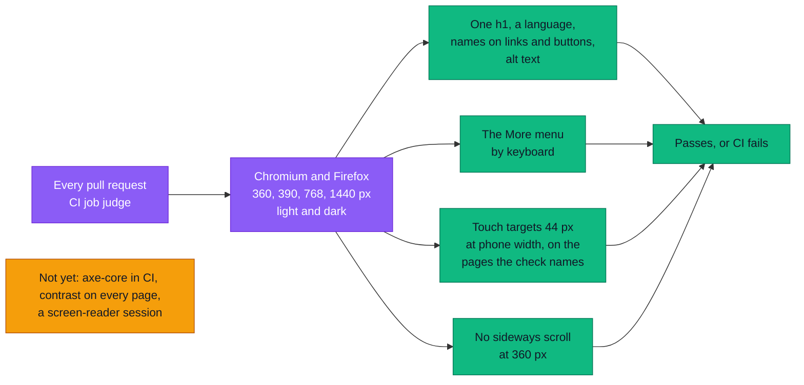

<a href="../README.md"><picture><source media="(prefers-color-scheme: dark)" srcset="assets/brand/purser-mark-dark.svg"></picture></a>

# Accessibility and internationalisation

**What Purser's pages do for people with disabilities, what is checked automatically, what is not, and where it stands on languages.**

&nbsp;&nbsp;&nbsp;&nbsp;&nbsp;

[Accessibility](#accessibility) · [Internationalisation](#internationalisation) · [Report a problem](../.github/ISSUE_TEMPLATE/bug_report.md)

What Purser's pages do for people with disabilities, what is checked automatically, what is not, and where Purser
stands on languages and locales. Written on 19 November 2026; it states what is in the code and the checks, and names
the gaps.

## Accessibility

**The target** is WCAG 2.1 level AA for the hosted pages (the site, `/try`, `/try/sign`, the CFO's phone pages) and
Purser Cloud's console. Nobody has audited Purser against it: the checks below are the project's own.

What the pages do, and what checks it on every pull request (CI job `judge`, [ci.yml](../.github/workflows/ci.yml)):

- **Structure a screen reader can follow:** every page declares its language (`<html lang="en">`) and has exactly one
  `h1`; every link and button has an accessible name; every image has alt text (decorative ones an empty `alt`); the
  main navigation is a `nav` with a label. Checked in Chromium and Firefox at 360, 390, 768 and 1440 px, light and dark
  ([test/browser/pages.check.ts](../test/browser/pages.check.ts)); a page that fails any of these fails CI.
- **Keyboard:** the navigation's "More" menu needs no script and works from the keyboard (Tab reaches it, Enter opens
  it, focus moves into the menu); the same browser check drives it by keyboard. Approving uses the platform's own passkey
  sheet (Face ID, Touch ID, Windows Hello, a security key), which brings its own accessibility.
- **Touch targets:** links and buttons in a page's main content are at least 44 px tall at phone width (checked in the
  same browser check, on the pages it names).
- **Colour is not the only signal:** a refused or held payment says so in words ("Refused", the reason, the rule), not
  only by colour; amounts, statuses and outcomes are text.
- **Contrast and themes:** the guest pages have a light and a dark theme from the system setting; the browser checks
  render both. The film's subtitles and overlay text are held to WCAG AA contrast by a test (`test/premiere.test.ts`).
- **Motion:** animations stop or shorten under `prefers-reduced-motion` (asserted in `test/try-page.test.ts`,
  `test/try-sign-motion.test.ts`, `test/visuals.test.ts` and others).
- **Phones:** no page scrolls sideways at 360 px; the browser checks fail on any page wider than the screen.

Not done yet: no audit with a full automated rule set (such as axe-core) runs in CI, contrast is checked for the film
but not for every page, and no test session with a screen reader (VoiceOver, NVDA, TalkBack) has been recorded. An
accessibility problem is a bug: report it as an issue ([bug report](../.github/ISSUE_TEMPLATE/bug_report.md)).

## Internationalisation

**The product is internationalised; the hackathon site is not.**

- **One message catalogue for the product's pages**, in Dutch (the default) and English: the local payables pages, the
  transactions page, the CFO's phone pages and Purser Cloud's console read every word a person sees from
  [src/ui/i18n.ts](../src/ui/i18n.ts). Every key exists in both languages: the type system holds that at compile time,
  and `test/i18n.test.ts` and `test/i18n-keys-used.test.ts` hold it at run time, together with "no English left in
  the words of a Dutch page". Adding a language means a third catalogue and its code in the `Lang`
  type, not changes to the pages.
- **Language choice:** a person's own language (on their account), else the company's, else a choice kept in the
  browser; Cloud's API takes `POST /v1/me/language` and the company's `language` ([cloud.md](cloud.md)). The API itself
  stays English and keeps its codes; only what a person reads changes.
- **Amounts and dates in the reader's locale:** `fmtMoney`, `fmtAmount` and `fmtDay` in the catalogue write Dutch amounts
  and dates on a Dutch page (`€ 1.850,00`) and English ones on an English page. In code, money is integer minor units
  with ISO 4217 currency codes; dates are stored and exchanged as ISO 8601 in UTC; payments export as ISO 20022
  (`npm run iso20022`).
- **Documents from other countries:** the sample invoices include Dutch and German number formats and German VAT, and
  the tests read them. Text is UTF-8 throughout.

**Not internationalised:** the hackathon site (`src/redesign`, `/try`, `/try/sign`) and the CLIs are English only,
their text in the code. That is said in the catalogue's own header and is not planned to change.
