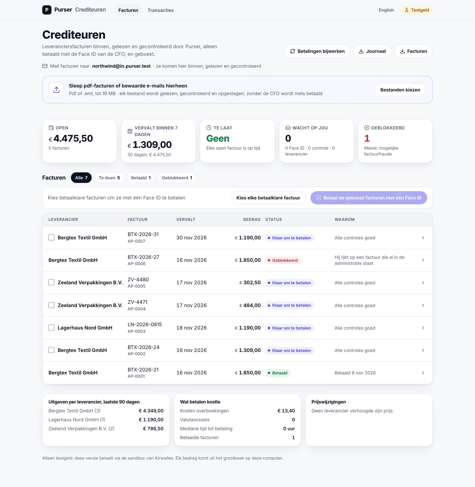
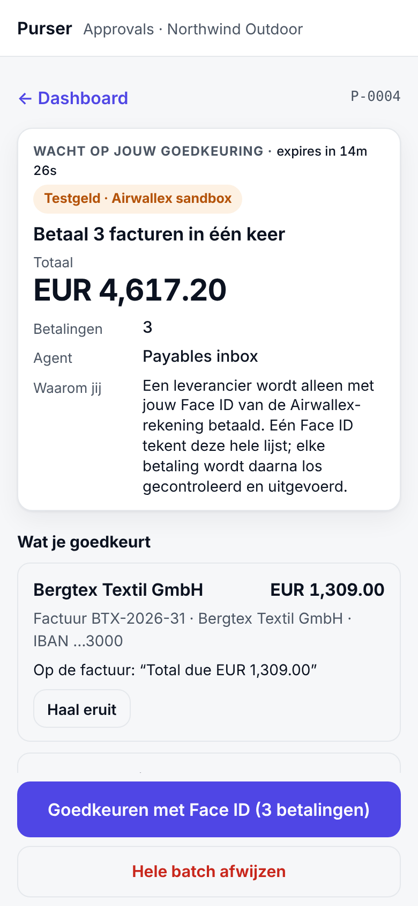
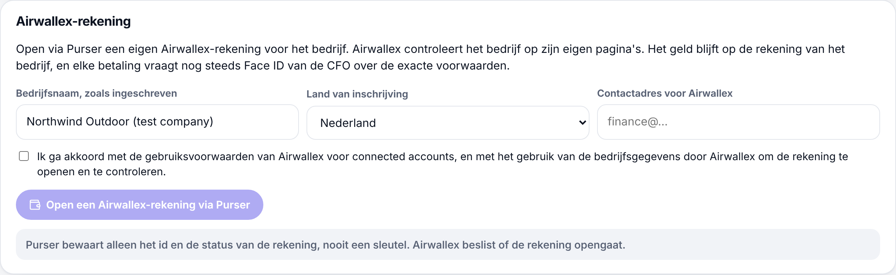

# Built after the kit

On [/try/sign](https://kit11.max-31b.workers.dev/try/sign) the Treasury agent asks to pay one invoice above its limit,
and the CFO signs the exact terms with Face ID. The payables inbox is built to do the same for every supplier invoice of
a small company: the same control, the CFO's Face ID over the exact terms, applied to accounts payable.

Why small companies is a hypothesis, not validated with customers yet: 2 finance conversations so far (a CFO and a
finance professional at a bank, both anonymous); more in progress.

Where it stands: work in progress, built and tested against **stand-ins** for Airwallex and Claude and on Cloudflare's
local database. Its connected-account payout path ran once in Airwallex's sandbox on 10 November, and later that day
the inbox ran end to end for three test companies: 1 payout PAID, 3 refused by Airwallex (below;
[run record](runs/2026-11-10-platform-e2e.md)). Purser Cloud runs publicly as a test preview at purser-try.max-31b.workers.dev/try: test companies, test money on a simulated bank. Its console's hosted preview exists but is **private** (behind an access key); no
customer uses it, and it is **not ready for real money** ([what is missing](go-live.md)). None of it is part of the
Kit 11 runs described in the README. The Kit 11 build keeps Metal and x402 for the agents' own payments; the inbox
pays suppliers through Airwallex payouts.

Where the code is: in this repository. The owner decided on 12 November to merge it now, so the jury can read it
([decisions.md](decisions.md), D29).

| Part | Code | Its page |
|---|---|---|
| The inbox: reading, checks, paying | `src/ap` | [payables.md](payables.md) |
| The books | `src/ledger` | [ledger.md](ledger.md) |
| The documents | `src/vault` | [vault.md](vault.md) |
| The accounting links | `src/erp` | [erp.md](erp.md) |
| Payments in other currencies | `src/payouts` | [payables.md](payables.md#paying-suppliers-abroad) |
| Purser Cloud: the console and its API | `cloud/` | [cloud.md](cloud.md) |

## What exists

| Part | What it does | Status |
|---|---|---|
| Payables inbox | Supplier invoices arrive as PDF or e-mail (own inbox address per company), are read, checked and filed. Checks: duplicate number in any notation, changed bank details, totals that do not add up, unknown supplier, unusual amount, credit notes netted only after a person accepts them. | Built, tested against stand-ins |
| Scanned invoices | A PDF without text or a photo is read twice by Claude. Only when both readings agree on IBAN, total, currency and invoice number (and the IBAN checksum holds) can it be paid; otherwise a person checks each field next to the crop it came from. Text on the scan is data: it never changes who is paid. | Built, tested against a stand-in model; not yet run against the live model |
| One Face ID for a batch | The CFO signs one list of exact payment terms. One changed line refuses the whole batch; each payment then runs and is checked on its own, so a failed line never pays another twice. | Built, tested against a stand-in Airwallex |
| Payments in any currency | Through Airwallex payouts, with FX only for the shortfall and fees booked. | Built, tested against a stand-in Airwallex |
| Bookkeeping | Hash-chained ledger, period closing, Dutch VAT overview, a register of every money movement with its approval, booking and proof. | Built, tested |
| Cloud console | Passkey sign-in (no passwords), onboarding, invoices, transactions, books, people and API keys, GDPR export. It never pays: payments are approved on the phone. Dutch and English. | Built, tested locally on Cloudflare's local D1; the hosted preview is private (behind an access key) |
| Security | Six red-team rounds on the payables and cloud code. Every confirmed finding is fixed and covered by a test, except one point from round 6 that is still open: in this build the runner still holds the platform key ([go-live.md](go-live.md), "Platform on-behalf-of through a Purser-held service"). | Ongoing |

## Airwallex connected accounts: run in the sandbox on 10 November

Purser as an Airwallex platform: each customer opens its own Airwallex account through Purser (a connected account),
Purser pays that customer's suppliers from it, and every payout is still approved by the CFO's Face ID over the exact
terms. Purser keeps only the account id and status, never a key. Before every payout and every card call (create,
limits, controls, status, transactions), Purser checks a signed binding between the company and its Airwallex account;
a different, dormant, closed or expired account is refused and nothing reaches Airwallex.

Airwallex enabled connected accounts on our sandbox on 10 November. What ran there, with test data and test money
([run record](runs/2026-11-10-connected-accounts-sandbox.md), 17 calls):

| Step | Airwallex's answer |
|---|---|
| Purser opens a connected account for a fake Dutch test company | `acct_SC-QD89fOneAeqaRFgOymw`, `CREATED` |
| Verification details (fake, a non-registered sole trader), submitted | `SUBMITTED`; then `ACTIVE` through the sandbox's simulation (no real verification) |
| The platform funds it with EUR 20.00 | `tr_oZIJlT2oNQ2OX33f83UCag` |
| A EUR 5.00 payout on the company's behalf (`x-on-behalf-of`) through Purser's payout code, **Purser's fee sent as `application_fee_options`** | `a9460dba-f31b-4111-be58-6d9a9e71adb1`, `SCHEDULED`; **application fee accepted at exactly EUR 0.05** |
| Settlement | `SENT`, then `PAID` through the sandbox's simulation API (simulated) |

Not shown by this run: the CFO's Face ID on this payout (the run called Purser's payout code directly with a test
approval hash; the Face ID flow itself is the one on /try/sign), the live (non-simulated) settlement, and Airwallex's
web-app approval workflow, which can be switched on as a second lock (a payout then waits `IN_APPROVAL`).

### Later on 10 November: three test companies end to end

Purser ran end to end in the sandbox for three fictional companies, each on its own connected account
([run record](runs/2026-11-10-platform-e2e.md)):

- **Accounts:** **3 connected accounts ACTIVE**. Two were opened in the run: `acct_O07lI0VvMLagXlj5aeOgyg` and
  `acct_XFhJLpkwNp6lzl8rpySE_Q`, each funded with EUR 60.00 of test money.
- **Invoices:** four came in by upload or e-mail and were read by Claude. New suppliers were created on SEPA. Approvals
  were signed with a test passkey, not Face ID.
- **Paid:** one EUR 4.84 payout went **PAID** on the company's behalf (`593c340b-1752-4537-9ef2-0eb3558897cc`), with
  **Purser's EUR 0.02 fee taken** (simulated settlement). It was booked, posted to T:0 (`je_prod_wop0vx1B8xOmHQl0`,
  `je_prod_WN96JsvKXGCY7mYs`, converted at Airwallex's sandbox rate), and its receipt verifies offline.
- **Refused by Airwallex:** the payouts from the two new accounts. Airwallex requires the paying company's
  registration number (they were opened as non-registered sole traders) and refuses a `payer` object on the transfer
  (`payer`, code 048). Next: open such companies as registered sole traders.

**Pilot pricing: Starter €49 a month (100 invoices, then €0.25 each); Business from €249 a month; a small fee per payout.**
One model, a hypothesis: pilot prices, nothing is on sale and no customer has seen a price
([docs/business/model.md](business/model.md#pilot-pricing-hypothesis), [/pricing](https://kit11.max-31b.workers.dev/pricing)).

The fee is a percentage of each payout: the CFO signs the rate in the policy, and code keeps it at or under 1.00%, rounds it to the cent and sends it to Airwallex as a fixed amount. The two sandbox runs used test values, not prices: EUR 0.05 on EUR 5.00 (1.00%, a fixed test fee set for that run) and EUR 0.02 on EUR 4.84 (the test policy's 0.50%, rounded to the cent).

## Screenshots (test company, stand-ins, test money)

The screens are in Dutch, the default for a Dutch company; English is one click away.

| | |
|---|---|
|  |  |
| Payables inbox: what is open, due, blocked and why. | One Face ID for three invoices, with the account paid from and Purser's fee per line. On a stand-in Airwallex (the connected-account payout itself ran in the sandbox, above). |
|  | |
| Opening the company's own Airwallex account through Purser (test company). | |
