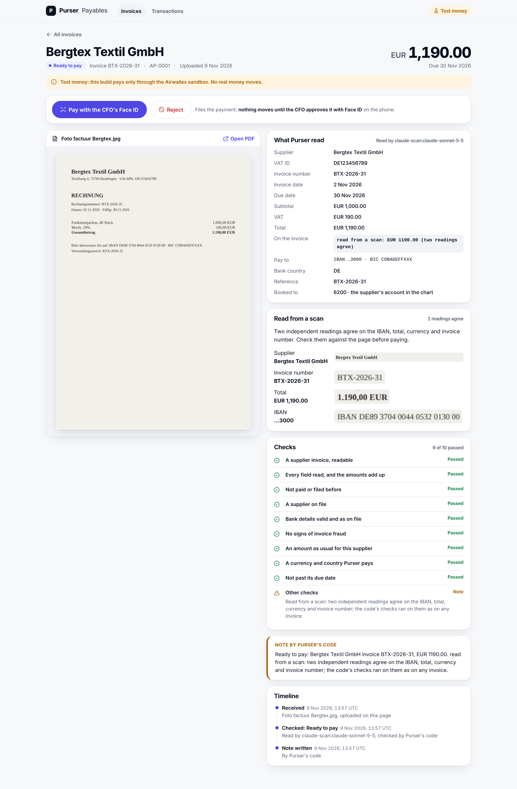
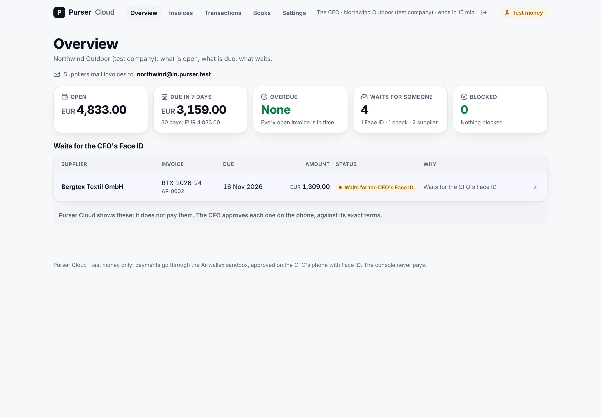

# Built after the kit

After the hackathon submission, Purser's rule (nothing is paid unless the CFO signed the exact terms) was applied to a
second problem: paying supplier invoices in a small company. This is work in progress on a separate branch. It runs on
the Airwallex sandbox with **test money**, it is **not deployed**, and no customer uses it. None of it is part of the
Kit 11 runs described in the README.

## What exists

| Part | What it does | Status |
|---|---|---|
| Payables inbox | Supplier invoices arrive as PDF or e-mail (own inbox address per company), are read, checked and filed. Checks: duplicate number in any notation, changed bank details, totals that do not add up, unknown supplier, unusual amount, credit notes netted only after a person accepts them. | Built, tested, sandbox |
| Scanned invoices | A PDF without text or a photo is read twice by Claude. Only when both readings agree on IBAN, total, currency and invoice number (and the IBAN checksum holds) can it be paid; otherwise a person checks each field next to the crop it came from. Text on the scan is data: it never changes who is paid. | Built, tested against a stand-in model; not yet run against the live model |
| One Face ID for a batch | The CFO signs one list of exact payment terms. One changed line refuses the whole batch; each payment then runs and is checked on its own, so a failed line never pays another twice. | Built, tested, sandbox |
| Payments in any currency | Through Airwallex payouts, with FX only for the shortfall and fees booked. | Built, tested, sandbox |
| Bookkeeping | Hash-chained ledger, period closing, Dutch VAT overview, a register of every money movement with its approval, booking and proof. | Built, tested |
| Cloud console | Passkey sign-in (no passwords), onboarding, invoices, transactions, books, people and API keys, GDPR export. It never pays: payments are approved on the phone. Dutch and English. | Built, tested locally on Cloudflare's local D1; not deployed |
| Security | Five red-team rounds on the payables and cloud code; every confirmed finding fixed and covered by a test. | Ongoing |

## Planned: Airwallex connected accounts

Purser as an Airwallex platform: each customer gets its own Airwallex account through Purser (a connected account),
Purser pays that customer's suppliers from it, and every payout is still approved by the CFO's Face ID over the
exact terms. Connected accounts are not enabled for our sandbox yet (a test call on 9 November was refused); until Airwallex enables them, this is a plan,
not a feature.

## Screenshots (test data, test money)

| | |
|---|---|
|  |  |
|  |  |
