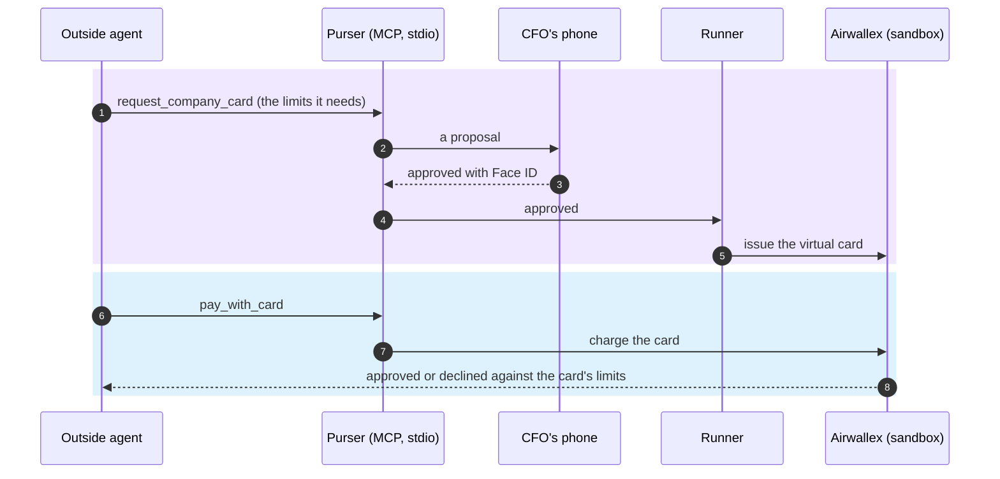
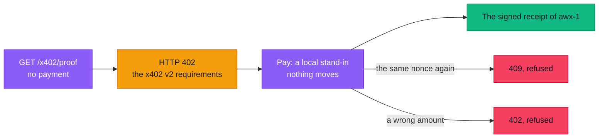

<div align="center">

<a href="../README.md"><picture><source media="(prefers-color-scheme: dark)" srcset="assets/brand/purser-mark-dark.svg"></picture></a>

# Outside agents and the ERP export

**How an outside AI agent works under the CFO's policy, an x402 endpoint to try with test money, and the GL export for an ERP.**

[](https://github.com/agamemnon-coder/x402-business-agents/actions/workflows/ci.yml?query=branch%3Amain)&nbsp;[](#outside-agents-the-agent-api-mcp)&nbsp;[](#outside-agents-the-agent-api-mcp)&nbsp;[](#try-it-yourself-an-x402-endpoint-test-money-metal-testnet)&nbsp;[](#try-it-yourself-an-x402-endpoint-test-money-metal-testnet)&nbsp;[](#the-books-double-entry)&nbsp;[](../README.md#built-with)

[The agent API](#outside-agents-the-agent-api-mcp) · [Try x402](#try-it-yourself-an-x402-endpoint-test-money-metal-testnet) · [GL export](#gl-coding-and-export-for-the-erp) · [The books](#the-books-double-entry) · [MCP reference](mcp.md)

</div>

Moved from the project README. Back to the [README](../README.md).

## Outside agents: the agent API (MCP)

Any AI agent, ours or not, can work under the same CFO policy as our own three agents. `npm run -s mcp` serves the
agent API as an MCP server on stdio. Whoever sets it up names the outside agent it serves (`KIT11_AGENT`). For
example, for Claude Code (`.mcp.json`):

```json
{ "mcpServers": { "purser": { "command": "npm", "args": ["run", "-s", "mcp"],
  "env": { "KIT11_AGENT": "acme-research", "KIT11_DB": "data/rehearsal-3.sqlite" } } } }
```

It also needs the Airwallex sandbox keys in its environment, like the runner.

The outside agent gets five tools:

| Tool | What it does |
|---|---|
| `request_company_card` | Asks for a virtual company card with the limits it needs. This is a proposal; the CFO approves it with Face ID, and only then does the runner issue the card at Airwallex. |
| `pay_with_card` | Charges its card. Airwallex approves or declines the charge against the card's limits. |
| `request_limit_raise` | Asks for a higher limit. This is a policy change, approved with Face ID. |
| `company_card` | Reads its card, limits, spend this month and recent charges. |
| `ask_for_task_card` | Asks, in plain words, for a single-use card for one flight, hotel or train, with the most it may cost. It becomes a proposal the CFO approves with Face ID; the agent never gets a card at once. |

A refusal is a tool result with isError: true and a structured object that names the next tool: the same shape the
x402 MCP transport uses for a payment refusal (these tools pay by card, not by x402). The sentence stays the first text;
the object (`refused_by`, then `reason` and `next_tool`, or Purser's `code`) is in structuredContent and a second text.

The repository includes a Skill file (the open SKILL.md format) for agents that use the agent API:
[skills/purser-spend/SKILL.md](../skills/purser-spend/SKILL.md).



The agent cannot approve, set a limit, or reach another agent's card. Once its card is issued:

- its limits are part of the CFO policy, and the phone may tighten them;
- the emergency stop freezes its card with the rest;
- the dashboard shows it under its own name;
- the GL export books its spend to cost centre CC400.

<picture><source media="(prefers-color-scheme: dark)" srcset="assets/anim/emergency-stop-dark.svg"></picture>

On stdio the server runs on the runner's machine, under the name the person who set it up gave it. Serving agents
on other machines (over HTTP, each with its own token) is the next step.

## Try it yourself: an x402 endpoint (test money, Metal testnet)

`GET /x402/proof` on the relay Worker (`worker/src/x402.ts`) sells one small resource over x402: the signed receipt of
the Airwallex run awx-1 (the exact terms the CFO approved). The price is 0.01 test *USDZ on Metal testnet. It is test
money, never real money. The route is in the code; it is live only after the next deploy of the Worker.

Ask for it without paying. The answer is HTTP 402, with the x402 version 2 requirements in the `PAYMENT-REQUIRED`
header (base64) and in the body:

```sh
curl -i https://kit11.max-31b.workers.dev/x402/proof
```



Pay with a local stand-in payment. No money moves, and the answer says so. A second use of the same nonce is
refused (409), and a wrong amount is refused (402):

```sh
URL=https://kit11.max-31b.workers.dev/x402/proof
ACCEPTED=$(curl -s $URL | node -e 'let s="";process.stdin.on("data",d=>s+=d).on("end",()=>console.log(JSON.stringify(JSON.parse(s).accepts[0])))')
PAY=$(node -e 'const a=JSON.parse(process.argv[1]);console.log(Buffer.from(JSON.stringify({x402Version:2,accepted:a,payload:{standIn:"local stand-in payment, test money, nothing moves",nonce:"juror-"+Date.now()}})).toString("base64"))' "$ACCEPTED")
curl -s -H "PAYMENT-SIGNATURE: $PAY" $URL
```

A signed payment (the `exact` scheme, as Metal's x402 clients send it) is verified and settled by Metal's
facilitator only when `X402_TESTNET_SETTLE` is `on`. It is off by default; with it off, a signed payment is refused
(503) and nothing is sent. When on, each request settles at most 0.01 test *USDZ and at most 20 settle per UTC day.

## GL coding and export for the ERP

`npm run gl -- csv|json [file]` writes the GL journal: one line for every movement of money. Each line has:

- a GL account and a cost centre (one per agent);
- the bank account the money moved through;
- the signed amount and currency;
- its proof: a transaction hash, a clearing receipt or an Airwallex id;
- the approval behind it (the proposal id);
- the rule that chose the account.

Lines come from data sales, data purchases, refunds, card charges, invoice payments and their fees, currency
conversions, sweeps and clearing withdrawals. Only money that moved is booked; a refused purchase or a declined card
charge is not.

The chart in `src/config/gl.ts` is an example: map the numbers to your own chart there. Text cells that a spreadsheet
would read as a formula (a merchant name from outside, say) get a leading apostrophe.


## The books (double entry)

On the dashboard, the **Books** tab (`?books`, and `?recorded&books` for a recording) shows the same: a "Balanced"
check, the trial balance, cash moved per bank account, spend per cost centre and the latest 20 postings.

`npm run books` turns the GL journal into double entry: every line is a debit and a credit of the same integer cents
in its own currency (money in: debit the bank account, credit the GL account; money out: the other way round), so
debits equal credits in every currency, checked for any journal by a property test (`test/books.test.ts`). It prints
the trial balance, the cash moved through each bank account and the spend per cost centre; `--csv` exports every
posting for an ERP, `--json` the whole view. Only movements Purser booked are there: opening balances are not. A
currency conversion leaves account 1590 (money in transit) with a USD debit and a EUR credit, since one currency
cannot net against another; an FX result account is the next step.
