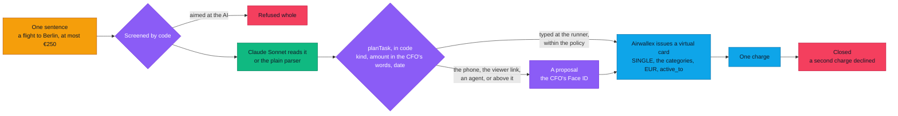

<div align="center">

<a href="../README.md"><picture><source media="(prefers-color-scheme: dark)" srcset="assets/brand/purser-mark-dark.svg"></picture></a>

# Task cards: a card for one task, from one sentence

**The CFO types one sentence; Purser issues a single-use card for one flight, hotel or train, within the policy or after Face ID.**

[](https://github.com/agamemnon-coder/x402-business-agents/actions/workflows/ci.yml?query=branch%3Amain)&nbsp;[](#what-decides-what)&nbsp;[](#what-decides-what)&nbsp;[](#task-cards-a-card-for-one-task-from-one-sentence)&nbsp;[](runs/2026-10-30-single-use.md)&nbsp;[](#what-is-simulated)&nbsp;[](../README.md#built-with)

[What decides what](#what-decides-what) · [What is simulated](#what-is-simulated) · [The run of 30 Oct](runs/2026-10-30-single-use.md) · [The CFO policy](cfo-policy.md) · [Agent API](agent-api.md)

</div>

Until 21 November this feature was called "Ask Purser"; that name is now the chat on Purser Cloud (`/ask`,
`cloud/src/ask/`), so the feature is called task cards here. The code keeps its old names (`src/agents/askPurser.ts`,
`npm run ask`).

The CFO types on the runner, or on the phone (CFO policy page, "Task card"):

```bash
npm run ask -- "Book a flight to Berlin for the trade fair on 12 November, at most €250"
```

Typed at the runner, up to the CFO policy's threshold for task cards (`approval.task_card_eur`, 300.00 to start;
raising it needs Face ID), Purser issues the card at once, at most three a day, never above the four-eyes threshold,
and only when the amount is written next to € or EUR and the date, if any, is in the message: *"Done, within your policy: a single-use flight card •••• 4821, at most 250.00 EUR,
until 2026-11-12."* Anything else, and every message sent from the phone or the viewer link (the relay cannot tell who holds the link)
or by an outside agent, Purser proposes, with who asked in the signed terms: *"I proposed P-0011: … Approve it with Face ID and I book it."*,
and Opus writes a short risk review beside the proposal. Either way Airwallex issues a virtual card that can pay
**one** airline charge, up to the amount, until the end of the day named. After that one charge Purser closes the card
at Airwallex. Then:

```bash
npm run ask -- book P-0011 189.00     # the agent books (T-0001 for a card issued within the policy); the
                                      # airline's charge is a sandbox simulation; the card is closed after it
npm run ask -- show P-0011            # a second charge and a hotel charge: Airwallex declines both
```



## What decides what

| Step | Who | What |
|---|---|---|
| Screen the message | code (`src/policy/injection.ts`) | Instructions aimed at the AI ("ignore your rules", "pre-approved") or hidden characters: refused whole, before any model reads it |
| Read the message | Claude Sonnet 5.5, or the plain parser without a key | Kind, amount as written, purpose, date |
| Decide | code (`planTask`, `src/agents/askPurser.ts`) | Only flights (merchant category 4511, at most 1,500.00), hotels (7011, 1,000.00) and trains (4112, 500.00); the amount must be in the CFO's own words; the date at most 30 days ahead (7 days when none is named) |
| Approve | at the runner, the CFO policy up to its threshold; otherwise the CFO, Face ID (two people above the four-eyes threshold), with Opus's review beside the terms | The exact card: kind, categories, amount, end, single use, and the hash of the message |
| Issue | Airwallex Issuing | `allowed_transaction_count: SINGLE`, the categories, euros only, `active_to`; read back, and frozen if it differs from what was approved |
| Pay | the merchant, through Airwallex | One successful charge; anything else is declined by Airwallex |

An agent can ask too: outside agents through the MCP tool `ask_for_task_card`. An agent's request is always a proposal
for the CFO, never a card at once.

The card shows in the dashboard's cards grid and its charges in the feed; the conversation is in the dashboard's
task-card panel. Card spend on task cards goes to account 6300 (travel), cost centre CC500, in the GL export. A task card is
not counted against an agent's velocity limits: its own limit, one purchase, is stricter. The emergency stop freezes it
like any card.

## What is simulated

The airline's charge is Airwallex's sandbox simulation (`POST /simulation/issuing/create`); no real flight is booked.
Single-use cards are documented by Airwallex ("only 1 successful debit transaction") and checked live in the sandbox
on 30 October ([run log](runs/2026-10-30-single-use.md)): `SINGLE` is accepted and reads back; after the one purchase
Airwallex closes the card itself, a moment later, and declines a second charge with `CARD_CLOSED`. Purser freezes the
card if it is still open and otherwise records it closed.
