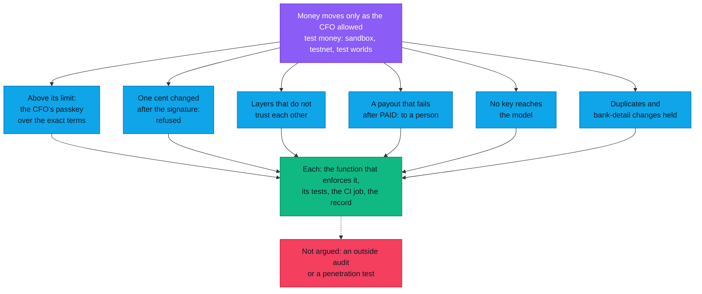

<a href="../README.md"><picture><source media="(prefers-color-scheme: dark)" srcset="assets/brand/purser-mark-dark.svg"></picture></a>

# Assurance case: each invariant, the code that holds it, its tests and the record

**Each promise Purser makes about money, argued with the code that enforces it, its tests, its CI job and its record.**

&nbsp;&nbsp;&nbsp;&nbsp;

[The invariants](#assurance-case-each-invariant-the-code-that-holds-it-its-tests-and-the-record) · [The rest of the case](#the-rest-of-the-assurance-case) · [Controls matrix](controls-matrix.md) · [Security](security.md) · [Zero trust](zero-trust.md)

Each row is one thing Purser promises about money, the code that enforces it (file and function), the tests that
check it, the CI job that runs those tests on every push to `main` and every pull request
([ci.yml](../.github/workflows/ci.yml)), and the record that shows it on a run or in a report. Test money only:
the records are Airwallex sandbox, Alta (formerly Metal) testnet and test-world runs. Written on 19 November 2026;
`test/assurance.test.ts` checks that every file linked here exists, that each function named is defined in the file
it links to, and that each CI job named is one ci.yml runs.

| Invariant | Enforced in | Tests | CI job | Record |
|---|---|---|---|---|
| **Above its limit, an agent's payment needs the CFO's passkey signature over the exact terms.** A proposal is approved without the CFO only when it is an invoice's payment within the limit; once a passkey is enrolled it is the only way to approve, its signature must be over the SHA-256 of the stored terms, and the hash is recomputed before anything runs. | [`approveWithinLimit`](../src/policy/approvals.ts), [`decide`](../src/policy/approvals.ts), [`beginExecution`](../src/policy/approvals.ts), [`verifyApprovalSignature`](../src/passkey/webauthn.ts), [`termsHash`](../src/lib/terms.ts) | [approvals.test.ts](../test/approvals.test.ts), [passkey.test.ts](../test/passkey.test.ts), [property-terms.test.ts](../test/property-terms.test.ts) | `test` | [The signed hash in Airwallex's own transfer record](runs/airwallex-transfer-approval-2026-11-06.json) (main run of 3 November, read back on 6 November) |
| **One cent changed after the signature is refused.** At payment (before Airwallex is called), at booking and at tokenizing, each against the hash the CFO signed. | [`beginExecution`](../src/policy/approvals.ts), [`signedTermsRefusal`](../src/ledger/termsLock.ts), [`approvedInvoice`](../src/tokenize/record.ts) | [one-cent-three-locks.test.ts](../test/one-cent-three-locks.test.ts); in a browser, [judge-try.check.ts](../test/browser/judge-try.check.ts) | `test`, `judge` | [/try, three timed runs on 15 November](evidence/try-timed-2026-11-15.json), in [the verification of 15 November](evidence/verification-2026-11-15.md) |
| **The limits are enforced in layers that do not trust each other:** Purser's checks in code, the CFO's passkey, and the rail's own controls (the card's limits at Airwallex, the agent's mandate on Alta). The zero-trust report also says where a single break-in gets past them. | [`reserveSpend`](../src/policy/holds.ts) (code), [`decide`](../src/policy/approvals.ts) (passkey), [`syncCards`](../src/policy/cards.ts) (writes the policy's limits to each card at Airwallex) | [zero-trust.test.ts](../test/zero-trust.test.ts), [holds.test.ts](../test/holds.test.ts), [cards.test.ts](../test/cards.test.ts), [executors-mandate.test.ts](../test/executors-mandate.test.ts) | `test` | [zero-trust.md](zero-trust.md) and [its data](zero-trust/report.json); Airwallex declining a card over its limit ([run of 30 October](runs/2026-10-30-friday-1.md)); Alta refusing purchase #24 over the mandate's cap ([main run](runs/2026-11-03-main-run.md)) |
| **A payout that fails after PAID goes to a person.** A webhook only asks; Airwallex is read again; the invoice goes to a person, the books take the payment back, and nothing is sent again under the old approval. | [`followPayouts`](../src/payouts/follow.ts) | [payout-returned.test.ts](../test/payout-returned.test.ts), [late-failure.test.ts](../test/late-failure.test.ts) | `test` | [Airwallex sandbox, 17 November: two PAID payouts failed by its simulation endpoint](runs/2026-11-17-airwallex-late-failure.json) |
| **No key reaches the model.** What the reader sends Claude (the document's text and a schema, to classify, read an invoice or a dispute, or review a proposal) carries no key, token or credential, with every key set in the environment; code checks what comes back. | [`ClaudeReader`](../src/claude/reader.ts), [`Tools`](../src/claude/tools.ts) | [adversarial.test.ts](../test/adversarial.test.ts) ("no key, token or credential ever reaches a model") | `test`; `secrets` (gitleaks, for keys in git) | No run record: the test is the evidence. The claim and its row: [security.md](security.md#attackers-and-attacks), row 16 |
| **Duplicates and bank-detail changes are held.** An invoice already paid is refused, however its number is written; a new IBAN is blocked until a person records the supplier's out-of-band confirmation and the CFO approves the change. | [`invoiceAlreadyHandled`](../src/agents/euroBill.ts), [`checkInvoice`](../src/agents/invoice.ts), [`assessInvoice`](../src/policy/fraud.ts), [`recordVerification`](../src/policy/payeeChange.ts), [`executePayeeChange`](../src/policy/payeeChange.ts) | [invoice-duplicate-key.test.ts](../test/invoice-duplicate-key.test.ts), [fraud.test.ts](../test/fraud.test.ts), [payee-change.test.ts](../test/payee-change.test.ts) | `test` | [The red team's report](redteam/report.json) (`duplicate-invoice`: blocked before anything moved); the lookalike supplier with a new IBAN blocked before Airwallex ([run of 30 October](runs/2026-10-30-friday-1.md)) |

The CI job `test` runs the whole suite (`npm run test:coverage`); `judge` runs the browser checks a juror's first run
needs; `secrets` runs gitleaks. Each control with its risk, for an auditor: [controls-matrix.md](controls-matrix.md);
every attack and what stops it: [security.md](security.md).

## The rest of the assurance case

The table above argues the money invariants one by one. The other parts of the case, each in its own document:

- **The threat model and the trust boundaries:** [security.md](security.md#trust-boundaries) (assets, the boundaries as
  a diagram, every attack with its STRIDE class and what stops it, the accepted risks).
- **Secure design principles applied, and common weaknesses countered:**
  [security/requirements.md](security/requirements.md) (Saltzer and Schroeder's principles, the OWASP Top Ten, input
  validation, hardening, cryptography, and the assumptions the case rests on).
- **The layers tested against each other:** [zero-trust.md](zero-trust.md), generated from a run of the attacks on the
  real code.
- **What has not been argued or tested:** no outside audit or penetration test; the accepted risks in
  [security.md](security.md#accepted-risks-and-what-is-out-of-scope).
