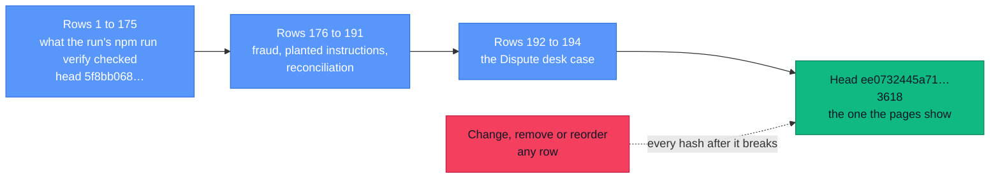

<div align="center">

<a href="../../README.md"><picture><source media="(prefers-color-scheme: dark)" srcset="../assets/brand/purser-mark-dark.svg"></picture></a>

# The recorded run's audit log

**The hash-chained audit log of the recorded run of 30 October, as stored, with the one command that checks it offline.**

[](https://github.com/agamemnon-coder/x402-business-agents/actions/workflows/ci.yml?query=branch%3Amain)&nbsp;[](friday-1-audit.jsonl)&nbsp;[](#check-it-offline-with-no-keys)&nbsp;[](#check-it-offline-with-no-keys)&nbsp;[](#what-it-contains)&nbsp;[](../../README.md#built-with)

[What it is](#what-it-is) · [Check it offline](#check-it-offline-with-no-keys) · [What it contains](#what-it-contains) · [The log](friday-1-audit.jsonl)

</div>

| At a glance | Record |
|---|---|
| **194 rows**, one per line; chain intact | [friday-1-audit.jsonl](friday-1-audit.jsonl) |
| Head `ee0732445a71…3618`, the one the pages show | `test/recorded-audit.test.ts` in CI |
| No keys, card numbers or secrets; test IBANs only | this page, below |

## What it is

`friday-1-audit.jsonl` is the audit log of the recorded run (Friday run 1, 30 October 2026, Northwind Outdoor), as
stored: 194 rows, one per line. Rows 1 to 175 are what the run's `npm run verify` checked (head `5f8bb068…`); rows
176 to 191 are the fraud, planted-instruction and reconciliation steps that followed; rows 192 to 194 are the
Dispute desk case, decided after the run on the same ledger.

Each row's hash is SHA-256 over the previous row's hash and the row itself (`src/audit/log.ts`), so changing,
removing or reordering any row breaks every hash after it.



## Check it offline, with no keys

```bash
npm run verify-log -- --jsonl docs/audit/friday-1-audit.jsonl --anchor 194:ee0732445a717f7386b4c6ccd94c0f5459b515e1d3e0869833c10d328fd83618
```

The head, `ee0732445a71…3618`, is the one the pages show ("194 rows, chain intact"); `test/recorded-audit.test.ts`
checks that in CI.

## What it contains

Every decision, refusal, payment, approval and Claude reading of the run, with Airwallex ids and
Metal transaction hashes. What it does not contain: keys, card numbers or secrets. The IBANs in it are the test
IBANs of the run's invoices, including the two fake ones.

`npm run verify` goes further (credentials, pulls and receipts against the chain, passkey signatures, Airwallex), but
it needs the full ledger and a Metal RPC endpoint.
