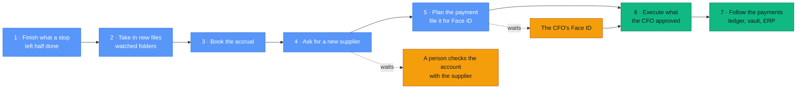

<div align="center">

<a href="../README.md"><picture><source media="(prefers-color-scheme: dark)" srcset="assets/brand/purser-mark-dark.svg"></picture></a>

# The autopilot

**Every pending supplier invoice one step forward, until nothing can move without a person.**

[](https://github.com/agamemnon-coder/x402-business-agents/actions/workflows/ci.yml?query=branch%3Amain)&nbsp;[](#the-autopilot)&nbsp;[](#what-waits-for-a-person)&nbsp;[](#what-it-does-step-by-step)&nbsp;[](#what-waits-for-a-person)&nbsp;[](../README.md#built-with)

[Step by step](#what-it-does-step-by-step) · [What waits for a person](#what-waits-for-a-person) · [Running it](#running-it) · [Ledger](ledger.md) · [Moneybird](moneybird.md)

</div>

`npm run autopilot` takes every pending supplier invoice one step forward by itself, until nothing can move without a
person. It decides nothing new: each step calls the function a person's command calls today, with the same checks.
The code is `src/ap/autopilot.ts`; the command is `src/cli/autopilot.ts`.

## What it does, step by step

Each pass looks at the ledger and takes every item that can move one step:

1. **Finishes what a stop left half done.** A payment it began executing is finished by its executor, which looks up
   what already reached Airwallex and never sends it twice. A document that was filed but never read is read, once it
   has waited an hour (one reading takes at most about 27 minutes: three Claude calls of at most three tries of 180
   seconds each), so a reading that is still running is never done twice. A new supplier that was added just before a
   stop has its invoices checked again. A payment, or the CFO's rejection, that the bookkeeping sink did not take (it
   was down, or the process stopped) is booked on a later pass.
2. **Takes in new files** from the watched folders (PDFs, photos of invoices, saved e-mails). Each file is taken in once;
   nothing in the folder is moved or deleted. The inbox reads and checks it, as `npm run payables -- add` does.
3. **Books** a checked invoice's accrual. With `KIT11_AP_AGENTS=on` the Coder agent codes its lines first, and code
   enforces the coding (`src/ap/coderCore.ts`).
4. **Asks for a new supplier** once per supplier. A person then checks the account with the supplier; after that, the
   autopilot files the new supplier for the CFO's Face ID.
5. **Plans the payment** of a ready invoice and files it for the CFO's Face ID.
6. **Executes** what the CFO approved: a new supplier, or a payment. A payment the runner began first is left to the
   runner, and the lines of a payment batch are always the runner's: the CFO approves the batch, the runner pays it.
7. **Follows the payments**, then posts the ledger, files the vault and, when `--erp <connector>` is given, sends the books
   to that bookkeeping package.



Every step writes one audit row, `autopilot.step`, with the item, the step, the outcome and how long it took. A pass
with nothing to do writes no audit row (it only renews its lease now and then).

## What waits for a person

The autopilot never decides for a person. It never approves a payment or a new supplier, never confirms a supplier's
account, and never says an invoice is not a duplicate. A blocked invoice, one that needs review, a credit note and a scan
nobody could read wait as they are.

**Every supplier payment waits for the CFO's Face ID.** This ledger's policy has no limit for paying supplier invoices
alone, so the command passes no limit at all. The code has room for one (an `AloneGate`: a limit in one currency, and an
approval of exactly the stored terms), and the tests use a stand-in for it. Even then the executor runs only the terms
that were approved, and nothing above the limit runs without the CFO. When a payment fails, its invoice's next payment
waits for the CFO: a gate never sends it again.

**A task token.** Where the CFO lets the agent pay alone (a limit to pay alone, `ap.alone_eur`) and scopes it with a task
mandate (`npm run mandates -- grant`, signed with the passkey), `KIT11_TASK_TOKEN` hands the autopilot the agent's task
token (`npm run mandates -- token <id>`, shown once). Every payment it then pays alone stands on that token's mandate
only; one outside it is refused, recorded (`task_mandate.refused` or `task_token.refused`) and waits for the CFO's Face
ID. `npm run payables -- pay <id>` passes the same token. Only the token's id is written to the audit log, never the
token. Tested on stand-in rails (`test/task-token-payer.test.ts`); not run against the sandbox.

## Running it

```
npm run autopilot -- --once                 # drain: run until nothing moves, then stop
npm run autopilot                           # keep running, every 30 seconds (--interval <seconds>)
npm run autopilot -- --folder <dir>         # watch this folder (default: <KIT11_AP_DIR or data/ap>/inbox)
npm run autopilot -- --erp moneybird        # also send the books to that package after each change
npm run autopilot -- --parked               # list the items it parked, with the reason
npm run autopilot -- --retry <item>         # put a parked item back in line
```

Without the Airwallex sandbox keys it says so once, and plans or executes no payment. `KIT11_VAULT=off` leaves the vault
alone. Test money only: the Airwallex sandbox.

## When a step fails

A step that fails is tried again after a wait (1 minute, then 5 minutes). After the third failure in a row the item is
**parked**: it is skipped until a person looks at it and puts it back with `--retry`. The reason is in the audit log
(`autopilot.parked`) and in `--parked`. A success in between starts the count again.

## One per ledger, safe to stop

One autopilot runs per ledger: it holds a lease in the ledger itself. A second one finds the lease and does nothing. A
running step renews the lease every minute, however long it takes. A lease whose process is gone, or that was not
renewed for 15 minutes, is taken over.

The autopilot may be stopped at any moment. The tests stop it at every point between two steps of a small batch (a
payment after the CFO's approval, a new supplier, a scan, with the Coder, the vault and a stand-in for the bookkeeping
package), start a new one, and check that the end is the same: no second payment, booking or document
(`test/ap-autopilot.test.ts`). One limit: a stop inside a push to the bookkeeping sink, after the sink took it and
before the ledger noted that, sends that push once more on the next pass.
