<a href="../../README.md"><picture><source media="(prefers-color-scheme: dark)" srcset="../assets/brand/purser-mark-dark.svg"></picture></a>

# Business case (hypothesis)

**Who would buy Purser, why now, and what comes next; a hypothesis, with every outside fact sourced.**

&nbsp;&nbsp;&nbsp;&nbsp;

[The problem](problem.md) · [The model](model.md) · [The roadmap](roadmap.md) · [Finance value](../finance-value.md) · [Claims](../claims.md)

| At a glance | Record |
|---|---|
| **2 finance conversations** (a CFO and a bank finance professional, anonymous); **no pilots, no revenue** | [problem.md](problem.md) · [model.md](model.md) |
| Measured, not assumed: Claude's cost per invoice and the passkey-to-PAID time, in the sandbox | [finance-value.md](../finance-value.md) |

> [!IMPORTANT]
> **These pages are a hypothesis.** Not validated with customers yet: 2 finance conversations (a CFO and a bank finance professional, quoted, anonymous); more in progress; no pilots, no revenue.

| Page | What it covers |
|---|---|
| [problem.md](problem.md) | How finance teams let software pay today, what goes wrong, why now (sourced), and how Purser answers it |
| [model.md](model.md) | Buyer, user and decider; go-to-market; pilot pricing (hypothesis); market; risks |
| [roadmap.md](roadmap.md) | One card: what comes after the hackathon, with no dates we cannot keep |

Every outside fact has a source we opened, with the date we read it. Product claims link to [claims.md](../claims.md).
