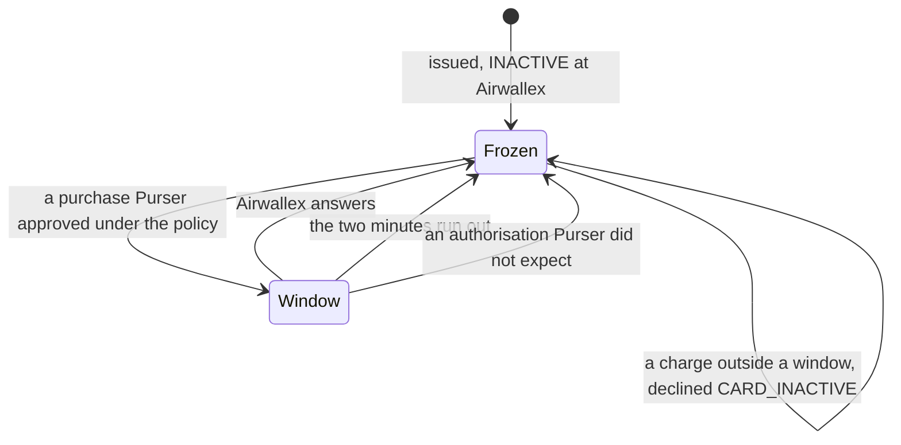
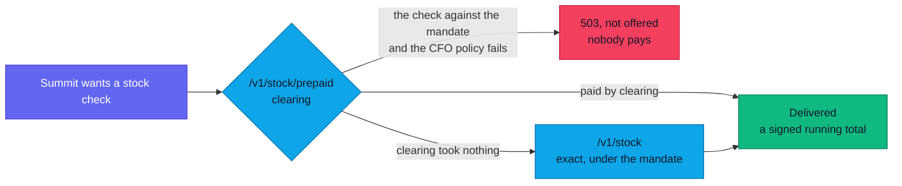

<a href="../README.md"><picture><source media="(prefers-color-scheme: dark)" srcset="assets/brand/purser-mark-dark.svg"></picture></a>

# Company cards, clearing and the simulated month

**Each agent's own card, limited at Airwallex and frozen at rest; selling by Metal clearing; and a month replayed in 90 seconds.**

&nbsp;&nbsp;&nbsp;&nbsp;&nbsp;&nbsp;&nbsp;

[Company cards](#company-cards-airwallex-issuing) · [Card governance](#card-governance-per-agent-hours-merchants-currencies-and-a-trace-to-agent-task-and-policy-26-november) · [Metal clearing](#selling-by-metal-clearing-prepaid-new-on-testnet) · [A month in 90 seconds](#a-month-in-90-seconds-simulated) · [Cards run log](runs/2026-10-29-cards.md)

Moved from the project README. Back to the [README](../README.md).

## Company cards (Airwallex Issuing)

| Agent | Card | Per purchase | Per month | Buys |
|---|---|---|---|---|
| sourcing | virtual Visa | 30.00 EUR | 100.00 EUR | market data (Packwise) |
| support | virtual Visa | 60.00 EUR | 150.00 EUR | helpdesk software (Replyhub) |
| treasury | virtual Visa | 25.00 EUR | 50.00 EUR | bookkeeping software (Ledgerly) |

The merchants are fictional (Microsoft's sample company names).

```mermaid
%%{init: {"themeVariables": {"xyChart": {"plotColorPalette": "#0ea5e9, #8b5cf6"}}}}%%
xychart-beta
  title "Card limits per agent, EUR: per month (sky), per purchase (violet)"
  x-axis ["sourcing", "support", "treasury"]
  y-axis "EUR" 0 --> 160
  bar [100, 150, 50]
  bar [30, 60, 25]
```

Record: [the card table above](cards-and-clearing.md#company-cards-airwallex-issuing), read by `test/docs-charts.test.ts`: per month 100.00, 150.00 and 50.00 EUR; per purchase 30.00, 60.00 and 25.00 EUR, from the CFO policy's `card.<agent>.monthly` and `.per_tx`.

- **Issued and synced.** `npm run cards -- setup` gives each agent a DELEGATE cardholder and a virtual Visa card.
  It sets the card's per-purchase and monthly limits to the CFO policy's `card.<agent>.per_tx` and
  `card.<agent>.monthly`. The runner checks every few seconds that each card at Airwallex still has the policy's
  limits, and it trusts what Airwallex reads back, not what it asked for.
- **Frozen by default (19 November).** Each agent card rests INACTIVE at Airwallex. Purser thaws it only for a
  purchase it approved under the policy and freezes it again as soon as Airwallex answers, when the two-minute window
  runs out, or at the first authorisation it did not expect. A charge outside a window is declined by Airwallex with
  `CARD_INACTIVE` before money moves. Tested against the Issuing stand-in, not yet against the live sandbox; the limits
  of this control are in [security.md](security.md#agent-cards-frozen-by-default-19-november-fifth-round).
- **The card is the guardrail.** The agent does not check its own limit before buying, on purpose: even an agent that
  ignores its policy cannot spend past the card. `npm run cards -- buy packwise-pro` (45.00 EUR on a 30.00 card)
  is declined by Airwallex with `LIMIT_EXCEEDED`. The decline is in the audit log and shown red on the dashboard.
- **A raise needs Face ID.** `npm run cards -- raise sourcing 50.00 --reason "…"` is the agent asking. It is an
  ordinary policy change, approved on the phone. Once it runs, the card at Airwallex gets the new limit, and the same
  purchase goes through. On the phone the CFO can only lower a card limit; a raise always comes as a proposal.
- **Every authorisation is recorded once**, by Airwallex's card transaction id, whichever source sees it first:
  - our own (simulated) charge;
  - the runner's poll;
  - an Airwallex webhook to the relay. The webhook's HMAC signature is checked on the relay and again on the runner
    (`npm run cards -- webhook` subscribes, and the secret never reaches the screen).
- **Honest limits.** In the sandbox the merchant's charge is Airwallex's simulation endpoint, but the approve or
  decline is Airwallex's own. The card number and CVV never leave Airwallex: no call asks for them, and the ledger
  keeps the last four digits.

Run log: [docs/runs/2026-10-29-cards.md](runs/2026-10-29-cards.md).

### Card governance per agent: hours, merchants, currencies, and a trace to agent, task and policy (26 November)

Dan Kim's (Airwallex) post "Agentic banking starts with governance" asks for one card per agent with
"budget limits, permitted currencies, merchant category codes, and time windows", and every transaction connected
back to the agent, the task and the policy. What Purser does for each, and who enforces it:

| Control | CFO policy key | Enforced by |
|---|---|---|
| Limit per purchase and per month | `card.<agent>.per_tx`, `.monthly` | **Airwallex** (`transaction_limits`) |
| Merchant categories | `card.<agent>.mccs` (e.g. `5734`) | **Airwallex** (`allowed_merchant_categories`) |
| Currencies | `card.<agent>.currencies` (e.g. `EUR`) | **Airwallex** (`allowed_currencies`) |
| End date; single use for task cards | from the code | **Airwallex** (`active_to`, `allowed_transaction_count`) |
| Hours, e.g. `Mon-Fri 08:00-18:00 Europe/Amsterdam` | `card.<agent>.hours` (empty: any time) | **Purser**, see below |

- **Hours are Purser's control, not Airwallex's.** Airwallex Issuing has no recurring time window: its authorization
  controls (docs and API reference read 26 November 2026) have one activity period, `active_from` / `active_to`, and
  no time of day or day of week. So Purser enforces the hours (src/policy/cardHoursGate.ts, src/policy/cards.ts):
  - every card purchase Purser starts outside them is refused before anything reaches Airwallex
    (`outside_card_hours`, recorded as `card.purchase_refused`): `buyPlan`, `chargeUnderHold`, `chargeInWindow` and
    the agent tokens (`OUTSIDE_CARD_HOURS`);
  - no purchase window opens outside them;
  - when they end, the runner's card sync closes an open purchase window and freezes the card at Airwallex
    (`card_status: INACTIVE`, the same card update freeze by default uses). At their start nothing is thawed: the card
    stays frozen by default until Purser opens a window for a purchase.
  A merchant charging the card by itself outside the hours meets that frozen card and Airwallex declines it
  (`CARD_INACTIVE`): the decline is Airwallex's, the hours behind it are Purser's. A process that bypasses Purser
  (someone with the Airwallex web app or the API key) is not bound by the hours.
- **Loosening needs the CFO's passkey; tightening counts at once.** Wider hours (or none), a new merchant category or a
  new currency loosens the policy (src/policy/loosens.ts; the phone page has the same rule). It is a `policy_change`
  proposal the CFO signs with the passkey; the phone may only tighten. As for a raised limit, the card sync checks
  again that the exact value is signed (src/policy/cardRaise.ts `cardControlRefusal`): a wider value written straight
  into the settings, or applied without a signature that verifies, stays off the card and is recorded once as
  `card.loosening_refused`. Narrower hours count from the next purchase, before any sync; a removed merchant category
  or currency reaches the card at the next sync.
- **Every card transaction names its agent, its task and the policy version behind it.** `card_transactions` has the
  agent, the purpose (the caller's, else the purchase window's) and, new, `policy_version`: the CFO policy version
  the purchase window was opened under (else the version in force when the transaction was recorded). The
  `card.charge_approved` / `card.charge_declined` audit entries carry the same. At Airwallex the card's own `metadata`
  names `agent_id` and `policy_version` when it is issued, and `agent_id`, `task_id` (the purchase's purpose) and
  `policy_version` each time Purser thaws it for a purchase (one card update, with the status). Whether Airwallex
  copies card metadata onto its transactions is not documented, so Purser does not rely on it.
- **What has run where.** All of this is tested against the Issuing stand-in (test/card-governance.test.ts,
  test/card-hours.test.ts), not yet against the live sandbox: the card `metadata` field and the hours freeze are not
  yet seen live.

## Selling by Metal clearing (prepaid, new on testnet)

Metal's [Offer Pay-per-Call Clearing](https://docs.metalntwx.com/agents/clearing) went live on testnet in October
2026. Summit deposits *USDZ once and pays each 0.07 query with a signed running total. Metal's clearing service
issues a receipt and certifies the totals on chain each epoch, so there is no transaction per query.

- **Two routes.**
  - `/v1/stock/prepaid` takes clearing only.
  - `/v1/stock` stays as it was: exact, under Summit's mandate, with its signed order.
  - Summit tries clearing first. It falls back to the mandate route whenever clearing took nothing, so a sale never
    depends on the new scheme. It never pays a tick a second way when a clearing payment may have been counted.

- **Offered only when we can deliver.** Seen live: a clearing payment is counted when the buyer makes it, before the
  seller can refuse. So before the prepaid route makes an offer, the sourcing agent checks the supplier's price
  against its mandate and the CFO policy, for free. If that check fails, the answer is 503 "not offered" and nobody
  pays.
- **On the dashboard,** the prepaid clearing budget is shown apart from the mandates.
- **`npm run verify`** checks every clearing sale's signed payment again with Metal's service.
- **Commands:** `npm run clearing -- deposit 5.00 | buy <from> <to> | withdraw`. Earnings leave clearing once their
  epoch is final, about 20 minutes later.
- Run log: [docs/runs/2026-10-29-clearing.md](runs/2026-10-29-clearing.md).

## A month in 90 seconds (simulated)

`npm run dashboard` and the relay serve `/month`. A seeded month at small-business scale replays in 90 seconds:
about 5,000 queries on weekdays, the supplier's price rise on day 9, the card declines, a fake invoice, a planted
instruction and the bills.

- **At the top:** what the agents did alone, what waits for the CFO, and what was blocked.
- **Below that:** the company's net day by day, and a P&L per agent:
  - what the agent earned;
  - what it spent over x402;
  - its company card spend;
  - FX and fees;
  - AI cost, priced from the tokens each call used in rehearsal 3.
- **The bills Airwallex paid** are listed under the agents.

The decisions in the simulation come from the live build's code:
- refund routing;
- the price-rise options;
- the invoice fraud check on the real allowlist;
- the card limits as Airwallex applied them.

The CFO's decisions are scripted and marked "CFO (simulated)". The data sits inside the page, so the replay needs no
network once loaded. `/month?at=end` shows the finished month. Code: `src/sim/month.ts`, `src/dashboard/month.html`.

