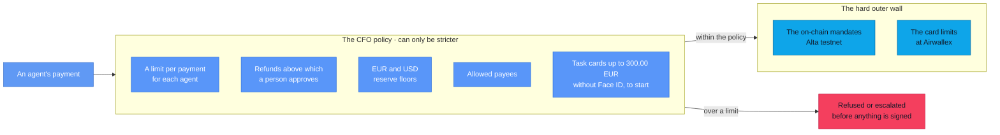
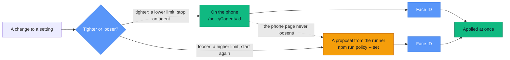
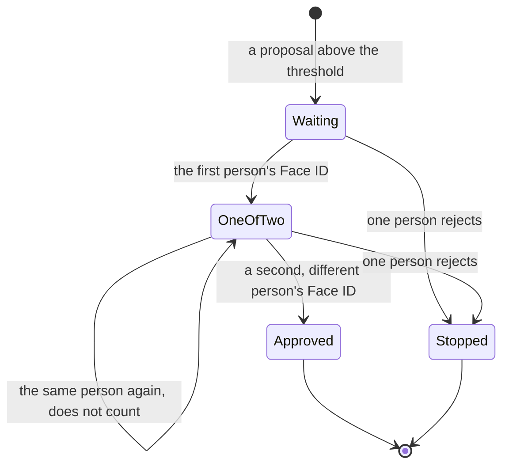

<a href="../README.md"><picture><source media="(prefers-color-scheme: dark)" srcset="assets/brand/purser-mark-dark.svg"></picture></a>

# The CFO policy

**The limits the agents work within, set by the CFO and changed only with the CFO's Face ID.**

&nbsp;&nbsp;&nbsp;&nbsp;&nbsp;&nbsp;

[CFO policy](#cfo-policy) · [Simulator](#what-would-have-happened-the-policy-simulator) · [Agents page](#the-agents-page) · [In plain words](#the-cfo-policy-in-plain-words) · [Two people](#four-eyes-two-people-above-a-threshold) · [Emergency stop](#emergency-stop-and-changed-bank-details)

Moved from the project README. Back to the [README](../README.md).

## CFO policy

The CFO sets limits the agents work within: each agent's company card limits (per purchase and per month, synced to
the card at Airwallex), and inside their on-chain mandates a limit per payment for each agent,
the refund amounts above which a person must approve, the EUR and USD reserve floors, which Airwallex payees
are allowed, and up to which amount a task card is issued without Face ID ("Task cards up to this
are issued without Face ID", `approval.task_card_eur`, 300.00 EUR to start; see [ask-purser.md](ask-purser.md)). Each is checked before anything is signed: the sourcing agent aborts the x402 payment when the
supplier's offer is over its limit (`policy_cap_exceeded`, nothing signed, the customer not charged), refunds and
sweeps refuse before the pull, and an invoice to a blocked payee escalates. The mandates stay the hard outer wall;
the policy can only be stricter.

A change is a `policy_change` proposal that names the value it replaces. On the phone (`/policy` on the relay) the
CFO writes the change, sees it on the same confirm screen and signs it with Face ID; the runner checks it against the
current policy and verifies the signature before it becomes a proposal, approved by that signature, and applies it
at once. `npm run policy` shows the policy and proposes changes from a terminal (`npm run policy -- set cap.sourcing
0.03 --reason "…"`), to approve on the phone or the laptop page. Every change is a `policy.changed` row in the audit
log; the dashboard shows the policy limit beside each mandate's cap.

### What would have happened (the policy simulator)

Before signing, the CFO sees what the change would have done to the recent payments. `npm run policy -- simulate
<key>=<value> ... [--since YYYY-MM-DD]` replays the period's supplier payments (the last 30 days by default) under the
policy now and with the change, with Purser's own decision code, and lists each payment that would change: now paid
alone, now needing the CFO, or now refused, with why. Example: `npm run policy -- simulate ap.alone_eur=1000.00
"counterparty:Bergtex Textil GmbH=blocked"` (`none` removes an optional limit). A waiting policy change shows the same
one line on the runner's dashboard and on the phone's approval page ("If this had been in force since …: N payments
would have …"); it is not part of the terms the passkey signs. The replay writes nothing and calls nothing; what it
cannot know (an agent's judgement) is in [governance.md](governance.md#before-the-cfo-signs-a-policy-change-what-would-have-happened).

## The Agents page

The dashboard's **Agents** tab (`?agents`, also in the recorded run as `?recorded&agents`) shows each agent on one
panel, all read from the same CFO policy the agents are held to (`src/agents/profiles.ts`; the page keeps no copy):

- its job, and whether it is working, stopped (its own stop, for example a velocity limit) or frozen (the emergency stop);
- the Claude model for each of its jobs (Haiku sorts documents, Sonnet reads them, Opus reviews its proposals), from
  the same list the tools call (`CLAUDE_JOBS` in `src/claude/tools.ts`; a test keeps the two equal);
- its company card (per purchase, per month, merchant categories), its Metal mandate and the policy's limit inside it,
  and its speed limit (payments a minute, amounts an hour);
- what it does on its own, and what waits for the CFO's Face ID, with the policy's current numbers;
- its settings, as the policy editor shows them.

Changing a setting follows the policy's rules, unchanged: **tightening** (a lower limit, stopping the agent) is done
on the phone, opened for that agent (`/policy?agent=<id>`, or `&stop=on` to stop it), signed with Face ID and applied
at once. **Loosening** (a higher limit, starting an agent again) is a proposal from the runner (`npm run policy --
set <key> <value> --reason "…"`, shown under each setting on the local dashboard), approved with Face ID. The phone
page never loosens: the relay serves it, so a compromised relay must not be able to slip a loosening into a Face ID
prompt.

## The CFO policy in plain words

The CFO writes the policy as they would say it, for example "the sourcing agent's card at most €25 per purchase;
refunds above 0.05 I want to see". This works on the runner (`npm run policy -- from-text "…"`) or in the box at the
top of the phone's policy page.

1. Opus maps each sentence onto the existing settings. For each rule it gives the exact words the rule rests on. A
   sentence that fits no single setting comes back with a question instead.
2. Code keeps a rule only if:
   - its setting exists;
   - its quote is copied from the CFO's text;
   - its amount is written in that quote (Opus may not split, add up or round);
   - its value passes the setting's limits.

   From the phone, a rule that would loosen the policy is refused, just as in the policy editor.
3. The rules that are left become one policy-change proposal. The approval page shows which words gave which rule.
   **Nothing changes until the CFO approves it with Face ID.**

Tried live with Opus. It mapped two of four sentences and asked about the other two. One gave an amount in euros for
a setting in *USDZ. The other asked for a total across all three cards, which no single setting holds.

## Four eyes: two people above a threshold

The CFO policy setting **"Payments above this need two people"** (`approval.four_eyes_eur`) is off by default. Once
it is set, these proposals need the Face ID of **two different people**, each with their own passkey:

- an invoice payment above the threshold;
- an outside agent's card with a monthly limit above it;
- a currency conversion above it, valued in euros (what it buys or may sell in EUR; a conversion between two other
  currencies always counts as above), together with the other conversions to the same currency that one person
  approved within the split window (27 days, or the company's own); one conversion cut into parts is still one;
- a supplier's new bank details, at any amount.

The rules:

- The first approval is kept, and the proposal waits. The phone shows "1 of 2" and who has signed so far.
- The same person approving twice does not count.
- Whoever proposed it can never approve it.
- One person's rejection stops it.
- A typed hash prefix can never meet the rule.
- `npm run verify` checks both signatures again, from two different people.

To add a second person, run `npm run passkey -- add anna` on the runner. Anna opens `/enrol` on her own phone and
types the code. Then confirm the fingerprint her phone shows with `npm run passkey -- confirm <fingerprint>`.

Each person has one active passkey. Replacing yours leaves the others alone.

Turning four eyes on, or lowering its threshold, tightens the policy. Turning it off, or raising the threshold, needs a
proposal and Face ID.

## Emergency stop and changed bank details

- **Emergency stop.**
  - The dashboard's **Emergency stop** opens the CFO policy on the phone with `freeze` set. One Face ID then does two
    things:
    - every agent payment is refused before anything is signed (supplier purchases, refunds, sweeps, invoice
      payments, prepaid clearing offers);
    - every company card is set INACTIVE at Airwallex, which declines with `CARD_INACTIVE` (checked live).
  - Pulling it tightens the policy, so the phone may do it. Lifting it loosens the policy, so it needs a proposal and
    Face ID.
  - While it is on, the dashboard shows a red band saying who pulled it, when and why.
<picture><source media="(prefers-color-scheme: dark)" srcset="assets/anim/emergency-stop-dark.svg"></picture>

- **A supplier's new bank details** (`npm run payee`). Changed bank details are how invoice fraud works, so a new IBAN
  is paid only after three separate steps:
  1. a request, which changes nothing;
  2. a person records that the supplier confirmed the account on a contact already in our own records (an agent
     cannot do this);
  3. a proposal with the full new IBAN and that verification, approved with Face ID.

  Only then is the account added at Airwallex and made the supplier's active payee. The old account is kept as
  REPLACED.

