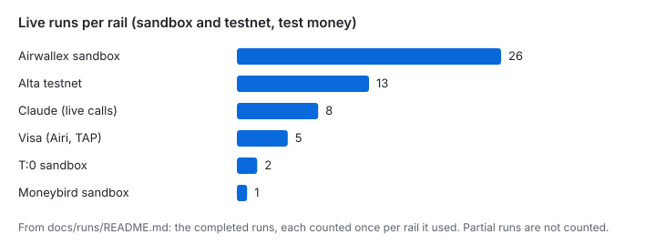
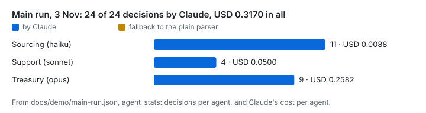
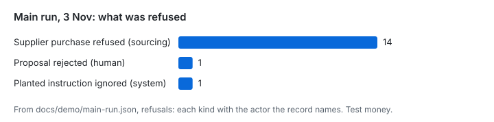
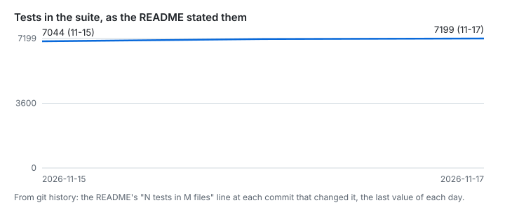

# Proof in numbers

Moved from the [README](../README.md) on 15 November, to keep it short.

   

Drawn from the run records and git history by `npm run charts` (scripts/repo-charts.ts); `test/repo-charts.test.ts` redraws them. Every id behind them is on [/proof](https://kit11.max-31b.workers.dev/proof) and in [docs/runs/](runs/README.md).
