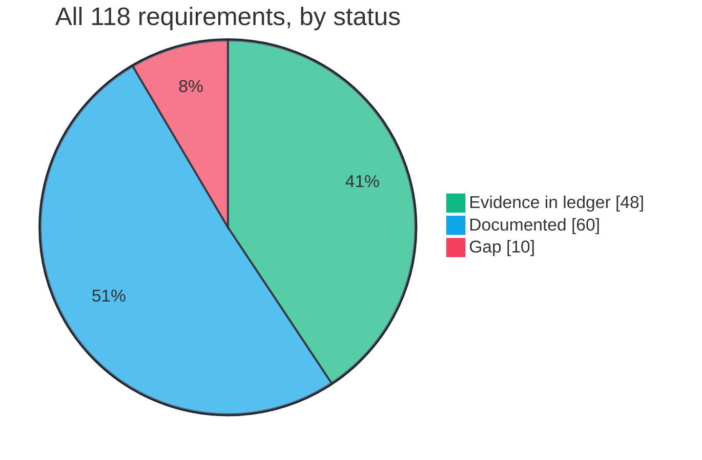
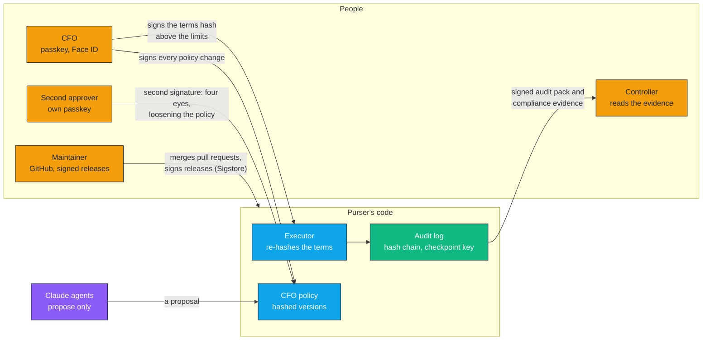

<div align="center">

<a href="../../README.md"><picture><source media="(prefers-color-scheme: dark)" srcset="../assets/brand/purser-mark-dark.svg"></picture></a>

# Governance and compliance

**Nine frameworks mapped to Purser's controls, the evidence each control leaves in the ledger, the documents behind the rest, and every gap that is still open.**

[](#the-dashboard)&nbsp;[](#run-it)&nbsp;[](controls.md#gaps-in-one-list)&nbsp;[](#governance-and-compliance)&nbsp;[](#governance-and-compliance)

[Dashboard](#the-dashboard) · [Who signs what](#who-signs-what) · [Documents](#the-documents) · [Run it](#run-it) · [Verify](#what-the-verifier-checks) · [Example](#an-example-on-test-data)

</div>

**Mapped to, not certified against: certification or an attestation needs an independent auditor, and nobody has audited Purser against any of these frameworks. Purser moves test money only, in the Airwallex sandbox and on Alta testnet.**

## The dashboard

The EU AI Act, ISO/IEC 42001, SOC 2, DORA, PSD2's strong customer authentication, the GDPR, eIDAS, NIS2 and
ISO/IEC 27001, each requirement mapped in [controls.md](controls.md) to the Purser controls that address it. The block
below is generated from [`src/compliance/controls.ts`](../../src/compliance/controls.ts) by `npm run compliance:controls`
and `test/compliance-docs.test.ts` fails when it is behind.

<!-- dashboard:start: generated by npm run compliance:controls from src/compliance/controls.ts; do not edit by hand -->

118 requirements of 9 frameworks, mapped to 38 Purser controls: 48 with evidence in the ledger, 60 documented, 10 gaps. In the bars, █ is evidence in the ledger, ▓ documented, ░ gap.

| Framework | Requirements | Status | Evidence in ledger | Documented | Gap |
|---|---|---|---|---|---|
| [EU AI Act](controls.md#eu-ai-act-regulation-eu-20241689) | 20 | `█████████▓▓▓▓▓▓▓▓▓▓▓` |  |  |  |
| [ISO/IEC 42001:2023](controls.md#isoiec-420012023-annex-a-reference-controls) | 14 | `███████▓▓▓▓▓▓▓▓▓▓▓▓░` |  |  |  |
| [SOC 2](controls.md#soc-2-aicpa-trust-services-criteria-2017-points-of-focus-revised-2022-cc6-cc7-cc8) | 11 | `███████████████▓▓▓▓▓` |  |  |  |
| [DORA](controls.md#dora-regulation-eu-20222554) | 17 | `████████▓▓▓▓▓▓▓▓▓▓░░` |  |  |  |
| [PSD2 SCA](controls.md#psd2-sca-directive-eu-20152366-art-97-and-the-rts-on-strong-customer-authentication-delegated-regulation-eu-2018389) | 10 | `████████████▓▓▓▓▓▓▓▓` |  |  |  |
| [GDPR](controls.md#gdpr-regulation-eu-2016679) | 13 | `███▓▓▓▓▓▓▓▓▓▓▓▓▓▓▓░░` |  |  |  |
| [eIDAS](controls.md#eidas-regulation-eu-no-9102014-as-amended-by-regulation-eu-20241183) | 4 | `█████▓▓▓▓▓▓▓▓▓▓░░░░░` |  |  |  |
| [NIS2](controls.md#nis2-directive-eu-20222555-art-212-cybersecurity-risk-management-measures) | 10 | `██████▓▓▓▓▓▓▓▓▓▓░░░░` |  |  |  |
| [ISO/IEC 27001:2022](controls.md#isoiec-270012022-annex-a-controls) | 19 | `███████▓▓▓▓▓▓▓▓▓▓░░░` |  |  |  |



<!-- dashboard:end -->

Where the first round left it (26 November, before this round): four frameworks, 54 requirements, 13 gaps (EU AI Act
3, ISO/IEC 42001 4, SOC 2 1, DORA 5). Twelve of those thirteen are closed by a document or code below; DORA Art. 30(1),
contracts with the providers, stays a gap: there are none yet.

v1.5.1 (26 November, Max: close the open gaps as far as a repository honestly can): 14 gaps before, 10 after. Four rows
move from gap to documented, each by a document whose missing part its row states: EU AI Act Art. 4 (the literacy note),
Art. 11(1) (the technical documentation after Annex IV), Art. 17(1) (the quality management outline) and GDPR Art. 28
(the data processing agreement template, signed with nobody). The other ten stay gaps, with their rows pointing at the
new documents where one helps: DORA Art. 30(1) (a clause checklist, no contract), GDPR Art. 44 (a transfers note, no
mechanism), training (ISO/IEC 42001 A.4.6, NIS2 Art. 21(2)(g), ISO/IEC 27001 A.6.3: material written, nobody's
training recorded), backups (DORA Art. 12(1), NIS2 Art. 21(2)(c), ISO/IEC 27001 A.8.13: no policy for the runner's
ledger, no recorded restore test), eIDAS Art. 25(2) (no qualified signature made) and ISO/IEC 27001 A.7.1 (premises).

## Who signs what

Every change to money, limits or the code goes through a signature, and no model holds one.



| Change | Who signs | With what | Recorded as |
|---|---|---|---|
| A payment above the limits | The CFO; above the four-eyes threshold, two people | Passkey over the SHA-256 of the exact terms | `proposal.approved`, `proposal.cosigned` (PC-01, PC-05) |
| A payment within the limits | Nobody: code, under the limit the CFO signed | The signed policy version | `proposal.within_limit` (PC-03) |
| A change to the CFO policy | The CFO; loosening above a threshold, two people | Passkey over the change's terms | `policy.changed`, `policy.version` (PC-04) |
| The emergency stop, on or off | The CFO (lifting it is a loosening) | Passkey | `policy.changed freeze` (PC-06) |
| A change to the code | The maintainer merges; CI must be green | A pull request; releases signed with Sigstore SLSA provenance | Git history, release attestations (PC-21, PC-32) |
| The evidence for a period | The audit checkpoint key | Ed25519 over the manifest | `manifest.json` of the evidence (PC-10) |

## The documents

| Document | What it is | Closes |
|---|---|---|
| [ai-policy.md](ai-policy.md) | The AI policy: no model output moves money, roles, oversight, acceptable use, review | ISO/IEC 42001 A.2.2 |
| [ai-impact-assessment.md](ai-impact-assessment.md) | Per agent and feature: use, affected parties, risks scored, mitigations to controls, residual risk, the risk register | ISO/IEC 42001 A.5.2; EU AI Act Art. 9(2) |
| [instructions-for-use.md](instructions-for-use.md) | For deployers: what it does and does not, oversight, how to stop it, accuracy as measured | EU AI Act Arts. 13(3), 15(3) |
| [ai-act-classification.md](ai-act-classification.md) | Each agent and feature against Art. 5, Annex III and Art. 50 | EU AI Act Arts. 5, 6, 50 |
| [incident-response.md](incident-response.md) | Severity classes tied to audit events, the runbook, communication, the record | SOC 2 CC7.3; ISO/IEC 42001 A.8.4; DORA Arts. 18, 19 |
| [third-parties.md](third-parties.md), [third-parties.json](third-parties.json) | The ICT third-party register, test-checked against the code's hosts | DORA Art. 28(3); ISO/IEC 42001 A.10.3 |
| [exit-plans.md](exit-plans.md) | Exit plans per critical provider; what a production contract must include | DORA Art. 28(8) |
| [retention.md](retention.md) | Retention per kind of record; `npm run retention -- --check` | EU AI Act Art. 12(1), in part |
| [psd2-sca.md](psd2-sca.md) | The passkey approval against the RTS on SCA: two elements, dynamic linking | PSD2 SCA (new) |
| [gdpr.md](gdpr.md) | Record of processing, DPIA, data subjects' rights, transfers | GDPR (new) |
| [ai-technical-documentation.md](ai-technical-documentation.md) | The AI system in the order of Annex IV: models per role, agents, guardrails, evals, oversight, logging; held to the code by a test | EU AI Act Art. 11(1) (v1.5.1) |
| [qms.md](qms.md) | A quality management outline: Art. 17(1)(a) to (m), each pointing at the procedure in use | EU AI Act Art. 17(1) (v1.5.1) |
| [ai-literacy.md](ai-literacy.md) | AI literacy and security awareness per role, and the record of who has read it (none yet) | EU AI Act Art. 4 (v1.5.1); material for NIS2 Art. 21(2)(g), ISO/IEC 27001 A.6.3, which stay gaps |
| [templates/dpa.md](templates/dpa.md) | A data processing agreement template for a company using Purser Cloud: every Art. 28(3) item, subprocessors from the register. Template, not legal advice; signed with nobody | GDPR Art. 28 (v1.5.1) |
| [templates/ict-contract-clauses.md](templates/ict-contract-clauses.md) | The clauses DORA Art. 30(1) to (3) require, with each provider of the register. Template only | DORA Art. 30(1) stays a gap: no contract |
| [transfers.md](transfers.md) | Where personal data goes, per provider, and which Chapter V mechanism it would need | GDPR Art. 44 stays a gap: no mechanism in place |
| [../legal/eidas-qes.md](../legal/eidas-qes.md) | The passkey as an electronic signature, the JAdES export, RFC 3161 time-stamps and the QES adapter (tested against mocks) | eIDAS (new, mapped) |
| [../security/README.md](../security/README.md) | The security index: key management, data classification, ASVS L2, SBOM, signed releases, OpenSSF | NIS2 Art. 21(2), ISO/IEC 27001 Annex A (new, mapped) |
| [controls.md](controls.md) | The control map, generated: every row, its status and what is missing | |

Code in this round: the approval page reports whether Details was opened before signing (PC-26, EU AI Act Art.
14(4)(b)); a webhook whose signature the runner refuses is an audit row (PC-14); the audit pack's refusals now take in
the anomaly hold; `npm run retention -- --check` (PC-31).

## How the evidence works

Three parts, one source:

- **The control map**, [controls.md](controls.md): for each requirement of the nine frameworks above, the Purser
  controls mapped to it, where its evidence comes
  from, and a status: *evidence in ledger*, *documented* or *gap*. Its source is
  [`src/compliance/controls.ts`](../../src/compliance/controls.ts); `npm run compliance:controls` renders the page, and a
  test fails when the page is behind it.
- **The evidence for a period**, `npm run compliance-evidence`: per control, the records in the ledger that show it ran
  in the period, a summary per framework, and a manifest signed with Ed25519 exactly as the signed audit pack's is
  (`npm run audit-pack`; the same code: [`src/audit/pack.ts`](../../src/audit/pack.ts)).
- **The verifier**, `npm run verify-compliance-evidence`: offline, no database, no network. It names the file that fails.

## Run it

The ledger is `KIT11_DB` (read only: the command opens it read-only and writes nothing to it). The signing key is the
audit checkpoint key, as for the audit pack: `PURSER_CHECKPOINT_KEY_FILE`, an Ed25519 key kept outside this repository
(`npm run verify-audit -- keygen --out <file>` makes one).

```sh
npm run compliance-evidence -- --from 2026-11-01 --to 2026-11-30 --out evidence-2026-11
npm run audit-pack -- --from 2026-11-01 --to 2026-11-30 --out audit-pack-2026-11.json
npm run verify-compliance-evidence -- evidence-2026-11 --trust <public key> --audit-pack audit-pack-2026-11.json
```

The first command prints the summary per framework and the public key to pin: `<public key>` is that key, the audit
checkpoint key's, as you got it from the signer (never from the files you are checking; `PURSER_CHECKPOINT_TRUST` holds
it too). It refuses (exit 1) a ledger whose audit log does not verify from the genesis hash, and writes only into a new
or empty directory.

The verifier says `VALID` (exit 0) only with a pinned key and the audit pack, signed by the same key. With no key pinned
it says `UNPINNED: pass --trust <public key>`, and without `--audit-pack` it says `PARTIAL`: exit 3, never `VALID`,
since anyone can rebuild evidence and sign it again with a key of their own. A check that fails is exit 1.

## What the directory holds

| File | What it is |
|---|---|
| `manifest.json` | The period, the run of the audit chain it covers (first and last row, the hash before it, its head), each file's size and SHA-256, the signer's public key and the Ed25519 signature over the manifest's canonical JSON (RFC 8785). |
| `summary.json` | Per framework: requirements with evidence in the period, mapped to a ledger control but with no records in the period, documented only, and gaps. Per control: its records in the period. |
| `mapping.json` | Every requirement of the map with its controls, status, what is missing, and what stood behind it in this period. |
| `controls/PC-xx.json` | One per control: how its evidence is derived, the count per audit event, every cited audit row (`seq`, time, event, subject, `row_hash`), every cited table row (the columns the map names and the row's SHA-256), and for PC-10 the period's run of the chain. |

What leaves the ledger is what the audit pack already carries, and less: no payload, no terms, no secret, no token
(ids only), no card number, no person's name from a table. A test scans the output for keys, tokens and card-number
patterns, and for the secrets its seeded ledger handed out.

The same ledger and period give the same files, byte for byte: nothing in them depends on the time they were made, and
Ed25519 signatures are deterministic. Rows written later to the ledger, after the period, change nothing in it.

## What the verifier checks

| Check | Fails when |
|---|---|
| `format` | `manifest.json` is missing or is not a `purser.compliance-evidence/v1` manifest. |
| `signature`, `key` | The Ed25519 signature does not verify over the manifest; the signer is not a pinned key. With no key pinned, `key` is not checked (`UNPINNED`). |
| `files` | A file's SHA-256 is not the manifest's (the file is named), a listed file is missing, or a file is not listed. |
| `summary` | A count in a control's file, the mapping or the summary does not agree with the rows the files cite. |
| `audit pack` | With `--audit-pack`: the pack is signed by another key than the evidence, does not verify, is of another period, or covers another run of the chain. |
| `cited rows` | Without `--audit-pack`: not checked (`PARTIAL`). With it: a cited audit row is not in the pack's period, or its hash, event, subject or time differ; a cited policy version or approval is not as the pack has it. |

What it does not prove: that a control is designed well enough for a framework (that is an auditor's judgement), that
nothing happened outside the ledger (since 26 November a webhook whose signature the runner refuses is an audit row;
one the relay refused never reaches the runner), or whose key signed it unless you pin one with `--trust`.

`summary.json` also carries the automation-bias signal of the period (PC-26): *approvals signed with the rationale
viewed: n/m*, where m counts the passkey approvals the phone's approval page reported on and n those signed after
opening Details. It is what the page reported, not signed; approvals made in Purser Cloud's console or the CLI report
nothing and are in neither number.

## In Purser Cloud

With every push (`npm run cloud -- push`) the runner also sends the evidence in short for the last 30 days: per
framework the four counts above, per control its records, and the map's gaps; counts only, no audit row, subject or
payload ([`src/compliance/evidence.ts`](../../src/compliance/evidence.ts) `complianceSnapshot`). The cloud checks it
against a strict schema, keeps the newest per company, returns it on `GET /v1/compliance` (read scope, the caller's
company only) and shows it as text, folded, at the foot of the console's Company page. It is not signed there: the
signed evidence is the one made and verified on the runner, as above. The demo company has none.

## An example, on test data

The seeded ledger of `test/support/complianceWorld.ts` (test data: a November with policy changes, two-person
approvals, the emergency stop pulled and lifted, agent identities rotated, verified, refused and revoked, one payment
approved and one rejected, holds and a reconciliation, and two approvals the approval page reported on) gives, for 1
to 30 November:

| Framework | Requirements | Evidence in period | Ledger control, no records in period | Documented | Gap |
|---|---|---|---|---|---|
| EU AI Act | 20 | 8 | 1 | 11 | 0 |
| ISO/IEC 42001 | 14 | 5 | 0 | 8 | 1 |
| SOC 2 | 11 | 8 | 0 | 3 | 0 |
| DORA | 17 | 7 | 0 | 8 | 2 |
| PSD2 SCA | 10 | 5 | 1 | 4 | 0 |
| GDPR | 13 | 2 | 0 | 10 | 1 |
| eIDAS | 4 | 1 | 0 | 2 | 1 |
| NIS2 | 10 | 3 | 0 | 5 | 2 |
| ISO/IEC 27001 | 19 | 6 | 1 | 9 | 3 |

The rows with a ledger control but no records are EU AI Act Art. 13(1) (its ledger control is the rationale record per
payment, PC-12, and no payment was executed in that test month), PSD2 RTS Art. 22(1) and ISO/IEC 27001 A.5.17 (no
passkey was enrolled or revoked in November; the test passkeys date from October). The automation-bias signal of the
month: *approvals signed with the rationale viewed: 1/2*. `test/compliance-evidence.test.ts` checks these counts, the
determinism, the verifier, and that one changed byte is named.

## See also

- [controls.md](controls.md): the map, and its gaps in one list.
- [../compliance.md](../compliance.md): who does what, and how Purser supports each rule.
- [../governance.md](../governance.md): Airwallex's governance principles, held in code.
- [../security/SECURITY-MAPPING.md](../security/SECURITY-MAPPING.md): SSDF, OWASP LLM Top 10 and DORA, by security control.
