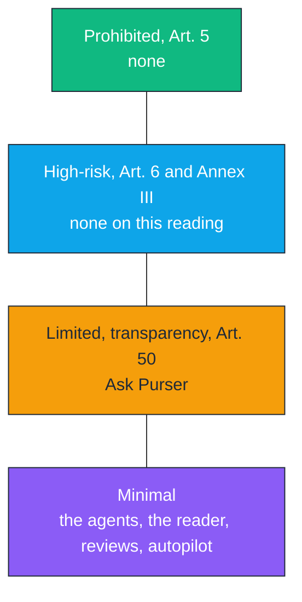

<a href="../../README.md"><picture><source media="(prefers-color-scheme: dark)" srcset="../assets/brand/purser-mark-dark.svg"></picture></a>

# EU AI Act: risk classification and transparency

**Each Purser agent and feature against the AI Act's tiers, with the reasoning, and the transparency duties that apply whatever the tier.**

&nbsp;&nbsp;&nbsp;&nbsp;

[Tiers](#the-tiers) · [Classification](#the-classification) · [Art. 5](#prohibited-practices-art-5) · [Annex III](#why-not-high-risk-annex-iii) · [Art. 50](#transparency-art-50) · [Roles](#provider-or-deployer)

## Document control

| Owner | Version | Written | Review by | Reviewed by a lawyer |
|---|---|---|---|---|
| The maintainer, as AI system owner | 1.0 | 26 November 2026 | 26 May 2027, and when an agent or feature is added | No |

> [!IMPORTANT]
> **Test money / sandbox; not legal advice.** This is Purser's own reading of Regulation (EU) 2024/1689 for Purser as
> built. A deployer's own use can change the answer: using the agents to score or profile people, for example, would
> need this classification redone. The rows it supports are Arts. 5(1), 6(2) and 50(1) in [controls.md](controls.md).

## The tiers

## The classification

| Agent or feature | What it does | Interacts with a person? | Tier | Why |
|---|---|---|---|---|
| Sourcing agent | Buys data and tools for the business within its mandate and card limits | No: it deals with suppliers' services and other agents | Minimal | A purchasing tool for a business; no Annex III use |
| Support agent | Settles disputes from other companies' agents: refunds within its cap or escalates to the CFO | No: its counterparts are agents (a simulated customer in the demo) | Minimal | Refunds a business's own sales; it never refuses a claim, a person decides what it does not refund |
| Treasury agent | Keeps balances above floors, rebalances budgets, times foreign-currency bills | No | Minimal | Treasury of the business's own money |
| Payables agents: Checker, Coder, Payer | Check, code and propose payment of supplier invoices | No | Minimal | Accounts payable of a business; fraud checks are Purser's code, not a model |
| The reader | Turns a document into fields, checked by code against the document's own lines | No | Minimal | Extraction, with the result checked |
| Reviews on the approval page | Advisory text beside a proposal | The CFO reads it, labelled as Opus's review | Minimal (labelled) | Advice to a person who decides |
| Autopilot | Calls the functions a person's command calls | No | Minimal | No AI of its own |
| **Ask Purser** (Purser Cloud) | Answers questions from the docs and the demo records, read-only | **Yes**: a person chats with it | **Limited** (Art. 50(1)) | A chatbot: people must know it is AI |

## Prohibited practices (Art. 5)

None of the practices Art. 5(1) lists is a use of Purser: no subliminal or manipulative technique, no exploitation of
vulnerabilities, no social scoring, no prediction of crimes, no scraping of facial images, no emotion recognition at
work, no biometric categorisation, no real-time remote biometric identification. The [AI policy](ai-policy.md#acceptable-use-of-claude-agents)
forbids using the agents for any of them.

## Why not high-risk (Annex III)

- **Payments agents are not credit scoring.** Annex III point 5(b) covers AI that evaluates the creditworthiness of
  natural persons or establishes their credit score. Purser's agents pay a business's own suppliers and refund its own
  sales, within limits the business set; they evaluate no person's creditworthiness, grant no credit and decide no
  one's access to a financial service. Point 5(b) also excludes AI used to detect financial fraud, and Purser's fraud
  checks are code, not a model.
- **Not insurance pricing** (5(c)), **not public benefits** (5(a)), **not emergency calls** (5(d)).
- **Not employment** (point 4): no agent recruits, evaluates or monitors workers. The approval page's
  automation-bias signal records whether Details was opened before an approval; it is read as a control on the approval
  process, never to evaluate the approver, and the [AI policy](ai-policy.md#human-oversight) says so.
- **Not critical infrastructure** (point 2): Purser is not a safety component of digital infrastructure, road traffic or
  utilities. A payment system can be critical for a business (DORA), which is not the AI Act's point 2.
- **No other point** applies: no biometrics, education, law enforcement, migration or justice use.
- **Annex I** (products under EU harmonisation law) does not apply: Purser is not a safety component of such a product.

The requirements for high-risk systems (Arts. 9 to 17) are still mapped in [controls.md](controls.md): they are good
practice for a system that moves money, and they show what a deployer would have if its use made Purser high-risk.

## Transparency (Art. 50)

| Duty | Applies to | How Purser meets it | Checked by |
|---|---|---|---|
| Art. 50(1): tell people they are interacting with AI | Ask Purser | Every answer is labelled by who wrote it: "Answered by Claude (Haiku) from Purser's docs and the demo company's records", or, without AI, "Answered from Purser's docs without AI" and "Answered by Purser's own code" ([cloud/src/ask/page.ts](../../cloud/src/ask/page.ts)) | `test/compliance-docs.test.ts` holds the labels to the page |
| Art. 50(1) in spirit, elsewhere | The approval page and the dashboard | Each proposal names the agent that proposed it; a review is labelled as the model's advice; the dashboard says the agents are AI and a person decides (PC-22) | [src/dashboard/page.html](../../src/dashboard/page.html), `test/approve-client-pages.test.ts` |
| Art. 50(2) and (4): mark generated content | Providers of generative AI; deployers of deep fakes | Purser generates no images, audio or video in the product. The demo film's voice-over is synthetic (ElevenLabs, scripts outside the product) | Not mapped as a requirement |
| Art. 4: AI literacy | Providers and deployers | The [instructions for use](instructions-for-use.md) say what an approver must know; no training is recorded: a gap | [controls.md](controls.md) |

## Provider or deployer

Purser uses Anthropic's general-purpose models (Claude) and builds an AI system on them: for that system the project
is its provider, and a business that runs it is its deployer. Anthropic is the provider of the general-purpose models
(Arts. 53 and 55 are its duties, not Purser's).
