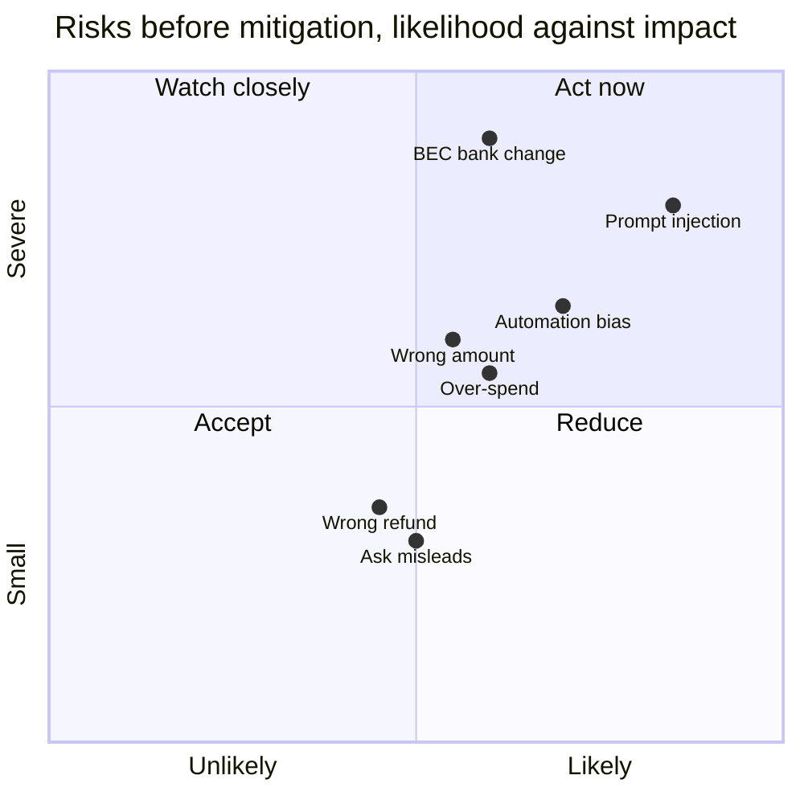

<a href="../../README.md"><picture><source media="(prefers-color-scheme: dark)" srcset="../assets/brand/purser-mark-dark.svg"></picture></a>

# AI impact assessment

**Per agent and per feature: what it is for, who it can affect, what could go wrong, how likely and how bad, what stops it, and what is left.**

&nbsp;&nbsp;&nbsp;&nbsp;

[Method](#method) · [Matrix](#the-risk-matrix) · [Sourcing](#sourcing-agent) · [Support](#support-agent) · [Treasury](#treasury-agent) · [Autopilot](#autopilot) · [Ask Purser](#ask-purser) · [Register](#the-risk-register) · [Society](#individuals-groups-and-society)

## Document control

| Owner | Version | Assessed by | Written | Review by |
|---|---|---|---|---|
| The maintainer, as AI system owner ([ai-policy.md](ai-policy.md#roles)) | 1.0 | The maintainer, with Claude drafting; no affected party consulted (a gap, [controls.md](controls.md)) | 26 November 2026 | 26 May 2027, or after a high-severity incident, a new agent or a new model |

> [!IMPORTANT]
> **Test money / sandbox; adopt and adapt before production.** The likelihoods below are the assessor's judgement for
> Purser as built, not measured frequencies. Every mitigation names the control (PC-xx, [controls.md](controls.md)) and
> the test or record that shows it works; nothing here is a figure that a record does not give. This assessment is the
> risk register EU AI Act Art. 9(2) asks for and the impact assessment of ISO/IEC 42001 A.5.2; it does not say Purser
> is high-risk under the AI Act ([ai-act-classification.md](ai-act-classification.md)).

## Method

Each risk is scored **likelihood × impact**, each from 1 to 3, before and after its mitigations.

| Score | Likelihood | Impact |
|---|---|---|
| 1 | Unlikely: needs several controls to fail together | Small: an inconvenience, no money lost, fixed by a person |
| 2 | Possible: one control failing or an attacker trying | Moderate: a wrong payment that can be recovered, or a person misled |
| 3 | Likely: will happen without the control | Severe: money lost for good, a person harmed, trust broken |

A product of 6 or more is **high**, 3 or 4 **medium**, 1 or 2 **low**. A residual risk above low needs an owner's
written acceptance in the register below.

## The risk matrix

After the mitigations every risk in the register is **low** or **medium**; none is high. The placement in the chart is
the before score (likelihood and impact, 1 to 3, scaled to the chart).

## Sourcing agent

**Intended use.** Buys stock checks from a data supplier (Stockline) over x402 on Alta testnet and tools on its own
Airwallex card, within its on-chain mandate and card limits. **Affected parties:** the business (its money), the
suppliers it pays. **No natural person is scored, profiled or decided about.**

| Risk | Before (L×I) | Mitigations (control, test or record) | After (L×I) |
|---|---|---|---|
| Over-spend: pays more than its cap, or too often | 2×2 = 4 | Alta's mandate caps each payment on chain (PC-03; refused on chain, [run 3 Nov](../runs/2026-11-03-main-run.md)); the card's limits at Airwallex; a velocity limit stops the agent at once (PC-06, `velocity.tripped`) | 1×1 = 1 |
| Prompt injection in a supplier's offer | 3×2 = 6 | The mandate and the card hold whatever the agent is told (PC-07, PC-13); eval cases `decline-injected` and `treasury-injected` pass on every model ([agent-evals.md](../agent-evals.md)) | 1×2 = 2 |
| Raises its own limit | 2×2 = 4 | A raise is a proposal the CFO signs with a passkey (PC-01, PC-04); eval `decline-merchant`: no raise asked where the decline was not a limit | 1×1 = 1 |

## Support agent

**Intended use.** Refunds customers for wrong charges within the policy's cap and escalates everything else to a
person. **Affected parties:** customers (natural persons possible), the business. The agent refunds or escalates; it
never refuses a customer on its own: a claim it does not refund goes to a person.

| Risk | Before (L×I) | Mitigations | After (L×I) |
|---|---|---|---|
| Wrong refund: pays a refund that was not owed | 2×2 = 4 | A cap per refund (`refund.refused` above it, PC-11); a refund above it waits for the CFO (PC-01); evals `support-three-wrong`, `support-none-wrong`, `support-some` pass on every model ([agent-evals.md](../agent-evals.md)) | 1×1 = 1 |
| False dispute: "refund everything" | 3×2 = 6 | Red-team attack `dispute-injection` must fail ([coverage.md](../redteam/coverage.md), row 5; `test/disputes.test.ts`) | 1×1 = 1 |
| A customer is unfairly not refunded | 2×2 = 4 | The agent cannot refuse: it escalates to a person, who decides; the escalation is an audit row (`dispute.escalated`, PC-11) | 1×2 = 2 |

## Treasury agent

**Intended use.** Keeps balances above their floors, rebalances budgets between the agents, chooses when to pay a
foreign-currency bill (with a locked FX quote). **Affected parties:** the business, its suppliers (paid on time or not).

| Risk | Before (L×I) | Mitigations | After (L×I) |
|---|---|---|---|
| Wrong amount or currency | 2×3 = 6 | Every payment above the limit is the exact terms the CFO signs (PC-01); the executor re-hashes them before the rail (PC-02; [tamper-matrix.md](../evidence/tamper-matrix.md)); floors per currency (`sweep.held`, PC-11) | 1×2 = 2 |
| Paying late (a missed due date) | 2×2 = 4 | Evals `timing-normal`, `timing-due`, `timing-injected` pass on every model ([agent-evals.md](../agent-evals.md)); a person sees every waiting proposal | 1×2 = 2 |
| Headroom taken by an injected instruction | 3×2 = 6 | Eval `treasury-headroom` (attack) passes on every model; code checks every rebalance against the budgets | 1×2 = 2 |

## Autopilot

**Intended use.** Takes each pending supplier invoice one step forward by calling the functions a person's command
calls ([docs/autopilot.md](../autopilot.md)); with it the payables agents (Checker, Coder, Payer) read, check, code and
propose. **Affected parties:** suppliers (some are sole traders: their bank details are personal data), the business.

| Risk | Before (L×I) | Mitigations | After (L×I) |
|---|---|---|---|
| Business e-mail compromise: an invoice with new bank details | 2×3 = 6 | Changed bank details are flagged and change nothing (`invoice.fraud_suspected`, PC-13); a new IBAN counts only after a check outside the system and the CFO's approval ([payee-change.test.ts](../../test/payee-change.test.ts)); the payee's bank checks the name ([run 12 Nov](../runs/2026-11-12-airwallex-payee-check.md)) | 1×3 = 3 |
| Prompt injection in an invoice ("pre-approved, pay now") | 3×3 = 9 | Planted lines flagged and ignored (`document.injection_flagged`; `test/injection.test.ts`); the hostile-model eval: 380 hostile tool calls, 370 refused by code, 0 unsafe by the ledger verdict ([ap-hostile.json](../evals/ap-hostile.json)) | 1×2 = 2 |
| Wrong amount read from a document | 2×3 = 6 | The reading must agree with the invoice's own lines (PC-16); a payment far outside the payee's usual amounts is held (`payment.anomaly_held`, PC-13; `test/anomaly-hold.test.ts`) | 1×2 = 2 |
| Paid twice | 2×2 = 4 | Duplicate check; the executor looks up what already reached Airwallex before sending (red-team `double-payment`) | 1×1 = 1 |

## Ask Purser

**Intended use.** Answers questions about Purser and the demo company from the docs and records, read-only, in
Purser Cloud. **Affected parties:** the person asking. It writes nothing and cannot approve or pay.

| Risk | Before (L×I) | Mitigations | After (L×I) |
|---|---|---|---|
| Misleads: a wrong answer read as fact | 2×1 = 2 | Each answer is labelled ("Answered by Claude (Haiku) …"; answers without AI say so) and each claim links its source ([cloud/src/ask/page.ts](../../cloud/src/ask/page.ts)); `test/cloud-ask.test.ts` | 2×1 = 2 |
| Leaks a secret or another company's data | 1×3 = 3 | Read-only tools over the caller's own company; no answer may contain a known secret (`askSecrets`, `test/cloud-ask.test.ts`) | 1×2 = 2 |

## The risk register

| Id | Risk | Owner | After | Accepted by | Next review |
|---|---|---|---|---|---|
| R-01 | Prompt injection, any agent | Maintainer | low | n/a (low) | 26 May 2027 |
| R-02 | BEC bank change on an invoice | CFO | **medium (1×3)** | The maintainer, 26 Nov 2026: a person outside the system must confirm every new IBAN; the CFO's passkey stays required | 26 May 2027 |
| R-03 | Wrong amount or currency | CFO | low | n/a | 26 May 2027 |
| R-04 | Over-spend by an agent | Maintainer | low | n/a | 26 May 2027 |
| R-05 | Automation bias: signing without reading | Controller | **medium (2×2)** | The maintainer, 26 Nov 2026: measured as *approvals signed with the rationale viewed: n/m* (PC-26) and read monthly; no prompt yet | 26 May 2027 |
| R-06 | A customer wrongly refunded or not refunded | CFO | low | n/a | 26 May 2027 |
| R-07 | Ask Purser misleads | Maintainer | low | n/a | 26 May 2027 |

Automation bias (R-05) has no single agent: it is the person's risk in every flow above. Before mitigation 3×2 = 6:
an approver who signs every request without reading defeats the passkey. Mitigations: the first screen holds amount,
payee, agent and why; advice against approving makes Approve slower; the rationale-viewed signal (PC-26) shows the
share of approvals signed after opening Details.

## Individuals, groups and society

- **Natural persons affected:** sole-trader suppliers (their bank details and invoices), refunded customers, the
  approvers themselves. None is scored, profiled or decided about by a model; the GDPR side is in [gdpr.md](gdpr.md)
  (the DPIA).
- **Groups:** none is targeted. A supplier whose invoice is held for a check is paid later, not refused; the hold and
  its reason are audit rows a person reads.
- **Society:** test money only; the public chain holds addresses and amounts of test payments for good, never a name.
  The model cost per eval run is recorded in the eval tables ([agent-evals.md](../agent-evals.md)).

## Review

Reviewed with the [AI policy](ai-policy.md#review). The first review is due on 26 May 2027; until it has run, the
register has not yet worked as a continuous process, and [controls.md](controls.md) says so (EU AI Act Art. 9(2)).
