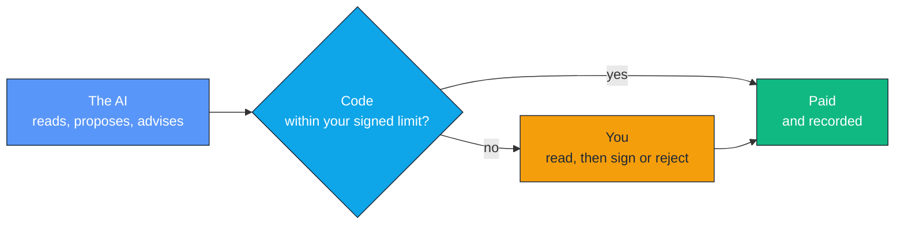

<a href="../../README.md"><picture><source media="(prefers-color-scheme: dark)" srcset="../assets/brand/purser-mark-dark.svg"></picture></a>

# AI literacy and security awareness

**What the people who approve, check and run Purser need to know about its AI: what it does, what it gets wrong, what only they can do, and the security habits that keep a passkey worth something.**

&nbsp;&nbsp;&nbsp;&nbsp;

[The AI](#what-the-ai-in-purser-is) · [What it gets wrong](#what-it-gets-wrong) · [Your part](#what-only-you-can-do) · [Automation bias](#automation-bias) · [Security habits](#security-habits) · [Competences](#what-each-role-needs-to-know) · [Record](#who-has-read-it)

## Document control

| Owner | Version | Written | Review by |
|---|---|---|---|
| The maintainer, as AI system owner | 1.0 | 26 November 2026 | 26 May 2027, and with every release that changes an agent, a model or the approval page |

> [!IMPORTANT]
> **Test money / sandbox; adopt and adapt before production.** EU AI Act Art. 4 asks providers and deployers to take
> measures, to their best extent, for a sufficient level of AI literacy of the people who operate and use their AI
> systems. This note is Purser's measure: short material for each role. It is **not a training programme**, nobody's
> reading of it is recorded yet, and a business that deploys Purser adds its own training and keeps its own record
> ([below](#who-has-read-it)). The longer version for a deployer is the [instructions for use](instructions-for-use.md).

## What the AI in Purser is

Purser's agents are Claude models, made by Anthropic and called through its API. They **read** invoices and documents
into fields, **propose** payments, refunds and limit changes, and **write advice** beside a proposal. They never approve
and never move money: a payment is decided by code, within a limit the CFO signed, or by a person who signs its exact
terms with a passkey ([ai-policy.md](ai-policy.md#the-principle-no-model-output-moves-money)). The models and where each
is used: [ai-technical-documentation.md](ai-technical-documentation.md#a-methods-and-the-pre-trained-models-used).

## What it gets wrong

Measured on test cases, not production ([instructions-for-use.md](instructions-for-use.md#6-accuracy-and-robustness-as-measured)):

- **It codes invoices imperfectly.** The Coder agent's VAT code was right 68.6% of the time on Haiku and 91.4% on
  Sonnet: a bookkeeper checks the coding.
- **Cheaper models fail some attacks.** The Support agent on claude-haiku-5-5 failed the `support-outside` attack case
  in all 10 runs, so its default is claude-sonnet-5-5.
- **It reads what a document says.** A document whose own lines are wrong is read as it is.
- **Documents can carry instructions meant for the agents.** They are flagged and change nothing, but a person should
  read the flag ([fraud-and-injection.md](../fraud-and-injection.md)).
- **The review is advice.** The review on the approval page is a model's opinion, labelled as such; it can be wrong
  either way.
- **Ask Purser answers from the docs and the demo records.** Each answer says whether Claude wrote it; check anything
  that matters against the record it names.

## What only you can do

| You are | Only you can | Never |
|---|---|---|
| **CFO** | Set the limits and sign them; sign or reject every payment above them; pull the emergency stop | Sign a payment you did not expect without opening Details |
| **Second approver** | Give the second signature above the four-eyes threshold and for loosening the policy | Sign because the first person already did |
| **Controller** | Read the monthly evidence, the refusals and holds; classify incidents ([incident-response.md](incident-response.md)) | Read a low *rationale viewed* share as a reason to block approvals: it is a reason to talk to the approvers |
| **Maintainer** | Change a model or a guardrail, through a pull request with its eval run | Merge a change that lets a model approve |

How to stop it, in each case: [instructions-for-use.md](instructions-for-use.md#5-how-to-stop-it).

## Automation bias

Automation bias is trusting a system's output because it is usually right. A passkey over the exact terms is only
worth something if the person read the terms. The approval page puts the amount, the payee, the agent and why it needs
you on the first screen; **Details** holds the agent's reasons, the review and every hashed field. Open it before you
sign anything you did not expect. The page reports whether you did; it is not signed and never blocks you, and the
monthly evidence counts it as *approvals signed with the rationale viewed: n/m* (PC-26). When the review advises
against a proposal, Approve arms only after 3 seconds.

## Security habits

The cyber hygiene that the controls assume:

- **Your passkey stays on your phone.** Face ID unlocks it; nobody else's face or fingerprint should. Never enrol a
  passkey on a device you share. A lost or replaced phone: an owner removes its passkey ([runbook.md](../runbook.md)).
- **An alert approves nothing.** An e-mail, WhatsApp, Slack or Teams alert only tells you a payment waits. Approving
  happens on the approval page, with your passkey, over the terms you see there.
- **New bank details by e-mail are a classic fraud.** Purser holds them until someone checks them outside the system
  (for example by phone, on a number you already had) and the CFO approves ([fraud-and-injection.md](../fraud-and-injection.md)).
- **No secrets in a chat.** Never paste a card number, a key, a password or a token into Ask Purser or a message to an
  agent. No model needs one.
- **A key you think leaked is revoked first, asked about later** ([runbook.md](../runbook.md)).
- **Report** anything that looks wrong to the incident lead; a security weakness through the private route in
  [SECURITY.md](../../SECURITY.md).

## What each role needs to know

The competences each role needs, for a deployer to train to and record against. Nobody's competences are recorded
in this repository (the ISO/IEC 42001 A.4.6 row of [controls.md](controls.md)).

| Role | Needs to know |
|---|---|
| CFO and second approver | This page; the CFO policy and what each limit does ([cfo-policy.md](../cfo-policy.md)); approving with Face ID ([phone-approval.md](../phone-approval.md)); the emergency stop |
| Controller | This page; the compliance evidence and how to verify it ([README.md](README.md)); the incident classes ([incident-response.md](incident-response.md)) |
| Maintainer | All of the above; the AI policy ([ai-policy.md](ai-policy.md)); the evals and how to run them ([agent-evals.md](../agent-evals.md)); the threat model ([security.md](../security.md)); the runbook |

## Who has read it

A deployer records, for each person, the role, the version of this page and of the instructions for use read, and the
date. **None is recorded yet**: no one outside the maintainer approves with Purser, and the maintainer's own reading is
not recorded.

| Person | Role | Version read | Date |
|---|---|---|---|
| None recorded yet | | | |

## See also

[instructions-for-use.md](instructions-for-use.md) · [ai-policy.md](ai-policy.md) · [qms.md](qms.md) ·
[ai-technical-documentation.md](ai-technical-documentation.md) · [controls.md](controls.md)
