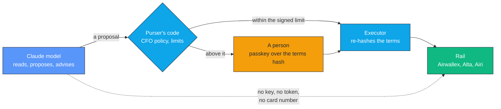

<a href="../../README.md"><picture><source media="(prefers-color-scheme: dark)" srcset="../assets/brand/purser-mark-dark.svg"></picture></a>

# AI policy

**How Purser uses AI: models read and propose, people and code decide, and no model output ever moves money.**

&nbsp;&nbsp;&nbsp;

[Principle](#the-principle-no-model-output-moves-money) · [Scope](#scope) · [Roles](#roles) · [Oversight](#human-oversight) · [Acceptable use](#acceptable-use-of-claude-agents) · [Suppliers](#ai-suppliers) · [Review](#review)

## Document control

| Owner | Version | Approved by | Written | Review by |
|---|---|---|---|---|
| The maintainer (@agamemnon-coder), as AI system owner | 1.0 | The maintainer (no second approver exists yet: [GOVERNANCE.md](../../GOVERNANCE.md)) | 26 November 2026 | 26 May 2027, or at once after a high-severity incident ([incident-response.md](incident-response.md)) |

> [!IMPORTANT]
> **Test money / sandbox; adopt and adapt before production.** This is the policy of the Purser project as it runs
> today: one maintainer, the Airwallex sandbox, Alta testnet and Visa through Airwallex Airi in the sandbox. A business
> that deploys Purser with real money adopts it as its own, names its own people in each role and adapts it with its
> adviser. It is written to ISO/IEC 42001 A.2.2 and maps to the controls in [controls.md](controls.md); nobody has
> audited Purser against it.

## The principle: no model output moves money

A model's output is a proposal or a reading, never a decision. Every payment is decided by one of two things only:

1. **Code**, within a limit the CFO signed with a passkey (`aloneLimitInForce`, `src/policy/aloneLimit.ts`; PC-03).
2. **A person**, whose passkey signs the SHA-256 of the exact terms (Face ID on the phone; PC-01). Above the four-eyes
   threshold, two different people (PC-05).

The executor re-hashes the terms before any call to a rail and refuses a mismatch (PC-02). No model holds a key, a
token or a card number (`test/adversarial.test.ts`). This principle is not negotiable in a deployment: a change that
lets a model approve, or that weakens the signature over the exact terms, is refused in review
([CONTRIBUTING.md](../../CONTRIBUTING.md)).

## Scope

Every use of AI inside Purser and in building it:

| Where | AI used | What it may do | What it may never do |
|---|---|---|---|
| The agents: Sourcing, Support, Treasury; the payables Checker, Coder and Payer | Claude models through the Claude API | Read documents into typed data, propose payments, refunds and limit changes, write advice | Approve, pay, hold a key, change a limit, change a payee's bank details |
| The reader ([src/claude/reader.ts](../../src/claude/reader.ts)) | Claude | Turn an invoice into fields that code checks against the document's own lines | Decide that a mismatch is fine |
| Reviews on the approval page | Claude Opus | Write an advisory review beside a proposal | Make the approve button act (advice against approving only makes approving slower) |
| Ask Purser (Purser Cloud) | Claude Haiku with read-only tools | Answer from the docs and the demo company's records, labelled as Claude's | Call any tool that writes |
| Autopilot ([docs/autopilot.md](../autopilot.md)) | None of its own: it calls the functions a person's command calls | Move each invoice one step | Decide anything a person's command could not |
| Building Purser | Claude Code sessions the maintainer starts | Draft code, tests and documents in a branch | Merge, hold a key, change a setting ([GOVERNANCE.md](../../GOVERNANCE.md)) |

## Roles

| Role | Today | Responsible for |
|---|---|---|
| **AI system owner** | The maintainer | This policy, the [impact assessment](ai-impact-assessment.md), the [instructions for use](instructions-for-use.md), the model choice per agent, the [third-party register](third-parties.md); stops an agent or a model when a review or incident calls for it. |
| **CFO** (the deploying business) | Max, in the demo company | Signs the limits and every payment above them with a passkey; can pull the emergency stop; reads the rationale before signing. |
| **Second approver** | A labelled test passkey in the recorded runs | The second of two signatures above the four-eyes threshold and for loosening the policy (segregation of duties). |
| **Controller** (the deploying business's finance or compliance lead) | Vacant in the sandbox | Reads the compliance evidence each month (`npm run compliance-evidence`), including the automation-bias signal; classifies incidents; owns retention. |
| **Maintainer** | @agamemnon-coder | Reviews and merges every change; holds the keys of the sandbox and testnet runs; incident lead ([incident-response.md](incident-response.md)). |

## Human oversight

- **Above every limit, a person signs the exact terms.** The approval page shows what is paid, to whom, by which agent,
  and why it needs the person; Details holds the agent's reasons, the review and every hashed field.
- **Automation bias is measured.** With each passkey approval the approval page reports whether Details was opened
  before signing; the compliance evidence gives *approvals signed with the rationale viewed: n/m* per period (PC-26).
  The controller reads it monthly. A low share is a signal to talk to the approvers, never a reason to block an
  approval: approving stays one Face ID.
- **Advice against is slower to override.** When the review advises against a proposal, Reject comes first and Approve
  arms after 3 seconds instead of 0.8 ([src/approve/client.ts](../../src/approve/client.ts)).
- **One action stops everything.** The emergency stop (one approved policy change) refuses every agent payment and
  freezes every card (PC-06); one agent can be paused or revoked (PC-07).

## Acceptable use of Claude agents

1. An agent acts only as a principal with its own capabilities: tools, rails, currencies and payees (PC-07), and
   signs each money-relevant request with its own key (PC-08).
2. Documents, e-mails and supplier text are untrusted input: an instruction found in them is flagged and changes
   nothing (PC-13; [docs/fraud-and-injection.md](../fraud-and-injection.md)).
3. Every model reading is logged with the model, request id, input hash and token use (PC-16); a spend cap stops it.
4. A model is changed only through a pull request with its eval run on the cases of [docs/agent-evals.md](../agent-evals.md)
   and its default chosen as the cheapest that passed every case.
5. No agent is given personal data it does not need; no card number, CVV or secret ever reaches a model.
6. Prohibited: using Purser's agents to score or profile people, to decide on anyone's credit, employment or access to
   a service, or for any practice EU AI Act Art. 5 lists ([ai-act-classification.md](ai-act-classification.md)).

## AI suppliers

Anthropic is the only model supplier. Its service, data and location are in the [third-party
register](third-parties.md); what happens if it is unavailable is in the [exit plans](exit-plans.md#anthropic).
Before a new model supplier is used: its terms on training with customer data, its location and transfer mechanism,
and an eval run on the same cases.

## Review

This policy, the impact assessment and the register are reviewed together, at the latest on the review date, and at
once after a high-severity incident, a new agent or feature, a new model supplier, or a change of the law that applies.
A review is a pull request that updates the version and the date, and says what changed and why.

## See also

[ai-impact-assessment.md](ai-impact-assessment.md) · [instructions-for-use.md](instructions-for-use.md) ·
[ai-act-classification.md](ai-act-classification.md) · [incident-response.md](incident-response.md) ·
[controls.md](controls.md) · [README.md](README.md)
