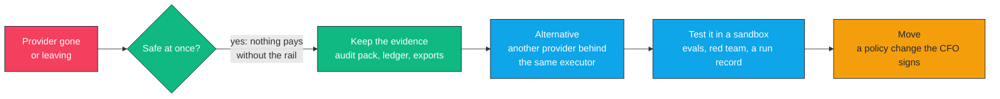

<a href="../../README.md"><picture><source media="(prefers-color-scheme: dark)" srcset="../assets/brand/purser-mark-dark.svg"></picture></a>

# Exit plans and contracts

**For each provider a critical or important function depends on: what stops without it, how Purser keeps safe, and how it would leave. And what a production contract must say.**

&nbsp;&nbsp;&nbsp;&nbsp;

[Airwallex](#airwallex) · [Alta](#alta) · [Cloudflare](#cloudflare) · [Anthropic](#anthropic) · [Visa via Airi](#visa-through-airwallex-airi) · [GitHub](#github) · [Contracts](#contracts-what-a-production-contract-must-include)

## Document control

| Owner | Version | Written | Review by | Exercised |
|---|---|---|---|---|
| The maintainer | 1.0 | 26 November 2026 | 26 May 2027, and when a provider is added to the [register](third-parties.md) | None of these plans has been exercised end to end |

> [!IMPORTANT]
> **Test money / sandbox; adopt and adapt before production.** Every account below is a test or developer account on
> the provider's standard terms; there is no contract to terminate. Each plan says what holds the day the provider is
> gone (Purser fails safe: nothing pays) and the steps to move. The providers and their criticality are those of the
> [ICT third-party register](third-parties.md).

## Airwallex

**Critical.** Supplier payments, FX, the agents' cards and the webhooks stop without it.

- **The day it is gone.** Nothing is paid: an executor that cannot reach Airwallex fails and records it; a transfer in
  doubt is looked up before it is ever sent again ([docs/runbook.md](../runbook.md#airwallex-or-metal-unavailable)). The
  agents' cards are frozen at Airwallex except inside a two-minute window, so a card left behind cannot spend.
- **Keep.** The ledger, the audit log and Airwallex's own records (statements, the transfers' `metadata.approval_sha256`)
  as they were; `npm run reconcile` on the last day.
- **Move.** Another licensed provider with payouts, FX and issued cards. The executors call Airwallex through
  `src/airwallex/` (adapter, client); a new provider is a new adapter with the same checks (the terms hash re-checked
  before the call, the approval hash in the transfer's metadata), its own sandbox run record and the red-team suite.
  The payees' bank details are the business's own and move with the export.
- **Time.** Not measured; it has not been done.

## Alta

**Critical** for agent-to-agent payments on chain and for anchoring the audit log's head.

- **The day it is gone.** On-chain payments stop; the mandates' limits stay on chain and cannot be exceeded by anyone.
  The audit log stays hash-chained and its checkpoints signed; only the anchor is missing.
- **Keep.** The transaction hashes in the ledger; the anchored heads already on chain stay there for good.
- **Move.** Agent payments by card or bank transfer only (Airwallex), or another chain with mandate contracts
  (`src/metal/` holds the client). The audit log's anchoring can be switched off without weakening the chain.

## Cloudflare

**Critical.** The relay that carries the phone's passkey approvals to the runner, and Purser Cloud with its data.

- **The day it is gone.** No passkey approval reaches the runner, so every payment above the limits waits: it fails
  safe. Payments within the signed limits still run on the runner. Purser Cloud is down.
- **Keep.** Purser Cloud's export per company (`POST /v1/export/staged`); the runner's own ledger is on the owner's disk.
- **Move.** The relay and Purser Cloud are Workers with Durable Objects, D1 and R2 (`worker/src/`, `cloud/src/`):
  another host for Workers-compatible code, or a rewrite of the storage layer. Not attempted.

## Anthropic

**Important.** Reading invoices, the agents, reviews and Ask Purser.

- **The day it is gone.** The reader falls back to the plain parser (`claude.fallback`); the agents stop proposing and a
  person proposes; reviews and Ask Purser's model answers stop (Ask Purser still answers from the docs without AI).
  No money rule depends on a model.
- **Move.** Another model provider behind `src/claude/`, chosen as every model is: the eval cases of
  [agent-evals.md](../agent-evals.md) run on it first, and the default is the cheapest that passed every case.

## Visa through Airwallex Airi

**Important** for agent purchases at merchants through Airi.

- **The day it is gone.** No Airi purchase; nothing else depends on it.
- **Move.** Agent purchases on the agent's own Airwallex card, within its limits, or none.

## GitHub

**Important** for change control, not for payments.

- **The day it is gone.** Payments are unaffected. No pull request, CI run or release.
- **Keep and move.** Every clone is a full copy of the repository; the CI workflows are YAML that another CI can run.
  The release signatures (Sigstore) stay verifiable.

## Contracts: what a production contract must include

**No contract yet: test accounts.** Every provider in the register is used on its standard sandbox, testnet or
developer terms (DORA Art. 30(1) stays a gap in [controls.md](controls.md)). Before production, a contract with each
critical or important provider must set out, as DORA Art. 30(2) and (3) list (in full, clause by clause and per
provider: [templates/ict-contract-clauses.md](templates/ict-contract-clauses.md)):

| Must include | Why for Purser |
|---|---|
| The services, and the locations where they are provided and data is processed | The register's location column; GDPR transfers ([gdpr.md](gdpr.md)) |
| Availability, integrity, confidentiality and protection of data, personal data included | The Restricted and Secret data each provider receives |
| Access to and return of the data, in an accessible format, on insolvency or termination | The exit steps above |
| Service levels with precise targets | Payments wait when a rail is down: how long is acceptable |
| Assistance when an ICT incident occurs, at no or a fixed cost | [incident-response.md](incident-response.md) |
| Cooperation with the competent authorities | A financial entity's supervisor |
| Termination rights and minimum notice periods | Time to move under the plans above |
| Full rights of access, inspection and audit for the entity and its authority | No audit of any provider has been made |
| Exit strategies with a mandatory transition period | These plans, agreed with the provider |
| A data processing agreement (GDPR Art. 28) and the transfer mechanism (Chapter V) | No DPA or transfer mechanism is recorded today ([docs/privacy/data-inventory.md](../privacy/data-inventory.md)); a DPA template is [templates/dpa.md](templates/dpa.md), the mechanisms per provider [transfers.md](transfers.md) |
