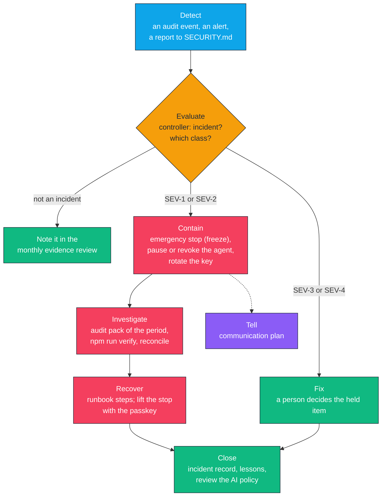

<div align="center">

<a href="../../README.md"><picture><source media="(prefers-color-scheme: dark)" srcset="../assets/brand/purser-mark-dark.svg"></picture></a>

# Incident response and classification

**Which recorded events are incidents, how severe, who acts and who is told, and the record each incident leaves.**

[](#document-control)&nbsp;[](#document-control)&nbsp;[](controls.md)&nbsp;[](controls.md)&nbsp;[](#reporting-to-an-authority)

[Classes](#severity-classes) · [Runbook](#the-runbook) · [Roles](#roles) · [Communication](#communication-plan) · [Authority](#reporting-to-an-authority) · [Template](#the-incident-record)

</div>

## Document control

| Owner | Version | Written | Review by |
|---|---|---|---|
| The maintainer, as incident lead | 1.0 | 26 November 2026 | 26 May 2027, and after every SEV-1 or SEV-2 incident |

> [!IMPORTANT]
> **Test money / sandbox; adopt and adapt before production.** No incident in this repository has ever been reported to
> an authority: Purser is not a financial entity, a controller of real personal data or an entity NIS2 covers, and it
> moves test money only. Reporting is the deploying business's duty; this page gives it the classes, the steps and a
> template to start from. ISO/IEC 42001 A.8.4, SOC 2 CC7.3 and CC7.4, DORA Arts. 17 to 19, GDPR Art. 33 and NIS2 Art.
> 21(2)(b) map here ([controls.md](controls.md), PC-29).

## Severity classes

Every class starts from an audit event Purser writes (PC-11, PC-13, PC-14; [controls.md](controls.md)). An event is
**evaluated** by the controller within the time in the last column; the controller decides whether it is an incident
and which class, and writes that in the incident record below. The classes use DORA Art. 18(1)'s criteria by name:
clients and counterparts affected, duration, data lost, critical services, economic impact.

| Class | Criteria | Events that open an evaluation | Evaluate within |
|---|---|---|---|
| **SEV-1 critical** | Money may have moved without a valid approval; the ledger's integrity is in doubt; a key that signs or pays has leaked | `execution.refused_ledger_tampered`, `audit.checkpoint_refused`, `airwallex.disagrees` (a payout or conversion Purser did not make), a leaked key reported by anyone | 1 hour |
| **SEV-2 high** | A control was attacked or misconfigured and held, but may not hold next time; a critical provider is down for more than 4 hours | `airwallex.webhook_refused`, `principal.identity_refused` (more than one in an hour), `passkey.refused` (repeated), `reconcile.difference`, `velocity.tripped` | 4 hours |
| **SEV-3 medium** | A fraud or injection attempt stopped as designed; a payment held for a person | `invoice.fraud_suspected`, `document.injection_flagged`, `payment.anomaly_held`, `payee.change_requested` | 1 working day |
| **SEV-4 low** | A control doing its daily work | `refund.refused`, `sweep.held`, `proposal.rejected`, `claude.fallback`, `claude.capped` | The monthly evidence review |

A SEV-3 or SEV-4 event that repeats, or that a person cannot explain, is raised one class. An event not in the table is
classed by its criteria.

## The runbook



The steps for each containment (the emergency stop, a leaked key, an outage, recovery) are in
[docs/runbook.md](../runbook.md), which says which of them were exercised live. The investigation uses the signed audit
pack of the period (`npm run audit-pack`), the ledger check (`npm run verify`) and a reconciliation.

## Roles

| Role | Today | Does |
|---|---|---|
| **Incident lead** | The maintainer (@agamemnon-coder) | Runs the runbook, contains, investigates, writes the record |
| **Decides on the stop** | The CFO (the deploying business) | Pulls the emergency stop with the passkey; lifts it with the passkey |
| **Controller** | The deploying business's finance or compliance lead (vacant in the sandbox) | Evaluates events and classifies incidents; owns the record; decides on reporting |
| **Deputy** | Vacant | One person holds every role today: a gap ([controls.md](controls.md)) |

## Communication plan

| Who is told | When | By | How |
|---|---|---|---|
| The CFO | SEV-1 and SEV-2: at once | Incident lead | Phone, and the approval channel's alert (push, Slack, Teams, e-mail or WhatsApp as the company set them) |
| The second approver | SEV-1: at once | Incident lead | Phone |
| Affected suppliers or customers | When a payment to or from them is wrong or delayed | Controller | E-mail, with what happened and when it will be fixed |
| The PSP or chain (Airwallex, Alta, Anthropic, Cloudflare) | SEV-1 or SEV-2 that involves their service | Incident lead | Their support channel ([third-parties.md](third-parties.md)) |
| A security reporter | Within 3 working days of the report | Maintainer | As [SECURITY.md](../../SECURITY.md) says |
| Users of the open-source project | A vulnerability in Purser itself | Maintainer | A GitHub security advisory |
| An authority | Only the deploying business, under its own law | Controller | See below |

## Reporting to an authority

Not done in the sandbox, and not Purser's duty. A business that deploys Purser decides under its own law:

| Law | Who reports | What and when |
|---|---|---|
| DORA Arts. 19 and 20 | A financial entity | A major ICT-related incident to its competent authority: an initial notification, an intermediate and a final report, in the timelines of the regulatory technical standards |
| GDPR Art. 33 | The controller | A personal data breach to the supervisory authority within 72 hours where feasible; to the people affected when the risk is high (Art. 34) |
| NIS2 Art. 23 | An essential or important entity | A significant incident: an early warning within 24 hours, a notification within 72 hours, a final report within a month |

## The incident record

Kept outside the ledger today (the ledger records the events; the classification is a person's decision and is not
yet an audit row: a gap in [controls.md](controls.md)). One record per incident:

```text
Incident id:            INC-YYYY-NNN
Class:                  SEV-1 | SEV-2 | SEV-3 | SEV-4 (and why, by the criteria above)
Opened / closed:        <UTC time> / <UTC time>
Detected by:            <audit event and seq, alert, or report>
Audit rows:             <seq range; the audit pack of the period and its manifest hash>
What happened:          <plain words>
Money affected:         <amounts and currencies, or none; test money?>
People affected:        <suppliers, customers, approvers; personal data involved?>
Services affected:      <rail or provider, duration>
Contained by:           <emergency stop, pause, revoke, key rotation; time>
Recovered by:           <steps of docs/runbook.md; time>
Told:                   <who, when, how (communication plan)>
Reported to authority:  <none (sandbox) | authority, date, reference>
Root cause:             <cause>
Lessons and changes:    <pull requests, policy or control changes>
Signed off by:          <controller>, <date>
```
