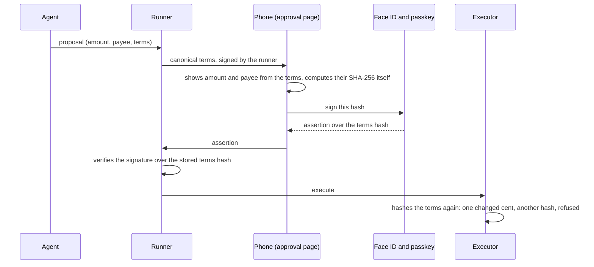

<a href="../../README.md"><picture><source media="(prefers-color-scheme: dark)" srcset="../assets/brand/purser-mark-dark.svg"></picture></a>

# PSD2 strong customer authentication and dynamic linking

**How the CFO's passkey approval maps to the RTS on SCA: two elements, and a signature bound to the exact amount and payee. And where Purser is not a PSP.**

&nbsp;&nbsp;&nbsp;

[Not a PSP](#where-purser-is-not-a-psp) · [Two elements](#two-elements-rts-art-4) · [Dynamic linking](#dynamic-linking-rts-art-5) · [Credentials](#the-credentials-rts-arts-22-to-27) · [Open](#what-is-open)

## Document control

| Owner | Version | Written | Review by | Sources |
|---|---|---|---|---|
| The maintainer | 1.0 | 26 November 2026 | 26 May 2027 | Directive (EU) 2015/2366 (PSD2) Art. 97; Commission Delegated Regulation (EU) 2018/389 (the RTS), Arts. 4, 5, 9, 22 to 27 |

> [!IMPORTANT]
> **Test money / sandbox; not legal advice.** This page maps a control to a regulation's requirements. It does not say
> Purser applies SCA in the sense of PSD2: only a payment service provider does that. The rows, with their status, are
> in [controls.md](controls.md#psd2-sca-directive-eu-20152366-art-97-and-the-rts-on-strong-customer-authentication-delegated-regulation-eu-2018389).

## Where Purser is not a PSP

- **SCA is the PSP's duty** (PSD2 Art. 97). For a business paying its suppliers through Purser, the PSP is Airwallex:
  its own SCA applies to the business's logins and payments at Airwallex, whatever Purser does.
- **Purser's passkey approval is the business's own control**, inside the business, before the payment reaches the PSP.
  It is a second, independent lock: it never replaces the PSP's SCA, it does not make an exemption apply, and no PSP
  relies on it.
- **Purser is not licensed** as a payment service provider and holds no client money: the money stays in the
  business's own Airwallex and Alta accounts, moved with the business's own keys. Whether running Purser Cloud for other
  companies would be a payment initiation service has **not been assessed**; it would need a lawyer before Purser Cloud
  moves real money for anyone but its operator.

## Two elements (RTS Art. 4)

| Element | In Purser | Where |
|---|---|---|
| **Possession** | A passkey: a private key created on the CFO's phone in an enrolment the runner opened, confirmed by its fingerprint on the runner; only the public key leaves the phone | [src/passkey/ledger.ts](../../src/passkey/ledger.ts), PC-25 |
| **Inherence** | Face ID unlocks the passkey for each signature: the page asks for user verification and the runner refuses a signature without it (`requireUserVerification: true`) | [src/passkey/webauthn.ts](../../src/passkey/webauthn.ts), [src/approve/client.ts](../../src/approve/client.ts) |
| **Knowledge** (fallback) | If the phone falls back from Face ID, its passcode unlocks the passkey: still a second element, of another category | the phone's platform |

**The authentication code** is the WebAuthn assertion: a signature by the passkey over a challenge that is the hash of
the exact terms. It cannot be forged without the private key; each assertion is stored with its hash and handled once
(a resend is answered with what came of it, never run again); the signature counter only moves forward
([src/passkey/process.ts](../../src/passkey/process.ts), `test/passkey-resend-and-rejection.test.ts`).

## Dynamic linking (RTS Art. 5)

This is the strongest match. The RTS asks that the authentication code be **specific to the amount and the payee**, and
that **any change to either invalidates it**. In Purser the passkey signs the SHA-256 of the canonical terms, which hold
the amount, the currency and the payee; nothing else is signed.

| RTS Art. 5(1) | In Purser | Evidence |
|---|---|---|
| (a) the payer is made aware of the amount and payee | The approval page draws the amount and the payee from the hashed terms it checks itself, on the first screen, before Face ID | `test/approve-client-pages.test.ts` |
| (b) the code is specific to the amount and payee | The challenge is the hash of the terms that hold them | `proposal.approved` rows with the `terms_sha256` signed (PC-01) |
| (c) the code accepted matches the original amount and payee | The runner verifies the signature against the stored terms' hash; the executor re-hashes before any call to a rail | `proposal.executing` with the recomputed hash (PC-02) |
| (d) any change invalidates the code | One changed character changes the hash: the signature no longer verifies and the payment is refused | [tamper-matrix.md](../evidence/tamper-matrix.md): every changed copy refused (PC-19) |

A rejection signs a different hash derived from the terms hash, so no rejection can ever be replayed as an approval
([src/lib/terms.ts](../../src/lib/terms.ts) `rejectionSha256`).

## The credentials (RTS Arts. 22 to 27)

- **Creation and association** (Arts. 23, 24): a passkey counts only after an enrolment window the runner opened and its
  fingerprint confirmed on the runner (`passkey.enrolled`, PC-25).
- **Confidentiality** (Art. 22): the private key never leaves the phone; the ledger stores public keys only.
- **Revocation** (Art. 27): a replaced passkey is revoked (`passkey.revoked`) and signs nothing after.

## What is open

- **A synced passkey** (iCloud Keychain, Google Password Manager) can be on more than one of the person's devices.
  Whether it still counts as a possession element is for a PSP and its supervisor to judge; Purser has not decided it.
- **Independence of the elements** (Art. 9): both sit on one phone and rest on its secure hardware, which Purser has
  not assessed.
- **Five failed attempts** (Art. 4(3)(b)): failed signatures are counted and alerted, and the relay slows an address
  that keeps failing; the passkey itself is not blocked after five (the phone's own Face ID lock applies).
