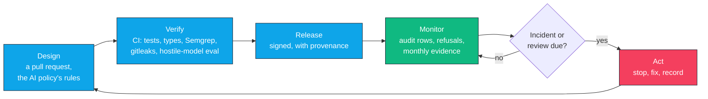

<a href="../../README.md"><picture><source media="(prefers-color-scheme: dark)" srcset="../assets/brand/purser-mark-dark.svg"></picture></a>

# Quality management system: an outline

**The procedures EU AI Act Art. 17(1) lists, one by one, each pointing at the procedure Purser follows today and saying what is not yet in place.**

&nbsp;&nbsp;&nbsp;&nbsp;

[The cycle](#the-cycle) · [Art. 17(1)](#the-procedures-art-171) · [Post-market](#h-post-market-monitoring) · [Accountability](#accountability) · [Not yet](#what-is-not-in-place)

## Document control

| Owner | Version | Approved by | Written | Review by |
|---|---|---|---|---|
| The maintainer, as AI system owner | 1.0 | The maintainer (no second approver exists yet: [GOVERNANCE.md](../../GOVERNANCE.md)) | 26 November 2026 | 26 May 2027, with the AI policy |

> [!IMPORTANT]
> **Test money / sandbox; adopt and adapt before production. Not legal advice.** Art. 17 binds the provider of a
> high-risk AI system; on Purser's own reading ([ai-act-classification.md](ai-act-classification.md)) Purser is not one,
> and this outline is written voluntarily. Art. 17(2) lets the system be proportionate to the size of the provider:
> Purser is one maintainer, CI and the change rules, and this page writes those down as one system. A business that
> deploys Purser adds its own people and procedures. Nobody has audited Purser against it.

## The cycle

## The procedures (Art. 17(1))

| Art. 17(1) | What it asks for | Purser's procedure today | Where |
|---|---|---|---|
| (a) | A strategy for regulatory compliance, including how modifications are managed | The classification against Art. 5, Annex III and Art. 50, redone when an agent or feature is added; the control map of nine frameworks with every gap listed; a change through a pull request only | [ai-act-classification.md](ai-act-classification.md), [controls.md](controls.md), [CONTRIBUTING.md](../../CONTRIBUTING.md) |
| (b) | Design, design control and design verification | The principle that no model output moves money, not negotiable in review; each guardrail tested where it lives | [ai-policy.md](ai-policy.md#the-principle-no-model-output-moves-money), [assurance.md](../assurance.md) |
| (c) | Development, quality control and quality assurance | Every change through a pull request and CI: tests, type checks, lint, Semgrep, gitleaks, OSV-Scanner, CodeQL; Actions pinned by SHA (PC-21, PC-32) | `.github/workflows/ci.yml`, [releasing.md](../releasing.md) |
| (d) | Examination, test and validation before, during and after development, and how often | The hostile-model eval on every change in CI; the real-model evals before a model is changed ([ai-policy.md](ai-policy.md#acceptable-use-of-claude-agents)); held-out adversarial sets committed before their first run; red team, tamper matrix, fuzzing, chaos | [ai-technical-documentation.md](ai-technical-documentation.md#g-validation-and-testing), [agent-evals.md](../agent-evals.md) |
| (e) | Technical specifications and standards applied | No harmonised standard; the frameworks mapped in the control map | [ai-technical-documentation.md](ai-technical-documentation.md#7-standards-applied) |
| (f) | Data management: collection, labelling, storage, retention and the rest | Purser trains no model. Each table classified with its personal and credential columns; retention per kind of record; each model reading logged with a hash of its input (PC-16, PC-18, PC-31) | [data-classification.md](../security/data-classification.md), [retention.md](retention.md), [gdpr.md](gdpr.md) |
| (g) | The risk management system of Art. 9 | The impact assessment and its risk register, with owners and a review date | [ai-impact-assessment.md](ai-impact-assessment.md) |
| (h) | Post-market monitoring (Art. 72) | [Below](#h-post-market-monitoring) | |
| (i) | Reporting a serious incident (Art. 73) | Severity classes tied to audit events, the runbook, the record; reporting to an authority is the deployer's duty, and nothing is reported from the sandbox | [incident-response.md](incident-response.md) |
| (j) | Communication with authorities, notified bodies, other operators, customers and others | Security reports through a private route with a response time; everything else as an issue on the repository; no dealings with any authority yet | [SECURITY.md](../../SECURITY.md), [instructions-for-use.md](instructions-for-use.md#1-the-provider) |
| (k) | Record-keeping of all relevant documents and information | Everything in git, every release signed; the ledger's audit log hash-chained, carried out by the signed audit pack and the compliance evidence (PC-10) | [README.md](README.md#run-it), [retention.md](retention.md) |
| (l) | Resource management, including security of supply | The third-party register, with an exit plan per critical or important provider; the reader falls back to the plain parser without the model | [third-parties.md](third-parties.md), [exit-plans.md](exit-plans.md) |
| (m) | An accountability framework for management and staff | [Below](#accountability) | |

### (h) Post-market monitoring

What is collected while Purser runs, and who reads it:

| Signal | Collected by | Read by, how often |
|---|---|---|
| Each model reading: model, request id, input hash, token use; each fallback, rejection and spend cap | PC-16 | The controller, in the monthly evidence |
| Refusals, holds, blocks and escalations, each with its reason | PC-11 | The CFO on the dashboard; the controller monthly |
| Differences between the ledger and the rails | PC-15, hourly | Raised at once |
| Approvals signed with the rationale viewed, *n/m* | PC-26 | The controller monthly ([ai-policy.md](ai-policy.md#human-oversight)) |
| Incidents | [incident-response.md](incident-response.md) | The incident lead, at once |

At each review, and after a high-severity incident, the AI system owner reads these with the risk register and decides
whether an agent, a model or a guardrail changes. **No such review has run yet**: the first is due on 26 May 2027. No
plan in the form of the Commission's template for Art. 72 is drawn up.

## Accountability

| Role | Today | Accountable for |
|---|---|---|
| AI system owner | The maintainer | This outline, the AI policy, the impact assessment, the technical documentation, the model per agent; stopping an agent or a model |
| Maintainer | @agamemnon-coder | Reviewing and merging every change; signed releases; incident lead |
| Second reviewer, deputy | Vacant | One person holds every role: most changes have no second human reviewer |
| Deployer: CFO, second approver, controller | The deploying business | The limits and approvals; reading the evidence; the incidents it must report |

Roles in full: [ai-policy.md](ai-policy.md#roles) and [docs/security/roles.md](../security/roles.md). What each role must
know: [ai-literacy.md](ai-literacy.md).

## What is not in place

- **A second person.** One maintainer holds every role; there is no deputy and no independent review of a change.
- **A review that has run.** The procedures above are in use, but the review that closes the cycle is due on 26 May 2027.
- **Signed test reports.** Test records are dated and committed; none is signed by a responsible person.
- **An audit.** Nobody has audited this system against Art. 17 or any standard.

## See also

[ai-technical-documentation.md](ai-technical-documentation.md) · [ai-policy.md](ai-policy.md) ·
[ai-impact-assessment.md](ai-impact-assessment.md) · [incident-response.md](incident-response.md) · [controls.md](controls.md)
