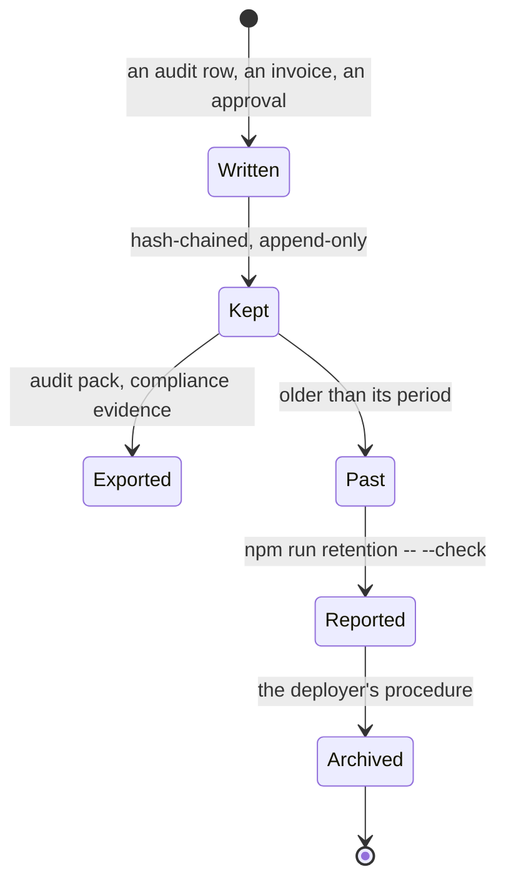

<div align="center">

<a href="../../README.md"><picture><source media="(prefers-color-scheme: dark)" srcset="../assets/brand/purser-mark-dark.svg"></picture></a>

# Log retention and data lifecycle

**How long each kind of record on the runner's ledger is kept by default, how to check it, and how records leave.**

[](#document-control)&nbsp;[](#document-control)&nbsp;[](#check-it)&nbsp;[](#document-control)

[Lifecycle](#the-lifecycle) · [Periods](#the-periods) · [Check it](#check-it) · [How records leave](#how-records-leave) · [Cloud](#purser-cloud)

</div>

## Document control

| Owner | Version | Written | Review by |
|---|---|---|---|
| The maintainer; in a deployment, the controller ([ai-policy.md](ai-policy.md#roles)) | 1.0 | 26 November 2026 | 26 May 2027 |

> [!IMPORTANT]
> **Test money / sandbox; adopt and adapt before production.** The periods below are defaults. The books follow the
> seven years [docs/privacy/retention.md](../privacy/retention.md) gives (Article 2:10 BW, Article 52 AWR, to 31 December of
> the seventh year), which is longer than the six months the EU AI Act asks logs to be kept at least (Arts. 19(1) and
> 26(6)). A deploying business confirms them with its adviser; not legal advice.

## The lifecycle



## The periods

The table is [`src/compliance/retention.ts`](../../src/compliance/retention.ts) `RETENTION`, which the check reads;
`test/compliance-retention.test.ts` holds this page to it, and each table and level to
[data-classification.md](../security/data-classification.md).

<!-- retention:start -->
| Table | What it holds | Level | Kept for | Basis |
|---|---|---|---|---|
| `audit_log` (by `ts`) | The hash-chained audit log: every decision, refusal and approval | Restricted | 7 years, to 31 December | evidence for a payment's decision, kept with the books; longer than the 6 months of EU AI Act Arts. 19(1) and 26(6) |
| `ledger_entries` (by `created_at`) | The double-entry ledger | Restricted | 7 years, to 31 December | bookkeeping: Article 2:10 BW, Article 52 AWR (docs/privacy/retention.md) |
| `proposals` (by `created_at`) | Proposals with their exact terms | Restricted | 7 years, to 31 December | evidence for a payment's decision, kept with the books; longer than the 6 months of EU AI Act Arts. 19(1) and 26(6) |
| `approvals` (by `created_at`) | Approvals: who, how, which terms hash | Restricted | 7 years, to 31 December | evidence for a payment's decision, kept with the books; longer than the 6 months of EU AI Act Arts. 19(1) and 26(6) |
| `passkey_assertions` (by `verified_at`) | The stored passkey signatures behind approvals | Restricted | 7 years, to 31 December | evidence for a payment's decision, kept with the books; longer than the 6 months of EU AI Act Arts. 19(1) and 26(6) |
| `cosignatures` (by `created_at`) | First signatures of two-person approvals | Restricted | 7 years, to 31 December | evidence for a payment's decision, kept with the books; longer than the 6 months of EU AI Act Arts. 19(1) and 26(6) |
| `policy_versions` (by `created_at`) | Every version of the CFO policy, hashed | Internal | 7 years, to 31 December | evidence for a payment's decision, kept with the books; longer than the 6 months of EU AI Act Arts. 19(1) and 26(6) |
| `ap_invoices` (by `received_at`) | Supplier invoices as read | Restricted | 7 years, to 31 December | bookkeeping: Article 2:10 BW, Article 52 AWR (docs/privacy/retention.md) |
| `ap_documents` (by `received_at`) | The invoice documents as received | Restricted | 7 years, to 31 December | bookkeeping: Article 2:10 BW, Article 52 AWR (docs/privacy/retention.md) |
| `card_transactions` (by `recorded_at`) | The agents' card transactions | Restricted | 7 years, to 31 December | bookkeeping: Article 2:10 BW, Article 52 AWR (docs/privacy/retention.md) |
| `airwallex_events` (by `received_at`) | Airwallex webhooks, after their signature verified | Restricted | 7 years, to 31 December | evidence for a payment's decision, kept with the books; longer than the 6 months of EU AI Act Arts. 19(1) and 26(6) |
| `payee_changes` (by `created_at`) | Changes of a supplier's bank details and their checks | Restricted | 7 years, to 31 December | bookkeeping: Article 2:10 BW, Article 52 AWR (docs/privacy/retention.md) |
| `agent_messages` (by `created_at`) | Messages between the agents (may quote invoice data) | Restricted | 1 year | proposed default: not bookkeeping; a year to investigate an incident |
| `balance_snapshots` (by `taken_at`) | The runner's balance snapshots | Restricted | 1 year | proposed default: operational; the books keep the balances |
| `passkey_pending` (by `created_at`) | Passkeys waiting for their fingerprint to be confirmed | Restricted | 1 day | short-lived: an enrolment window lasts minutes |
| `tap_nonces` (by `seen_at`) | Nonces of signed agent requests (replay protection) | Internal | 1 day | short-lived: a nonce is checked within minutes |
<!-- retention:end -->

## Check it

```sh
npm run retention -- --check                          # now
npm run retention -- --check --now 2034-01-01T00:00:00Z   # as it will stand on a later day
```

It opens the ledger (`KIT11_DB`) read-only, prints each kind of record with its rows and how many are past their
period (and the oldest), and exits 1 when any are, so a scheduled job can alert. **It never deletes anything.**

## How records leave

- **The audit log and the ledger leave whole, never row by row.** The database refuses an edit or a delete of an audit
  row, and taking out one row would break the hash chain that proves nothing was changed. A deploying business archives
  a closed period as its signed audit pack and compliance evidence (both verify offline), keeps the archive for its
  period, and starts a new ledger whose chain links to the archived head. That procedure is **not built**: the check
  reports, and the step after it is the deployer's ([controls.md](controls.md), EU AI Act Art. 12(1)).
- **Short-lived records** (passkeys waiting for confirmation, nonces) have no use after a day; the check shows any
  that are left, for the deployer to clear.
- **Personal data around the books** (a person's name, e-mail, passkeys) is minimised at once in Purser Cloud on
  erasure or offboarding, not after seven years ([gdpr.md](gdpr.md#data-subjects-rights)).

## Purser Cloud

Purser Cloud has its own rules, applied by its daily job (`cloud/src/privacy.ts`): the books seven years, the security
log a year, sessions a day past expiry, exports a day: [docs/privacy/retention.md](../privacy/retention.md).
