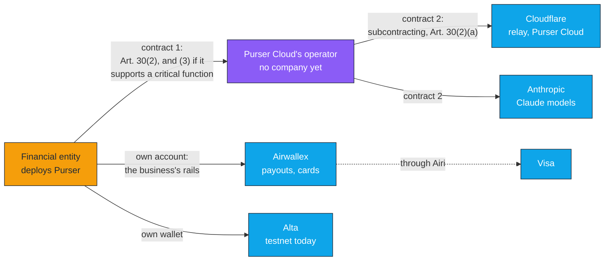

<a href="../../../README.md"><picture><source media="(prefers-color-scheme: dark)" srcset="../../assets/brand/purser-mark-dark.svg"></picture></a>

# ICT contract clauses: a DORA Art. 30 checklist

**The clauses DORA Art. 30 says a contract for ICT services must hold, what Purser can point to for each today, and which providers of the register each contract would be with.**

&nbsp;&nbsp;&nbsp;&nbsp;

[Who signs](#who-signs-which-contract) · [Art. 30(1)](#art-301-in-writing-one-document) · [Art. 30(2)](#art-302-every-contract) · [Art. 30(3)](#art-303-critical-or-important-functions) · [Per provider](#per-provider) · [Before signing](#before-signing)

## Document control

| Owner | Version | Written | Review by | Reviewed by counsel |
|---|---|---|---|---|
| The maintainer | 1.0 | 26 November 2026 | 26 May 2027, and when a provider is added to the [register](../third-parties.md) or a contract is signed | No |

> [!IMPORTANT]
> **Test money / sandbox. Template, not legal advice; not reviewed by counsel.** DORA (Regulation (EU) 2022/2554)
> binds financial entities, and Purser is not one: a financial entity that deploys Purser uses this list when it
> negotiates. **No contract exists today.** Every provider in the [third-party register](../third-parties.md) is used
> on a test, sandbox or developer account on its standard terms: in the register's words, *"none: sandbox terms"* or
> the like, per provider. This page lists what a contract must hold; it is not one, and DORA Art. 30(1) stays a gap in
> [controls.md](../controls.md) until a contract is signed. The regulatory technical standards made under DORA (on
> subcontracting and on the policy for ICT services) are not mapped.

## Who signs which contract

Two layers. A financial entity that runs Purser contracts with whoever operates Purser Cloud for it, and the
providers below sit in the chain behind that, as subcontractors of the operator or as the entity's own providers
when it runs the runner with its own accounts.

Who holds which account is the deployment's choice: the [instructions for use](../instructions-for-use.md#8-what-it-needs-to-run)
list the keys each part needs. The money stays in the business's own Airwallex and Alta accounts.

## Art. 30(1): in writing, one document

| Clause | What the contract must say | Purser today | Check when negotiating |
|---|---|---|---|
| 30(1) | The rights and obligations of both parties, clearly allocated and set out in writing; the full contract, service levels included, in one written document, on paper or in a downloadable, durable and accessible format | **None.** Test accounts on the providers' standard terms, accepted online | One signed document per provider, kept with the entity's register of information; the register's `contract` field updated ([third-parties.json](../third-parties.json)) |

## Art. 30(2): every contract

For every ICT service, whatever the function it supports.

| Clause | What the contract must say | Purser today (from this repository) | Check when negotiating |
|---|---|---|---|
| 30(2)(a) | A clear and complete description of all functions and ICT services; whether subcontracting of a critical or important function, or a material part of it, is allowed, and on which conditions | The register describes each provider's service and the functions it supports; one provider is reached through another (Visa through Airwallex Airi) | Subcontracting named and bounded; Purser's own subprocessors listed as in the [DPA's Annex III](dpa.md#annex-iii-subprocessors) |
| 30(2)(b) | The locations (regions or countries) where the services are provided and data is processed, storage included; notice in advance before a location changes | The register's location column; several say *not documented in this repository*. Purser Cloud's D1 is placed in western Europe and its R2 bucket in the EU jurisdiction; Durable Objects and logs are not pinned | Every location named; advance notice of a change; the [transfers note](../transfers.md) for anything outside the EU |
| 30(2)(c) | Availability, authenticity, integrity and confidentiality of data, personal data included | Purser's own side: data levels per [data-classification.md](../../security/data-classification.md), hash-chained audit log (PC-10), passkey over the exact terms (PC-01), webhook signatures checked twice (PC-14). The providers' side: their standard terms, not reviewed | The provider's measures in writing, at least as strict as the levels of the data it receives |
| 30(2)(d) | Access, recovery and return of personal and non-personal data, in an easily accessible format, on the provider's insolvency, resolution, discontinuation or the contract's end | Purser Cloud: a company's export (`GET /v1/export`, `POST /v1/export/staged`) and a tested import into a fresh database (`cloud/src/restore.ts`; no route runs it in production). The runner's ledger is a SQLite file the business holds. Nothing is agreed with any provider | Format and timing of the return; who pays; what the provider deletes afterwards, and when |
| 30(2)(e) | Service level descriptions, with their updates and revisions | **None agreed.** Purser publishes no service level; without a rail, payments wait (it fails safe: [exit-plans.md](../exit-plans.md)) | Levels set from how long a payment may wait; how a change to them is agreed |
| 30(2)(f) | Assistance when an ICT incident related to the service occurs, at no extra cost or at a cost fixed in advance | [incident-response.md](../incident-response.md) has Purser's own procedure; nothing is agreed with any provider | Contact, response time and cost of help in an incident |
| 30(2)(g) | Full cooperation with the competent authorities and resolution authorities, and persons they appoint | **None.** Purser has no dealings with any authority | Cooperation in writing, without a cost that stops it |
| 30(2)(h) | Termination rights and minimum notice periods, as the competent authorities expect | The providers' standard terms; [exit-plans.md](../exit-plans.md) says what moving away takes | Notice long enough to carry out the exit plan |
| 30(2)(i) | The conditions for the provider's participation in the entity's ICT security awareness programmes and digital operational resilience training (Art. 13(6)) | Purser's own awareness material: [ai-literacy.md](../ai-literacy.md). No programme has run | Who of the provider takes part, and how often |

## Art. 30(3): critical or important functions

On top of Art. 30(2), for a service that supports a critical or important function of the entity. The register marks
Airwallex, Alta and Cloudflare critical, and Anthropic, Visa through Airi and GitHub important; the entity decides for
itself.

| Clause | What the contract must say | Purser today (from this repository) | Check when negotiating |
|---|---|---|---|
| 30(3)(a) | Full service level descriptions, with precise quantitative and qualitative performance targets, so the entity can monitor them and act when they are not met | **None.** What Purser measures (hourly reconciliation, PC-15; refusals and holds, PC-11) are its own records, not targets | Targets per service, measured the same way on both sides |
| 30(3)(b) | Notice periods and the provider's reporting duties, including any development that may materially affect its ability to provide the service | **None agreed.** Purser notices some changes itself: a webhook that disagrees with the ledger (`airwallex.disagrees`), a reconciliation difference | Notice of changes to the API, the service or its locations |
| 30(3)(c) | The provider implements and tests business contingency plans, and has ICT security measures, tools and policies at the level the entity's regulatory framework needs | Purser's own [runbook](../../runbook.md) says which steps were exercised; the providers' plans have not been seen | The provider's plan, and the results of its tests |
| 30(3)(d) | The provider takes part, and cooperates fully, in the entity's threat-led penetration testing (Arts. 26 and 27) | **None.** No threat-led penetration test has been run (the DORA Art. 24(1) row of [controls.md](../controls.md)) | Participation, scope and notice |
| 30(3)(e) | Ongoing monitoring of performance: unrestricted rights of access, inspection and audit for the entity, a third party it appoints and the competent authority; the right to take copies; other assurance if other clients' rights are affected; cooperation in on-site inspections; scope, procedures and frequency of audits | **None.** No provider has been audited by Purser ([third-parties.md](../third-parties.md#what-it-is-not)) | Audit rights in full; pooled audits where the provider offers them |
| 30(3)(f) | Exit strategies, in particular a mandatory adequate transition period, during which the provider keeps providing the service | [exit-plans.md](../exit-plans.md): one plan per critical or important provider, written, none exercised; no transition period agreed | A transition period at least as long as the exit plan needs |

## Per provider

Generated from the [third-party register](../third-parties.json) and the [record of processing](../gdpr.md#record-of-processing-activities-art-30).

<!-- ict-providers:start: generated by npm run compliance:controls from docs/compliance/third-parties.json; do not edit by hand -->

20 providers in the register (as of 2026-11-26). Criticality is Purser's own view in the register; the financial entity decides its own.

| Provider | Criticality (register) | Art. 30 clauses the contract needs | Contract today (register) | Personal data (record of processing) | Exit plan |
|---|---|---|---|---|---|
| **Airwallex** | critical | Art. 30(2) and 30(3) | none: a sandbox account on Airwallex's standard terms | Yes (R3, R4, R5, R9): a [DPA](dpa.md) and, outside the EU, a [transfer mechanism](../transfers.md) | [exit plan](../exit-plans.md#airwallex) |
| **Visa, through Airwallex Airi** | important | Art. 30(2) and 30(3) | none: through Airwallex's sandbox | Yes (R4): a [DPA](dpa.md) and, outside the EU, a [transfer mechanism](../transfers.md) | [exit plan](../exit-plans.md#visa-through-airwallex-airi) |
| **Alta (formerly Metal)** | critical | Art. 30(2) and 30(3) | none: a public testnet | Yes (R4): written to a public chain, so keep personal data off it ([transfers](../transfers.md)) | [exit plan](../exit-plans.md#alta) |
| **Anthropic (Claude API)** | important | Art. 30(2) and 30(3) | none: a developer API key on Anthropic's standard terms | Yes (R3, R5): a [DPA](dpa.md) and, outside the EU, a [transfer mechanism](../transfers.md) | [exit plan](../exit-plans.md#anthropic) |
| **Cloudflare** | critical | Art. 30(2) and 30(3) | none negotiated: the maintainer's account on Cloudflare's standard terms | Yes (R1, R2, R3, R4, R5, R6, R7, R8, R9): a [DPA](dpa.md) and, outside the EU, a [transfer mechanism](../transfers.md) | [exit plan](../exit-plans.md#cloudflare) |
| **GitHub** | important | Art. 30(2) and 30(3) | none: the maintainer's account on GitHub's standard terms | No | [exit plan](../exit-plans.md#github) |
| **T:0** | optional | Art. 30(2) | none: a test account | Yes (R3): a [DPA](dpa.md) and, outside the EU, a [transfer mechanism](../transfers.md) | none (not critical or important) |
| **Moneybird** | optional | Art. 30(2) | none: a test administration | Yes (R3): a [DPA](dpa.md) and, outside the EU, a [transfer mechanism](../transfers.md) | none (not critical or important) |
| **Xero** | optional | Art. 30(2) | none: a developer app | Yes (R3): a [DPA](dpa.md) and, outside the EU, a [transfer mechanism](../transfers.md) | none (not critical or important) |
| **Intuit QuickBooks Online** | optional | Art. 30(2) | none: a developer app | Yes (R3): a [DPA](dpa.md) and, outside the EU, a [transfer mechanism](../transfers.md) | none (not critical or important) |
| **Exact Online** | optional | Art. 30(2) | none: a developer app | Yes (R3): a [DPA](dpa.md) and, outside the EU, a [transfer mechanism](../transfers.md) | none (not critical or important) |
| **Odoo** | optional | Art. 30(2) | none | Yes (R3): a [DPA](dpa.md) and, outside the EU, a [transfer mechanism](../transfers.md) | none (not critical or important) |
| **Microsoft (Entra ID, Graph, Business Central, Teams)** | optional | Art. 30(2) | none: developer apps | Yes (R1, R3, R7): a [DPA](dpa.md) and, outside the EU, a [transfer mechanism](../transfers.md) | none (not critical or important) |
| **Google (Sign-In, Gmail, Drive, Sheets)** | optional | Art. 30(2) | none: developer apps | Yes (R1, R3): a [DPA](dpa.md) and, outside the EU, a [transfer mechanism](../transfers.md) | none (not critical or important) |
| **Apple (Sign in with Apple)** | optional | Art. 30(2) | none: a developer account | Yes (R1): a [DPA](dpa.md) and, outside the EU, a [transfer mechanism](../transfers.md) | none (not critical or important) |
| **Slack** | optional | Art. 30(2) | none | Yes (R7): a [DPA](dpa.md) and, outside the EU, a [transfer mechanism](../transfers.md) | none (not critical or important) |
| **Resend** | optional | Art. 30(2) | none | Yes (R7): a [DPA](dpa.md) and, outside the EU, a [transfer mechanism](../transfers.md) | none (not critical or important) |
| **Twilio** | optional | Art. 30(2) | none | Yes (R7): a [DPA](dpa.md) and, outside the EU, a [transfer mechanism](../transfers.md) | none (not critical or important) |
| **ElevenLabs** | not-in-product | none: not an ICT service the product uses | none | No | none (not critical or important) |
| **Sigstore (Rekor)** | optional | Art. 30(2) | none: Sigstore's public-good service on its terms of use | No | none (not critical or important) |

<!-- ict-providers:end -->

## Before signing

1. **Agree the criticality.** The register's criticality is Purser's view of its own functions. The financial entity
   decides which of its functions Purser supports and whether they are critical or important; that decides whether
   Art. 30(3) applies.
2. **Hold each provider's terms against the tables above.** Where its standard terms leave a clause out, negotiate it
   or record the gap in the entity's own risk assessment.
3. **Consider standard clauses** that public authorities have developed for specific services (Art. 30(4)).
4. **Add the data protection terms**: a data processing agreement ([dpa.md](dpa.md)) and, for data that leaves the EU,
   a transfer mechanism ([transfers.md](../transfers.md)).
5. **Agree the exit**: the plan in [exit-plans.md](../exit-plans.md), with the transition period.
6. **Record it.** The register's `contract` field for that provider, then `npm run compliance:controls`. Only then can
   the DORA Art. 30(1) row of [controls.md](../controls.md) change.

## See also

- [../third-parties.md](../third-parties.md): the register these tables are drawn from.
- [../exit-plans.md](../exit-plans.md#contracts-what-a-production-contract-must-include): the exit plans, and the short list this page expands.
- [dpa.md](dpa.md): the data processing agreement template.
- [../controls.md](../controls.md): the control map (PC-38).
