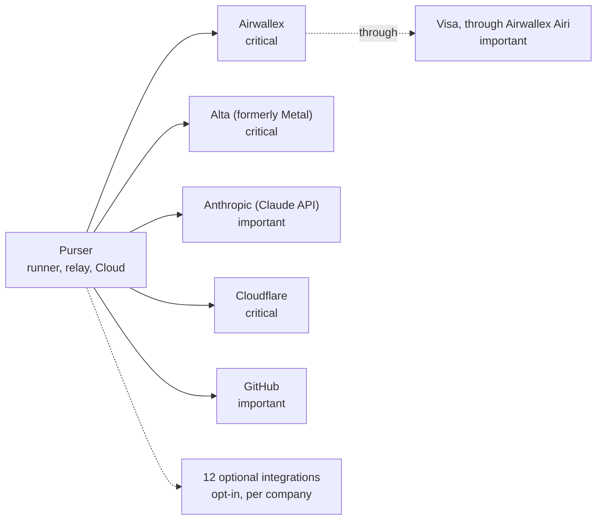

<a href="../../README.md"><picture><source media="(prefers-color-scheme: dark)" srcset="../assets/brand/purser-mark-dark.svg"></picture></a>

# ICT third-party register

**Every outside service Purser's code calls: what it does for Purser, what it receives, how critical it is, and how it would be replaced.**

&nbsp;&nbsp;&nbsp;

<!-- Generated by npm run compliance:controls from docs/compliance/third-parties.json. Do not edit by hand. -->

| Owner | Version | As of | Review by | Source |
|---|---|---|---|---|
| the maintainer (@agamemnon-coder) | 1.0 | 2026-11-26 | 2027-05-26 | [third-parties.json](third-parties.json) (machine-readable) |

> [!IMPORTANT]
> Purser's register of ICT third-party service providers, after DORA Art. 28(3). Test money only: the Airwallex sandbox, Alta testnet and Visa via Airwallex Airi in the sandbox. No provider is under a negotiated contract: every account is a test or developer account on the provider's standard terms. Data levels are those of docs/security/data-classification.md; locations are those docs/privacy/data-inventory.md records, else 'not documented in this repository'. A test (test/compliance-third-parties.test.ts) holds every outside host the code calls to a provider here, and every host here to the code.

> [!NOTE]
> Mapped to, not certified against: certification or an attestation needs an independent auditor, and nobody has audited Purser against any of these frameworks. Purser moves test money only, in the Airwallex sandbox and on Alta testnet.

## Who depends on whom

## The register

19 providers: 3 critical, 3 important, 12 optional (switched on per company), 1 not in the product. Critical or important means the function it supports stops or degrades without it (DORA Art. 3(22)); each has an [exit plan](exit-plans.md).

| Provider | Function for Purser | Data it receives (level) | Criticality | Hosts the code calls | Location | Contract | Exit and substitution |
|---|---|---|---|---|---|---|---|
| **Airwallex** | Pays suppliers (transfers, batch payouts, FX); Issues and freezes each agent's virtual card; Sends webhooks Purser checks against its ledger | Suppliers' names and bank details (beneficiaries), amounts, payouts, conversions, the agents' cardholders (placeholder personal details in the sandbox) (Restricted); The hash of the terms the CFO signed, in a transfer's metadata (approval_sha256) (Internal) | **critical** | `api.sandbox.airwallex.com`, `files.sandbox.airwallex.com`, `checkout.sandbox.airwallex.com`, `static.airwallex.com`, `www.sandbox.airwallex.com` | Sandbox today (docs/privacy/data-inventory.md); the production region is not documented in this repository | none: a sandbox account on Airwallex's standard terms | Another licensed payment provider with an API for payouts and issued cards; the executors call it through src/airwallex/ (adapter, client). [Exit plan](exit-plans.md#airwallex) |
| **Visa, through Airwallex Airi** | One agent purchase at a merchant, after the cardholder's passkey in Airi | The purchase (merchant, amount, description); Purser never sees a card number (Restricted) | important | through Airwallex | Through Airwallex's sandbox (no Visa host is called by Purser's code) | none: through Airwallex's sandbox | Agent purchases on the agent's own Airwallex card (src/policy/cards.ts), or none. [Exit plan](exit-plans.md#visa-through-airwallex-airi) |
| **Alta (formerly Metal)** | Agent-to-agent payments (x402) within each agent's on-chain mandate; Anchors the audit log's head | Agents' addresses and amounts, written to a public testnet for good (Restricted); The audit log's head hash (anchoring) (Internal) | **critical** | `x402-testnet.metalntwx.com` (The chain's RPC endpoint is a credential, read from METAL_RPC_URL and never printed (src/metal/network.ts)) | Public testnet: written for good (docs/privacy/data-inventory.md) | none: a public testnet | No chain: agent payments go by card or bank transfer only; the audit log is still hash-chained and signed without the anchor. [Exit plan](exit-plans.md#alta) |
| **Anthropic (Claude API)** | Reads invoices into typed data (checked by code); The agents propose; they never approve or hold a key; Ask Purser answers from the docs, read-only | Invoice text and documents to read, the agents' prompts, a person's question to Ask Purser (Restricted) | important | `api.anthropic.com` | United States (docs/privacy/data-inventory.md) | none: a developer API key on Anthropic's standard terms | Reading falls back to the plain parser (claude.fallback); the agents can be switched off and every payment proposed by a person; another model provider behind src/claude/. [Exit plan](exit-plans.md#anthropic) |
| **Cloudflare** | Serves the phone's approval pages and relays signed approvals to the runner; Hosts Purser Cloud and its data | Everything Purser Cloud stores and every request it serves (the books, documents, people, security logs) (Restricted); Sealed tokens and key hashes Purser Cloud keeps (never a secret in the clear) (Secret) | **critical** | `api.cloudflare.com`, `challenges.cloudflare.com` | D1 placed in western Europe (--location weur); R2 bucket in the EU jurisdiction; Durable Objects and logs not pinned (docs/privacy/data-inventory.md) | none negotiated: the maintainer's account on Cloudflare's standard terms | Without the relay no passkey approval reaches the runner, so payments above the limits wait (they fail safe); Purser Cloud would move to another Workers-compatible host. [Exit plan](exit-plans.md#cloudflare) |
| **GitHub** | Change control (PC-21): every change through a pull request and CI | The source code and its records (test money only); no company data (Public) | important | none | not documented in this repository | none: the maintainer's account on GitHub's standard terms | Any git host with CI; the repository is a full copy wherever it is cloned. [Exit plan](exit-plans.md#github) |
| **T:0** | Bookkeeping sink (opt-in) | Journal entries: invoices, suppliers and payments (Restricted) | optional (opt-in) | `api.t0.ai` | The provider's (docs/privacy/data-inventory.md) | none: a test account | Any other bookkeeping sink, or none: the ledger keeps the books |
| **Moneybird** | Bookkeeping sink (opt-in) | Invoices, suppliers and journal entries pushed to the company's own administration (Restricted) | optional (opt-in) | `moneybird.com` | The provider's (docs/privacy/data-inventory.md) | none: a test administration | Any other bookkeeping sink, or none |
| **Xero** | Bookkeeping sink and invoice source (opt-in) | Invoices, suppliers and journal entries (Restricted) | optional (opt-in) | `api.xero.com`, `identity.xero.com`, `login.xero.com` | The provider's (docs/privacy/data-inventory.md) | none: a developer app | Any other bookkeeping sink, or none |
| **Intuit QuickBooks Online** | Bookkeeping sink (opt-in) | Invoices, suppliers and journal entries (Restricted) | optional (opt-in) | `appcenter.intuit.com`, `oauth.platform.intuit.com`, `developer.api.intuit.com` | The provider's (docs/privacy/data-inventory.md) | none: a developer app | Any other bookkeeping sink, or none |
| **Exact Online** | Bookkeeping sink (opt-in) | Invoices, suppliers and journal entries (Restricted) | optional (opt-in) | `start.exactonline.nl` | The provider's (docs/privacy/data-inventory.md) | none: a developer app | Any other bookkeeping sink, or none |
| **Odoo** | Bookkeeping sink (opt-in) | Invoices, suppliers and journal entries (Restricted) | optional (opt-in) | none (Each company's own Odoo address, set by the company) | The provider's (docs/privacy/data-inventory.md) | none | Any other bookkeeping sink, or none |
| **Microsoft (Entra ID, Graph, Business Central, Teams)** | Sign-in to Purser Cloud (opt-in); Invoice source and bookkeeping sink (opt-in); Approval alerts to the company's own Teams channel (opt-in) | A sign-in request (Purser receives the account's subject and e-mail); invoices read from the mailbox or folder; journal entries; an approval alert's message (Restricted) | optional (opt-in) | `login.microsoftonline.com`, `graph.microsoft.com`, `api.businesscentral.dynamics.com` (A Teams incoming webhook is the company's own URL) | The provider's (docs/privacy/data-inventory.md) | none: developer apps | Passkey sign-in without a linked account; other invoice sources |
| **Google (Sign-In, Gmail, Drive, Sheets)** | Sign-in to Purser Cloud (opt-in); Invoice source (opt-in) | A sign-in request (Purser receives the account's subject and e-mail); invoices read from the mailbox or folder (Restricted) | optional (opt-in) | `accounts.google.com`, `oauth2.googleapis.com`, `www.googleapis.com`, `gmail.googleapis.com`, `sheets.googleapis.com` | The provider's (docs/privacy/data-inventory.md) | none: developer apps | Passkey sign-in without a linked account; other invoice sources |
| **Apple (Sign in with Apple)** | Sign-in to Purser Cloud (opt-in) | A sign-in request; Purser receives the account's subject and e-mail (Restricted) | optional (opt-in) | `appleid.apple.com` | The provider's (docs/privacy/data-inventory.md) | none: a developer account | Passkey sign-in without a linked account |
| **Slack** | Approval alerts with a link to the passkey page, never a way to approve (opt-in) | An approval alert's message (amount, payee, link) (Restricted) | optional (opt-in) | `hooks.slack.com` | The provider's (docs/privacy/data-inventory.md) | none | E-mail or WhatsApp alerts, or the phone's push notification |
| **Resend** | Approval alerts by e-mail (opt-in) | An approval alert's e-mail address and message (amount, payee, link) (Restricted) | optional (opt-in) | `api.resend.com` | United States (docs/privacy/data-inventory.md) | none | Another e-mail provider, or the other alert channels |
| **Twilio** | Approval alerts by WhatsApp (opt-in) | An approval alert's phone number and message (Restricted) | optional (opt-in) | `api.twilio.com` | United States (docs/privacy/data-inventory.md) | none | The other alert channels |
| **ElevenLabs** | None in the product: only scripts that voice the demo film | The film's script (Public) | not in the product | `api.elevenlabs.io` | not documented in this repository | none | Any voice, or none |

## How it is kept true

- `test/compliance-third-parties.test.ts` reads every `https://` host written in `src/`, `cloud/src/` and `worker/src/`. Each is either a provider's host here, or listed in the test as not called (a documentation link, an explorer link, Purser's own deployments, a placeholder in a test case), with the reason. A new outside host fails the test until it is registered; a host here that the code no longer names fails it too.
- Each provider's data levels are the levels of [data-classification.md](../security/data-classification.md); a critical or important provider has an exit plan in [exit-plans.md](exit-plans.md).
- The register is reviewed with the AI policy ([ai-policy.md](ai-policy.md)), at the latest on its review date, and whenever a provider is added.

## What it is not

- Not DORA's register of information in the form of its implementing technical standards: Purser is not a financial entity and has no contractual arrangements to report. A financial entity that deploys Purser enters these providers in its own register.
- No due diligence on a provider beyond what its public documents say; no provider has been audited by Purser.

## See also

- [exit-plans.md](exit-plans.md): exit plans per critical provider, and what a production contract must include.
- [../privacy/data-inventory.md](../privacy/data-inventory.md#subprocessors-the-code-calls): the same providers as subprocessors of company data.
- [controls.md](controls.md): the control map (PC-30).
