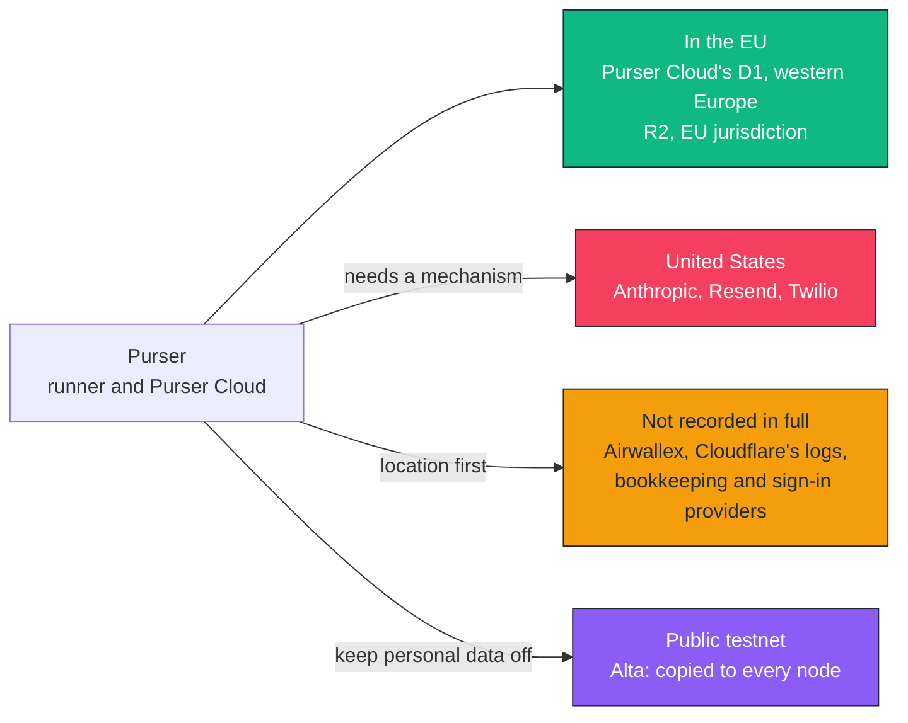

<a href="../../README.md"><picture><source media="(prefers-color-scheme: dark)" srcset="../assets/brand/purser-mark-dark.svg"></picture></a>

# Transfers outside the EU

**Where the personal data Purser handles goes, per provider of the register, and which GDPR Chapter V mechanism each transfer would need. None is in place yet.**

&nbsp;&nbsp;&nbsp;&nbsp;

[Where data goes](#where-the-data-goes) · [Per provider](#per-provider) · [The mechanisms](#the-mechanisms) · [What limits the data](#what-already-limits-what-leaves) · [Before real data](#before-real-data)

## Document control

| Owner | Version | Written | Review by | Reviewed by counsel |
|---|---|---|---|---|
| The maintainer; in a deployment, the controller's data protection lead | 1.0 | 26 November 2026 | 26 May 2027, and when a provider or its location changes in the [register](third-parties.md) | No |

> [!IMPORTANT]
> **Test money / sandbox. Not legal advice; not reviewed by counsel.** Purser holds test data only. This note says,
> from the [third-party register](third-parties.md) and the [record of processing](gdpr.md#record-of-processing-activities-art-30),
> which providers receive personal data and where they are, and which mechanism a transfer would need. **No transfer
> mechanism is in place or recorded for any provider**, so GDPR Art. 44 stays a gap in [controls.md](controls.md).
> Whether a provider is listed under the EU-US Data Privacy Framework has not been checked in this repository.

## Where the data goes

## Per provider

Generated from the [third-party register](third-parties.json) and the record of processing
([`src/compliance/gdpr.ts`](../../src/compliance/gdpr.ts)); the activities R1 to R9 are those of
[gdpr.md](gdpr.md#record-of-processing-activities-art-30).

<!-- transfers:start: generated by npm run compliance:controls from docs/compliance/third-parties.json and src/compliance/gdpr.ts; do not edit by hand -->

17 providers receive personal data: 3 in the United States, 13 whose location the repository does not record in full, 1 public chain. A transfer mechanism is recorded for none of them.

| Recipient | Location (register) | Activities | Outside the EU | Mechanism it would need | Recorded today |
|---|---|---|---|---|---|
| **Airwallex** | Sandbox today (docs/privacy/data-inventory.md); the production region is not documented in this repository | R3, R4, R5, R9 | not known | **Not known until the location is.** Record where the data is processed; if outside the EEA and with no adequacy decision, Standard Contractual Clauses with a transfer impact assessment | none |
| **Visa, through Airwallex Airi** | Through Airwallex's sandbox (no Visa host is called by Purser's code) | R4 | not known | **Not known until the location is.** Record where the data is processed; if outside the EEA and with no adequacy decision, Standard Contractual Clauses with a transfer impact assessment | none |
| **Alta (formerly Metal)** | Public testnet: written for good (docs/privacy/data-inventory.md) | R4 | everywhere its nodes run | **None can cover it.** A public chain is copied wherever its nodes run: keep personal data off it | none |
| **Anthropic (Claude API)** | United States (docs/privacy/data-inventory.md) | R3, R5 | **yes** | **Needed.** The EU-US Data Privacy Framework only if the recipient is listed under it for this data on the day; otherwise Standard Contractual Clauses (Module 3 from Purser Cloud's operator, Module 2 where the business contracts directly) with a transfer impact assessment | none |
| **Cloudflare** | D1 placed in western Europe (--location weur); R2 bucket in the EU jurisdiction; Durable Objects and logs not pinned (docs/privacy/data-inventory.md) | R1, R2, R3, R4, R5, R6, R7, R8, R9 | not known | **Not known until the location is.** Record where the data is processed; if outside the EEA and with no adequacy decision, Standard Contractual Clauses with a transfer impact assessment | none |
| **T:0** | The provider's (docs/privacy/data-inventory.md) | R3 | not known | **Not known until the location is.** Record where the data is processed; if outside the EEA and with no adequacy decision, Standard Contractual Clauses with a transfer impact assessment | none |
| **Moneybird** | The provider's (docs/privacy/data-inventory.md) | R3 | not known | **Not known until the location is.** Record where the data is processed; if outside the EEA and with no adequacy decision, Standard Contractual Clauses with a transfer impact assessment | none |
| **Xero** | The provider's (docs/privacy/data-inventory.md) | R3 | not known | **Not known until the location is.** Record where the data is processed; if outside the EEA and with no adequacy decision, Standard Contractual Clauses with a transfer impact assessment | none |
| **Intuit QuickBooks Online** | The provider's (docs/privacy/data-inventory.md) | R3 | not known | **Not known until the location is.** Record where the data is processed; if outside the EEA and with no adequacy decision, Standard Contractual Clauses with a transfer impact assessment | none |
| **Exact Online** | The provider's (docs/privacy/data-inventory.md) | R3 | not known | **Not known until the location is.** Record where the data is processed; if outside the EEA and with no adequacy decision, Standard Contractual Clauses with a transfer impact assessment | none |
| **Odoo** | The provider's (docs/privacy/data-inventory.md) | R3 | not known | **Not known until the location is.** Record where the data is processed; if outside the EEA and with no adequacy decision, Standard Contractual Clauses with a transfer impact assessment | none |
| **Microsoft (Entra ID, Graph, Business Central, Teams)** | The provider's (docs/privacy/data-inventory.md) | R1, R3, R7 | not known | **Not known until the location is.** Record where the data is processed; if outside the EEA and with no adequacy decision, Standard Contractual Clauses with a transfer impact assessment | none |
| **Google (Sign-In, Gmail, Drive, Sheets)** | The provider's (docs/privacy/data-inventory.md) | R1, R3 | not known | **Not known until the location is.** Record where the data is processed; if outside the EEA and with no adequacy decision, Standard Contractual Clauses with a transfer impact assessment | none |
| **Apple (Sign in with Apple)** | The provider's (docs/privacy/data-inventory.md) | R1 | not known | **Not known until the location is.** Record where the data is processed; if outside the EEA and with no adequacy decision, Standard Contractual Clauses with a transfer impact assessment | none |
| **Slack** | The provider's (docs/privacy/data-inventory.md) | R7 | not known | **Not known until the location is.** Record where the data is processed; if outside the EEA and with no adequacy decision, Standard Contractual Clauses with a transfer impact assessment | none |
| **Resend** | United States (docs/privacy/data-inventory.md) | R7 | **yes** | **Needed.** The EU-US Data Privacy Framework only if the recipient is listed under it for this data on the day; otherwise Standard Contractual Clauses (Module 3 from Purser Cloud's operator, Module 2 where the business contracts directly) with a transfer impact assessment | none |
| **Twilio** | United States (docs/privacy/data-inventory.md) | R7 | **yes** | **Needed.** The EU-US Data Privacy Framework only if the recipient is listed under it for this data on the day; otherwise Standard Contractual Clauses (Module 3 from Purser Cloud's operator, Module 2 where the business contracts directly) with a transfer impact assessment | none |

<!-- transfers:end -->

## The mechanisms

A transfer of personal data to a country outside the EEA needs one of the grounds of GDPR Chapter V. For Purser's
providers, three are relevant:

| Mechanism | When it covers a transfer | What to record |
|---|---|---|
| **Adequacy decision** (Art. 45), including the **EU-US Data Privacy Framework** (Commission Implementing Decision (EU) 2023/1795) | The recipient's country has an adequacy decision; for the United States, only an organisation that has signed up to the Framework and is on its list, for the kind of data sent, on the day of the transfer | The recipient's entry on the list and the date checked; check again at each review. The Framework's decision has been challenged before the EU courts: check its standing on the day |
| **Standard Contractual Clauses** (Art. 46(2)(c); Commission Implementing Decision (EU) 2021/914) | Otherwise. **Module 2** (controller to processor) where the business contracts with the provider directly, as when it runs the runner with its own accounts; **Module 3** (processor to processor) where Purser Cloud's operator engages the provider as its subprocessor | The signed clauses, and a transfer impact assessment of the recipient country's law with any supplementary measures (after the Court of Justice's judgment in case C-311/18, *Schrems II*) |
| **Derogations** (Art. 49) | Occasional, specific transfers only; not a basis for the regular transfers below | Not used |

Which module applies, and whether the recipient's own position under the GDPR changes the answer, is for counsel.
The [data processing agreement template](templates/dpa.md#11-transfers-outside-the-eu) carries the mechanism per
subprocessor as an attachment.

## What already limits what leaves

These hold in the code today; they reduce what is transferred, they are not a transfer mechanism.

- **Anthropic** receives the text of invoices and documents to read, the agents' prompts, and a question asked of Ask
  Purser. No card number, CVV, key or secret reaches a model ([ai-policy.md](ai-policy.md#acceptable-use-of-claude-agents));
  without a Claude key the reader falls back to the plain parser and nothing is sent.
- **Resend** and **Twilio** receive an approval alert only when the company switches one on: an e-mail address or a
  phone number and a message with the amount, the payee and a link. The link approves nothing: approving needs the
  passkey ([phone-approval.md](../phone-approval.md)).
- **Alta's testnet** receives agents' addresses and amounts, never a name; whether an address is personal data depends
  on whether it can be linked to a person, which the deployer decides before production.
- **Purser Cloud's database and documents** are placed in the EU (D1 in western Europe, R2 in the EU jurisdiction);
  Cloudflare's Durable Objects and logs are not pinned ([data-inventory.md](../privacy/data-inventory.md)).

## Before real data

1. Record each provider's processing location in the [register](third-parties.json) where it says *not documented*
   or *the provider's*.
2. For each provider outside the EEA, check the Data Privacy Framework's list on the day, or sign the Standard
   Contractual Clauses with a transfer impact assessment.
3. Record the mechanism per provider in the register and in the data processing agreement's attachment, then run
   `npm run compliance:controls`. Only then can the GDPR Art. 44 row of [controls.md](controls.md) change.

## See also

- [gdpr.md](gdpr.md#transfers-outside-the-eu): the record of processing and its transfers table.
- [templates/dpa.md](templates/dpa.md): the data processing agreement template, Annex III subprocessors.
- [third-parties.md](third-parties.md): the register.
- [../privacy/data-inventory.md](../privacy/data-inventory.md#subprocessors-the-code-calls): the same providers as subprocessors.
