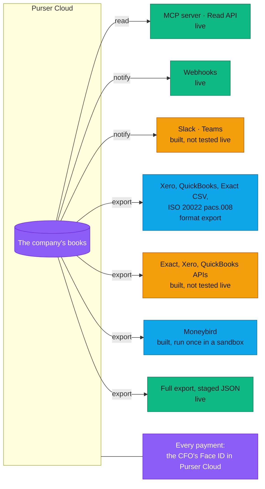
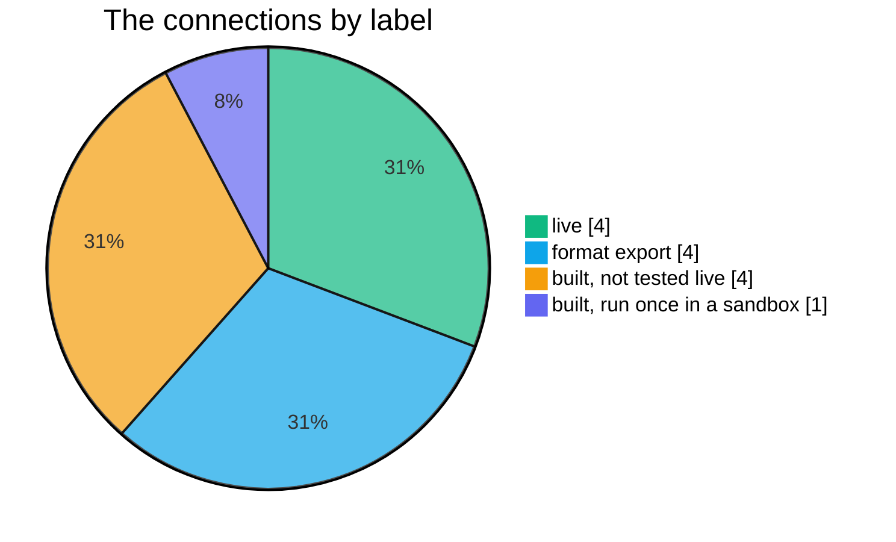

<div align="center">

<a href="../README.md"><picture><source media="(prefers-color-scheme: dark)" srcset="assets/brand/purser-mark-dark.svg"></picture></a>

# Connections to other systems

**Every connection reads, notifies or exports; none moves money, approves a payment, changes a limit or writes to Purser's books.**

[](https://github.com/agamemnon-coder/x402-business-agents/actions/workflows/ci.yml?query=branch%3Amain)&nbsp;[](#connections-to-other-systems)&nbsp;[](#connections-to-other-systems)&nbsp;[](#webhooks)&nbsp;[](#slack-and-microsoft-teams)&nbsp;[](../README.md#built-with)

[The connections](#connections-to-other-systems) · [Webhooks](#webhooks) · [Slack and Teams](#slack-and-microsoft-teams) · [Accounting exports](#accounting-exports-format-exports) · [OpenAPI](#the-read-apis-openapi) · [Connect anything](integrations/README.md)

</div>

Every connection on this page reads, notifies or exports. **None moves money, approves a payment, changes a limit or
writes to Purser's books;** an accounting system receives drafts or entries a person there checks. Every payment needs the
CFO's Face ID in Purser Cloud. `GET /v1/connections` returns these from the code (`cloud/src/connections.ts`), with the
payment rails listed apart, and `test/connections.test.ts` holds each label to what is built. Each company connects its
own systems in Settings ("Your connections"); what the platform sets up once is in
[integrations/owner-setup.md](integrations/owner-setup.md). Every connection, the payment rails and each AI client
included, with a quickstart each: [Connect Purser to anything](integrations/README.md). This page holds the details of
the webhooks, the chat formats and the accounting exports.

Labels: **live** means it is built and runs in Purser Cloud; **format export** means Purser writes a file or message in
another product's documented format, and a person or the team's own tooling takes it from there (there is no live
connection to that product); **built, not tested live** means the code exists but has not run against the real service.





<sub>Record: [the table below](connections.md#connections-to-other-systems), counted by `test/docs-charts.test.ts`; `GET /v1/connections` returns the same list from `cloud/src/connections.ts`, and `test/connections.test.ts` holds each label to what is built.</sub>

| Connection | Label | Direction | Where |
|---|---|---|---|
| MCP server (Connect any AI) | live | read | `/mcp`, set up per client on `/connect-ai`; [connect-claude.md](connect-claude.md) |
| Read API (REST) and its OpenAPI | live | read | `/v1/openapi.read.json` (the read API alone), `/v1/openapi.json` (everything) |
| Webhooks: `payment.paid`, `approval.needed`, `books.closed` | live | notify | `POST /v1/webhook` (an owner sets the address) |
| Slack and Microsoft Teams messages | built, not tested live | notify | `POST /v1/chat-hooks/{slack,teams}` (Connections, Slack and Teams); below |
| Xero: bills and manual journals (CSV) | format export | export | `/v1/export/csv/xero/bills`, `/v1/export/csv/xero/journals` |
| QuickBooks Online: bills (CSV) | format export | export | `/v1/export/csv/quickbooks/bills` |
| Exact Online: Inkoopboekingen and Memoriaalboekingen (CSV) | format export | export | `/v1/export/csv/exact/bills`, `/v1/export/csv/exact/journals` |
| Exact Online (REST API, from the runner) | built, not tested live | export | each company connects in Settings (`/v1/connect/exact/start`); `src/erp/exact.ts` with `ERP_EXACT_OAUTH=on` |
| Xero (API): draft bills | built, not tested live | export | each company connects in Settings (`/v1/connect/xero/start`), then `POST /v1/connect/xero/bills` |
| QuickBooks Online (API): connect only | built, not tested live | export | `/v1/connect/quickbooks/start`; bills push planned: [quickbooks-plan.md](integrations/quickbooks-plan.md) |
| Moneybird (API, from the runner) | built, run once in a sandbox | export | `src/erp/moneybird.ts`, [moneybird.md](moneybird.md) |
| ISO 20022 pacs.008 | format export | export | `npm run iso20022` (`src/finance/iso20022.ts`) |
| Full export (staged JSON) | live | export | `GET /v1/export`, `POST /v1/export/staged` |

## Webhooks

An owner sets one webhook address (`POST /v1/webhook` with `{ "url": "https://…" }`, a public https host); the answer
carries its signing secret once. Every event is a POST with `x-purser-signature: t=<unix seconds>,v1=<hex>`, where
`v1` is HMAC-SHA256 over `` `${t}.${body}` `` under that secret. Check the signature and that `t` is recent before you
trust a body. Up to three attempts per event; after 20 failed deliveries in a row the webhook turns itself off.

The business events come from the runner's pushes (`POST /v1/sync`): Purser compares each invoice before and after the
push and raises an event only for a change that push made, so a replayed push raises nothing.

| Event | When | `data` |
|---|---|---|
| `approval.needed` | an invoice is filed for the CFO's Face ID | `invoice_id`, `amount`, `currency`, `due_date`, `proposal_id`, `approve_in` (Purser Cloud), `note` |
| `payment.paid` | an invoice the cloud already held becomes paid (a backlog's first push is history, not news) | `invoice_id`, `amount`, `currency`, `paid_at`, `proposal_id`, `link` |
| `books.closed` | a year-end closing entry reaches the ledger | `year`, `entry_id`, `posting_date`, `entry_hash`, `link` |

The same webhook also carries the runner's alerts and the security events (an owner recovery, a staged export). Events
carry ids, amounts and days, never a supplier's or a person's name.

```json
{ "id": "evt_…", "type": "approval.needed", "created_at": "2026-11-13T09:00:00.000Z",
  "data": { "invoice_id": "AP-0005", "amount": "1309.00", "currency": "EUR", "due_date": "2026-11-23", "proposal_id": "P-0009",
            "approve_in": "https://purser-try.max-31b.workers.dev/#/invoices", "note": "Only the CFO approves, in Purser Cloud, with Face ID." } }
```

## Slack and Microsoft Teams

Each company's owner pastes its own Slack incoming webhook URL (`https://hooks.slack.com/services/…`) or Teams Workflow
URL (the Teams "Workflows" app, "Send webhook alerts to a channel":
`https://….environment.api.powerplatform.com/powerautomate/automations/direct/workflows/…/triggers/manual/paths/invoke?…`)
in Connections, Slack and Teams (`POST /v1/chat-hooks/{slack,teams}`, a signed-in owner). Purser then posts
`approval.needed`, `payment.paid` and `books.closed` there in the formats below (`cloud/src/chatHooks.ts`), retried up
to three times, at most 30 an hour, and switched off after 20 failed events in a row; "Send a test" posts one message
and switches a hook back on. Only Slack's and Microsoft's documented hosts are accepted; Office 365 connector URLs
(`webhook.office.com`) were retired by Microsoft in May 2026 and are refused. A message carries ids, amounts, days and
Purser Cloud's own link; never an approve action, a secret or a bank detail. The URL is never shown again or exported.
A team can still relay the signed webhook into chat itself with `chatMessage(event, "slack" | "teams")` in
`cloud/src/connections.ts`. The buttons only open Purser Cloud; there is nothing to approve in chat.
Approval alerts (docs/cloud.md, Approval alerts) post the same formats straight to a Slack or Teams incoming webhook an
owner sets in Connections, Alerts, with the payee and why the payment waits added; built and tested with stand-ins, not
yet sent live.

Slack (Block Kit, for an incoming webhook):

```json
{ "text": "Waiting for the CFO's Face ID: Invoice AP-0005, EUR 1309.00, due 2026-11-23, waits for the CFO's approval. Only the CFO approves, in Purser Cloud, with Face ID.",
  "blocks": [
    { "type": "header", "text": { "type": "plain_text", "text": "Waiting for the CFO's Face ID" } },
    { "type": "section", "text": { "type": "mrkdwn", "text": "Invoice AP-0005, EUR 1309.00, due 2026-11-23, waits for the CFO's approval. Only the CFO approves, in Purser Cloud, with Face ID." } },
    { "type": "actions", "elements": [ { "type": "button", "text": { "type": "plain_text", "text": "Review in Purser Cloud" }, "url": "https://purser-try.max-31b.workers.dev/#/invoices" } ] },
    { "type": "context", "elements": [ { "type": "mrkdwn", "text": "Purser · approval.needed" } ] } ] }
```

Microsoft Teams (an Adaptive Card 1.5 in a message, for a workflow's "post card" step):

```json
{ "type": "message", "attachments": [ { "contentType": "application/vnd.microsoft.card.adaptive", "content": {
  "$schema": "http://adaptivecards.io/schemas/adaptive-card.json", "type": "AdaptiveCard", "version": "1.5",
  "body": [ { "type": "TextBlock", "text": "Waiting for the CFO's Face ID", "weight": "Bolder", "size": "Medium", "wrap": true },
            { "type": "TextBlock", "text": "Invoice AP-0005, EUR 1309.00, due 2026-11-23, waits for the CFO's approval. Only the CFO approves, in Purser Cloud, with Face ID.", "wrap": true },
            { "type": "TextBlock", "text": "Purser · approval.needed", "isSubtle": true, "size": "Small" } ],
  "actions": [ { "type": "Action.OpenUrl", "title": "Review in Purser Cloud", "url": "https://purser-try.max-31b.workers.dev/#/invoices" } ] } } ] }
```

## Accounting exports (format exports)

`GET /v1/export/csv/{format}/{kind}` with a read-scoped key, optionally `from` and `to` (days; issue day for bills,
posting day for journals). RFC 4180 CSV: comma, CRLF, decimal dot; a cell that would start a spreadsheet formula is
prefixed with `'`. Credit notes, and rejected or blocked invoices, are left out of the bills. Each file follows the
product's published import page as read on 13 November 2026; check the first import against your own company's
settings (tax codes, journals, supplier codes are set per company and are left for the import to map).

| Format | Kind | Columns, and what to know |
|---|---|---|
| Xero | bills | `*ContactName, *InvoiceNumber, *InvoiceDate, *DueDate, Description, *Quantity, *UnitAmount, *AccountCode, *TaxType, TaxAmount, Currency` ("Import bills and credit notes"). Dates DD/MM/YYYY; amounts tax-exclusive (choose *Tax exclusive* at import); `TaxType` holds the rate (e.g. `19%`) until mapped to your Xero tax rate. The page names the fields; the template file needs a Xero login, so compare its headers once. |
| Xero | journals | `*Narration, *Date, Description, *AccountCode, *TaxRate, *Amount` ("Add, import and post manual journals"). Narration and date on a journal's first line only; debits positive, credits negative; base currency only, 300 lines per file. |
| QuickBooks Online | bills | `Bill No, Supplier, Bill Date, Due Date, Account, Line Description, Line Amount, Line Tax Code, Line Tax Amount, Currency` ("Import bills"; QuickBooks maps the columns in its import screen). Dates DD/MM/YYYY. No journals yet: QuickBooks imports journals by account name, not by the account numbers Purser books to. |
| Exact Online | bills | The *Inkoopboekingen* template's 31 columns, verbatim (`Dagboek: Code` … `Kostendrager: Omschrijving`). Dates year-month-day (Exact's D2), decimal dot (N1). `Dagboek: Code` and the supplier `Code` are left for your administration. |
| Exact Online | journals | The *Memoriaalboekingen* template's 23 columns, verbatim. One `Bedrag` per line, debit positive, credit negative; `Boekstuknummer` is Purser's entry number, so an entry's lines stay together. |

**Moneybird** has no CSV import for purchase invoices or journal entries (its help centre: they arrive as documents, by
UBL or Peppol, or through the API), so there is no Moneybird file; the runner's Moneybird connector posts them through
Moneybird's API. **ISO 20022:** `npm run iso20022` writes a pacs.008.001.08 message for one paid invoice; it validates
against the official schema and is pacs.008-shaped, not a message a bank sent (`src/finance/iso20022.ts` says why).

## The read API's OpenAPI

`/v1/openapi.read.json` is the read API alone: every GET a read-scoped key may call (invoices, documents, suppliers,
payments, the transactions register, the ledger, its reports and the CSV exports), built from the route table, so it
cannot disagree with the code. `/v1/openapi.json` is the whole API.
