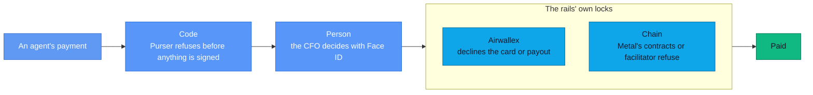
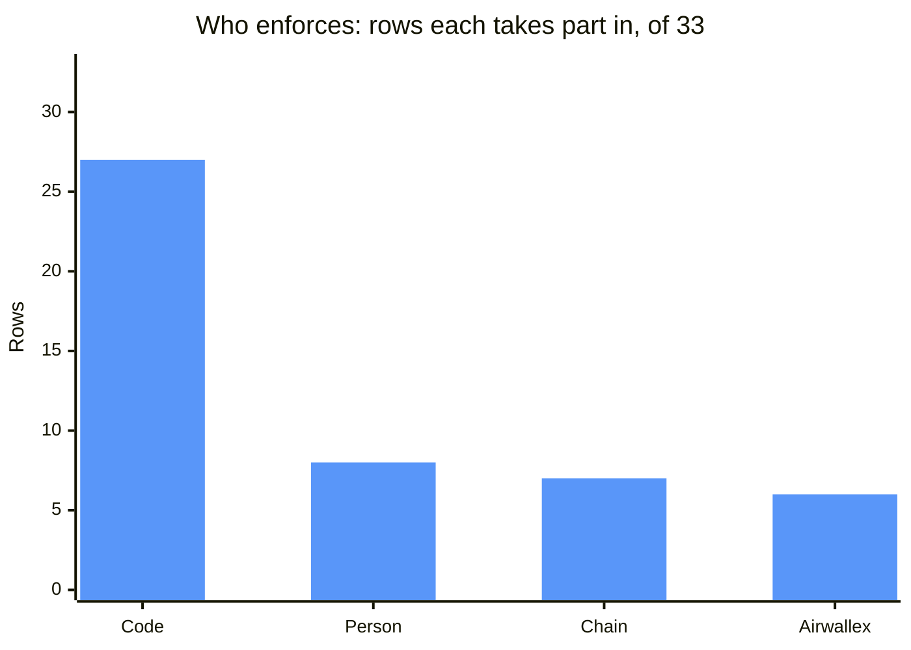

<a href="../README.md"><picture><source media="(prefers-color-scheme: dark)" srcset="assets/brand/purser-mark-dark.svg"></picture></a>

# Controls matrix: risk, control, test, evidence

**Each risk to a business whose AI agents spend money, the control against it, who enforces it, its test and its evidence.**

&nbsp;&nbsp;&nbsp;&nbsp;&nbsp;

[Zero trust](#layer-by-layer-zero-trust) · [Spending limits](#spending-limits) · [Approvals](#approvals) · [Fraud and payees](#fraud-and-payees) · [Detection](#detection-and-evidence) · [Keys and operations](#keys-and-operations) · [Not covered](#not-covered-known)

Each row is a risk to a business whose AI agents spend money, the control Purser puts against it, where that control
is enforced, the automated test, and the live evidence. This is also the test plan: every control has a test that
runs in CI (`npm test`). The evidence column says where it ran on the real rails (Airwallex sandbox, Metal testnet); "red team" means the
red team's run against in-memory stand-ins, not the real rails.

**Who enforces:**
- **Airwallex:** the card or payout is declined by Airwallex itself.
- **Chain:** Metal's contracts or facilitator refuse it.
- **Code:** Purser's own code refuses before anything is signed.
- **Person:** the CFO decides with Face ID.

What to do when a control fires: [runbook.md](runbook.md). Claims and their sources: [claims.md](claims.md).

Record: [the matrix's rows on this page](controls-matrix.md#spending-limits), counted by `test/docs-charts.test.ts` from the "Enforced by" column: of 33 rows, Code 27, Person 8 (one person or two), Chain 7, Airwallex 6; a row can name several.

## Layer by layer (zero trust)

This matrix lists each control once. [zero-trust.md](zero-trust.md) attacks them in layers: each attack starts with
part of the system already in the attacker's hands, and its test shows which layer outside the attacker's reach still
stops the money. Those tests ran against stand-ins of the rails, not the live rails; the report says which refusals a
run record also shows on the live sandbox and testnet. It is written by `npm run zero-trust` from
`src/zerotrust/model.ts` and a run of `test/zero-trust.test.ts`, with the same content as data in
[zero-trust/report.json](zero-trust/report.json); the numbers are there, not here.

## Spending limits

| Risk | Control | Enforced by | Test | Evidence (live run, or red team on stand-ins) |
|---|---|---|---|---|
| An agent overspends on its card | Per-purchase and monthly limits from the CFO policy, written to the card and read back; Purser writes them with its own key, so its own code or database can raise them (an open risk in [zero-trust.md](zero-trust.md)) | Airwallex | `test/cards.test.ts`, `test/issuing-adapter.test.ts` | Recorded run: €45.00 declined `LIMIT_EXCEEDED` |
| An agent buys the wrong kind of thing | Merchant categories, currency and end date per card | Airwallex | `test/cards.test.ts` | Recorded run: €19.99 declined `MERCHANT_CATEGORY_NOT_ALLOWED` |
| An agent overspends on chain | A mandate per agent: cap per payment, total budget, one payee, end date | Chain (the mandate contract; Metal's facilitator checks against it and refuses before anything is sent) | `test/executors-mandate.test.ts`, `test/metal-pay.test.ts` | Recorded run: price rise refused `mandate_cap_exceeded`; four-eyes run step 6 |
| Agents together exceed the business's budget | Atomic holds against the shared 20.00 and each limit before signing | Code | `test/holds.test.ts`, `test/holds-concurrency.test.ts` (128 holds from 8 processes) | Recorded run (no limit crossed) |
| An agent pays too often | Speed limits per agent and rail; a breach stops the agent and freezes its card | Code, Airwallex | `test/velocity.test.ts` | Red team on stand-ins `velocity-burst`: stopped after 30 allowed payments |
| A loop of small payments drains a budget | The same holds and speed limits; clearing payer capped per payment (`maxAmount`) | Code, chain | `test/clearing.test.ts` | Clearing load test ([run](runs/2026-10-30-clearing-load.md)): 2,000 of 2,000 paid, 4.24 a second, about $0.0007 RPC per payment |

## Approvals

| Risk | Control | Enforced by | Test | Evidence (live run, or red team on stand-ins) |
|---|---|---|---|---|
| Money moves without the CFO beyond the limits | Proposals; the CFO signs the exact terms' hash with a passkey (Face ID); the runner verifies the signature and the hash when the approval arrives, and again before executing: since 20 November the executor re-verifies the stored passkey signatures behind the approval against the enrolled public keys (not only the approval row, which lives in the same database), refuses an approval no verifying signature stands behind and logs it (`execution.refused_unsigned`); it checks the same hash again before a paid payout is booked and before its receipt is archived | Code, person | `test/approvals.test.ts`, `test/passkey.test.ts`, `test/property-terms.test.ts`, `test/execution-signature.test.ts`, `test/stored-signature.test.ts`, `test/zero-trust.test.ts` | Every live run: approvals by Max's passkey. Independent review, 20 Nov: an approval row written with no signature ran (EUR 9,999.00); refused since |
| An agent pays an invoice alone | Only within the limit to pay alone, and that limit counts only when the CFO signed it with the passkey (a policy change, `ap.alone_eur`; raising it loosens the policy), or as a `/try` test company's default labelled "system default … not signed by the CFO"; a setting written any other way is no limit. The payment records its limit's source, runs only on that record and a limit in force at the time, and `npm run verify` accepts it only then, naming the source | Code, person | `test/alone-limit-signed.test.ts`, `test/approve-within-limit.test.ts` | Independent review, 20 Nov: the limit was a deployment setting the CFO never signed, and verify raised a false alarm on every such payment; both fixed |
| An approval is replayed or reused for other terms | Hash-bound, single-use approvals; the expiry inside the signed terms; each payment executor runs only its own kind of payment | Code | `test/approvals.test.ts`, `test/adversarial.test.ts`, `test/zero-trust.test.ts` | Red team on stand-ins: replayed and swapped approvals refused |
| One person alone approves a large payment | Four eyes off chain: above a threshold, two different people's passkeys; a first signature counts only for the exact terms it was made over; whether two are needed is read from the signed terms, and a change of the agents' mandates runs only when its signed terms say so; the proposer never approves; since 20 November the executor re-verifies both people's stored signatures before money moves | Code, two people | `test/four-eyes.test.ts`, `test/execution-signature.test.ts`, `test/zero-trust.test.ts` | Optional; off in the recorded run |
| One person alone changes a mandate or moves the account's money | Four eyes on chain: a 2-of-2 Metal account (CFO + controller) | Chain | `test/four-eyes-onchain.test.ts` | [Four-eyes run](runs/2026-10-30-four-eyes.md): the CFO alone reverted twice on chain (a payment, a revoke), the CFO with a stranger's key once; the CFO and the controller together passed (two test keys on one machine, not two people) |
| In Purser Cloud, one person both runs the company and approves its payments | Separate scopes (20 Nov): the CFO approves (`approve`), owners manage (`admin`) and approve only in a company with no CFO who can sign in, which the console labels; no API key can hold `approve`. The role matrix is [security/roles.md](security/roles.md), held to the code by its test | Code | `test/cloud-roles.test.ts` | Not run live |
| A stolen owner session, or the platform operator, adds its own approval key and approves | A key added while one is active needs an active approval key's signature over its id and public-key hash, a second owner's passkey co-signature, or a recovery two different platform admin keys agreed to; it then approves nothing for 72 hours (never under 24 in the deployed Worker; 0 on /try, labelled), while every owner is told (security events, alert webhook) and every refusal is in the security log and the audit log (20 Nov) | Code, two people | `test/engine-key-life.test.ts`, `test/cloud-key-life.test.ts`, `test/cloud-recovery-two-admins.test.ts` | Not run live |
| A compromised relay forges or alters an approval | The runner trusts no relay: runner-signed terms on the phone, passkey checked on the runner, origin and fingerprint pinned | Code | `test/relay-sign.test.ts`, `test/relay-e2e.test.ts`, `test/relay-worker.test.ts` | Security review fixes ([hardening.md](hardening.md)) |
| The policy is loosened quietly | Only tightening from the phone; loosening is a proposal with Face ID; policy versions hashed and recorded with each decision | Code, person | `test/policy.test.ts`, `test/policy-versions.test.ts` | Red team on stand-ins: a taken-over phone page could only tighten |

## Fraud and payees

| Risk | Control | Enforced by | Test | Evidence (live run, or red team on stand-ins) |
|---|---|---|---|---|
| A fake invoice with changed bank details (business email compromise) | IBAN checked against the supplier's account on file; lookalike names and non-Latin letters caught | Code | `test/fraud.test.ts` | Recorded run: two fake invoices blocked (€3,700) |
| The same invoice paid twice | Invoice numbers normalised (case, dashes, spaces); one live payout per invoice | Code, ledger | `test/invoice-duplicate-key.test.ts` | Red team on stand-ins: "btx-dup" refused |
| A supplier's bank details changed by an attacker | Three steps: request, out-of-band confirmation by a person, CFO approval | Code, person | `test/payee-change.test.ts` | |
| A payout to a sanctioned or unapproved payee | Compliance send policy: the contract pays only with Purser's signed decision, after screening | Chain, code | `test/compliance-screening.test.ts`, `test/compliance-contract.test.ts` | [Compliance run](runs/2026-10-30-compliance-policy.md): 11 attacks reverted on chain; the sanctioned stand-in got no decision |
| A planted instruction in a document or a chat | Documents screened by code; a reading cannot carry a payee or approve | Code | `test/injection.test.ts`, `test/adversarial.test.ts` | Recorded run: two planted instructions flagged |
| Money from a stranger mixed into the business's funds | Metal receive policy on the sweep wallet; quarantine until the CFO decides | Chain, person | `test/quarantine.test.ts` | Separate world, 30 October ([metal-award.md](metal-award.md) section 5) |
| A customer disputes payments falsely | Dispute desk: each order checked against the chain with the signed order kept; code checks | Code, chain | `test/dispute-desk.test.ts`, `test/dispute-case.test.ts` | Recorded dispute case: 12 orders verified |

## Detection and evidence

| Risk | Control | Enforced by | Test | Evidence (live run, or red team on stand-ins) |
|---|---|---|---|---|
| A payment the ledger does not know about | Agent cards frozen at Airwallex by default, thawed only for a purchase Purser approved (a card charge Purser did not start is declined before money moves); then hourly reconciliation with Airwallex and the chain; alarm on a difference or a stale round | Code, Airwallex | `test/card-freeze-default.test.ts`, `test/reconcile.test.ts`, `test/health.test.ts` | Red team on stand-ins `hidden-payment`: prevented since 19 Nov (fifth round, `docs/redteam/rerun-2026-11-19b.json`); a charge racing Purser's own purchase inside its window is still found afterwards. Not yet run on the live sandbox |
| An Airwallex event the ledger cannot explain | Webhooks for cards, payouts, conversions and deposits, HMAC-checked twice, compared with the ledger; alarm | Code | `test/airwallex-events.test.ts`, `test/relay-hooks.test.ts` | [Webhooks run](runs/2026-10-30-webhooks.md): deposits matched by webhook alone |
| A forged webhook | HMAC over timestamp and body at the relay and again on the runner; five-minute window | Code | `test/relay-hooks.test.ts`, `test/property-webhooks.test.ts` | Red team on stand-ins: forged webhook ignored |
| The audit log is edited afterwards | Append-only, hash-chained log (no update, no delete, no replace); every payment verifies the chain first and a log that does not verify moves no money (since 19 Nov); `npm run verify`, anchors | Code | `test/audit.test.ts`, `test/ledger-tamper-gate.test.ts` | Red team on stand-ins `rewrite-history`: the row is still changed by someone holding the database file, but no money moves on it (re-run of 19 Nov, `docs/redteam/rerun-2026-11-19.json`); until 19 Nov found afterwards by verify |
| A payment's finality is disputed later | Metal's finality certificate stored per transaction; header, number and quorum checked; in the dispute pack, the audit PDF and verify | Code | `test/finality.test.ts` | Four-eyes and compliance runs: 26 transactions with reported certificates. The BLS signature is not verified (no published validator keys) |
| A bank or auditor cannot read what happened | ISO 20022 pacs.008 export linking the SWIFT transfer and the Metal transaction; GL journal export | Code | `test/iso20022.test.ts` (valid against the official XSD), `test/gl-export.test.ts` | [Example export](iso20022/pacs008-BTX-2026-11.xml) from the recorded run |

## Keys and operations

| Risk | Control | Enforced by | Test | Evidence (live run, or red team on stand-ins) |
|---|---|---|---|---|
| An agent's key leaks | Principals: revoke, expire, rotate; a revoked agent's card freezes | Code, Airwallex | `test/principals.test.ts` | Red team on stand-ins: a revoked agent and an old key refused |
| A secret ends up in git, a log or a model | Redaction of the RPC credential, a secret scan before each commit, gitleaks on all history, no key ever sent to a model | Code, CI | `test/redact.test.ts`, `test/adversarial.test.ts` | CI on every push |
| Something is badly wrong and it is not clear what | Emergency stop: every agent payment refused by Purser's own code (a card purchase too, also before the freeze has reached the card), an approved payout started afterwards refused, every card frozen at Airwallex | Code, Airwallex, person | `test/freeze.test.ts`, `test/zero-trust.test.ts` | Tested on stand-ins; `CARD_INACTIVE` checked live on one card |
| The runner crashes in the middle of a payment | Step log per action; resume from the last finished step; lookups by request id | Code | `test/chaos-kill.test.ts` (16 kill points), `test/chaos.test.ts` | |
| Load: many small payments | Metal clearing: one receipt per payment, no transaction per payment | Chain | `test/clearing.test.ts` | Clearing load test ([run](runs/2026-10-30-clearing-load.md)): 2,000 of 2,000 paid, 4.24 a second, about $0.0007 RPC per payment |

## Not covered (known)

- **No pager is connected to `/health/live`** (the relay's alarm; its public `/health` is calm between live runs).
- **The emergency stop has not been pulled live end to end.**
- **The BLS signature in finality certificates is not verified:** Metal has not published testnet's validator keys.
- **The compliance key is fixed per contract:** rotating it means a new contract.
- **Northwind's own account in the recorded run is one-owner.** The 2-of-2 ran in a test world.
- **Mandate payments bypass the compliance send policy** (Metal's design). Agents' mandates keep their own on-chain
  limits.
- **Someone who can write the ledger file gets past Purser's own checks and both signatures.** Airwallex's own
  approval of transfers (optional) holds such a payout, and `npm run verify` finds it afterwards.
- **Four eyes counts passkeys under two names, not two human beings.**
- **A ledger restored from a backup taken before a payment was planned can plan that payment again.** The last three
  are set out in [security.md](security.md), under accepted risks.
