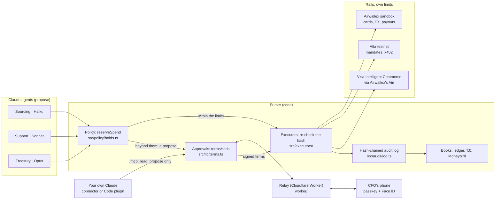
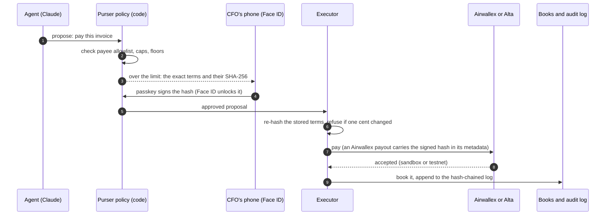
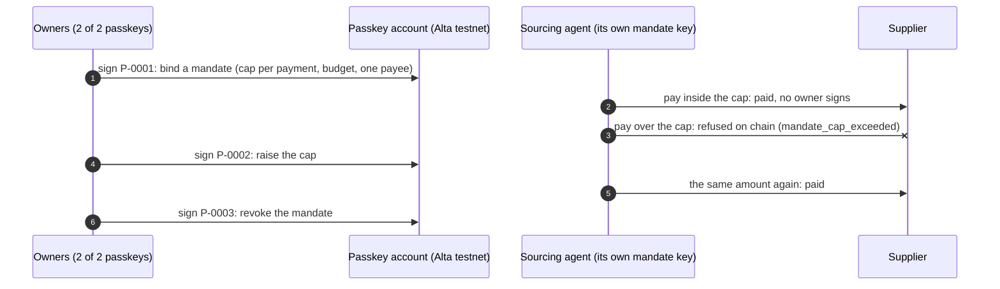
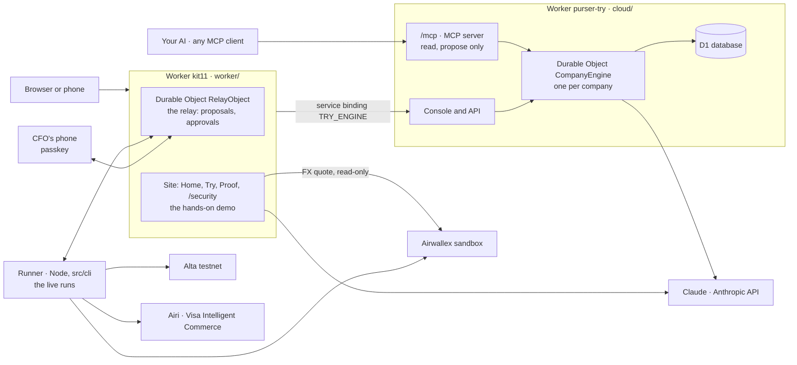

# Purser in five diagrams

Mermaid, so GitHub draws them from this text. Each names the file that does the step;
[How it works in 5 files](how-it-works.md) links the exact lines. Test money only: the Airwallex
sandbox and Alta (formerly Metal) testnet.

## 0. In one line

The README opens with it: an agent proposes, the CFO's policy decides, above the limit the CFO's passkey signs, the
rail pays under its own limit, and the books and the audit log record it.

```mermaid
flowchart LR
  I["Invoice or purchase<br/>(PDF, card, x402)"]:::cash --> RD["Reader<br/>Claude reads it"]:::agent
  RD --> CK["Checker<br/>Purser's code: duplicates,<br/>bank details, payee"]:::purser
  CK --> PO{"CFO policy<br/>(code, also exported<br/>as OPA/Rego)"}:::purser
  PO -- "within the agent's limit<br/>e.g. EUR 120.00" --> PAY["Agent pays alone"]:::paid
  PO -- "above it<br/>e.g. EUR 1,850.00" --> FID["CFO signs the SHA-256<br/>of the exact terms<br/>(passkey, Face ID)"]:::purser
  FID --> HC{"Before paying:<br/>terms still match<br/>the signed hash?"}:::purser
  HC -- "yes" --> PAY
  HC -- "one cent changed" --> X["Payment refused.<br/>Nothing was paid."]:::refused
  PAY --> RAIL["Rails, each with its own limit<br/>Airwallex sandbox · Alta testnet<br/>· Visa via Airwallex Airi"]:::testmoney
  RAIL --> BK["Books<br/>T:0 · Moneybird (sandboxes)"]:::proof
  BK --> LOG["Hash-chained audit log"]:::proof --> ANC["Head anchored on Alta testnet<br/>npm run verify-all"]:::proof
  classDef purser fill:#246bdd,stroke:#89b5fc,color:#fff
  classDef agent fill:#356fcd,stroke:#818cf8,color:#fff
  classDef paid fill:#047857,stroke:#34d399,color:#fff
  classDef refused fill:#be123c,stroke:#fb7185,color:#fff
  classDef testmoney fill:#b45309,stroke:#fbbf24,color:#fff
  classDef cash fill:#0369a1,stroke:#38bdf8,color:#fff
  classDef proof fill:#334155,stroke:#94a3b8,color:#fff
```

## 1. Architecture: who holds which limit

## 2. One payment beyond the limit, end to end

## 3. The mandate on Alta: bound, refused, raised, revoked

From the run of 12 November ([record](runs/2026-11-12-faceid-onchain.md)): a passkey account with two owners, the
CFO's passkey and a labelled virtual test passkey, threshold 2.

## 4. Where it runs

The two Cloudflare Workers (`worker/wrangler.jsonc`, `cloud/wrangler.try.jsonc`), their Durable Objects, the D1
database, the MCP server and the relay. The live runs are made by the runner (Node, `src/cli`), not by a Worker.

