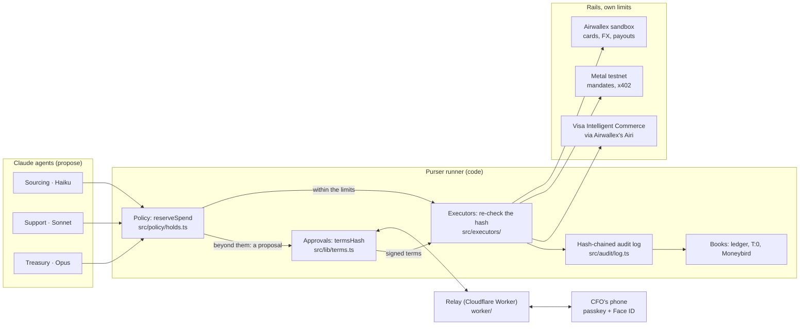
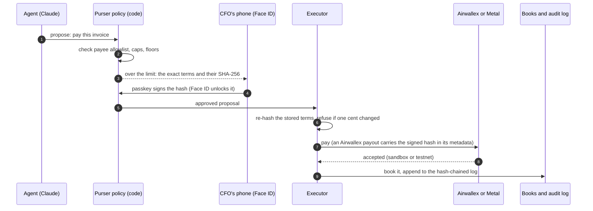
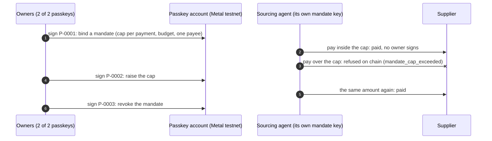

# Purser in three diagrams

Mermaid, so GitHub draws them from this text. Each names the file that does the step; the README's
[How it works in 5 files](../README.md#how-it-works-in-5-files) links the exact lines. Test money only: the Airwallex
sandbox and Metal testnet.

## 1. Architecture: who holds which limit

## 2. One payment beyond the limit, end to end

## 3. The mandate on Metal: bound, refused, raised, revoked

From the run of 12 November ([record](runs/2026-11-12-faceid-onchain.md)): a passkey account with two owners, the
CFO's passkey and a labelled virtual test passkey, threshold 2.

