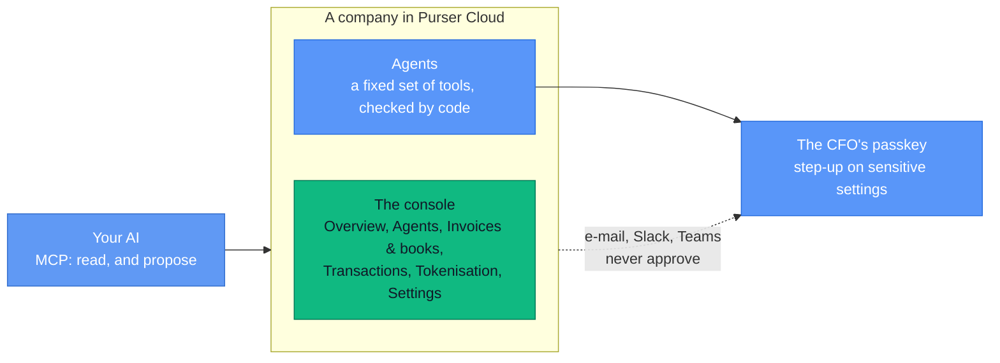

<a href="../README.md"><picture><source media="(prefers-color-scheme: dark)" srcset="assets/brand/purser-mark-dark.svg"></picture></a>

# Enterprise

**What a finance team gets beyond the demo, each with where to check it; test money today.**

&nbsp;&nbsp;&nbsp;&nbsp;&nbsp;

[Purser Cloud](cloud.md) · [Approval alerts](cloud.md#approval-alerts) · [Zero trust](security.md#zero-trust-layer-by-layer) · [Connect any AI](connect-any-ai.md) · [Before real money](go-live.md)

Moved from the [README](../README.md) on 15 November, to keep it short.

What a finance team gets beyond the demo; test money today, each with where to check it.

- **Purser Cloud:** a console per company with Overview, Agents, Invoices & books, Transactions, Tokenisation and Settings; a public test preview where *Try as guest* opens a demo company read-only ([purser-try.max-31b.workers.dev](https://purser-try.max-31b.workers.dev/), [docs/cloud.md](cloud.md)).
- **Approval alerts:** e-mail, Slack and Teams tell the CFO a payment waits; an alert never carries anything that approves. Built and tested with stand-ins, not sent live yet: e-mail needs an e-mail provider's key, Slack and Teams the company's own incoming webhook ([docs/cloud.md](cloud.md#approval-alerts)).
- **Zero trust and step-up:** agents act only through a fixed set of tools that code checks; sensitive console settings ask for a fresh passkey check ([docs/security.md](security.md#zero-trust-layer-by-layer), [cloud/src/stepUp.ts](../cloud/src/stepUp.ts)).
- **Security contact:** [security.txt](https://kit11.max-31b.workers.dev/.well-known/security.txt) and [SECURITY.md](../SECURITY.md); the layers a payment must pass on [/security](https://kit11.max-31b.workers.dev/security).
- **MCP connector:** 14 read tools, and proposing an invoice's payment, never approving it; described for the MCP Registry as `io.github.agamemnon-coder/purser` in [`server.json`](../server.json), not published there yet ([MCP](mcp.md#the-mcp-registry), [Connect any AI](connect-any-ai.md)).
- **Tests:** the suite's count is written from its last full run by `npm run test-count` ([summary](assets/test-summary.json), [the line below](../README.md#verify-it-yourself-in-3-commands)); CI runs it on every push.
