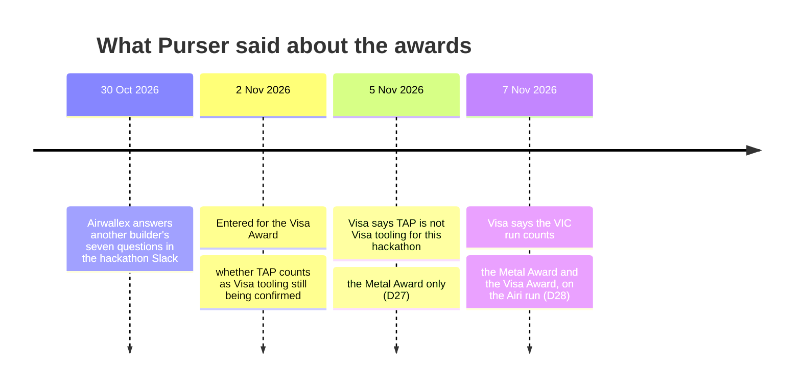

<a href="../../README.md"><picture><source media="(prefers-color-scheme: dark)" srcset="../assets/brand/purser-mark-dark.svg"></picture></a>

# Evidence

**What the organisers answered in the hackathon Slack, in our own words, and the verification reports this folder keeps.**

&nbsp;&nbsp;&nbsp;&nbsp;&nbsp;&nbsp;

[Red team, chaos, fuzzing](#red-team-v2-chaos-for-money-fuzzing-local) · [What the organisers answered](#what-the-organisers-answered) · [What we say since](#what-we-say-since) · [Tamper matrix](tamper-matrix.md) · [Verification, 15 Nov](verification-2026-11-15.md)

| At a glance | Record |
|---|---|
| **Entered for the Metal Award and the Visa Award** since 7 Nov; the Visa Award on the Airi run, never on TAP | [decisions.md](../decisions.md) (D27, D28) |
| **189 checks passed**, 3 could not run here, 0 failed (15 Nov, `npm run verify-all`) | [verification-2026-11-15.md](verification-2026-11-15.md) · [.json](verification-2026-11-15.json) |
| **Airwallex API coverage**: 56 endpoints the code calls; 45 in a committed sandbox run record, 3 named only by tests, 8 in the code only (19 Nov, `npm run airwallex:coverage`, offline) | [airwallex-api-coverage.md](airwallex-api-coverage.md) · [.json](airwallex-api-coverage.json) |
| **Tamper matrix**: every signed field of the 6 receipts and proof bundles committed here changed by one step (a cent, a digit, a letter, a second); 894 changed copies, 894 refused, 0 accepted; all 6 originals verify (19 Nov, `npm run tamper-matrix`, offline) | [tamper-matrix.md](tamper-matrix.md) · [.json](tamper-matrix.json) |

## Red team v2, chaos for money, fuzzing (local)

Three evidence sets run on this computer only: no request reaches the live site, Airwallex, Alta or Anthropic. Each report lists every finding with its repro.

| Set | Result | Report |
|---|---|---|
| Red team v2 on the public /try API (`npm run redteam:api`): cross-company access, signature replay, another world's passkey, terms tampering at every step, double pay, rate limits, the admin route, CSRF and origin, malformed bodies, prompt injection through the code reader, path traversal, open redirects, headers, over HTTP to the judge's server and an edge stand-in with the hosted limits | 128 attacks, 126 PASS, 2 FAIL: the judge's own 404 page and static files lack nosniff (judge server only); every attack on money stopped | [redteam-api.md](redteam-api.md) · [.json](redteam-api.json) |
| Chaos for money movement (`npm run chaos:money`): the real executor, saga and Airwallex client against a stand-in with timeouts, 5xx, 429, answers lost after the work, process deaths, skewed clocks and webhook storms | 317 scenarios (300 randomized from seed 20261119, 17 hand-written), 0 invariants broken (never paid twice, never without a valid signature, the ledger balances, a known end or a person, webhooks move nothing); 4 of 4 planted canaries caught; an approved payment refused before it begins (50 scenarios, mostly the EUR floor) is recorded, shown as blocked and alarmed on /health (outside audit 2.1, rerun offline 20 Nov; until then it sat silent until expiry) | [chaos-money.md](chaos-money.md) · [.json](chaos-money.json) |
| Fuzzing (`npm run fuzz`): the invoice reader, canonical terms and SHA-256 (NFC/NFD and numbers), the proof-bundle and receipt verifiers on the committed artifacts, webhook signatures, MCP input schemas | 17 properties, 275,756 runs, 13 held, 4 failed: letter-only invoice numbers "write your own" accepts are not read back; a bundle's decision and ledger entries can be edited and still verify; the bundle verifier throws on a base64url field of length 4n+1 | [fuzzing.md](fuzzing.md) · [.json](fuzzing.json) |

Since 19 November all three also run every night in CI with more runs and a new seed each night ([nightly-evidence.yml](../../.github/workflows/nightly-evidence.yml)): any broken invariant, failed property or failed attack fails the run, the reports are kept as artifacts, and nothing is committed; the reports here stay the dated, committed runs. The OWASP ZAP baseline scan of our two test sites (passive, weekly in CI): [dast-zap-2026-11-19.md](dast-zap-2026-11-19.md).

Also here: [approval-page.json](approval-page.json), the SHA-256 and CSP of each approval page as this commit serves it (`npm run approval-page-record`); `npm run verify-approval-page -- <url>` checks a live page against it. And [mutation testing](mutation-testing.md) ([.json](mutation-testing.json)), partial. These are bugs planted in the money-critical code to see whether the tests catch them. The proof-bundle verifier caught 15 of 51 before and 50 of 51 after the new tests. On 20 November the Stryker groups were redefined to run every test file that imports each module; one group (hash first) was measured before and after its new tests, the rest are not finished (`npm run mutation`, offline).

## What the organisers answered

The screenshots that were here were removed on 4 November 2026: they showed people's names and messages.

| When | Where | What was answered |
|---|---|---|
| 30 October 2026 | the hackathon Slack, #treasury-kits-1-and-3 | Another builder asked seven questions, and Airwallex answered them: judges review the video, the code and the write-up; a ring-fenced budget inside the sandbox wallet, an offline mock mode as a backup and calling the REST API directly at run time are all fine; beneficiaries may be created once and reused; the transfer simulation call is adequate (webhooks are not required); an outside LLM (Claude) is allowed, and builders got Claude API credits. |
| 1 and 2 November 2026 | the hackathon Slack, #help (our thread) | We asked two questions. One project may be considered for both the Visa and the Metal Award: yes. Whether a TAP integration built on Visa's reference counts as Visa tooling: first answered yes, then edited to "TBD", and Airwallex added someone from Visa to the thread. |
| 5 November 2026 | the hackathon Slack (Visa, in our thread) | Visa answered the open question: TAP is not available as Visa tooling for this hackathon; the only Visa tooling for the builds is Visa Intelligent Commerce (VIC) or Intelligent Commerce Connect (ICC). So, until 7 November, Purser was entered for the Metal Award only (`docs/decisions.md` D27); since 7 November it is entered for the Metal Award and the Visa Award (the next row). |
| 7 November 2026 | the hackathon Slack (Visa), as reported by the owner | Visa: the VIC run counts for the Visa Award. The run is the Airi run of 7 November, Visa Intelligent Commerce via Airwallex's Airi (Airwallex sandbox, test card, test money; log `docs/runs/2026-11-07-vic-1.md`). So Purser is entered for the Metal Award and the Visa Award (`docs/decisions.md` D28). Nothing changed about TAP. |

## What we say since

Since 7 November: entered for the Metal Award and the Visa Award; the Visa Award on the Airi
run (Visa Intelligent Commerce via Airwallex's Airi), never on TAP. "Visa TAP: built and verified against Visa's public
reference verifier; not eligible Visa tooling for this hackathon (Visa, 5 Nov)." No page may say TAP is eligible, or
that TAP or Purser is certified, endorsed or confirmed by Visa.

From 5 to 7 November we said Purser was entered for the Metal Award alone, because Visa had said TAP is not eligible
Visa tooling for this hackathon (5 Nov). That ended on 7 November (above).

From 2 to 5 November we said: "Entered for the Visa Award (organisers confirmed one project may enter both Visa and
Metal; whether TAP counts as Visa tooling is still being confirmed with Visa)."
