<a href="../README.md"><picture><source media="(prefers-color-scheme: dark)" srcset="assets/brand/purser-mark-dark.svg"></picture></a>

# Gallery

**Purser in pictures: the site, the phone, the console and four animations, light or dark as your GitHub is.**

&nbsp;&nbsp;&nbsp;

[The pictures](#gallery) · [Animations](#animations) · [See it](see-it.md) · [Charts](charts.md) · [/try](https://kit11.max-31b.workers.dev/try)

Moved from the [README](../README.md) on 15 November, to keep it short.

<table>
<tr><td width="50%" align="center"> <b>/try on a phone</b>: the approval with the exact terms (recorded from the live page; test money, a virtual test passkey)</td><td width="50%" align="center"> <b>/proof</b>: what Purser guarantees, who enforces it, the evidence</td></tr>
<tr><td width="50%" align="center"> <b>Purser Cloud as a guest</b>: the demo company, made-up data, test money</td><td width="50%" align="center"> <b>/security</b>: the layers a payment must pass</td></tr>
</table>

<a href="https://kit11.max-31b.workers.dev/"><picture><source media="(prefers-color-scheme: dark)" srcset="assets/readme/hero-dark.webp"></picture></a>

*Home, light or dark as your GitHub is: one sample invoice from Read to Paid.*

<a href="https://kit11.max-31b.workers.dev/"><picture><source media="(prefers-color-scheme: dark)" srcset="assets/readme/banner-dark.png"></picture></a> <picture><source media="(prefers-color-scheme: dark)" srcset="assets/hero/flow-dark.svg"></picture>

*The banner and the animated flow (an illustration; test money), which opened the README until 21 Nov 2026, when the owner asked for the logo, the tags, a small demo and the three steps on top.*

<picture><source media="(prefers-color-scheme: dark)" srcset="assets/readme/stats-dark.svg"></picture>

*Four figures from the records: the last full test run, and the main run of 3 November (Claude's decisions and the Alta payments in that run; the worst-case AI test of 15 Nov). Newer figures: the proof strip and /proof's evidence wall.*

## Animations

Drawn from their records by `npm run docs:anim` ([scripts/docs-anim.ts](../scripts/docs-anim.ts)); still for a
reader who asks for reduced motion.

<picture><source media="(prefers-color-scheme: dark)" srcset="assets/anim/money-path-dark.svg"></picture>

<picture><source media="(prefers-color-scheme: dark)" srcset="assets/anim/one-cent-dark.svg"></picture>

<picture><source media="(prefers-color-scheme: dark)" srcset="assets/anim/hash-chain-dark.svg"></picture>

<picture><source media="(prefers-color-scheme: dark)" srcset="assets/anim/emergency-stop-dark.svg"></picture>
