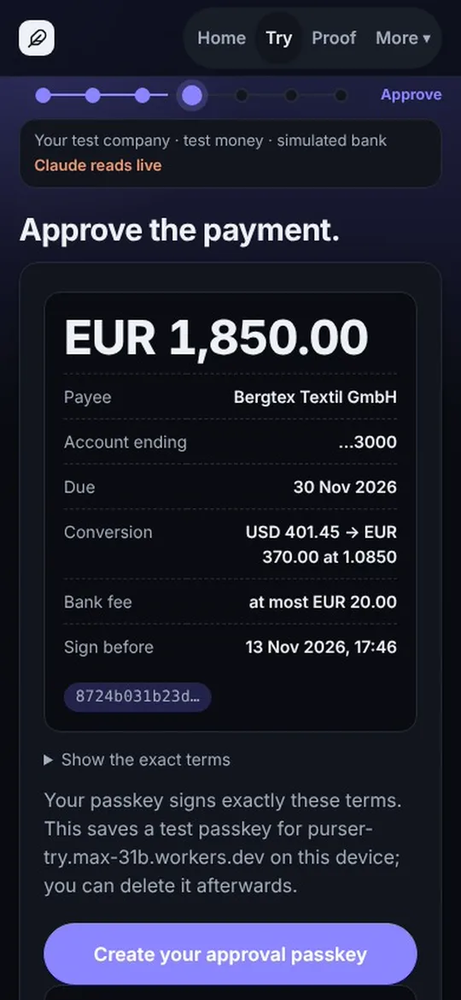
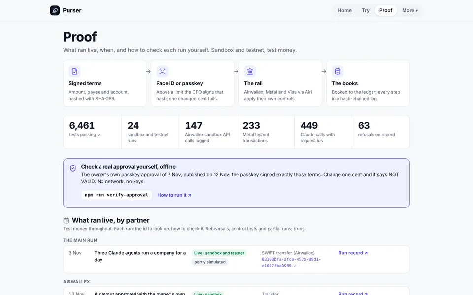
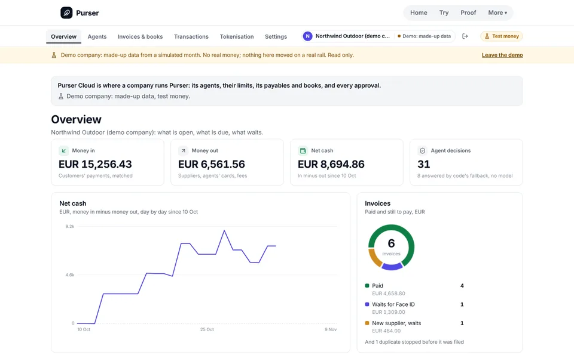

# Gallery

Moved from the [README](../README.md) on 15 November, to keep it short.

<table>
<tr><td width="50%" align="center"> <b>/try on a phone</b>: the approval with the exact terms (recorded from the live page; test money, a virtual test passkey)</td><td width="50%" align="center"> <b>/proof</b>: what Purser guarantees, who enforces it, the evidence</td></tr>
<tr><td width="50%" align="center"> <b>Purser Cloud as a guest</b>: the demo company, made-up data, test money</td><td width="50%" align="center"> <b>/security</b>: the layers a payment must pass</td></tr>
</table>

<a href="https://kit11.max-31b.workers.dev/"><picture><source media="(prefers-color-scheme: dark)" srcset="assets/readme/hero-dark.webp"></picture></a>

*Home, light or dark as your GitHub is: one sample invoice from Read to Paid.*
