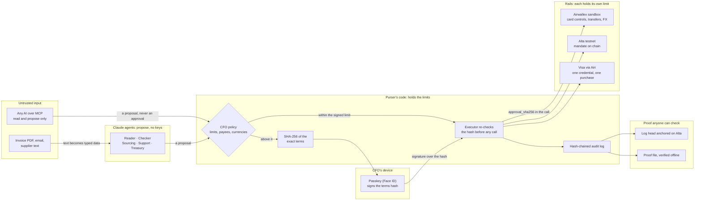

<a href="../README.md"><picture><source media="(prefers-color-scheme: dark)" srcset="assets/brand/purser-mark-dark.svg"></picture></a>

# Governance: Airwallex's principles, held in code

Each principle of Airwallex's "Agentic banking starts with governance", with the code that holds it, the test that proves it and the live record.

| At a glance | Record |
|---|---|
| **7 principles** from the article, each mapped to a file and line, a test and, where one ran, a live record (sandbox and testnet) | [The mapping](#the-mapping) |
| **5 held** in full; **2 partly**, with what is still open said in their row | [What is not done](#what-is-not-done) |

Source: Dan Kim, ["Agentic banking starts with governance"](https://www.airwallex.com/en-eu/blog/agentic-banking-governance),
Airwallex, 5 October 2026 (read again on 26 November 2026). The principles below are quoted from it; the mapping is
ours, not Airwallex's. **Test money only:** the Airwallex sandbox, Alta (formerly Metal) testnet and Visa via
Airwallex's Airi (sandbox, test card). Line links point at the code as it is on `main`; a later change can move a
line, never the function's name, which each row gives too.

## The trust boundaries

The article's central line is "A prompt is not a financial control." In Purser, Claude sits outside the boundary
that holds money: it reads and proposes, holds no key, and every limit is enforced by code, by the CFO's passkey or
by the rail itself.

A charge that reaches a rail without Purser still meets the rail's own lock: Airwallex's card controls and Alta's
mandate refuse it whatever an agent was told. The animated picture below is drawn from the run records (one record
link per rail inside it):

<picture><source media="(prefers-color-scheme: dark)" srcset="assets/rail-refusals-wide-dark.svg"></picture>

## The mapping

One row per principle: where Purser does it, the test that proves it, and the live record if one exists.

| # | The principle (the article's words) | Where Purser does it | The test that proves it | Live record | Status |
|---|---|---|---|---|---|
| a | "grant authority to agents by specifying what they can move, in which currencies, and to which recipients" | **What:** a cap per agent, `capRefusal` ([src/policy/rules.ts:235](../src/policy/rules.ts#L235)); card limits per agent from the CFO policy, `cardLimitsFrom` ([src/policy/cardRules.ts:11](../src/policy/cardRules.ts#L11)); the Alta mandate's cap, `boundCapUnits` ([src/metal/mandate.ts:82](../src/metal/mandate.ts#L82)). **Currencies:** each card EUR only, `agentCardControls` ([src/policy/cardRules.ts:20](../src/policy/cardRules.ts#L20)), sent to Airwallex as `allowed_currencies` ([src/airwallex/cardBody.ts:37](../src/airwallex/cardBody.ts#L37)); paying alone only in the limit's own currency, `aloneDecision` ([src/policy/withinLimit.ts:26](../src/policy/withinLimit.ts#L26)). **Recipients:** a blocked payee is refused, `counterpartyAllowed` ([src/policy/rules.ts:252](../src/policy/rules.ts#L252)); bank details checked against the supplier on file, `assessInvoice` ([src/policy/fraud.ts:13](../src/policy/fraud.ts#L13)); a new payee's name checked by the payee's bank through Airwallex, `checkPayeeChangeName` ([src/policy/payeeChange.ts:104](../src/policy/payeeChange.ts#L104)) | [test/cards.test.ts:28](../test/cards.test.ts#L28) (each card: its own merchants, euros, an end date); [test/approve-within-limit.test.ts:35](../test/approve-within-limit.test.ts#L35) (another currency goes to the CFO); [test/fraud.test.ts:81](../test/fraud.test.ts#L81) (changed bank details blocked); [test/airwallex-payee-name.test.ts:73](../test/airwallex-payee-name.test.ts#L73) (a name the bank does not hold, refused before any proposal) | [2026-11-12-airwallex-payee-check.md](runs/2026-11-12-airwallex-payee-check.md) (the payee's bank checks the name); [2026-11-07-awx-1.md](runs/2026-11-07-awx-1.md) (Airwallex declined a purchase outside the card's merchant category, `MERCHANT_CATEGORY_NOT_ALLOWED`) | Held |
| b | "set limits on transaction amounts and establish an approval chain" | Within the limit the CFO signed, code approves the exact terms, `approveWithinLimit` ([src/policy/approvals.ts:255](../src/policy/approvals.ts#L255)); above it the proposal waits for the CFO's passkey, `decide` ([src/policy/approvals.ts:157](../src/policy/approvals.ts#L157)); four eyes above a threshold, two different people, `fourEyes` ([src/policy/fourEyes.ts:49](../src/policy/fourEyes.ts#L49)); optionally Airwallex's own approval workflow as a second lock ([src/airwallex/approvals.ts](../src/airwallex/approvals.ts)) | [test/approve-within-limit.test.ts:22](../test/approve-within-limit.test.ts#L22); [test/four-eyes.test.ts:79](../test/four-eyes.test.ts#L79) (the same person twice does not count); [test/four-eyes.test.ts:92](../test/four-eyes.test.ts#L92) (the proposer never approves) | [2026-11-12-airwallex-two-locks-paid.md](runs/2026-11-12-airwallex-two-locks-paid.md) (Airwallex held a payout `IN_APPROVAL` until the owner approved it there, then `PAID`, settlement simulated); [2026-11-03-main-run.md](runs/2026-11-03-main-run.md) (four eyes, 2 of 2; the second approver a labelled test passkey) | Held; the second approver is simulated (see below) |
| c | "enforce those limits through underlying infrastructure rather than prompts." "A prompt is not a financial control." | Before any rail call the executor re-hashes the stored terms and refuses a mismatch, `beginExecution` ([src/policy/approvals.ts:414](../src/policy/approvals.ts#L414)), and `hashFirst` ([src/policy/hashFirst.ts:38](../src/policy/hashFirst.ts#L38)); each agent's card is frozen at Airwallex except inside a two-minute window Purser opens for one approved purchase, `CARD_WINDOW_MS` and `wantCardStatus` ([src/policy/cards.ts:97](../src/policy/cards.ts#L97), [:116](../src/policy/cards.ts#L116)); Airwallex's card controls and Alta's mandate hold their own limits; Claude holds no key and cannot approve | [test/adversarial.test.ts:112](../test/adversarial.test.ts#L112) (no key, token or credential reaches a model); [test/adversarial.test.ts:52](../test/adversarial.test.ts#L52) (terms changed after approval do not run); [test/card-freeze-default.test.ts:38](../test/card-freeze-default.test.ts#L38) (a charge with no window is declined before money moves); [test/over-cap-step.test.ts:9](../test/over-cap-step.test.ts#L9) (Alta's refusal over the cap recorded with its transaction) | [2026-11-07-awx-1.md](runs/2026-11-07-awx-1.md) (Airwallex declined an agent's card over the CFO's limit, `LIMIT_EXCEEDED`); [airwallex-card-cent-2026-11-15.json](runs/airwallex-card-cent-2026-11-15.json) (EUR 30.00 approved, EUR 30.01 declined); [2026-11-03-main-run.md](runs/2026-11-03-main-run.md) (purchase #24 refused on chain by Alta); [2026-11-20-card-drill.md](runs/2026-11-20-card-drill.md) (8 of 8 charges on a frozen card declined `CARD_INACTIVE`) | Held; the card drill's open findings are below |
| d | "People approve sensitive or high-risk decisions, with no exceptions for an agent's track record." | The pay-alone check takes the amount, the currency and the limit, and nothing else: no history, no score, `aloneDecision` ([src/policy/withinLimit.ts:26](../src/policy/withinLimit.ts#L26)); the only limit in force is one the CFO signed with the passkey, `aloneLimitInForce` ([src/policy/aloneLimit.ts:51](../src/policy/aloneLimit.ts#L51)); raising any limit loosens the policy and needs the passkey, `loosens` ([src/policy/loosens.ts:9](../src/policy/loosens.ts#L9)); once a passkey is enrolled, nothing else can approve ([src/policy/approvals.ts:162](../src/policy/approvals.ts#L162)) | [test/alone-limit-signed.test.ts:51](../test/alone-limit-signed.test.ts#L51) (a setting written by hand is no limit); [test/alone-limit-signed.test.ts:75](../test/alone-limit-signed.test.ts#L75) (raising it is a passkey-signed change); [test/four-eyes.test.ts:102](../test/four-eyes.test.ts#L102) (a typed hash prefix cannot approve); proven in Dafny: `Limit.PaidAloneIffWithinLimit` ([evidence/formal-proofs.md](evidence/formal-proofs.md)) | [2026-11-07-awx-1.md](runs/2026-11-07-awx-1.md) (the owner's real passkey approval; check it offline with `npm run verify-approval`, [receipt](runs/2026-11-07-awx-1/receipt-P-0002.json)) | Held, with one difference from the article (below) |
| e | "issue each agent its own virtual card for specific tasks, ... including budget limits, permitted currencies, merchant category codes, and time windows" | One virtual card per agent with the CFO's per-purchase and monthly limits, stored once per agent, `storeCard` ([src/policy/cards.ts:49](../src/policy/cards.ts#L49)); its merchant categories, EUR only and an end date 90 days after issue, `agentCardControls` ([src/policy/cardRules.ts:20](../src/policy/cardRules.ts#L20)); a single-use card for one task, `cardControls` ([src/policy/cards.ts:67](../src/policy/cards.ts#L67)) | [test/cards.test.ts:54](../test/cards.test.ts#L54) (one virtual card per agent, with the policy's limits, only once); [test/cards.test.ts:28](../test/cards.test.ts#L28); [test/card-freeze-default.test.ts:44](../test/card-freeze-default.test.ts#L44) (thawed for an approved purchase only) | [2026-11-07-awx-1.md](runs/2026-11-07-awx-1.md) (`LIMIT_EXCEEDED` and `MERCHANT_CATEGORY_NOT_ALLOWED`, both Airwallex's own declines); [2026-10-30-single-use.md](runs/2026-10-30-single-use.md) (a single-use task card) | Partly: budget, currencies, merchant categories and the end date are held; time windows the CFO sets per card are in progress |
| f | "Every transaction then carries a record connecting it back to the agent, the task, and the policy behind it" | Every money event records its origin (the approval, the approver, or code's rule within the limit), `approvalOrigin` ([src/executors/index.ts:39](../src/executors/index.ts#L39)); each proposal records the policy version it was made under ([src/policy/approvals.ts:104](../src/policy/approvals.ts#L104)); each card transaction row holds the agent and the purpose ([src/policy/cards.ts:430](../src/policy/cards.ts#L430)); the Airwallex transfer carries the signed hash in `metadata.approval_sha256` ([src/airwallex/adapter.ts:263](../src/airwallex/adapter.ts#L263)); every row goes into the hash-chained log, `audit` ([src/audit/log.ts:38](../src/audit/log.ts#L38)) | [test/origin.test.ts:43](../test/origin.test.ts#L43) (the audit row of a money event records its origin, inside the chain); [test/audit.test.ts:22](../test/audit.test.ts#L22) (a tampered row is detected); [test/airwallex-verify.test.ts:60](../test/airwallex-verify.test.ts#L60) (a transfer carrying another hash fails) | [airwallex-transfer-approval-2026-11-06.json](runs/airwallex-transfer-approval-2026-11-06.json) (Airwallex's own record of the transfer carries the hash the CFO signed); [2026-11-13-anchor.md](runs/2026-11-13-anchor.md) (the log's head anchored on Alta testnet); [2026-11-14-t0-readback.md](runs/2026-11-14-t0-readback.md) (the books read back from T:0) | Held |
| g | "an agent moving money still depends on regulated infrastructure: accounts that safeguard funds, permissions that enforce policy, networks that move money across borders, and ledgers that record every action" | Purser holds no funds: money stays in Airwallex accounts and Alta mandates, moved on their rails ([src/airwallex/adapter.ts](../src/airwallex/adapter.ts)); for a company on its own connected account, every payout is checked against that company's signed account binding, `checkPayingAccount` ([src/airwallex/binding.ts:144](../src/airwallex/binding.ts#L144)) | [test/airwallex-binding-checks.test.ts:156](../test/airwallex-binding-checks.test.ts#L156) (terms signed for another account, or a rail paying from another, refused) | [2026-11-10-connected-accounts-sandbox.md](runs/2026-11-10-connected-accounts-sandbox.md) (a connected account taken to `ACTIVE` in the sandbox); [2026-11-14-t0-readback.md](runs/2026-11-14-t0-readback.md) (an outside ledger agrees to the cent) | Partly: sandbox and testnet only; several entities, each paying only from its own account under the CFO's signed `pay_from` rule, are held in code and tests ([src/policy/entities.ts](../src/policy/entities.ts), [test/entities.test.ts](../test/entities.test.ts)), not yet in a recorded run |

The same path, one payment at a time (animated, drawn from the code's own steps):

<picture><source media="(prefers-color-scheme: dark)" srcset="assets/payment-life-wide-dark.svg"></picture>

## What is not done

Said plainly, so no row above reads as more than it is.

- **Card time windows (principle e): in progress.** Today a card has an end date (90 days from issue) and is frozen
  except for a two-minute window Purser opens for one approved purchase. Time windows the CFO sets per card (hours or
  days of the week) are being built and are not claimed here.
- **Funding from several entities (principle g): built, not yet run live.** The terms the CFO signs name the paying
  entity and its funding account, and an agent pays from an entity only where the CFO signed `pay_from.<entity>.<agent>`
  allowed ([src/policy/entities.ts](../src/policy/entities.ts)); refusals are tested. No recorded sandbox run with two
  entities yet, and no screen in Purser Cloud chooses the entity yet.
- **No second human approver yet (principle b).** Where a run shows a second approver it is a labelled test passkey,
  not a second person ([main run](runs/2026-11-03-main-run.md)).
- **An agent may pay alone within its limit (principle d).** The article says a person still approves anything that
  leaves the account today. Purser lets an agent pay alone at or below the limit the CFO signed with the passkey, and
  only there; above it, always the CFO. That is a choice the CFO makes by signing a limit, not one the agent earns.
  No test runs many clean payments and then checks the limit is unchanged; it holds because the check has no input
  for a track record, which the Dafny proof covers.
- **The card drill's open findings (principle c).** In the drill of 20 November, 37 of 54 steps passed and 11 failed:
  a second charge inside an open purchase window was approved by Airwallex, which judges a thawed card on its limits
  and merchant categories only, and Purser found it only afterwards ([record](runs/2026-11-20-card-drill.md)).
- **No production money and no independent review.** Sandbox, testnet and a test card only; the security assessment
  is a self-assessment ([go-live.md](go-live.md) lists every requirement before real money).

Related: [controls-matrix.md](controls-matrix.md) (each risk, its control, its test and its evidence) and
[requirements-matrix.md](requirements-matrix.md#3-governance-article) (the article against the hackathon build, 29
October to 7 November). Back to the [README](../README.md).
