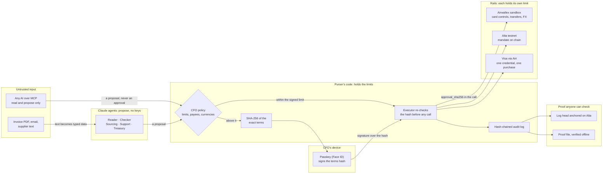
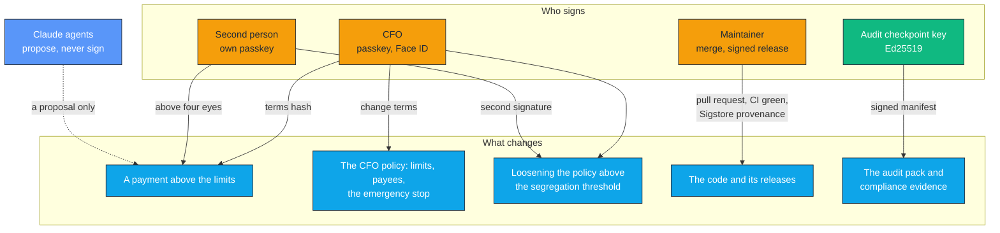

<a href="../README.md"><picture><source media="(prefers-color-scheme: dark)" srcset="assets/brand/purser-mark-dark.svg"></picture></a>

# Governance: Airwallex's principles, held in code

Each principle of Airwallex's "Agentic banking starts with governance", with the code that holds it, the test that proves it and the live record.

| At a glance | Record |
|---|---|
| **7 principles** from the article, each mapped to a file and line, a test and, where one ran, a live record (sandbox and testnet) | [The mapping](#the-mapping) |
| **5 held** in full; **2 partly**, with what is still open said in their row | [What is not done](#what-is-not-done) |

Source: Dan Kim, ["Agentic banking starts with governance"](https://www.airwallex.com/en-eu/blog/agentic-banking-governance),
Airwallex, 5 October 2026 (read again on 26 November 2026). The principles below are quoted from it; the mapping is
ours, not Airwallex's. **Test money only:** the Airwallex sandbox, Alta (formerly Metal) testnet and Visa via
Airwallex's Airi (sandbox, test card). Line links point at the code as it is on `main`; a later change can move a
line, never the function's name, which each row gives too.

## The trust boundaries

The article's central line is "A prompt is not a financial control." In Purser, Claude sits outside the boundary
that holds money: it reads and proposes, holds no key, and every limit is enforced by code, by the CFO's passkey or
by the rail itself.

A charge that reaches a rail without Purser still meets the rail's own lock: Airwallex's card controls and Alta's
mandate refuse it whatever an agent was told. The animated picture below is drawn from the run records (one record
link per rail inside it):

<picture><source media="(prefers-color-scheme: dark)" srcset="assets/rail-refusals-wide-dark.svg"></picture>

## The mapping

One row per principle: where Purser does it, the test that proves it, and the live record if one exists.

| # | The principle (the article's words) | Where Purser does it | The test that proves it | Live record | Status |
|---|---|---|---|---|---|
| a | "grant authority to agents by specifying what they can move, in which currencies, and to which recipients" | **What:** a cap per agent, `capRefusal` ([src/policy/rules.ts:235](../src/policy/rules.ts#L235)); card limits per agent from the CFO policy, `cardLimitsFrom` ([src/policy/cardRules.ts:11](../src/policy/cardRules.ts#L11)); the Alta mandate's cap, `boundCapUnits` ([src/metal/mandate.ts:82](../src/metal/mandate.ts#L82)). **Currencies:** each card EUR only, `agentCardControls` ([src/policy/cardRules.ts:20](../src/policy/cardRules.ts#L20)), sent to Airwallex as `allowed_currencies` ([src/airwallex/cardBody.ts:37](../src/airwallex/cardBody.ts#L37)); paying alone only in the limit's own currency, `aloneDecision` ([src/policy/withinLimit.ts:26](../src/policy/withinLimit.ts#L26)). **Recipients:** a blocked payee is refused, `counterpartyAllowed` ([src/policy/rules.ts:252](../src/policy/rules.ts#L252)); bank details checked against the supplier on file, `assessInvoice` ([src/policy/fraud.ts:13](../src/policy/fraud.ts#L13)); a new payee's name checked by the payee's bank through Airwallex, `checkPayeeChangeName` ([src/policy/payeeChange.ts:104](../src/policy/payeeChange.ts#L104)) | [test/cards.test.ts:28](../test/cards.test.ts#L28) (each card: its own merchants, euros, an end date); [test/approve-within-limit.test.ts:35](../test/approve-within-limit.test.ts#L35) (another currency goes to the CFO); [test/fraud.test.ts:81](../test/fraud.test.ts#L81) (changed bank details blocked); [test/airwallex-payee-name.test.ts:73](../test/airwallex-payee-name.test.ts#L73) (a name the bank does not hold, refused before any proposal) | [2026-11-12-airwallex-payee-check.md](runs/2026-11-12-airwallex-payee-check.md) (the payee's bank checks the name); [2026-11-07-awx-1.md](runs/2026-11-07-awx-1.md) (Airwallex declined a purchase outside the card's merchant category, `MERCHANT_CATEGORY_NOT_ALLOWED`) | Held |
| b | "set limits on transaction amounts and establish an approval chain" | Within the limit the CFO signed, code approves the exact terms, `approveWithinLimit` ([src/policy/approvals.ts:278](../src/policy/approvals.ts#L278)); above it the proposal waits for the CFO's passkey, `decide` ([src/policy/approvals.ts:164](../src/policy/approvals.ts#L164)); four eyes above a threshold, two different people, `fourEyes` ([src/policy/fourEyes.ts:100](../src/policy/fourEyes.ts#L100)); optionally Airwallex's own approval workflow as a second lock ([src/airwallex/approvals.ts](../src/airwallex/approvals.ts)) | [test/approve-within-limit.test.ts:22](../test/approve-within-limit.test.ts#L22); [test/four-eyes.test.ts:79](../test/four-eyes.test.ts#L79) (the same person twice does not count); [test/four-eyes.test.ts:92](../test/four-eyes.test.ts#L92) (the proposer never approves) | [2026-11-12-airwallex-two-locks-paid.md](runs/2026-11-12-airwallex-two-locks-paid.md) (Airwallex held a payout `IN_APPROVAL` until the owner approved it there, then `PAID`, settlement simulated); [2026-11-03-main-run.md](runs/2026-11-03-main-run.md) (four eyes, 2 of 2; the second approver a labelled test passkey) | Held; the second approver is simulated (see below) |
| c | "enforce those limits through underlying infrastructure rather than prompts." "A prompt is not a financial control." | Before any rail call the executor re-hashes the stored terms and refuses a mismatch, `beginExecution` ([src/policy/approvals.ts:402](../src/policy/approvals.ts#L402)), and `hashFirst` ([src/policy/hashFirst.ts:38](../src/policy/hashFirst.ts#L38)); each agent's card is frozen at Airwallex except inside a two-minute window Purser opens for one approved purchase, `CARD_WINDOW_MS` and `wantCardStatus` ([src/policy/cards.ts:97](../src/policy/cards.ts#L97), [:116](../src/policy/cards.ts#L116)); Airwallex's card controls and Alta's mandate hold their own limits; Claude holds no key and cannot approve | [test/adversarial.test.ts:112](../test/adversarial.test.ts#L112) (no key, token or credential reaches a model); [test/adversarial.test.ts:52](../test/adversarial.test.ts#L52) (terms changed after approval do not run); [test/card-freeze-default.test.ts:38](../test/card-freeze-default.test.ts#L38) (a charge with no window is declined before money moves); [test/over-cap-step.test.ts:9](../test/over-cap-step.test.ts#L9) (Alta's refusal over the cap recorded with its transaction) | [2026-11-07-awx-1.md](runs/2026-11-07-awx-1.md) (Airwallex declined an agent's card over the CFO's limit, `LIMIT_EXCEEDED`); [airwallex-card-cent-2026-11-15.json](runs/airwallex-card-cent-2026-11-15.json) (EUR 30.00 approved, EUR 30.01 declined); [2026-11-03-main-run.md](runs/2026-11-03-main-run.md) (purchase #24 refused on chain by Alta); [2026-11-20-card-drill.md](runs/2026-11-20-card-drill.md) (8 of 8 charges on a frozen card declined `CARD_INACTIVE`) | Held; the card drill's open findings are below |
| d | "People approve sensitive or high-risk decisions, with no exceptions for an agent's track record." | The pay-alone check takes the amount, the currency and the limit, and nothing else: no history, no score, `aloneDecision` ([src/policy/withinLimit.ts:26](../src/policy/withinLimit.ts#L26)); the only limit in force is one the CFO signed with the passkey, `aloneLimitInForce` ([src/policy/aloneLimit.ts:51](../src/policy/aloneLimit.ts#L51)); raising any limit loosens the policy and needs the passkey, `loosens` ([src/policy/loosens.ts:9](../src/policy/loosens.ts#L9)); once a passkey is enrolled, nothing else can approve ([src/policy/approvals.ts:166](../src/policy/approvals.ts#L166)) | [test/alone-limit-signed.test.ts:51](../test/alone-limit-signed.test.ts#L51) (a setting written by hand is no limit); [test/alone-limit-signed.test.ts:75](../test/alone-limit-signed.test.ts#L75) (raising it is a passkey-signed change); [test/four-eyes.test.ts:102](../test/four-eyes.test.ts#L102) (a typed hash prefix cannot approve); proven in Dafny: `Limit.PaidAloneIffWithinLimit` ([evidence/formal-proofs.md](evidence/formal-proofs.md)) | [2026-11-07-awx-1.md](runs/2026-11-07-awx-1.md) (the owner's real passkey approval; check it offline with `npm run verify-approval`, [receipt](runs/2026-11-07-awx-1/receipt-P-0002.json)) | Held, with one difference from the article (below) |
| e | "issue each agent its own virtual card for specific tasks, ... including budget limits, permitted currencies, merchant category codes, and time windows" | One virtual card per agent with the CFO's per-purchase and monthly limits, stored once per agent, `storeCard` ([src/policy/cards.ts:49](../src/policy/cards.ts#L49)); its merchant categories, EUR only and an end date 90 days after issue, `agentCardControls` ([src/policy/cardRules.ts:20](../src/policy/cardRules.ts#L20)); a single-use card for one task, `cardControls` ([src/policy/cards.ts:67](../src/policy/cards.ts#L67)) | [test/cards.test.ts:54](../test/cards.test.ts#L54) (one virtual card per agent, with the policy's limits, only once); [test/cards.test.ts:28](../test/cards.test.ts#L28); [test/card-freeze-default.test.ts:44](../test/card-freeze-default.test.ts#L44) (thawed for an approved purchase only) | [2026-11-07-awx-1.md](runs/2026-11-07-awx-1.md) (`LIMIT_EXCEEDED` and `MERCHANT_CATEGORY_NOT_ALLOWED`, both Airwallex's own declines); [2026-10-30-single-use.md](runs/2026-10-30-single-use.md) (a single-use task card); [2026-11-26-card-governance-live.md](runs/2026-11-26-card-governance-live.md) (an agent card read back from Airwallex with its `metadata` and controls as the policy says; outside its hours a purchase refused before any Airwallex call; the card frozen at Airwallex, `INACTIVE` read back, when the hours ended, Purser's clock injected) | Partly: budget, currencies, merchant categories and the end date are held at Airwallex; hours per card are Purser's own control (Airwallex has no recurring window), enforced before any purchase and by freezing the card when they end ([src/policy/cardHoursGate.ts](../src/policy/cardHoursGate.ts), [test/card-governance.test.ts](../test/card-governance.test.ts)); run once in the sandbox, with Purser's clock injected for the end of the hours |
| f | "Every transaction then carries a record connecting it back to the agent, the task, and the policy behind it" | Every money event records its origin (the approval, the approver, or code's rule within the limit), `approvalOrigin` ([src/executors/index.ts:39](../src/executors/index.ts#L39)); each proposal records the policy version it was made under ([src/policy/approvals.ts:108](../src/policy/approvals.ts#L108)); each card transaction row holds the agent and the purpose ([src/policy/cards.ts:430](../src/policy/cards.ts#L430)); the Airwallex transfer carries the signed hash in `metadata.approval_sha256` ([src/airwallex/adapter.ts:263](../src/airwallex/adapter.ts#L263)); every row goes into the hash-chained log, `audit` ([src/audit/log.ts:38](../src/audit/log.ts#L39)) | [test/origin.test.ts:43](../test/origin.test.ts#L43) (the audit row of a money event records its origin, inside the chain); [test/audit.test.ts:22](../test/audit.test.ts#L22) (a tampered row is detected); [test/airwallex-verify.test.ts:60](../test/airwallex-verify.test.ts#L60) (a transfer carrying another hash fails) | [airwallex-transfer-approval-2026-11-06.json](runs/airwallex-transfer-approval-2026-11-06.json) (Airwallex's own record of the transfer carries the hash the CFO signed); [2026-11-13-anchor.md](runs/2026-11-13-anchor.md) (the log's head anchored on Alta testnet); [2026-11-14-t0-readback.md](runs/2026-11-14-t0-readback.md) (the books read back from T:0) | Held |
| g | "an agent moving money still depends on regulated infrastructure: accounts that safeguard funds, permissions that enforce policy, networks that move money across borders, and ledgers that record every action" | Purser holds no funds: money stays in Airwallex accounts and Alta mandates, moved on their rails ([src/airwallex/adapter.ts](../src/airwallex/adapter.ts)); for a company on its own connected account, every payout is checked against that company's signed account binding, `checkPayingAccount` ([src/airwallex/binding.ts:144](../src/airwallex/binding.ts#L144)) | [test/airwallex-binding-checks.test.ts:156](../test/airwallex-binding-checks.test.ts#L156) (terms signed for another account, or a rail paying from another, refused) | [2026-11-10-connected-accounts-sandbox.md](runs/2026-11-10-connected-accounts-sandbox.md) (a connected account taken to `ACTIVE` in the sandbox); [2026-11-14-t0-readback.md](runs/2026-11-14-t0-readback.md) (an outside ledger agrees to the cent); [2026-11-26-entities-live.md](runs/2026-11-26-entities-live.md) (two entities on two sandbox accounts: paid from entity A's own account, `PAID`; funding from entity B's account refused before any create) | Partly: sandbox and testnet only; several entities, each paying only from its own account under the CFO's signed `pay_from` rule, are held in code and tests ([src/policy/entities.ts](../src/policy/entities.ts), [test/entities.test.ts](../test/entities.test.ts)), and run once in the sandbox with two accounts |

Principle f goes further for agents that reach Purser through the agent API. Since 26 November each request can carry
the agent's own Ed25519 signature over that request, and the money action records the verified key id. A request sent a
second time, signed with a rotated key or sent by a revoked agent is refused and audited
([security/agent-identity.md](security/agent-identity.md); `required` on the runner's agent API by default since 26 November; the owner can relax it with
`PURSER_AGENT_IDENTITY=optional` or `off`).

The same path, one payment at a time (animated, drawn from the code's own steps):

<picture><source media="(prefers-color-scheme: dark)" srcset="assets/payment-life-wide-dark.svg"></picture>

## Before the CFO signs a policy change: what would have happened

Purser replays the recent supplier payments under the proposed rules before the CFO signs them, and says what would
have gone differently: `simulatePolicyChange` ([src/policy/simulate.ts](../src/policy/simulate.ts)). It reads the
period's invoice and supplier payments from the ledger and runs Purser's own decision code twice, under the policy in
force and under the proposed one: the executors' holds (a blocked payee, the paying entity, the emergency stop, a
stopped or paused agent: refused), then what `approveWithinLimit` checks before code pays alone (the limit to pay
alone in integer cents, four eyes, the second key, the anomaly hold over the payee's history as it stood then: the
CFO). Each payment gets its before and after, and the counts: would now need the CFO, would now be paid alone, would
now be refused, unchanged.

- **Where it shows:** `npm run policy -- simulate ap.alone_eur=1000.00 [--since 2026-11-01]` (each payment that would
  change, with why; the last 30 days by default); after `npm run policy -- set`; on the runner's dashboard and on the
  phone's approval page beside a waiting policy change ("If this had been in force since 2026-10-27: 2 payments would
  have been paid alone instead of by the CFO; 14 unchanged (16 replayed).").
- **Not signed:** the line sits beside the change. The passkey signs the same terms hash as before; the phone shows the
  line under "Purser's replay of past payments, not part of what you sign" (signed by the runner's display key with
  the rest of the relayed state, like the Opus review).
- **Read-only and deterministic:** SELECTs only, no rail, no model, no audit row. The test checks the ledger file is
  byte-identical after a run ([test/policy-simulate.test.ts](../test/policy-simulate.test.ts)).
- **What it cannot replay:** an agent's judgement. A payment filed outside the payables inbox stays with the CFO (only
  an inbox invoice is ever paid alone), as does one the Checker, the Payer, the cash check or a task mandate declined,
  or one whose invoice carries a finding that sends it to the CFO. A payment that went to the CFO only because it was
  above the limit is assumed to pass the agents and the cash check under a higher limit: "would have been paid alone"
  means Purser's rules would have allowed it.

## Told in Slack or Teams, approved only with Face ID

When a payment or a policy change waits for the CFO, the runner can post to a Slack or Teams incoming webhook what
waits (the payee, the amount, the last four characters of the account, why) with one link: the passkey approval page
for that proposal ([src/integrations/approvalNotify.ts](../src/integrations/approvalNotify.ts)). The chat is a
doorbell, not a key: nothing in a message approves, so principle d holds unchanged. Set `PURSER_NOTIFY_SLACK_WEBHOOK`
and/or `PURSER_NOTIFY_TEAMS_WEBHOOK` in the runner's environment (off when unset; other hosts refused); each proposal is
announced once, a failure is logged as `notify.failed` and blocks nothing. A policy change's message carries the
simulator's line above. Tested with a fake fetch ([test/approval-notify.test.ts](../test/approval-notify.test.ts));
not yet posted to a live channel. The safeguards are in [security.md](security.md#approval-notifications-in-slack-or-teams-face-id-kept-26-november).

## What is not done

Said plainly, so no row above reads as more than it is.

- **Card hours (principle e): built, run once in the sandbox with Purser's clock injected.** Airwallex's card controls
  have one start and one end date, no recurring hours, so the hours the CFO sets per card (`card.<agent>.hours`) are
  Purser's own control: a purchase Purser would start outside them is refused before Airwallex, and a card thawed for a
  purchase is frozen when they end. A merchant charging the card on its own meets a frozen card. Wider hours, a new
  merchant category or currency need the CFO's passkey. The sandbox run of 26 November
  ([record](runs/2026-11-26-card-governance-live.md)) set Purser's clock to the last half minute of the hours and the
  first after them instead of waiting for real hours; the runner's every-few-seconds loop did not run (the card sync was
  called once), and the passkey was a labelled virtual test passkey.
- **Funding from several entities (principle g): built, run once in the sandbox.** The terms the CFO signs name the
  paying entity and its funding account, and an agent pays from an entity only where the CFO signed
  `pay_from.<entity>.<agent>` allowed ([src/policy/entities.ts](../src/policy/entities.ts)); refusals are tested. The
  sandbox run of 26 November ([record](runs/2026-11-26-entities-live.md)) used two accounts, the sandbox's connected
  account (entity A) and the platform account (entity B), which are not two independent companies; it paid from A and
  only refused funding from B. On the runner, entities are kept without editing a setting: `npm run entities -- list`, `add <id> --name "<legal name>" --country NL --account acct_…` (`--currency` where the country does not say it), and `allow <entity> <agent>`, which files `pay_from.<entity>.<agent>` allowed as a policy change that counts only once the CFO approves it with the passkey ([src/cli/entities.ts](../src/cli/entities.ts), [test/entities-cli.test.ts](../test/entities-cli.test.ts)). An invoice's page on the runner names the paying entity and its account from the payment's signed terms, and "Why it was paid this way" says which entity's balance paid. The runner's payables inbox (Pay on an invoice) does not choose an entity yet, and with entities held the planner escalates a payment that names none (`entity_missing`, tested in [test/entities.test.ts](../test/entities.test.ts)). No screen in Purser Cloud chooses the entity yet.
- **No second human approver yet (principle b).** Where a run shows a second approver it is a labelled test passkey,
  not a second person ([main run](runs/2026-11-03-main-run.md)).
- **An agent may pay alone within its limit (principle d).** The article says a person still approves anything that
  leaves the account today. Purser lets an agent pay alone at or below the limit the CFO signed with the passkey, and
  only there; above it, always the CFO. The limit holds per payee too: what code paid alone to one payee within the
  split window (27 days by default, counted from when code approved each payment, never from dates a supplier prints)
  and this payment stay within it together, or the CFO signs. That is a choice the CFO makes by signing a limit, not one the agent earns.
  No test runs many clean payments and then checks the limit is unchanged; it holds because the check has no input
  for a track record, which the Dafny proof covers.
- **The card drill's open findings (principle c).** In the drill of 20 November, 37 of 54 steps passed and 11 failed:
  a second charge inside an open purchase window was approved by Airwallex, which judges a thawed card on its limits
  and merchant categories only, and Purser found it only afterwards ([record](runs/2026-11-20-card-drill.md)).
- **No production money and no independent review.** Sandbox, testnet and a test card only; the security assessment
  is a self-assessment ([go-live.md](go-live.md) lists every requirement before real money).

## Who can change what, and with which signature

Every change that touches money, limits, the record or the code needs a signature, and no model holds one. The AI
policy ([compliance/ai-policy.md](compliance/ai-policy.md)) sets the roles; the dashboard
([compliance/README.md](compliance/README.md#who-signs-what)) lists each change with the audit event it leaves.

## The controls, mapped to nine frameworks

The controls above, and the rest of Purser's, are mapped to the EU AI Act, ISO/IEC 42001, SOC 2, DORA, PSD2's strong
customer authentication, the GDPR, eIDAS, NIS2 and ISO/IEC 27001, with what each leaves in the ledger and the gaps, in
[compliance/controls.md](compliance/controls.md). Per framework, by status (generated from
`src/compliance/controls.ts`; a test holds this table to it):

<!-- frameworks:start: generated by npm run compliance:controls from src/compliance/controls.ts; do not edit by hand -->

| Framework | Requirements | Evidence in ledger | Documented | Gap |
|---|---|---|---|---|
| EU AI Act | 20 | 9 | 11 | 0 |
| ISO/IEC 42001:2023 | 14 | 5 | 8 | 1 |
| SOC 2 | 11 | 8 | 3 | 0 |
| DORA | 17 | 7 | 8 | 2 |
| PSD2 SCA | 10 | 6 | 4 | 0 |
| GDPR | 13 | 2 | 10 | 1 |
| eIDAS | 4 | 1 | 2 | 1 |
| NIS2 | 10 | 3 | 5 | 2 |
| ISO/IEC 27001:2022 | 19 | 7 | 9 | 3 |
| **All** | 118 | 48 | 60 | 10 |

<!-- frameworks:end -->

`npm run compliance-evidence` lists the records that show each control ran in a period, signed, and
`npm run verify-compliance-evidence` checks them offline ([how to run and verify](compliance/README.md)). Evidence for
a mapping, not a certificate of any kind. The governance documents behind the rows: the
[AI policy](compliance/ai-policy.md), the [AI impact assessment](compliance/ai-impact-assessment.md), the
[instructions for use](compliance/instructions-for-use.md), [incident response](compliance/incident-response.md), the
[third-party register](compliance/third-parties.md) and [exit plans](compliance/exit-plans.md).

Related: [controls-matrix.md](controls-matrix.md) (each risk, its control, its test and its evidence) and
[requirements-matrix.md](requirements-matrix.md#3-governance-article) (the article against the hackathon build, 29
October to 7 November). Back to the [README](../README.md).
