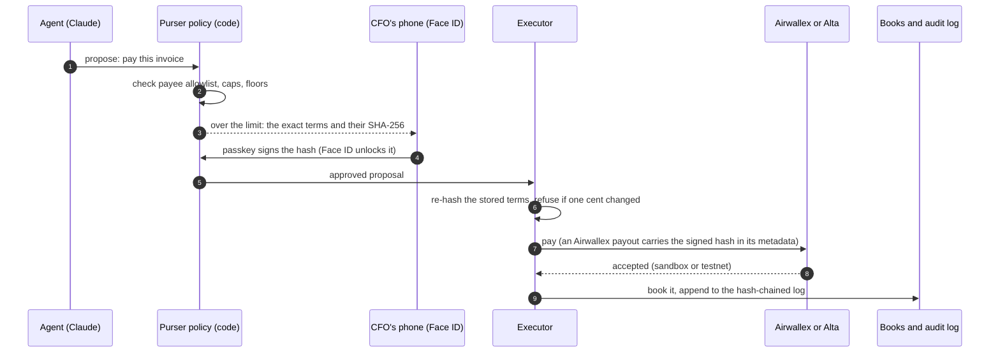

<a href="../README.md"><picture><source media="(prefers-color-scheme: dark)" srcset="assets/brand/purser-mark-dark.svg"></picture></a>

# How it works in 5 files

**The code in 5 files, one payment end to end, and the worst case the policy allows.**

&nbsp;&nbsp;&nbsp;&nbsp;&nbsp;&nbsp;

[One payment, end to end](#one-payment-beyond-the-limit-end-to-end) · [The worst case](#the-worst-case-the-policy-allows) · [The code in 5 files](#the-code-in-5-files) · [Architecture](architecture.md) · [Security](security.md)

Moved from the [README](../README.md) on 15 November, to keep it short.

Northwind Outdoor, the example company, is an outdoor wholesaler that sells live stock data to retailers per query: the
kit's data business. Purser gives each AI agent of a small company its own Airwallex card and its own Alta (formerly Metal) on-chain mandate. Alta holds
each agent's on-chain budget, Airwallex holds each card's limit, Purser's code holds the rest; the CFO approves anything
beyond them, with a passkey (Face ID on iPhone) on the exact terms.

**Claude agents propose and pay; Purser's code, Airwallex and Alta each hold a limit; above them, the CFO signs the exact terms with a passkey (Face ID on iPhone).**

### One payment beyond the limit, end to end

Within the limits an agent pays on its own; beyond them, nothing runs without the CFO's passkey.

### The worst case the policy allows

<!-- worst-case -->
**Worst case, set by policy: EUR 28,200 on cards and task cards + USD 20 on chain a month.**

Task cards under a CFO-signed limit: EUR 900 a day. Everything above waits for the CFO.

How this is computed

- Sourcing agent: EUR 100 on its card + USD 10 on chain (test USD) a month.
- Support agent: EUR 150 on its card + USD 4 on chain (test USD) a month.
- Treasury agent: EUR 50 on its card + EUR 27,900 in task cards + USD 6 on chain (test USD) a month.
- A day: EUR 1,200 + USD 20: a card or a mandate can go in one day, task cards 3 a day.
- Counted: each card's monthly limit (card.*.monthly, EUR) and each Alta mandate's budget (test USD, *USDZ; it lasts 40 days and can all go at once). Task cards, which the Treasury agent may issue on its own within the limit the CFO signed with Face ID: up to EUR 300 each (approval.task_card_eur), 3 a day (EUR 900), 31 days a month (EUR 27,900), counted above.
- ≈ EUR 28,217.70 in all at the main run's rate of 3 Nov 2026 (1.129917 USD per EUR, docs/demo/main-run.json); test USD is never added to EUR otherwise.
- With a shared card or an API key, the limit is the card's or the account's.
- Computed from the policy by [`exposureOf`](../src/policy/exposure.ts); `test/exposure.test.ts` checks this block against it.

<!-- /worst-case -->

### The code in 5 files

> [!TIP]
> Each name below links to the line that defines it; a test fails if that line moves.

1. **The policy.** [`reserveSpend`](../src/policy/holds.ts#L65) runs before an agent's payment is signed or charged: its identity, the CFO's stops and caps, the mandate's cap and budget, the shared 20.00 total and velocity. A refusal means nothing is signed.
2. **The terms hash and the passkey.** [`termsHash`](../src/lib/terms.ts#L43) is the SHA-256 of a proposal's exact terms as canonical JSON; [`verifyApprovalSignature`](../src/passkey/webauthn.ts#L46) accepts a passkey's signature only if it signed that hash, with user verification (Face ID) on.
3. **The executors' hash check.** Every executor in [src/executors/](../src/executors/) starts with [`beginExecution`](../src/policy/approvals.ts#L399), which re-hashes the stored terms and runs nothing unless they match the approved hash, before the expiry, and (since 20 November) re-verifies the stored passkey signatures behind the approval over those exact terms.
4. **The Alta mandate layer.** [`payUnderMandate`](../src/metal/pay.ts#L34) signs an x402 payment with the agent's own mandate key only after the caller's guard passes it (Sourcing's is `reserveSpend`); on chain, Alta refuses what is over the mandate.
5. **The audit chain.** [`audit`](../src/audit/log.ts#L39) appends each event with `row_hash = SHA-256(prev_hash ‖ JCS(row))`; the database refuses UPDATE and DELETE, and `npm run verify` re-checks the chain.
