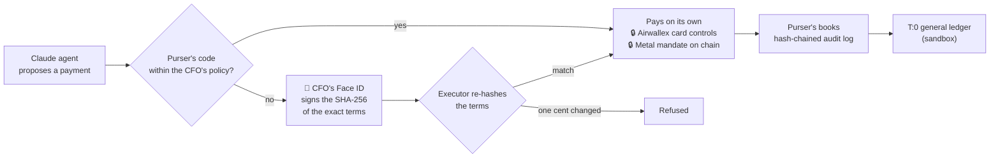
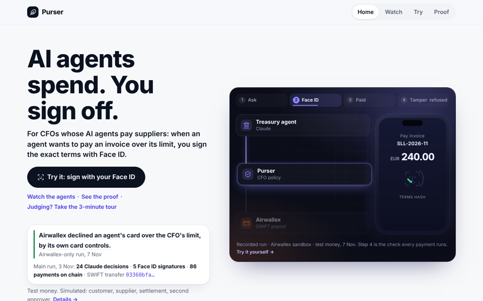
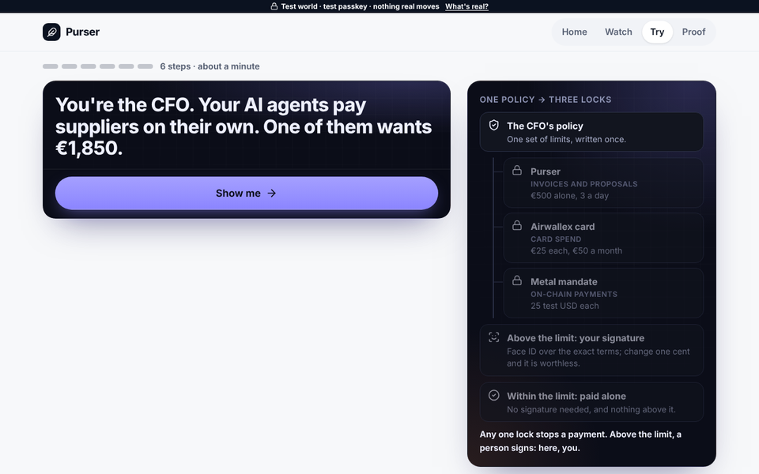
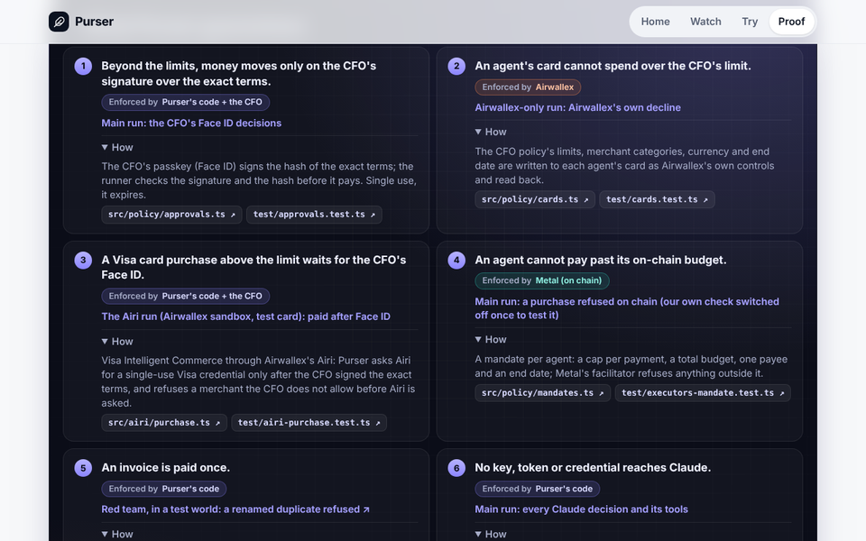
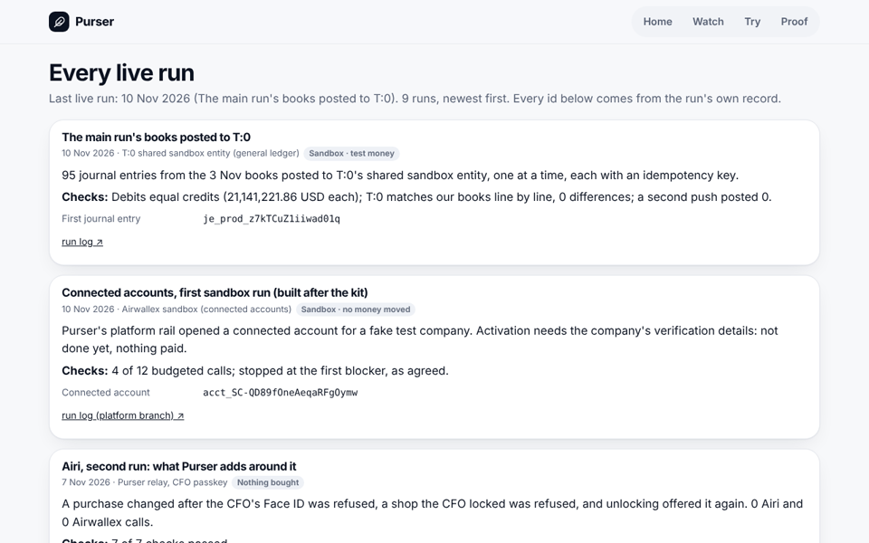
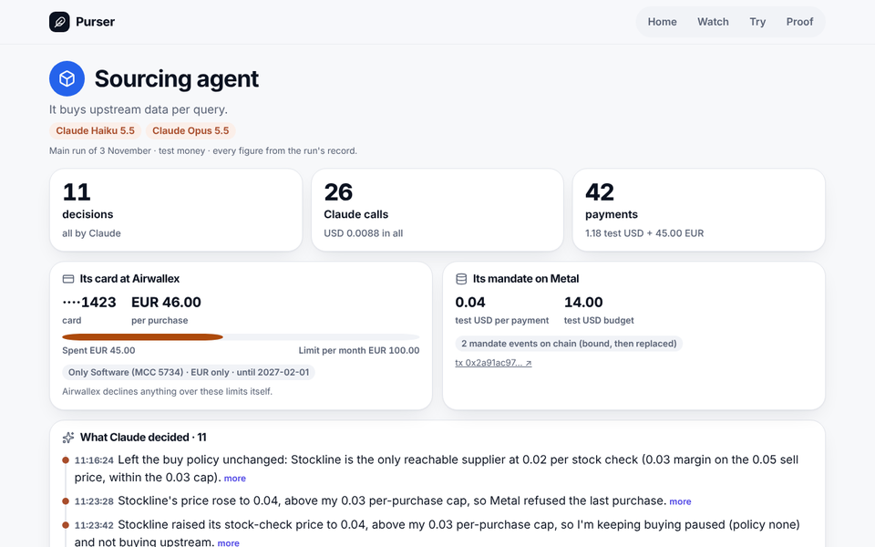
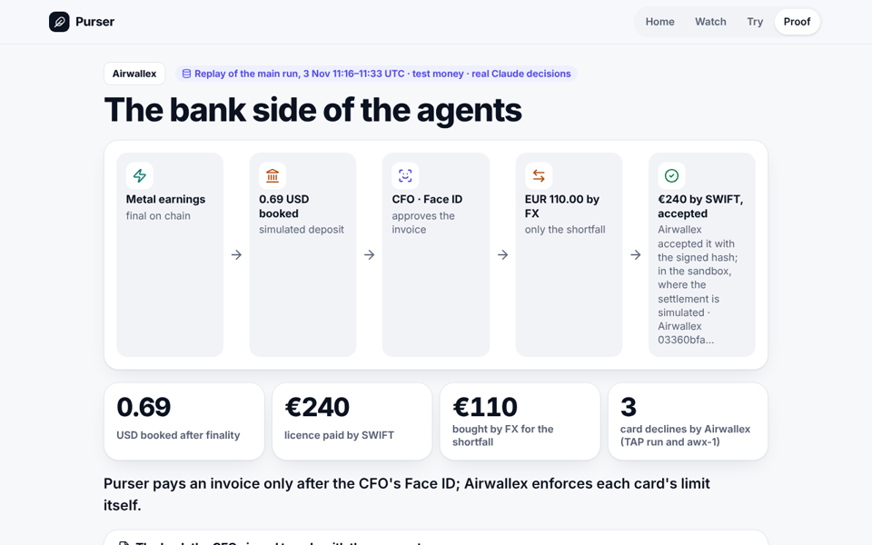

# Purser in depth

Back to the [README](../README.md). The README's first screen in full: what ran live with one id per rail, where each
judging criterion is proven, how a payment flows, the site in pictures, the proof per partner, the Kit 11 runs with
every id, Try step by step, what is real and what is mock, and the words. Every live run: [runs/README.md](runs/README.md). Test money only throughout: the Airwallex sandbox and Metal testnet.

## What ran live, one id per rail

The Kit 11 scenario, run live on 3 November, and the separate runs after it:

| Rail | What ran live (Airwallex sandbox, Metal testnet, test money) | One id |
|---|---|---|
| Airwallex | Airwallex's own card controls declined an agent's EUR 45.00 purchase over its EUR 30.00 limit (`LIMIT_EXCEEDED`; the charge simulated through the sandbox), in the Airwallex-only run of 7 November | card transaction [`01a1b5e8-6dc2-7000-95bf-c8fc5e6e2f38`](demo/airwallex-run.json) |
| Metal | Purchase #24, over the agent's mandate, refused on chain in the main run of 3 November, after we switched off our own check once to test the chain | [`0x2e92f9cb…1871`](https://testnet.metalntwx.com/tx/0x2e92f9cb4549246f58b9b888881c258bf117c6233c1d8f126f4833ae6ae41871) |
| Visa | Visa Intelligent Commerce (VIC) through Airwallex's Airi wallet. Latest live run, 13 November: 2 paid (1 after Face ID), 5 refused by Purser incl. reused credentials, 1 not tapped: nothing charged ([record](runs/2026-11-13-vic-4.md)). First run, 7 November: a scripted purchase with no model call, confirmed by a person's passkey tap in Airi; above Purser's limit it ran only after the CFO's Face ID. TAP is an extra ([note](submission/long-description.md#visa)) | PaymentIntent [`int_sgpvzc9hjhnxvxc26ie`](runs/2026-11-07-vic-1.md) |
| Claude | Three tool-use agents made all 24 of the main run's decisions, with 0 fallbacks; routine payments are code | request [`req_011Cgfuhfh5iBjb9NbobuahB`](demo/main-run.json) |
| x402 | The seller checks each payment before it does the work and settles it on Metal before it sends the answer; the protocol leaves the payer's budget to the payer, and in Purser that is the CFO's signed limit. 41 sales among the main run's 86 test-USD payments, each its own transaction | first sale [`0x2cc5a16e…2fc7`](https://testnet.metalntwx.com/tx/0x2cc5a16e4aa74d5912e1b155f815270bd6f8a82796c08371dafa540410fa2fc7) |

**The live runs of 12 and 13 November** (sandbox and testnet, test money; [all runs](runs/README.md)): on Metal, a passkey account whose two owners (the CFO's passkey and a labelled virtual test passkey) signed 2 of 2, and Metal refused a payment over the mandate's cap on chain ([record](runs/2026-11-12-faceid-onchain.md)); at Airwallex, a payout held `IN_APPROVAL` until a person approved it there, then PAID, settlement simulated ([record](runs/2026-11-12-airwallex-two-locks-paid.md)); an invoice token minted, financed and settled on Metal testnet, a prototype with a simulated financier ([record](runs/2026-11-12-tokenize.md)); the books in a Moneybird sandbox, 0 differences ([record](runs/2026-11-12-moneybird-sandbox.md)); and Try with Claude Haiku reading the invoice, on a simulated bank and a test passkey ([record](runs/2026-11-13-try-sample.json)).

## Where each judging criterion is proven

| Criterion | Where it is proven |
|---|---|
| Airwallex use | [/airwallex](https://kit11.max-31b.workers.dev/airwallex): cards per agent with the CFO policy as Airwallex's own controls, read back; Airwallex's own declines; SWIFT payouts carrying the signed hash; FX for the shortfall only. [Run log](runs/2026-11-07-awx-1.md) |
| Agentic | [/claude](https://kit11.max-31b.workers.dev/claude), and the replay of the main run of 3 November at [/replay](https://kit11.max-31b.workers.dev/replay): three Claude agents, all 24 decisions by Claude; an agent read Airwallex's decline and asked the CFO for a raise instead of retrying |
| Technical | [What Purser guarantees](https://kit11.max-31b.workers.dev/proof#guarantees), each promise with its code, its test and where it ran; [controls matrix](controls-matrix.md); [verify it yourself](../README.md#verify-it-yourself-in-3-commands) |
| Finance value | [/try/sign](https://kit11.max-31b.workers.dev/try/sign); [the business case](business/) (a hypothesis; 2 finance conversations, quoted, anonymous; more in progress; no customers yet) |
| Metal Award | [/metal](https://kit11.max-31b.workers.dev/metal), [docs/metal-award.md](metal-award.md) |
| Visa Award | [/visa](https://kit11.max-31b.workers.dev/visa), [the Airi run's log](runs/2026-11-07-vic-1.md) |
| Founder's and Judges' Choice | [/try/sign](https://kit11.max-31b.workers.dev/try/sign) in a minute; what comes next, not live: [docs/after-the-kit.md](after-the-kit.md) |

## How a payment flows

## See it

<table>
<tr>
<td width="33%"> <b>Home</b> · change one cent of a real approval</td>
<td width="33%"> <b>Try</b> · sign with your own Face ID</td>
<td width="33%"> <b>Proof</b> · each guarantee, its code, test and run</td>
</tr>
<tr>
<td width="33%"> <b>Runs</b> · every live run and its ids</td>
<td width="33%"> <b>An agent</b> · card, mandate, every decision</td>
<td width="33%"> <b>Airwallex</b> · cards, declines, the signed hash</td>
</tr>
</table>

## The proof, one sentence per partner

- Airwallex (sandbox): the hash of the exact terms the CFO signed with Face ID is in Airwallex's own record of the EUR 240.00 SWIFT payment, and 3 of 3 agent cards carry the CFO's policy as Airwallex's own controls, read back from Airwallex. ([proof](https://kit11.max-31b.workers.dev/proof#airwallex))
- Metal (testnet): a mandate on chain per agent; 86 payments, each its own transaction; purchase #24 refused on chain (mandate_cap_exceeded); the mandates replaced on chain by the owner key after the CFO's Face ID in Purser (four eyes; second approver a labelled test passkey). ([proof](https://kit11.max-31b.workers.dev/proof#metal))
- Claude: all 24 decisions in the main run by Claude, 0 fallbacks; a reliability run (rel-1) found a fault in how the agents hand off a card raise, and after the fix the eval rebuilt from that moment now passes every run, and the next run (rel-1b) passed every step. ([proof](https://kit11.max-31b.workers.dev/proof#claude))
- awx-1, a separate Airwallex-only run (7 November; sandbox, test money, 0 Metal calls): accepted, all seven checks passed in one attempt. Airwallex approved and declined the agents' cards itself (`LIMIT_EXCEEDED`, `MERCHANT_CATEGORY_NOT_ALLOWED`); the Sourcing agent (Claude Haiku) read the decline and asked the CFO for a raise instead of retrying; two invoices were paid by SWIFT after the CFO's Face ID (settlement simulated in the sandbox), each carrying the signed hash in Airwallex's own metadata. ([run](#the-airwallex-only-run-awx-1-7-november-sandbox-test-money), [on the site](https://kit11.max-31b.workers.dev/airwallex#awx-1))

## The main run (3 November)

World `main-1`, 11:16–11:33 UTC, on the Airwallex sandbox and Metal testnet with test money, frozen commit `35e1cac`.
All 24 decisions by Claude (Sourcing on Haiku, Support on Sonnet, Treasury on Opus), 0 fallbacks. Max, the builder,
plays the CFO and signed with a personal passkey (Face ID on a phone). The second approval (four eyes on P-0002, 2 of 2) came from a labelled
virtual test passkey on the runner machine, pressed by our build tool, Claude Code, on the builder's go; in production the
second approver is a second person. The three runtime agents hold no owner key and no passkey, and no key reaches their
Claude models. Log: [docs/runs/2026-11-03-main-run.md](runs/2026-11-03-main-run.md); record:
[docs/demo/main-run.json](demo/main-run.json); replayed on [/replay](https://kit11.max-31b.workers.dev/replay).

The three scenes, the stops and the payments, every id

**1. The price rise** ([watch](https://kit11.max-31b.workers.dev/replay?scene=1)). Stockline went from 0.02 to 0.04 a
stock check, over the Sourcing mandate's 0.03 cap. We switched off our own check once to prove the chain holds the line:
Purser refuses an over-cap purchase before signing; with that check off for purchase #24, Metal refused it anyway; the
refusal is recorded on chain: `mandate_cap_exceeded` at 11:23:27, tx
`0x2e92f9cb4549246f58b9b888881c258bf117c6233c1d8f126f4833ae6ae41871` (11:23:33). Treasury's options came at 11:24:07,
40 s after Metal's refusal and 34 s after that tx, within the same 20.00: option A (P-0002) raises Sourcing's cap to
0.04 and keeps our price at 0.05; option B (P-0003) takes the same cap and raises our price to 0.07. The CFO signed A;
after four eyes (the second signature from a test passkey, not a second person), both mandates were replaced on chain: Treasury `0x789abb249896e01cee8e3641d7794676b6f2ce5d05f45093f6cc64101c9aebbc` (11:26:54), Sourcing
`0x2a91ac97fc2a459da2b0c73f2b8020edec1901d051c7ef03bb088d36067fe790` (11:26:59).

**2. The dispute** ([watch](https://kit11.max-31b.workers.dev/replay?scene=2)). A simulated customer disputes 12 orders,
saying its agent never placed them. Every order carries its agent's signature, so that claim fails. Three orders had
wrong data; the Support agent refunds those 3 (0.15 test USD) itself. "Refund the other 9" goes to the CFO, who rejects
it with Face ID. The refunds, #7, #10 and #13:
`0xe4bf79623f9cb9212a49ea7c0ced60d241041051f322d199e319989d6548c89d`,
`0xe44a3460faf6cb2050067bf22791df61803f8646adeb5fcc2a205d1f1afa75e5`,
`0x5099fe44b03d83f4dd3963fc59a40e2a506bee533e5a41e8f1b00a12bee14510`; P-0004 ("refund the other 9") rejected by Max
with Face ID at 11:29:37.

**3. Earnings and euros** ([watch](https://kit11.max-31b.workers.dev/replay?scene=3)). 0.69 swept after finality, tx
`0x86936a5b29f9550857676fa710231af9e20882ebe6eee16f75a90af29767ccb4`, booked at Airwallex as deposit
`b3812e05-2afa-4698-8f64-429f9608e0a0`. The Treasury agent planned the EUR 240.00 licence itself; after the CFO's
Face ID, EUR 110.00 bought by FX for USD 124.29 (conversion `3ca88196-05da-4d88-9caa-796f03704636`), then SWIFT:
transfer `03360bfa-afce-457b-89d1-e1097fbe3985`, fee EUR 13.42, accepted by Airwallex with the signed hash in its
metadata. Its settlement is simulated: in the sandbox Purser itself moves the transfer to SENT and PAID through
Airwallex's simulation API (marked PAID 11:31:24, 6 s after Face ID). The Sourcing agent
asked for a card raise first (P-0006, EUR 30.00 → 46.00), the CFO approved it with Face ID, and Airwallex approved the
TAP-signed EUR 45.00 purchase (authorization `01a1a12f-4113-7000-b76d-014677710007`).

**16 stops, nothing paid over a limit: one buy rule Claude set stopped 12 overpriced checks, Metal refused 2 purchases, the CFO rejected 1 proposal, and 1 planted instruction changed nothing.**
The buy rule's 12: stock checks #25–#36. The Sourcing agent (Claude Haiku) set its buy rule; code applied it to each
check while Stockline asked 0.04, over its 0.03 cap; nothing signed, no customer charged. Metal's 2: 1 over the mandate's cap (#24, its refusal
recorded in the tx above), 1 on a mandate that had just been replaced (#37, `mandate_revoked`, no tx of its own). The
CFO's 1: P-0004, with Face ID. The planted instruction: a line aimed at the AI inside the dispute document, treated as
data.\
*Not counted (a separate TAP run, 2 November):* Airwallex declined EUR 45.00 over the card limit (`LIMIT_EXCEEDED`).

**Payments:** 86 Metal payments + 1 card charge, all inside the limits with no approval at the time: 41 sales + 41
supplier purchases + 3 refunds + 1 sweep on Metal, and 1 card charge at Airwallex. 14 of the 55 queries got an error and were not charged. `verify` passes,
`reconcile` checked 88 with 0 differences, and every one of the 110 money movements has an origin.

| Kit 11 agent | Its job in the brief | Budget (test USD) when bound → after the CFO's Face ID |
|---|---|---|
| Sourcing agent | buys the upstream data per query; its card pays warehouse and data software | 10.00 → 14.00, cap 0.03 → 0.04 a purchase |
| Support agent | refunds customers when a dispute holds; its card pays helpdesk software | 4.00, cap 0.10 a refund |
| Treasury agent | rebalances the budgets after the price rise, sweeps earnings to Airwallex, plans the EUR licence (Airwallex FX and SWIFT, after Face ID) | 6.00 → 2.00 |

20.00 test USD between them, before and after, held in code (`TOTAL_BUDGET_CENTS`). The limits in code, each with its test:
[docs/controls.md](controls.md#guards-in-code).

**Visa:** the Sourcing agent signs its card checkout with Visa's Trusted Agent Protocol (TAP), so a merchant can check
which agent is buying. Visa's public reference verifier accepted the signatures in a separate test on 2 November; the
merchant is ours.

## The Airwallex-only run, awx-1 (7 November; sandbox, test money)

A separate world, Airwallex sandbox only, test money only, 0 Metal calls; accepted, all seven checks (a–g) passed in
one attempt. The CFO signed all three proposals with Face ID on a personal phone. Log:
[docs/runs/2026-11-07-awx-1.md](runs/2026-11-07-awx-1.md); record:
[docs/demo/airwallex-run.json](demo/airwallex-run.json); on the site:
[/airwallex](https://kit11.max-31b.workers.dev/airwallex#awx-1).

Cards, declines, invoices and calls, every id

- **Cards:** 3 issued (····2441, ····4175, ····1562), each read back from Airwallex with the policy's limits, merchant
  category, EUR only and an end date.
- **Approved and declined by Airwallex:** EUR 19.99 approved (`01a1b5e8-5933-7000-94c1-0a9d4115f515`); EUR 45.00
  over the 30.00 limit declined `LIMIT_EXCEEDED` (`01a1b5e8-6dc2-7000-95bf-c8fc5e6e2f38`): the Sourcing agent (Claude
  Haiku) read the code and asked the CFO for a raise (P-0001) instead of retrying; after the CFO's Face ID the card was updated
  at Airwallex and the same 45.00 was approved (`01a1b5eb-5c54-7000-8227-1f077fc047f5`). EUR 19.99 on the Support card
  (MCC 7372 only) declined `MERCHANT_CATEGORY_NOT_ALLOWED` (`01a1b5eb-6784-7000-8bb2-ecf137506d3f`); its agent asked
  for no raise. All 4 card transactions came in by webhook (21 webhooks in all).
- **Invoices:** SLL-2026-11, EUR 240.00, paid from EUR without FX (free EUR 1,500.00 ≥ 260.00): transfer
  `738a4263-6d6c-4de8-94a3-93da1c175fb4`, PAID, fee EUR 13.50. BTX-2026-11, EUR 1,850.00 against free EUR 1,246.50:
  only EUR 623.50 bought for USD 704.45 at 1.129833 (quote `1605354b-5f6f-3ab5-8dbc-3af479c54b33`, conversion
  `fafcc208-bd1e-43d9-bd09-69191a8aa81f`, SETTLED), then transfer `4140dee2-6373-4eb4-a71f-bf69130f96a7`, PAID, fee
  EUR 13.50. Each payout carries `approval_sha256` in Airwallex's metadata; `verify` passes, `reconcile` 0 differences.
- **Calls:** 71 Airwallex API calls (run budget: 96); 14 Claude calls (0.0839 USD). Merchant charges and SENT/PAID are
  the sandbox's simulation endpoints; every approve, decline and code is Airwallex's own.

## Visa Intelligent Commerce via Airwallex's Airi: a live run (7 Nov)

A scripted run, no Claude call (0 calls): the run's conductor bought for the Sourcing agent with a single-use Visa (VIC)
credential from Airi, each purchase confirmed by the cardholder's passkey: within Purser's limit with no Purser
approval, above it only after the CFO's Face ID; a disallowed merchant was refused by Purser first. A separate world:
Airwallex sandbox, test card, test money. What the sandbox could not show: the credential is a test credential from
Airi's test card; one person played both the CFO and the cardholder; the agent's process typed the single-use number
into Airwallex's hosted checkout page with a headless browser, because the sandbox refuses a direct confirm; the
merchant is our own Airwallex sandbox merchant. Passed, [every check](runs/2026-11-07-vic-1.md#checks-the-records-checks),
on the fourth attempt that day, the second in its world (the attempts before it are in the log). Log:
[docs/runs/2026-11-07-vic-1.md](runs/2026-11-07-vic-1.md); record:
[docs/demo/airi-run.json](demo/airi-run.json); on the site:
[/airwallex](https://kit11.max-31b.workers.dev/airwallex#airi-run),
[/visa](https://kit11.max-31b.workers.dev/visa#airi-run) and [/proof](https://kit11.max-31b.workers.dev/proof#airi-run).

The three purchases, and the control test (vic-2)

- **✓ Within the limit:** EUR 12.00 (Purser's limit: EUR 20.00). Within Purser's limit, no Purser approval is needed. Airi
  itself asks the cardholder to confirm each purchase with a passkey. PaymentIntent `int_sgpvzc9hjhnxvpblt2r`
  SUCCEEDED.
- **✓ Paid after Face ID:** EUR 45.00, above the limit, waited for the CFO's Face ID on its exact terms (P-0002); only
  then did Purser ask Airi for the credential (mandate `mdt_nlpdgv8gqhnxvxcjxbv`); the cardholder confirmed it in Airi,
  and the PaymentIntent (`int_sgpvzc9hjhnxvxc26ie`) SUCCEEDED.
- **✕ Refused by Purser:** EUR 5.00 at a merchant the CFO does not allow (`PURSER_MERCHANT_NOT_ALLOWED`), before any
  call to Airi.

**A control test of Purser's own checks, not a Visa run (vic-2, 7 Nov, 19:06–19:08 UTC).** The CFO's Face ID on a
phone, three times; 0 Airi and 0 Airwallex calls in the whole test, so nothing was bought.
[every check passes](runs/2026-11-07-vic-2.md#checks); log:
[docs/runs/2026-11-07-vic-2.md](runs/2026-11-07-vic-2.md); on the site:
[/visa](https://kit11.max-31b.workers.dev/visa#airi-run-2).

- **✕ Changed after Face ID: refused.** EUR 30.00, above the limit, approved with the CFO's Face ID. Our own labelled
  test then changed it to EUR 190.00 in the database; Purser refused it ("terms do not match the approved hash"), 0
  Airi calls.
- **✕ Shop locked by the CFO: refused.** The CFO blocked the test shop for Airi with Face ID (P-0002); the agent's next
  purchase, EUR 12.00, within the limit, was refused before Airi was asked (`PURSER_MERCHANT_NOT_ALLOWED`).
- **✓ Unlocked: offered again.** After the CFO's Face ID lifted the block (P-0003), the same purchase was offered on
  Airi again; the run stopped there.

## Try it, step by step

On [/try/sign](https://kit11.max-31b.workers.dev/try/sign), in a test world of your own; nothing real moves.

The seven steps

1. **The agent asks.** Your Treasury agent wants to pay an invoice above its limit. Claude Sonnet reads the invoice
   and Purser's code checks the reading; the terms come from that checked reading, with a live Airwallex sandbox
   quote. Claude Opus, live, advises as the Treasury agent.
2. **Signed with Face ID.** A passkey your phone or laptop makes (Face ID, Touch ID or a PIN) signs the hash of the
   exact terms, and the server checks the signature.
3. **Try to cheat.** Change one cent, the IBAN or the currency: the same signature is refused.
4. **Try to trick the agent.** Send it a fake invoice: Claude Sonnet reads it live, and Purser's code stops it.
5. **Change the rule, and see the worst case.** Let the agent pay more alone: a looser rule needs your signature, and
   the worst case in your test world is in sight.
6. **The agent pays alone.** Under the new rule, its next invoice is paid without you.
7. **The closing card.** What you did, and three ways on: the real run, a real payment traced, the code.

Then download the receipt and check it offline, with no server: `npm run verify-receipt -- receipt.json`.

**Also:** [the site](https://kit11.max-31b.workers.dev/) replays the main run; [`/try`](https://kit11.max-31b.workers.dev/try)
gives an agent a task of yours: Claude reads it, code applies the CFO's limits, no money moves.

## What is real, what is mock

- **Live, in the main run:** the Airwallex sandbox calls and Metal testnet transactions above, the Claude decisions and
  Max's passkey (Face ID on a phone). Test money only. The sandbox simulates a SWIFT transfer's last steps (SENT, PAID), the merchant's
  card charge and the deposit that stands in for Metal earnings at Airwallex.
- **On Metal testnet, checked against the chain on 5 November:** the 4 mandates bound at setup that morning and the
  2 replacements; 86 test-USD payments, each its own transaction (41 sales, 41 supplier purchases, 3 refunds, 1 sweep);
  1 refusal recorded on chain (#24, [tx](https://testnet.metalntwx.com/tx/0x2e92f9cb4549246f58b9b888881c258bf117c6233c1d8f126f4833ae6ae41871)).
  No emulator and no clearing in this run. Not on Metal: the EUR licence (FX, SWIFT) and the card buy, on the Airwallex
  sandbox; the other 13 refused purchases (12 stopped by the buy rule the Sourcing agent set, applied by code; #37, refused by Metal against
  its just-revoked mandate, with no transaction of its own) are in the ledger, not as transactions on chain.
- **Run by us:** Summit Outfitters (the customer) and its agent, Stockline (the supplier), the TAP merchant.
- **Replayed:** Proof and the replay at `/replay` on the hosted site, and `npm run judge` offline, play the main run's record; Home's hero plays the Airwallex-only run's record of 7 November, and its fourth step checks the owner's real signature of that payment in the visitor's browser.
- **Stand-ins:** the automated tests and the Scenario Lab (`/lab`) run on stand-ins for Airwallex, Metal and Anthropic.
- **Your own test world:** `/try/sign` (live since 4 November 2026) runs each visitor's world on stand-in executors: no
  payment reaches Airwallex or Metal. Real: your passkey's signature and the server's check of it, the Airwallex sandbox
  FX quote (read-only), and the Claude agents' calls, each labelled live, or labelled as a fallback when none answered.
- **Live in the sandbox:** T:0 books: 95 journal entries posted to T:0's shared sandbox entity on 10 Nov (first je_prod_z7kTCuZ1iiwad01q); debits equal credits, and T:0 matches our books line by line ([record](runs/2026-11-10-t0-journal-sandbox.md)).
- **Built, not yet live (stand-ins only):** the Cardputer hub push and gate (a fake hub in the tests), the emergency stop and `npm run smoke:sandbox`.

**Other live tests (separate worlds, dated):** awx-1, the Airwallex-only run (7 November, above), the Airi run (Visa Intelligent Commerce via Airwallex's Airi, 7 November, a scripted run, no Claude call, above;
Airwallex sandbox, test card, test money), the TAP run (2 November), four eyes on chain (two test keys on one machine, not two people), the compliance contract and
clearing under load (30 October): [docs/runs/](runs/) and [docs/metal-award.md](metal-award.md).

## Words

Mandate, x402, terms hash, four eyes

- **Mandate:** an agent's on-chain spending permission on Metal: a cap per payment, a total budget, one payee, an end date.
- **x402:** HTTP 402 "Payment Required" as a payment protocol (version 2). On the mandate route the seller checks each payment before it does the work and settles it on Metal before it sends the answer. The protocol leaves the payer's budget to the payer; in Purser that is the CFO's signed limit, checked before anything is signed.
- **Terms hash:** the SHA-256 of a proposal's exact terms; the CFO's Face ID signs that hash, and nothing else runs.
- **Four eyes:** above the CFO's threshold, two approvers must each sign with their own passkey (in production two
  different people; in the main run the second signature came from a test passkey, not a second person); the proposer never approves.

